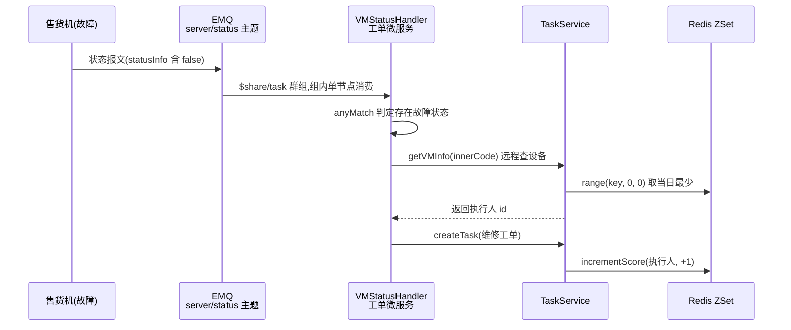

# 自动维修工单全链路：EMQ 状态报文、Redis ZSet 工单量均衡分配、xxl-job 初始化与建单测试

立可得第四章"自动化运营与运维解决方案"进入自动维修工单：设备发生故障，工单自己生成、自己派出去，全程不需要人工干预。建单的主体逻辑与第三章的手动工单一致，真正的新问题是"派给谁"。这一篇把整条链路一次走完：需求思路、Redis ZSet 工单量列表的初始化与更新、最少工单量查询、状态协议与带群组的共享订阅、接收报文建单，最后用三台设备三张工单验证分配均衡。

## 先给结论

- 工单有手动、自动两种创建方式，自动工单的派单规则由产品定死：当天、设备所在区域内、分配工单量最少的运维人员。系统按区域管理，不允许 A 区域的故障让 B 区域的人去修。
- 早期成员实现（查区域用户列表、工单表 count 分组统计、循环找零工单者、内存排序取最小）至少三次数据库查询，外加远程调用与大量内存计算；工单表是流水账大表且该方法被频繁调用，方案被否定。
- 优化方案用 Redis ZSet 存每人工单量：大 K = 前缀 + 日期（yyyyMMdd）+ 区域 id + 角色码，成员是人员 id，分数是工单量。ZSet 按分数自动排序，取最少工单的人只需取第一个元素，对数据库零查询。
- 工单量在创建工单时 +1、取消工单时 -1，用 incrementScore 原子增避免"取出加一再存回"的并发锁问题；初始化交给 xxl-job，每天 14 点（Cron 0 0 14 * * ?）生成第二天的数据，key 过期时间因此设为两天。
- 设备侧状态协议 msgType=vmStatus：statusInfo 每个元素是 statusCode（部件代号）加 status（布尔），只要有一个 false 就判定设备故障。服务端用 $share/task/server/status 带群组共享订阅——每个群组都收到消息，群组内只有一个节点消费。
- VMStatusHandler 解析报文后用 Stream 的 anyMatch 判定故障，经 Feign 远程查设备得到区域 id，调 getLeastUser 拿到当日工单量最少的人作为执行人，再走 createTask 建单。测试三张工单分别派给用户 11、6、7，均衡逻辑成立。

## 需求与实现思路：自动建单不难，难在派给谁

先理清整条业务链路。售货机零部件众多，某个部件出现故障，机器自己是知道的——它把故障信息封装成报文，发到 EMQ 的一个特定主题上；服务器上的工单微服务订阅这个主题，拿到消息就自动执行一段代码创建维修工单。建单的主体逻辑与手动创建类似，真正要回答的是：这单派给谁？总不能都派给同一个人，必须让每个维修人员的工单量保持均衡。

产品的需求很具体：当天，在售货机所在区域内，找出分配工单最少的那个维修员，把单子派给他。技术上怎么找，是研发的事。

实现上有两个关键点。一是从售货机到服务端：消息怎么收——就是第三章讲过的 EMQ 订阅主题，订阅过来拿到报文才能自动建单。二是找派发的人：区域内当天工单最少的那个人，这是整个功能最核心的逻辑。

课程先展示了一版成员写出的代码：方法签名 `getLeastUser(String innerCode, Boolean isRepair)`，入参是售货机编号和是否运维工单（true 运维、false 运营，选人逻辑两者相同）。逻辑分四块：

1. 根据售货机编号查所在区域的用户列表——Feign 远程调用（方法写在工单微服务，UserService 在用户微服务），内部至少两次查询：先查区域，再按区域查用户；
2. 查工单表做 count 统计，按执行人 assignor_id 分组、按工作量排序，条件叠加工单类型、排除已取消、创建时间，以及基于第一步用户列表的 in 查询；
3. 循环用户列表，找当天工单数为零的人直接返回——工单表里查不到没工单的人，必须拿用户列表去比对；
4. 都有工单就在内存里排序，取第一个（工单数最少）。

功能没问题，但性能太低：数据库至少查三遍、一次远程调用、大量内存计算。更麻烦的是这个方法会被频繁调用，而工单表是流水账，每天不知道增长多少，对这么一张大表反复做聚合统计，代价太高。

优化方案：最少工单量不查数据库，从 Redis 直接取现成数据——每人工单量存进 Redis，创建时更新、查询时直接读，数据库零查询；更新用原子增而不是取出加一再存回，省掉加锁；数据结构选 ZSet 而非 list 或 set，ZSet 扔进去就自动按分数排好，取最少不用再排序或循环。



## Redis ZSet 工单量列表：初始化、更新与最少值查询

代码实现分四大步：初始化、更新、最少工单量查询、自动建单。前三步都是为"找最少的人"服务。

先定缓存 key 的前缀常量，放在 common 工程的 VMSystem 常量类里，便于后期维护：

```java
public static final String REGION_TASK_KEY_PREF = "region.task.";
```

大 K 由前缀、时间字符串（年月日八位）、区域、工单类别拼接，点号分隔；小 K 是人员 id。不同区域、不同类别的数据不能混放，否则没法对同区域同类别的工单量排序。

### 第一步：初始化，交给 xxl-job

初始化是让每天每人的工单量从 0 起步，交给第一章讲过的分布式任务调度 xxl-job，在用户微服务的 UserJob 里写调度方法：

```java
@Component
public class UserJob {

    @Autowired
    private UserService userService;

    @Autowired
    private RedisTemplate<String, Object> redisTemplate;

    @XxlJob("workCountInitJobHandler")
    public ReturnT<String> workCountInitJobHandler(String param) throws Exception {
        List<UserEntity> userList = userService.list();
        userList.forEach(user -> {
            if (user.getRoleId().intValue() != 0) { // 角色id为0是管理员，排除
                String key = VMSystem.REGION_TASK_KEY_PREF
                        + LocalDate.now().plusDays(1)
                            .format(DateTimeFormatter.ofPattern("yyyyMMdd"))
                        + "." + user.getRegionId()
                        + "." + user.getRole().getCode(); // 1002运营 / 1003运维
                redisTemplate.opsForZSet().add(key, user.getId(), 0);
                redisTemplate.expire(key, Duration.ofDays(2));
            }
        });
        return ReturnT.SUCCESS;
    }
}
```

几个细节值得说明。用户直接 list() 全查：系统里绝大部分用户是运维员和运营员，管理员只是少数，全查后内存里排除角色 id 等于 0 的管理员即可。日期用 `plusDays(1)` 取明天——任务在每天下午执行，生成的是第二天的列表。写入用 `opsForZSet().add(key, userId, 0)`，初始分数为 0。过期时间设两天：下午生成的是明天的 key，只过期一天的话，到第二天下午这份 key 就没了，两天才稳妥。

xxl-job 调度中心新增任务：任务描述"每日工单量列表初始化"，路由策略选第一个，Cron 表达式 `0 0 14 * * ?`（每天 14 点），JobHandler 填 workCountInitJobHandler，阻塞处理策略用单机串行——整个逻辑几秒钟就跑完，执行时间点选哪个都无所谓。启动用户微服务后执行器里能看到地址，"执行一次"即完成初始化，调度日志全部成功；列表正确性留到整体测试。

### 第二步：更新，创建 +1 取消 -1

初始化后每人工单量都是 0，更新时机有两个：创建工单时加一，取消工单时减一。两个入口共用一个私有方法，写在工单微服务的 TaskServiceImpl 里：

```java
/**
 * 更新工单量统计：创建工单传 1，取消工单传 -1
 */
private void updateTaskZSet(TaskEntity taskEntity, int score) {
    String roleCode = "1003"; // 默认运维
    if (taskEntity.getProductTypeId() == VMSystem.TASK_TYPE_SUPPLY) {
        roleCode = "1002"; // 补货是运营工单
    }
    String key = VMSystem.REGION_TASK_KEY_PREF
            + LocalDate.now().format(DateTimeFormatter.ofPattern("yyyyMMdd"))
            + "." + taskEntity.getRegionId()
            + "." + roleCode;
    redisTemplate.opsForZSet().incrementScore(key, taskEntity.getAssignorId(), score);
}
```

和初始化时的 key 拼接相比有两处不同。一是日期取当天，不再 plusDays(1)——初始化写的是明天，更新操作的一定是当天。二是区域和角色码的来源：工单实体本身带区域 id；角色编码实体里没有，通过工单类型推算——工单类型有四种：1 投放、2 补货、3 维修、4 撤机，除补货（运营工单）外都属于运维，代码里据此切换 1002/1003。成员取的是工单的执行人 assignorId，注意不是创建人。incrementScore 原子增免锁；createTask 里传 1，cancelTask 里传 -1，各加一行调用即可。

### 第三步：最少工单量查询

TaskService 接口新增方法，返回值就是人员 id：

```java
@Override
public Integer getLeastUser(Integer regionId, Boolean isRepair) {
    String roleCode = "1002"; // 默认运营
    if (isRepair) {
        roleCode = "1003"; // 维修是运维工单
    }
    String key = VMSystem.REGION_TASK_KEY_PREF
            + LocalDate.now().format(DateTimeFormatter.ofPattern("yyyyMMdd"))
            + "." + regionId
            + "." + roleCode;
    Set<Object> set = redisTemplate.opsForZSet().range(key, 0, 0); // 只取分数最低的一个
    if (set == null || set.isEmpty()) {
        throw new LogicException("该区域暂时没有相关人员");
    }
    return (Integer) set.stream().collect(Collectors.toList()).get(0);
}
```

key 依然是当天日期加区域加角色码，isRepair 为 true 时角色码用 1003。因为 ZSet 本身按分数有序，range 取第一个元素就是工单量最少的人；取不到或集合为空，直接抛业务异常"该区域暂时没有相关人员"。

## 设备状态协议与带群组的共享订阅

自动维修工单由设备端主动发起。售货机的某个零部件发生变化或出现故障，机器通过网络把自身状态上报服务端，上报的格式就是状态协议：

```json
{
  "msgType": "vmStatus",
  "sn": "342424343",
  "innerCode": "01000005",
  "statusInfo": [
    { "statusCode": "1001", "status": true },
    { "statusCode": "1002", "status": false }
  ]
}
```

协议开头的 msgType（协议名称）、sn（唯一编号）、设备编号是每个协议都有的共性部分；statusInfo 是一个集合，每个元素两个属性：statusCode 是状态码，即部件代号（1001、1002 各代表一个部件）；status 是布尔值，true 正常、false 故障。判定规则只有一句话：上报的诸多状态中，只要有一个是 false，就表示设备故障，必须自动创建维修工单。

针对协议设计两个封装类：

```java
@Data
public class StatusInfo implements Serializable {
    /**
     * 状态码，部件代号
     */
    private String statusCode;
    /**
     * 是否正常
     */
    private boolean status;
}

@Data
public class VmStatusContract extends BaseContract {
    private List<StatusInfo> statusInfo;

    public VmStatusContract() {
        this.setMsgType("vmStatus");
    }
}
```

StatusInfo 对应集合里的每个元素，VmStatusContract 封装整体协议，继承公共的 BaseContract，构造函数里固定消息类型。

设备上报的主题设计为 server/status。工单微服务在 Consul 配置中心的 MQTT 配置里订阅它：

```yaml
mqtt:
  customer:
    # $queue: 共享订阅补货工单主题
    # $share/task/server/status: 带群组方式的共享订阅,server/status 才是主题名,task 是群组名
    consumerTopics: $queue/server/task/supply,$share/task/server/status
```

两个前缀的区别：`$queue` 是普通共享订阅，`$share` 是带群组方式的共享订阅。设备把报文发到主题后，假设被三个群组（task、vm、status）订阅，每个群组都会收到消息，群组内只有一个节点收到。意义在于：状态消息可能被多个微服务用到——状态微服务、售货机微服务、工单微服务都可能处理这份报文，群组订阅保证每个业务都能拿到消息各自处理；群组内部是共享订阅，各节点部署内容相同，一条消息只需一个节点执行，组内天然负载均衡。

## 接收报文建单与全链路测试

服务端的接收逻辑写在工单微服务的 com.lkd.business 包下，新建 VMStatusHandler 实现自研消息架构的 MsgHandler 接口，类上三个注解：@Component、@ProcessType（声明处理的协议名称 vmStatus）、@Slf4j。处理就两步：解析报文，创建维修工单。

```java
@Slf4j
@Component
@ProcessType("vmStatus")
public class VMStatusHandler implements MsgHandler {

    @Autowired
    private TaskService taskService;

    @Autowired
    private VMService vmService;

    /**
     * 状态协议处理
     */
    @Override
    public void process(String jsonMsg) throws IOException {
        // 1. 解析报文
        VmStatusContract contract = JsonUtil.getJsonByJsonMsg(jsonMsg, VmStatusContract.class);
        if (contract == null || contract.getStatusInfo() == null
                || contract.getStatusInfo().size() <= 0) return;
        // 2. 有一个 false 即设备故障,自动创建维修工单
        if (contract.getStatusInfo().stream().anyMatch(s -> s.isStatus() == false)) {
            try {
                TaskViewModel task = new TaskViewModel();
                task.setDesc("自动维修工单");
                task.setInnerCode(contract.getInnerCode());
                task.setProductType(VMSystem.TASK_TYPE_REPAIR);
                // 根据设备编号远程查询设备,拿到区域id
                VendingMachineViewModel vmInfo = vmService.getVMInfo(contract.getInnerCode());
                // 获取该区域当日工单量最少的运维人员
                Integer assignId = taskService.getLeastUser(vmInfo.getRegionId().intValue(), true);
                task.setAssignId(assignId);
                taskService.createTask(task);
            } catch (Exception e) {
                log.error("自动维修工单异常 msg is: " + jsonMsg);
            }
        }
    }
}
```

两处写法值得留意。判断故障没有用传统的循环加跳出，而是 JDK8 的 Stream：集合上 anyMatch(s -> s.isStatus() == false)，任一元素满足即成立，写法更优雅简洁。注意区分两个长得特别像的方法：allMatch 要求所有元素都符合条件才成立，anyMatch 是任意一个匹配就成立——这里的业务是"其中有一个 false 就算故障"，必须用 anyMatch。区域 id 报文里拿不到，只能拿设备编号经 VMService 远程查设备（Feign，基础设施代码已提供），取出区域 id 转 int。整个建单包在 try-catch 里，异常时打印错误日志并带上原始报文，便于排查。

### 测试：三台设备三张工单

测试先备数据。运营区域表选 id 为 1 的"货运街道"；售货机表取区域 1 的设备 01000005，运营状态不是 1 就改成 1；用户表里区域 1 且 roleCode 为 1003 的运维人员共三人：用户 6、7、11。

任务生成的工单量列表是第二天的，想测当天数据，把 UserJob 里的 plusDays(1) 暂时改成 plusDays(0)，测完改回。随后启动用户微服务（跑初始化任务）、工单微服务、售货机微服务（建单逻辑要远程查设备）三个服务，xxl-job 里"执行一次"初始化任务，调度日志确认成功。

发报文用 EMQ 控制台的 WebSocket 工具：连接后向 server/status 主题发布消息，内容就是设备 01000005 的两个状态——1001 为 true、1002 为 false，只要有一个 false 就是一台带故障的机器。发送后三个微服务没有报错，查工单表：已自动创建一条维修工单，设备编号正是 01000005，执行人分配给了 11。

第二单不能再用这台设备——该设备有未完成的同类型工单，不允许重复创建。换同区域的 01000006（运营状态改为 1），报文里设备编号替换后再次发送：新工单执行人是 6——11 已是工单量最多的人，不会再分给他。再换 01000007 发第三次：工单分配给了 7。

三张维修工单分别落到用户 11、6、7 头上，区域内三名运维人员工单量均衡，自动维修工单的整体测试完成。

## 小结

- 自动维修工单的完整链路是：设备封装状态报文发到 EMQ 的 server/status 主题，工单微服务以 $share/task 带群组共享订阅收消息，解析出故障状态后查设备、找区域内当日工单量最少的人、自动建单。
- 工单量均衡方案用 Redis ZSet 实现：前缀 + 日期 + 区域 + 角色码拼大 K，人员 id 做成员，工单量做分数，ZSet 自动排序让"取最少"退化成取第一个元素，全程数据库零查询。
- 初始化由 xxl-job 每天 14 点调度，生成第二天数据并设两天过期；更新挂在创建工单（+1）与取消工单（-1）两个入口，用 incrementScore 原子增规避并发问题；getLeastUser 取不到人时抛"该区域暂时没有相关人员"兜底。
- 状态协议约定 statusInfo 中只要一个 status 为 false 即设备故障；服务端用 anyMatch 判定，建单整体包 try-catch 并记录原始报文。
