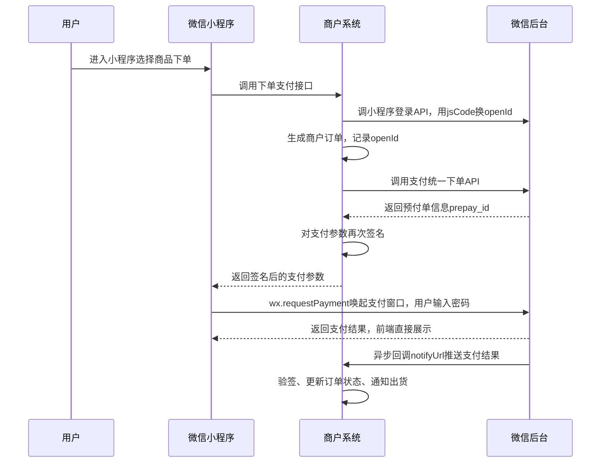

# 小程序微信支付全链路：创建订单、统一下单、回调处理与内网穿透联调

用户在小程序商品详情页点「立即付款」、输入密码，几秒后商品从售货机出货口掉出来。这几秒里，小程序、商户系统和微信支付平台之间完成了一整套交互。立可得第五章「订单支付与出货控制」的第四小节把这条链路落成代码，按创建订单、对接微信支付、发起支付请求、处理回调四大步推进，最后用 Taro 编译小程序前端做联调，再用 cpolar 内网穿透解决本地回调不可达的问题。

## 先给结论

- 支付结果走两条通知线：用户输完密码，微信后台直接把支付结果返回小程序前端展示，这条线不经过商户系统；同时微信后台异步回调商户系统的 notifyUrl，修改订单状态、通知出货这些业务处理只认回调这条线。
- 下单环节的核心产物是 prepay_id：商户系统调微信「统一下单 API」拿到预付单信息，再次签名后返给前端，前端凭这组带签名的参数唤起支付窗口。
- 回调处理有两件事不能省：先验签，不验签就无法区分请求来自微信平台还是伪造者；处理完必须给微信回 SUCCESS 应答，否则微信会按 15 秒、30 秒、3 分钟一直到 6 小时的递增间隔反复重试通知。
- 回调地址必须是公网可访问地址，写 127.0.0.1 微信永远调不到；本地调试用 cpolar 给订单微服务端口套一个临时公网域名。
- openId 做了新旧前端版本兼容：前端传了 openId 直接用，没传才拿 jsCode 去微信换取，后端升级不卡前端的版本节奏。

## 支付时序：一次下单，两条通知线

整章业务时序分几段：商品查询由小程序调小程序服务、再调售货机服务完成，前面小节已经实现；本章要写的是「支付下单」这一段；支付完成后系统向售货机下发出货指令，售货机上报出货结果，订单状态随之更新。

细化到微信支付内部，时序图里有四个角色：微信支付用户、微信小程序、商户系统（立可得后端）、微信后台。



三个容易忽略的点：小程序登录 API 和微信支付虽都由微信提供，但属于两个不同的平台体系；统一下单返回预付单时支付还没有发生，只是登记了一笔待支付的订单；微信后台对支付结果通知两次，一次同步给小程序前端展示，一次异步推给商户系统，商户系统的业务处理只认回调。

## 创建订单：RequestPay、Feign 与服务降级

接口文档对下单支付的定义很克制：POST 请求，只传三个参数，售货机编号 innerCode、商品 skuId、小程序端 jsCode。没有数量字段，因为售货机场景一次只能买一件，不像电商可以凑购物车。jsCode 是临时登录凭证，后端拿它去微信换 openId，存进订单表标记这笔订单是谁的。

对应的视图模型放在 service_common 里：

```java
@Data
public class RequestPay implements Serializable {
    private String innerCode; // 售货机编号
    private String jsCode;    // 小程序端JsCode
    private String openId;    // 用户OpenId
    private String skuId;     // 商品Id
}
```

比接口参数多了一个 openId，后面马上会用到。订单微服务里新建一个专门处理微信支付的控制器：

```java
@RestController
@RequestMapping("/wxpay")
@Slf4j
public class WxPayController {
    @Autowired
    private OrderService orderService;

    @PostMapping("/requestPay")
    public String requestPay(@RequestBody RequestPay requestPay) {
        CreateOrder createOrder = new CreateOrder();
        BeanUtils.copyProperties(requestPay, createOrder);
        createOrder.setPayType("2"); // 支付方式：1支付宝，2微信支付
        OrderEntity orderEntity = orderService.createOrder(createOrder); // 创建订单
        // TODO: 发起支付请求
        return "";
    }
}
```

CreateOrder 的属性和 RequestPay 大部分重合，拷贝属性之后补一个支付类型，微信支付固定传 2，然后调订单服务创建订单。发起支付请求的逻辑先留 TODO，稍后填充。

小程序前端并不直连订单微服务，请求先到小程序微服务再转发，所以在 service_common 里定义 Feign 接口做远程调用：

```java
@FeignClient(value = "order-service")
public interface OrderService {
    @PostMapping("/wxpay/requestPay")
    String requestPay(@RequestBody RequestPay requestPay);
}
```

远程调用就有调不通的可能，某个微服务挂掉会引发雪崩，所以要配熔断降级：降级工厂实现 FallbackFactory 接口，调不通时让 requestPay 返回 null。

```java
@Component
@Slf4j
public class OrderServiceFallbackFactory implements FallbackFactory<OrderService> {
    @Override
    public OrderService create(Throwable throwable) {
        log.error("订单服务调用失败", throwable);
        return new OrderService() {
            @Override
            public String requestPay(RequestPay requestPay) {
                return null;
            }
        };
    }
}
```

小程序微服务的 OrderController 把这几块串起来：

```java
@PostMapping("/requestPay")
public String requestPay(@RequestBody RequestPay requestPay) {
    if (!lkdService.hasCapacity(requestPay.getInnerCode(), Long.valueOf(requestPay.getSkuId()))) {
        throw new LogicException("该商品已售空");
    }
    // 如果openId为空，则根据jsCode生成
    if (Strings.isNullOrEmpty(requestPay.getOpenId())) {
        requestPay.setOpenId(wxService.getOpenId(requestPay.getJsCode()));
    }
    String responseData = orderService.requestPay(requestPay);
    if (Strings.isNullOrEmpty(responseData)) {
        throw new LogicException("微信支付接口调用失败");
    }
    return responseData;
}
```

先判断商品是否售空，再处理 openId，然后远程调用订单服务，返回串为空就抛「微信支付接口调用失败」。openId 判断值得单独说：jsCode 换 openId 要和微信平台交互，耗时。前端完全可以在小程序打开时就获取 openId 暂存，支付时直接传，后端省掉这次远程交互，接口更快。但不能把 jsCode 逻辑直接删掉上线：后端更新了、前端没跟上时，传上来的还是 jsCode，openId 就是空的。加一个 isNullOrEmpty 判断做兼容：传了 openId 直接用，没传才用 jsCode 换，新旧版本前端都能跑。

## 对接微信支付：统一下单拿 prepay_id

微信官方提供了 Java SDK，把接口调用、参数组装、XML 解析这些杂活封装了起来。不用 SDK 也可以：文档中心里的小程序支付、统一下单 API 把每个接口的地址、参数、响应列得很细，请求和响应都是 XML，自己组装和解析完全可行，只是麻烦。项目里引了 SDK：

```xml
<dependency>
    <groupId>com.github.wxpay</groupId>
    <artifactId>wxpay-sdk</artifactId>
    <version>0.9.3</version>
</dependency>
```

第二步是配置。订单微服务的 Consul 配置中心里加一段 wxpay 配置，包含小程序 ID、小程序密钥、商户号、商户密钥和回调地址（正式的号码课程资料里有提供）：

```yaml
wxpay:
  appid: xxxxxxxxxxxx      # 微信支付商户平台上的appid
  appSecret: xxxxxxxxxxxx  # 微信支付商户平台上的appSecret
  mchId: 1234567890        # 商户号
  partnerKey: 123456       # 微信支付商户平台的key
  notifyUrl: http://******/wxpay/payNotify # 微信支付成功之后的回调地址
```

接着是两个配置类，分工明确：WXConfig 用 @ConfigurationProperties 把上面的配置读进来；WXPaySdkConfig 继承 SDK 的抽象类 WXPayConfig，是给 SDK 用的，实现方法全是 get，返回值从 WXConfig 读出来，不做硬编码：

```java
@Component
@ConfigurationProperties("wxpay")
@Data
public class WXConfig {
    private String appid;
    private String appSecret;
    private String mchId;
    private String partnerKey;
    private String notifyUrl = "";
}
```

```java
@Component
public class WXPaySdkConfig extends WXPayConfig {
    @Autowired
    private WXConfig wxConfig;

    public String getAppID() {
        return wxConfig.getAppid();
    }

    public String getMchID() {
        return wxConfig.getMchId();
    }

    public String getKey() {
        return wxConfig.getPartnerKey();
    }

    InputStream getCertStream() {
        return null;
    }

    IWXPayDomain getWXPayDomain() {
        return new IWXPayDomain() {
            public void report(String s, long l, Exception e) {
            }

            public DomainInfo getDomainInfo(IWXPayConfig wxPayConfig) {
                return new DomainInfo("api.mch.weixin.qq.com", true);
            }
        };
    }
}
```

getWXPayDomain 返回微信支付的请求域名 api.mch.weixin.qq.com。有一点要注意：SDK 对这个类的包名有要求，必须在订单微服务里按指定包名创建，不能随意改。

准备就绪，第三大步发起支付请求，就是对微信统一下单接口的一次调用。服务接口定义 requestPay 方法，入参 openId 和订单编号，实现按四块走：封装请求参数、发送请求、解析返回结果、返给移动端需要的参数。

```java
// 1.封装统一下单请求参数
Map<String, String> map = Maps.newHashMap();
map.put("appid", wxPaySdkConfig.getAppID());
map.put("mch_id", wxPaySdkConfig.getMchID());
map.put("nonce_str", nonce_str);                    // 随机字符串
map.put("out_trade_no", orderNo);                   // 订单号
map.put("total_fee", orderEntity.getAmount() + ""); // 金额，以分为单位
map.put("spbill_create_ip", "127.0.0.1");           // 终端IP
map.put("notify_url", wxConfig.getNotifyUrl());     // 回调通知地址
map.put("trade_type", "JSAPI");                     // 交易类型
map.put("openid", orderEntity.getOpenID());         // 下单用户openid
// 生成带签名的XML，签名由工具类自动完成
String xmlParam = WXPayUtil.generateSignedXml(map, wxPaySdkConfig.getKey());
```

参数以开发文档为准，必填项一个不能少，金额注意以分为单位。往 map 里加参数时不用管签名，generateSignedXml 会按密钥把签名算好自动带进 XML。

```java
// 2.发送请求：统一下单接口不需要证书，最后一个参数传false
WXPayRequest wxPayRequest = new WXPayRequest(wxPaySdkConfig);
String xmlResult = wxPayRequest.requestWithCert("/pay/unifiedorder", null, xmlParam, false);

// 3.解析返回结果
Map<String, String> mapResult = WXPayUtil.xmlToMap(xmlResult);
String return_code = mapResult.get("return_code"); // 返回状态码
```

```java
// 4.返给移动端需要的参数
if (return_code.equals("SUCCESS")) {
    String prepay_id = mapResult.get("prepay_id"); // 预付单信息
    if (Strings.isNullOrEmpty(prepay_id)) {
        log.error("prepay_id is null!");
        throw new LogicException("当前订单可能已经被支付");
    }
    // 封装小程序支付参数
    response.put("appId", wxConfig.getAppID());
    response.put("package", "prepay_id=" + prepay_id);
    response.put("signType", "MD5");
    response.put("nonceStr", WXPayUtil.generateNonceStr());
    Long timeStamp = System.currentTimeMillis() / 1000; // 秒级时间戳
    response.put("timeStamp", timeStamp + "");
    String sign = WXPayUtil.generateSignature(response, wxConfig.getPartnerKey());
    response.put("paySign", sign);
    response.put("orderNo", orderNo);
    return JsonUtil.serialize(response);
} else {
    log.error("调用微信统一下单接口失败 {}", response);
    return null;
}
```

return_code 为 SUCCESS 时取 prepay_id；如果它是空的，多半说明这笔订单已经被支付过。随后组装前端唤起支付窗口需要的参数：appId、package（放 prepay_id）、signType、nonceStr、timeStamp，时间戳必须是秒级，再用 generateSignature 对这组参数整体签名得到 paySign。前端只有拿到正确的签名才能唤起支付窗口，签名不对这个窗口就弹不出来。安全上另有一处提醒：appId 这类参数比较敏感，尽量少在前后端之间来回传输。最后把 map 转 JSON 返回，控制器里创建订单之后接着调用请求支付方法，把结果交给前端。

## 回调处理与本地联调：验签、重试与 cpolar

用户输完支付密码，微信平台会主动 POST 配置里那个 notifyUrl。这个地址在统一下单时就已经随参数给了微信，它必须是公网可访问的地址，微信调不到内网里的地址。回调逻辑写在微信支付服务接口的 notify 方法里：

```java
@Override
public void notify(String notifyResult) throws Exception {
    // 解析
    Map<String, String> map = WXPayUtil.xmlToMap(notifyResult);
    // 验签
    boolean signatureValid = WXPayUtil.isSignatureValid(map, wxConfig.getPartnerKey());

    if (signatureValid) {
        if ("SUCCESS".equals(map.get("result_code"))) {
            String orderNo = map.get("out_trade_no");
            OrderEntity orderEntity = orderService.getByOrderNo(orderNo);
            orderEntity.setStatus(VMSystem.ORDER_STATUS_PAID);
            orderEntity.setPayStatus(VMSystem.PAY_STATUS_PAID);
            orderService.updateById(orderEntity);
        } else {
            log.error("支付回调出错 {}", notifyResult);
        }
    } else {
        log.error("支付回调验签失败 {}", notifyResult);
    }
}
```

微信传回来的是 XML 字符串，先转成 map。验签是安全的第一道防线：不验签就没法确定这次调用一定来自微信平台，伪造请求直接改订单状态业务就乱了，所以验不过只记日志、不做任何处理。验签通过且 result_code 为 SUCCESS 时，按 out_trade_no 查出订单，订单状态和支付状态都改成已支付，updateById 存回去；再往后是通知售货机出货，下一小节的内容，这里留了 TODO。

控制器层补一个 payNotify 接口承接微信的调用：

```java
/**
 * 微信支付回调接口
 */
@RequestMapping("/payNotify")
@ResponseBody
public void payNotify(HttpServletRequest request, HttpServletResponse response) {
    try {
        // 输入流转换为xml字符串
        String xml = ConvertUtils.convertToString(request.getInputStream());
        // 调用回调处理逻辑
        wxPayService.notify(xml);
        // 给微信支付一个成功的响应
        response.setContentType("text/xml");
        String data = "<xml><return_code><![CDATA[SUCCESS]]></return_code><return_msg><![CDATA[OK]]></return_msg></xml>";
        response.getWriter().write(data);
    } catch (Exception e) {
        log.error("支付回调处理失败", e);
    }
}
```

微信以输入流的方式 POST 数据，先转成 XML 字符串再交给 notify 处理。最关键的一步是应答：按文档「支付结果通知」的要求，把 SUCCESS/OK 用 CDATA 包好写回给微信，表明已经成功处理。如果微信收到的应答不符合规范或者超时，它会认定通知失败并再次重发，而且重试间隔逐次拉长：15 秒、15 秒、30 秒、3 分钟、10 分钟、20 分钟、30 分钟、60 分钟，再往后是每 3 小时一次、每 6 小时一次，问满一天才停。回一个 SUCCESS，它就不问了。

后端代码齐了，做联调验证。后端跑起四个服务：售货机微服务、订单微服务、小程序微服务、小程序网关。前端源码基于 React 和 Taro，Taro 是多端统一开发解决方案：微信、支付宝、京东、百度各家小程序端各不相同，一套源码编译出多端小程序，开发和维护成本都省了。联调先改前端 src 下的 config.ts，把后端网关地址从生产环境地址换成 `http://127.0.0.1:9010`，9010 是小程序网关端口，协议同步从 https 改成 http，本地服务没有证书。然后在终端执行：

```bash
npm i -g @tarojs/cli   # 全局安装 Taro CLI，只需执行一次
npm install            # 安装工程依赖，只需执行一次
npm run dev:weapp      # 编译小程序，源码变更后重新执行
```

控制台出现「监听文件修改中」即编译完成。打开微信开发者工具，扫码登录后导入项目，目录选编译产物 dist 文件夹，AppID 填资料里提供的小程序 ID。

首次运行报错：`http://127.0.0.1:9010 不在以下 request 合法域名列表中`。小程序默认校验请求域名，合法域名要在管理后台配置，本地地址没配过。测试阶段不必真去配，在开发者工具的「详情 → 本地设置」里勾选「不校验合法域名」以及 HTTPS 证书相关选项，页面立刻出数据，前后端通了。工具里的「扫一扫」打开的是选择图片窗口，和真机直接唤起扫码有差异，用资料里的售货机二维码图片代替，选一个商品进入详情，点支付。电脑上调试弹的是二维码，真机则唤起微信支付窗口，手机扫码完成支付后，页面跳转提示「支付成功，请取货」。

但此时去数据库订单表看，这笔订单的状态还是 0，没有变成已支付的 1。原因就在回调上：改状态的逻辑写在回调里，服务跑在本地，微信平台访问不到内网地址。解决方式有两个，一是部署到公网服务器、买域名做解析，要服务器要域名要时间，最麻烦的是线上没法打断点跟踪；二是内网穿透，课程选了 cpolar。注册账号、选择免费套餐后先做认证，在程序所在目录执行（密钥每个账号不同）：

```bash
cpolar authtoken <你的密钥>   # 认证并保存配置文件
cpolar http 9008             # 穿透本地9008端口，9008是订单微服务端口
```

cpolar 分配一个临时公网域名，每次运行都不一样，做测试足够了，公网访问这个域名等价于访问本地端口。把临时域名填进 Consul 配置中心里订单微服务的 wxpay.notifyUrl，路径部分 /wxpay/payNotify 保持不变（它同时给出 http 和 https 两个映射，任选其一），保存后重启订单微服务。再下一单支付，刷新订单表：订单状态变成 1，回调正常工作，控制台里也能看到回调内容的输出。

## 小结

这条链路的主干是四步：创建订单、对接微信支付、发起支付请求、处理回调。创建订单在订单微服务里落库，小程序微服务经 Feign 转发并配了降级兜底；统一下单拿到 prepay_id，再次签名后交前端唤起支付窗口；回调里先验签再改订单状态，并回给微信 SUCCESS 应答避免无休止重试。两个工程上的记忆点：一是 openId 的版本兼容判断，后端改协议时给前端留了缓冲；二是回调地址的公网可达性，本地调试靠 cpolar 的临时域名映射订单微服务端口。支付通了，出货控制在后面的小节接着走。
