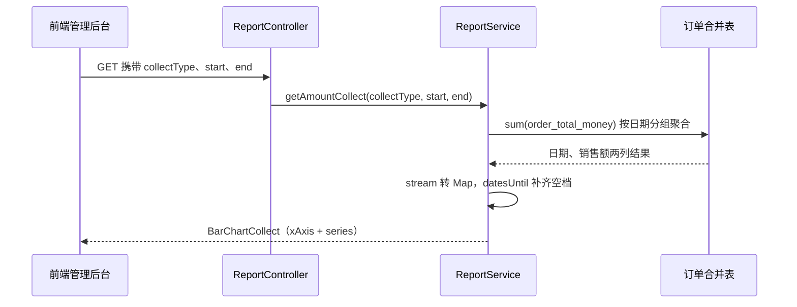

# 销售额趋势图：需求思路与两段代码实现

统计分析章推进到第 5 小节，主角是管理后台的销售额趋势图：把某一时间段内每个时间节点的销售额统计出来，连成一条曲线，用来反映这段时间的销售变化趋势，比如淡旺季。效果页里还有一张销售额分布柱状图，同样是销售额统计分析的范畴，但那是下一小节的内容，本篇只讲趋势图。数据源不需要新表，一条对订单合并表的聚合查询，再加一组随统计维度切换的变量，功能就能收住。

## 先给结论

- 需求原文：在立可得管理后台需要根据周、月、年三个维度统计销售额，前端以曲线图方式展示。选周展示本周每天的数据，选月展示本月每天的数据。
- 选年是设计点：按年若仍按天统计，一年 365 个节点，横轴显示不开，很难看，所以选年时按月统计，每个月一个节点连成线。
- 维度收敛为两种：选周和选月后端逻辑完全相同，都是按天统计；选年按月统计。前端传参就两类信息——统计起止日期加统计维度，1 为按日、2 为按月。
- 数据源是订单合并表 order_collect：IFNULL(sum(order_total_money),0) 聚合销售额，按日期分组，日期区间过滤加升序排序，空档日期补 0，保证横轴刻度与曲线数值一一对应。
- 按日按月合一的关键是四个三元变量：分组列 date/MONTH(date)、查询列 date/min(date)、格式化 ISO_LOCAL_DATE/yyyy-MM、步长 ofDays(1)/ofMonths(1)。
- 测试不走网关：只启动订单微服务，order 测试脚本最后一条"销售额趋势分析"直连验证，按日返回 31 个节点，按月返回 12 个节点。

## 一、需求与思路：周月年三个入口，后端两种统计

需求分析原文说得很清楚：在立可得管理后台需要根据周、月、年三个维度来进行销售额的统计，前端以曲线图的方式进行展示。效果图的左侧是销售额趋势图曲线图——横轴是日期（示例中 2021-01-04 到 2021-01-07），纵轴是销售额（0 到 2500 区间），曲线在 01-06 出现峰值后回落；右侧那张销售额分布柱状图是下一小节要讲的内容。

三个维度里藏着一个需要设计的地方。选周，展示的是本周每一天的数据；选月，展示的是本月每一天的数据——这两种情况后端逻辑完全相同，都是按天统计。选年就不一样了：如果还按每一天统计，一年就有 365 个节点，横轴根本显示不开，效果难看。所以选年时改成按月统计，把每个月的销售额连成一条线。

于是参数约定就出来了：前端给后端传递的数据包括一个时间段（统计开始日期和截止日期），再加统计的维度——选周或选月传 1，代表按日统计；选年传 2，代表按月统计。

实现思路上，数据直接从订单合并表聚合统计就可以，不用从别的表统计，订单合并表本身就支持这个功能。后端根据传过来的参数对订单合并表进行聚合统计，把结果封装成曲线图的视图模型——曲线图视图模型类在上一章做收益统计趋势图时已经封装过，就是 BarChartCollect（xAxis 与 series 两个数组），思路大体相同。整条链路串起来是这样：



## 二、按日统计：聚合查询、toMap 与补零组装

代码实现参照的 API 是管理后台工作台分组下的"获取销售额统计"：GET 请求，路径 /api/order-service/report/amount/collect/{collectType}/start/end，接收三个参数——统计时间类型 collectType（1 按日、2 按月）、开始日期 start、截止日期 end；返回的就是柱状图、曲线图的标准封装对象，xAxis 是 X 轴日期字符串数组，series 是对应的销售额数据。

打开订单微服务，统计分析归 report，在 ReportService 中定义方法。返回类型就是曲线图封装对象，方法叫 getAmountCollect，参数包括统计类型 collectType 和 LocalDate 类型的 start、end，含义是获取一定日期内的销售额趋势；start 和 end 用 @NotNull 做非空校验，保证日期范围有效。

先写按日统计的版本，分四步走。

第一步封装查询条件。new 一个 QueryWrapper<OrderCollectEntity>，select 里对销售额做聚合——必然用到 sum 对 order_total_money 求和，指定别名 order_total_money，外面用 IFNULL 包起来：没有数据时让它为 0 而不是 null，这样写比较严谨；另外把日期 date 这一列也查出来。接着 groupBy 按日期分组，一天一行。然后用 lambda 表达式构建条件：ge 日期大于等于 start、le 日期小于等于 end，时间段就有了；最后别忘了排序，按时间升序 orderByAsc。

第二步查询并转 Map。orderCollectService.list(qw) 得到一个集合，里面两列：日期、统计出来的销售额。但它是实体集合，取值不方便，最终要按日期取值，用 Map 最方便，所以 stream().collect(Collectors.toMap(...)) 转一下：key 是日期，value 是 getOrderTotalMoney。key 还要做一次转换——它本身是日期类型，而前端要求的是字符串，用 DateTimeFormatter.ISO_LOCAL_DATE 格式化，即年月日、中间横杠的格式。

第三步生成完整日期序列并组装返回值。先 new BarChartCollect。统计结果里有可能某一天是空着的——那天没有订单，所以必须按起始时间把每一天的数字都补上，没有就补 0。这件事交给 datesUntil：start.datesUntil(end.plusDays(1), Period.ofDays(1))，第二个参数是间隔周期，每间隔一天产生一个节点。注意"间隔一天"不是跳跃的意思——1 号、2 号、3 号连续节点叫间隔一天；如果传 2，产生的就是 1 号、3 号、5 号这种隔天跳跃的序列。另外 datesUntil 含头不含尾，end 要先 plusDays(1)，把截止日期本身包进来。

第四步逐日填充。forEach 里先把当天日期用同一个 formatter 格式化成字符串 key，加进横轴；然后判断 mapCollect 里有没有这个 key：有数据就取出来放进 series，没有就放 0。

```java
@Override
public BarChartCollect getAmountCollect(Integer collectType,
                                        @NotNull LocalDate start,
                                        @NotNull LocalDate end) {
    var qw = new QueryWrapper<OrderCollectEntity>();
    qw.select("IFNULL(sum(order_total_money),0) as order_total_money", "date")
      .groupBy("date")
      .lambda()
      .ge(OrderCollectEntity::getDate, start)
      .le(OrderCollectEntity::getDate, end)
      .orderByAsc(OrderCollectEntity::getDate);

    var mapCollect = orderCollectService.list(qw).stream()
            .collect(Collectors.toMap(
                    o -> o.getDate().format(DateTimeFormatter.ISO_LOCAL_DATE),
                    OrderCollectEntity::getOrderTotalMoney));

    var result = new BarChartCollect();
    start.datesUntil(end.plusDays(1), Period.ofDays(1)).forEach(date -> {
        String key = date.format(DateTimeFormatter.ISO_LOCAL_DATE);
        result.getXAxisList().add(key);
        if (mapCollect.containsKey(key)) {
            result.getSeriesList().add(mapCollect.get(key));
        } else {
            result.getSeriesList().add(0);
        }
    });
    return result;
}
```

## 三、按日按月合一：四个随维度切换的变量

刚才的逻辑只覆盖按日，而这个方法要根据传入参数同时满足按日和按月两种统计维度。做法是把两种情况下不一样的细节找出来，按 collectType 用三元运算符切换。三元表达式直接写在链式调用的位置上可读性比较差，代码也会很长，所以统一提成变量，一共四处。

第一处，分组列。按日 groupBy date；按月要在 date 上套一个时间函数 MONTH(date) 取月份，这样就是按月聚合。第二处，select 里的日期列。按日就是 date；按月时这个 date 应该显示哪一天？用 min 函数取最小的那天，也就是这个月的第一天。第三处，日期格式化。按日显示年月日；按月只需要显示年月，用 DateTimeFormatter.ofPattern("yyyy-MM") 自定义，否则用 ISO_LOCAL_DATE，toMap 的 key 和横轴两处都要用它。第四处，间隔单位。按日步长是天，按月就是一个 month，对应 datesUntil 的第二个参数。

```java
var groupColumn = collectType == 2 ? "MONTH(date)" : "date";
var dateColumn  = collectType == 2 ? "min(date)" : "date";
var formatter   = collectType == 2 ? DateTimeFormatter.ofPattern("yyyy-MM")
                                   : DateTimeFormatter.ISO_LOCAL_DATE;
var period      = collectType == 2 ? Period.ofMonths(1) : Period.ofDays(1);
```

四个变量分别替换进 select 的日期列、groupBy 的分组列、两处 format 与 datesUntil 的步长，这个方法就写完了。按月统计时分组列换成了时间函数，控制台打印的 SQL 形状如下，重点是 GROUP BY 从 date 变成 MONTH(date)：

```sql
SELECT IFNULL(sum(order_total_money), 0) as order_total_money, date
FROM order_collect
WHERE (date >= ? AND date <= ?)
GROUP BY MONTH(date)
ORDER BY date
```

服务层之后是 Controller。ReportController 里的接口方法直接从讲义里拿过来：接收统计类型、开始日期、截止日期三个路径参数，日期字符串转 LocalDate，方法体一行调用刚才写好的逻辑：

```java
@GetMapping("/amountCollect/{collectType}/{start}/{end}")
public BarChartCollect getAmountCollect(@PathVariable Integer collectType,
        @PathVariable @DateTimeFormat(pattern = "yyyy-MM-dd") LocalDate start,
        @PathVariable @DateTimeFormat(pattern = "yyyy-MM-dd") LocalDate end) {
    return reportService.getAmountCollect(collectType, start, end);
}
```

## 四、测试：直连订单微服务

代码完成后就是测试。测试脚本没有通过网关访问，所以只需要把订单微服务跑起来。打开 order 测试脚本，最后一条就是"销售额趋势分析"。

先测按日：统计类型传 1，时间段因为原来周期太长改短一点，改成 1 月 1 号到 1 月 31 号。执行后可以看到：没有数据的日期显示 0，有数据的日期显示具体数字——这就是 1 月 1 号到 1 月 31 号每天销售额的趋势，横轴显示格式是年月日。

再切第二种：按月统计，对应前端界面上点"年"。统计类型改成 2，时间范围写 1 月份到 12 月份。执行后显示格式变了：数据变成年月格式，一共 12 个数字，每个月一个销售额。销售额趋势图的代码开发到此完成。

## 小结

把本篇串起来：需求是管理后台按周月年三个维度看销售额曲线，周月按天统计、选年按月统计，前端传起止日期加维度（1 按日、2 按月）；数据源直接用订单合并表，IFNULL(sum(order_total_money),0) 聚合、按日期分组、区间过滤加升序排序；组装侧 stream 转 Map 后用 datesUntil 生成完整日期序列逐日取值，空档补 0，保证横轴与数值一一对应；按日按月的差异收敛为四个三元变量——分组列 MONTH(date)、日期列 min(date)、格式化 yyyy-MM、步长 ofMonths(1)；Controller 暴露 /amountCollect/{collectType}/{start}/{end}，测试直连订单微服务，按日 31 个节点、按月 12 个节点。曲线图视图模型复用了上一章封装的 BarChartCollect，上一章"序列完整、缺数补零"的经验在这里直接生效；下一小节的销售额分布图会换一个角度继续切这块统计数据。
