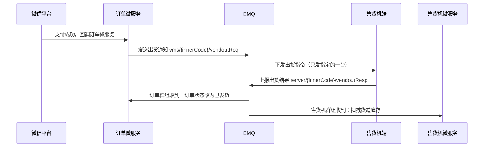

# 售货机出货并发控制全链路：出货流程、结果处理与分布式锁落地

第五章订单支付与出货控制推进到第 5 小节。前面已经把小程序支付与回调打通，钱付完之后剩两个问题：货怎么从售货机里出来，两个人同时买最后一件怎么办。本小节"售货机出货并发控制"把这两件事一次讲透，代码实现分五大步：判断库存、发送出货通知、处理出货结果、并发控制、取消订单释放锁。

## 先给结论

- 出货与传统电商不同：不走快递，服务端微服务通知售货机终端，设备端调串口驱动硬件把货道商品弹到取货口，用户即买即取。
- 并发控制的根因是售货机是物理实体且库存有限：同一时间只能处理一个用户的出货，否则两人同时买最后一件，都付了钱只有一人拿到货，另一人还得退款。
- 锁的时机：请求支付时按售货机编号加锁，售货机微服务收到出货上报、扣库存后立即解锁；下单不支付靠锁 60 秒过期自动释放兜底。
- 主题设计：出货通知是含售货机编号的动态主题 vms/{innerCode}/vendoutReq，每台售货机只订阅自己的编号；出货结果主题 server/{innerCode}/vendoutResp 由订单与售货机微服务 $share 共享订阅，各自处理。
- 分布式锁用 Consul 实现（DistributedLock 类，getLock/releaseLock），锁名就是售货机编号，sessionID 存 Redis（60 秒过期），释放时取出来调 releaseLock。
- 库存校验前置：下单前查货道表 currentCapacity 是否大于 0，售空直接拦截，避免支付完成拿不到货再退款。

## 一、需求与出货流程：独占式出货，锁住整台机器

需求分析把本节拆成两部分：出货、并发控制。

出货好理解。支付和回调已实现，支付成功后就要发货。形态和传统电商不一样：不走快递，直接从当前售货机把商品送到取货口。具体动作是微服务通知售货端执行出货——设备端本身也是一个微服务，接到出货指令后调用串口驱动售货硬件，把货道中的商品弹出来。串口编程不是本课程内容，要关心的是数据在服务之间怎么流转。

并发控制和传统电商区别很大。传统电商库存足够多，并发控制几乎可以忽略；售货机库存有限。设想某商品只剩最后一件，两人同时下单，不做控制可能都付了款，只有一人拿到商品——另一个人的钱不能扣，还得退款。需求原文把约束说得很硬：售货机是具体的、独占式的，处理一个用户出货的过程中不能同时处理另一个用户的出货，同一时间只能处理一个商品的出货，因此要在用户支付接口处用分布式锁做排他处理——只有获得锁的用户才能向微信支付平台发起支付请求，没获得锁的收到"售货机忙碌"提示，避免支付后拿不到商品。

出货流程是理解后续代码的地图，关键是订单微服务与售货机端之间由 EMQ 中转：通知与结果各走一个主题，结果主题被订单、售货机两个微服务分别订阅处理。



锁控制就两个动作点。一，下单时加锁：开始购买商品就获取锁，成功获取就占据了这个时间段购买交易的权利，像窗口买票，后面的人只能排队。二，售货机微服务收到售货机上报的出货消息后更新库存并解锁，解锁后下一个交易才能开始。兜底是锁本身有超时时间：下了单不支付，锁过期自动解开，时间大概一分钟左右——用户想买一分钟之内肯定买了，不买就是不想买。

## 二、判断库存与发送出货通知

第一步判断库存。下单前先判断商品在售货机里是否还有库存——没有库存支付完成拿不到货，还得退款，所以下单之前就要判断，没有直接返回。

逻辑封装在售货机微服务。VendingMachineService 接口新增 hasCapacity，返回 Boolean，入参售货机编号 innerCode 和商品 skuId。实现核心是一次 count 统计：MyBatis-Plus 的 count 传入条件即可统计记录数——售货机编号、商品 ID 加当前库存大于 0，结果大于 0 就是有库存：

```java
@Override
public Boolean hasCapacity(String innerCode, Long skuId) {
    var qw = new LambdaQueryWrapper<ChannelEntity>();
    qw.eq(ChannelEntity::getInnerCode, innerCode)
      .eq(ChannelEntity::getSkuId, skuId)
      .gt(ChannelEntity::getCurrentCapacity, 0);
    return channelService.count(qw) > 0;
}
```

查的是货道表 ChannelEntity，currentCapacity 就是当前库存。VendingMachineController 用 @GetMapping("/hasCapacity/{innerCode}/{skuId}") 暴露接口；小程序微服务要远程调用，在 service-common 的 Feign 接口 VMService 中补上同样定义。小程序微服务的 OrderController 里，requestPay 在调用订单服务之前加拦截：

```java
if (!vmService.hasCapacity(requestPay.getInnerCode(),
        Long.valueOf(requestPay.getSkuId()))) {
    throw new LogicException("该商品已售空");
}
```

没有库存直接抛异常，支付流程不再往下走。

第二步发送出货通知。通知经 EMQ 发到指定主题，售货机终端订阅主题来收取货通知。关键在主题名：不能是固定字符串——固定主题所有售货机都会收到，显然不行；必须是含售货机编号的动态主题，形如 vms/售货机编号/vendoutReq（前缀和动作名可自定义）。每台售货机只订阅自己编号的主题，精准投递就实现了。

代码在订单服务里。定义支付完成方法 payComplete(String orderNo)，实现只调用一个私有方法 sendVendout——为的是方便扩展：支付完成之后除出货外将来可能还有别的逻辑，全写在一起方法会非常乱，封成私有方法后主方法一串调用。

sendVendout 分两部分：封装出货协议、向售货机发请求（实际发到 EMQ）。先按订单编号查订单实体，再装协议。协议类 VendoutReq 里：vendoutData 是发货数据（VendoutReqData：订单号、支付价格、支付类型、商品编号、超时时间 60、请求时间），sn 是流水号，innerCode 是售货机编号，needResp 表示是否需要响应。主题由 TopicConfig.getVendoutTopic(innerCode) 拼接生成：

```java
@Autowired
private MqttProducer mqttProducer;

@Override
public boolean payComplete(String orderNo) {
    sendVendout(orderNo); // 发送出货通知
    return true;
}

/**
 * 出货
 */
private void sendVendout(String orderNo) {
    OrderEntity orderEntity = this.getByOrderNo(orderNo);
    VendoutReqData reqData = new VendoutReqData();
    reqData.setOrderNo(orderNo);
    reqData.setPayPrice(orderEntity.getAmount());
    reqData.setPayType(Integer.parseInt(orderEntity.getPayType()));
    reqData.setSkuId(orderEntity.getSkuId());
    reqData.setTimeout(60);
    reqData.setRequestTime(LocalDateTime.now().format(DateTimeFormatter.ISO_DATE_TIME));

    VendoutReq req = new VendoutReq();
    req.setVendoutData(reqData);
    req.setSn(System.nanoTime());
    req.setInnerCode(orderEntity.getInnerCode());
    req.setNeedResp(true);

    // 向售货机发送出货请求
    try {
        mqttProducer.send(
            TopicConfig.getVendoutTopic(orderEntity.getInnerCode()), 2, req);
    } catch (JsonProcessingException e) {
        log.error("send vendout req error.", e);
    }
}
```

调用点在微信支付回调 WXPayServiceImpl 的 notify 里：解析回调 XML、用 partnerKey 验签，通过且 result_code 为 SUCCESS 时取出 out_trade_no 查订单，订单状态与支付状态都改为已支付（ORDER_STATUS_PAID、PAY_STATUS_PAID），updateById 持久化——这些是上一小节完成的功能，本步只追加一句 orderService.payComplete(orderNo) 通知出货。

## 三、处理出货结果：共享订阅与双服务处理

第三步处理出货结果。这不是设备端的编程逻辑——设备端怎么发货不是本节内容，要处理的是发货之后的事：售货机端向 EMQ 发消息反馈"我已发货完成"，主题是 vendoutResp；订单与售货机微服务都用群组共享订阅来收它——一个群组内只有一个节点收到，两个群组都会收到。处理分两路：订单微服务改订单状态为已发货，售货机微服务扣减货道库存。

先辨析协议名：vendoutResp 和 vendoutReq 很像但不是一个东西——Resp 是出货响应，售货机端往回发；Req 是出货请求，服务端向售货机端发，写处理类时别混。

订单微服务侧用之前讲过的消息分发处理架构：@ProcessType 指定协议名 vendoutResp，实现 MsgHandler 接口；process 里把协议内容转成 VendoutResp，调订单服务的 vendOutResult——主要逻辑是订单状态改为已发货（内部实现不是本节重点，可看源码）：

```java
@Component
@ProcessType(value = "vendoutResp")
public class VentOutMsgHandler implements MsgHandler {
    @Autowired
    private OrderService orderService;

    @Override
    public void process(String jsonMsg) throws IOException {
        VendoutResp vendoutResp = JsonUtil.getByJson(jsonMsg, VendoutResp.class);
        orderService.vendOutResult(vendoutResp);
    }
}
```

写好处理类后订阅主题。订单微服务的订阅串是 $share/order/server/*/vendoutResp：$share 是群组共享订阅前缀，order 是群组名（不是主题名），server 是主题第一级；加号是通配符代表任意一级，替代售货机编号；井号可代表多级也能匹配，但售货机编号只需一级，所以用加号。

售货机微服务侧同样建一个处理类，协议名相同，多了校验：先判断是否出货成功，没成功直接返回；成功则解析，售货机编号为空也不处理；通过后把协议传给售货机服务的 vendOutResult——它做两件事：记录出货流水，以及更关键的扣减货道库存。方法内部不展开：

```java
@Component
@ProcessType(value = "vendoutResp")
public class VentOutMsgHandler implements MsgHandler {
    @Autowired
    private VendingMachineService vmService;

    @Override
    public void process(String jsonMsg) throws IOException {
        boolean success = JsonUtil.getNodeByName("success", jsonMsg).asBoolean();
        if (!success) return;
        VendoutResp vendoutResp = JsonUtil.getByJson(jsonMsg, VendoutResp.class);
        if (Strings.isNullOrEmpty(vendoutResp.getInnerCode())) return;
        vmService.vendOutResult(vendoutResp);
    }
}
```

售货机微服务的订阅串是 $share/vms/server/#：vms 是群组名，井号代表多级，同样能匹配"售货机编号 + vendoutResp"。两个微服务群组共享订阅、分别处理，这套思想是本节要领会的内容。

测试验证。先启动订单、售货机两个微服务（处理类分别在两个服务里）；再用 EMQ 的 WebSocket 工具模拟设备上报，向主题 server/01000001/vendoutResp 发送报文；观察两处：货道库存是否减少、订单状态是否变更。

报文按测试数据修改：innerCode 填测试下单的售货机编号 01000001；sn 随便定义一个数；msgType 不用改；vendoutResult 里 success 为 true，payType 是 2（微信支付），orderNo 改成测试下单那条订单号，skuId 从订单数据里拿，price 写 1（测试花了一分钱），channelId 是货道编号，要查数据库——打开售货机库的货道表，条件售货机编号加商品 ID，查出该商品分布的货道，选一个库存大于 0 的。测试选中 2-6 号货道，当前库存 3，处理完应变成 2：

```json
{
  "innerCode": "01000001",
  "sn": "181018102013",
  "msgType": "vendoutResp",
  "vendoutResult": {
    "success": true,
    "payType": 2,
    "orderNo": "0100000115744887641508",
    "skuId": "1339813834621194242",
    "channelId": "2-6",
    "price": 1
  }
}
```

执行时先在 EMQ 的 WebSocket 页面点连接，状态变绿表示成功；粘贴主题和报文，QoS 给 2，点发送。发送后刷新查询：货道 2-6 的库存从 3 变成 2；再看订单表，状态从 1（已付款、未发货）变成 2——两个微服务都成功处理了上报请求。

## 四、并发控制：Consul 分布式锁的单元测试与业务落地

第四步出货并发控制：保证每一台售货机同一时间只能处理一个出货请求，具有排他性。通常用分布式锁解决，Redis、Zookeeper、Consul 都可以实现；立可得项目用 Consul，并提供封装好的处理类 DistributedLock，两个常用方法：getLock 获取锁、releaseLock 解锁，内部基于 Consul 的 session 机制，构造时传主机名和端口。

先用单元测试体验用法。测试类加 @RunWith(SpringRunner.class) 和 @SpringBootTest，注入 ConsulConfig——@Value 取 consul.host（默认 localhost）与 consul.port（默认 8500）。测试获取锁：实例化 DistributedLock 后调 getLock，第一个参数是锁名（实际应用中就是设备编号），第二个参数是过期秒数，超时不释放锁也会自动释放，不会让人长期占用：

```java
@RunWith(SpringRunner.class)
@SpringBootTest
public class DistributedLockTest {
    @Autowired
    private ConsulConfig consulConfig;

    @Test
    public void testGetLock() {
        DistributedLock distributedLock = new DistributedLock(
                consulConfig.getConsulRegisterHost(),
                consulConfig.getConsulRegisterPort());
        DistributedLock.LockContext lockContext = distributedLock.getLock("abc", 30);
        System.out.println(lockContext.getSession());
        System.out.println(lockContext.isGetLock());
    }
}
```

getLock 返回的 LockContext 是内部类：getSession 拿 sessionID，释放锁时要指定它；isGetLock 表示是否拿到锁，true 成功，false 已被锁定无法获取。运行验证三轮：第一次成功，输出 sessionID 和 true；紧接着第二次获取同一个 "abc" 锁，返回 false——锁还没自动释放；第三次距第一次已超过 30 秒，锁过期自动释放，又能拿到，过期机制验证通过。

释放锁测试：把过期时间放大到 120 秒，先获取锁并复制 sessionID，再次获取失败（没超过两分钟）；调 releaseLock 立即释放，马上再获取，成功拿到新锁——立即释放没有问题：

```java
@Test
public void testReleaseLock() {
    DistributedLock distributedLock = new DistributedLock(
            consulConfig.getConsulRegisterHost(),
            consulConfig.getConsulRegisterPort());
    distributedLock.releaseLock("1ad9c6ed-b878-1882-3a9b-f3b48b4a46ea");
}
```

应用到业务。加锁在小程序微服务 OrderController 的 requestPay 里，位于调用订单服务请求支付之前：判断库存、拿 openId 之后创建分布式锁对象，然后 getLock——锁名用售货机编号，因为同一台售货机同一时间只能处理一次出货；60 秒过期，不能太长也不能太短：太长一个人占着机器，后续人无法操作；太短来不及付款。isGetLock 为 false 直接抛 LogicException("机器出货中请稍后再试")。拿到锁后往 Redis 放一个值：key 是固定前缀加售货机编号，value 是 sessionID，过期同样 60 秒——存它是为了释放锁时能拿到 sessionID，锁 60 秒就过期，Redis 存再久也没意义：

```java
// 分布式锁，机器同一时间只能处理一次出货
DistributedLock lock = new DistributedLock(
        consulConfig.getConsulRegisterHost(),
        consulConfig.getConsulRegisterPort());
DistributedLock.LockContext lockContext = lock.getLock(requestPay.getInnerCode(), 60);
if (!lockContext.isGetLock()) {
    throw new LogicException("机器出货中请稍后再试");
}
// 存入redis是为了释放锁
redisTemplate.boundValueOps(WSYSTEM_VM_LOCK_KEY_PREF + requestPay.getInnerCode())
        .set(lockContext.getSessionId(), Duration.ofSeconds(60));
```

解锁在售货机微服务的出货结果处理类里：vendOutResult 扣减库存后立即解锁——交易完事就该立刻释放，否则下一个用户只能干等 60 秒。关键是 sessionID：按固定前缀加售货机编号从 Redis 取出，调 releaseLock 释放：

```java
vmService.vendOutResult(vendoutResp);

// 解锁售货机状态
DistributedLock lock = new DistributedLock(
        consulConfig.getConsulRegisterHost(),
        consulConfig.getConsulRegisterPort());
String sessionId = redisTemplate
        .boundValueOps(WSYSTEM_VM_LOCK_KEY_PREF + vendoutResp.getInnerCode()).get();
lock.releaseLock(sessionId);
```

第五步取消订单释放锁，思路同出货后的解锁。先在 service-common 的 Feign 接口 OrderService 新增定义，把订单微服务的取消订单逻辑暴露出来：@GetMapping("/order/cancel/{orderNo}")，返回 Boolean，入参 orderNo。小程序的 OrderController 新增取消订单方法，在调用取消订单之前先释放锁：按固定前缀加售货机编号从 Redis 取 sessionID，取不到直接返回；取到就 releaseLock，再调 orderService.cancel(orderNo)，异常记日志：

```java
public void cancel(@PathVariable String innerCode, @PathVariable String orderNo) {
    DistributedLock lock = new DistributedLock(
            consulConfig.getConsulRegisterHost(),
            consulConfig.getConsulRegisterPort());
    String sessionId = redisTemplate
            .boundValueOps(WSYSTEM_VM_LOCK_KEY_PREF + innerCode).get();
    if (Strings.isNullOrEmpty(sessionId)) return;
    try {
        lock.releaseLock(sessionId);
        orderService.cancel(orderNo);
    } catch (Exception ex) {
        log.error("取消订单出错", ex);
    }
}
```

## 小结

五步串起来：判断库存前置拦截，货道 currentCapacity 大于 0 才放行支付请求；支付回调验签通过后改订单状态并调 payComplete，sendVendout 把订单数据装进 VendoutReq，发到动态主题 vms/{innerCode}/vendoutReq 按编号精准投递；售货机端出货后向 server/{innerCode}/vendoutResp 上报，订单与售货机微服务 $share 共享订阅，一个改订单状态为已发货，一个记流水并扣货道库存，EMQ WebSocket 模拟上报即可验证库存 3 变 2、订单状态 1 变 2；并发控制用 Consul 版 DistributedLock，单元测试验证获取、互斥、过期自动释放与立即释放，业务上请求支付前按售货机编号加锁 60 秒、sessionID 存 Redis，出货结果扣库存后立即解锁，取消订单时同样先释放锁再调取消接口。本小节代码实现收束，第五章"支付—出货"链路落地，后面剩超时订单处理兜底。
