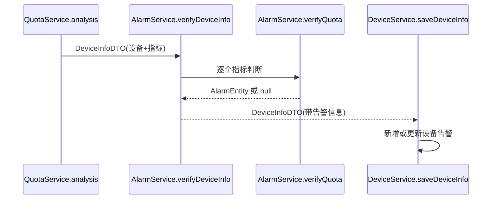

# 亿可控指标解析收尾与告警判断：两级告警封装、两轮测试与设备告警存储开篇

上一篇搭好了 `analysis` 方法的骨架：按主题查指标配置，查不到返回 null。这一篇把设备信息、指标列表的封装补完，让解析真正产出完整的 `DeviceInfoDTO`；接着进入第三章告警判断与存储——`verifyQuota` 判单指标、`verifyDeviceInfo` 封装两级告警信息，用两轮单元测试验证 1.2 与 12 的差别，最后开出设备告警信息保存的头：`saveDeviceInfo` 查设备、判开关、决定新增还是更新。

## 先给结论

- 解析方法四步走：`baseMapper.selectBySubject(topic)` 查配置（复用继承自 ServiceImpl 的 baseMapper，QuotaMapper 里已用 `@Select` 按 subject 扩展好查询）→ 封装设备（取第一条配置的 snKey，再从报文 Map 里取设备 ID，`Strings.isNullOrEmpty` 逐层校验）→ 循环配置封装指标 → 组装 `DeviceInfoDTO` 返回。
- 指标值封装要分两种：非数值（String、Boolean）存 `stringValue`、`value` 存 0；数值要区分 JSON 带引号与不带引号——`instanceof String` 判断，带引号先转字符串再 `Double.valueOf`，不带引号直接转换，两种情况 stringValue 都同步存。
- `BeanUtils.copyProperties(quota, quotaDTO)` 一句话拷贝指标配置，改过名的属性（quotaName）额外补一次 set。
- 告警与指标是多对一：`verifyQuota(QuotaDTO)` 返回 `AlarmEntity`（不告警返回 null）；用现成的 `getByQuotaId` 查规则（内部已按告警级别降序排列），循环匹配操作符 `>`、`<`、`=`，命中即赋值并 break；字符串/布尔指标只能判等于，用 `stringValue` 与阈值 equals。
- `verifyDeviceInfo` 传入解析结果、返回同一个对象但填满告警信息：指标级 `alarm` 用字符串 "0"/"1" 而非布尔（后续要写入 InfluxDB，布尔转换麻烦），外加 alarmName、level、alarmWebhook、cycle；设备级 `alarm` 是布尔，先设初始值（false、正常、级别 0、在线 true），只有告警实体的级别更高才更新——设备最终保留最高级别的告警。
- 测试准备一条"温度过高"告警（指标 ID 1、大于 10、二级、cycle 10 分钟、webhook 暂空）：值 1.2 不告警（全 0/正常），值 12 触发告警（设备 true/温度过高/级别 2，指标 alarm=1 带钩子和沉默周期）。收尾开篇 `saveDeviceInfo`：查设备判开关，关闭直接返回 false，查不到走 `esRepository.addDevice` 新增，查到走 `updateDeviceAlarm` 更新告警。

## 一、指标解析收尾：设备封装、指标循环与三种取值形态

`analysis` 的实现整体四块：获取指标配置、封装设备信息、封装指标列表、组装返回。配置查询不用自己写——`QuotaMapper` 里已经扩展好了：

```java
@Mapper
public interface QuotaMapper extends BaseMapper<QuotaEntity> {
    @Select("select * from tb_quota where subject=#{subject}")
    List<QuotaEntity> selectBySubject(String subject);
}
```

`QuotaServiceImpl` 继承了 ServiceImpl，直接用 `baseMapper` 调用即可，传入主题返回指标配置列表；列表为空说明主题没登记过，没有解析的必要，直接返回 null。

第二步封装设备信息，核心是拿到设备 ID。设备 ID 的 key 存在指标配置里：`snKey = quotaList.get(0).getSnKey()`——列表有很多条记录，取第一条即可，因为同一主题下的配置理论上 snKey 是一致的。拿 snKey 到报文 Map 里提设备 ID，两处都要做空校验：snKey 是 null 或空串返回 null，提出来的 deviceId 为空也返回 null，这个值就是设备编号。不为空就构建 `DeviceDTO` 并 `setDeviceId`。

第三步封装指标列表，逻辑是循环指标配置，到报文里去找对应的值：

```java
List<QuotaDTO> quotaDTOList = new ArrayList<>();
for (QuotaEntity quota : quotaList) {
    String quotaKey = quota.getValueKey();          // 指标值对应的 key
    if (!payloadMap.containsKey(quotaKey)) {
        continue;                                   // 报文里没有这个指标，忽略
    }
    QuotaDTO quotaDTO = new QuotaDTO();
    BeanUtils.copyProperties(quota, quotaDTO);      // 拷贝指标配置
    quotaDTO.setQuotaName(quota.getQuotaName());    // 改过名的属性单独补 set
    // ……指标值封装
    quotaDTO.setDeviceId(deviceId);
    quotaDTOList.add(quotaDTO);
}
```

配置属性用 `BeanUtils.copyProperties` 一次拷贝，省掉一堆 set；个别命名对不上的（指标名称改成了 quotaName）再单独补。值不存在就忽略这条配置，不存在告警误报的可能。

指标值封装是这段代码最有嚼头的地方，分数值与非数值两类。非数值（String、Boolean）没有数值可言：`stringValue` 存内容，`value` 存 0 占位。数值类反而要多想一层——报文里温度可能直接是数字 1.2，也可能 JSON 封装时带了引号写成 "1.2"，提取时要区分：

```java
if ("String".equals(quotaDTO.getValueType())
        || "Boolean".equals(quotaDTO.getValueType())) {
    // 非数值：value 存 0，内容进 stringValue
    quotaDTO.setStringValue(payloadMap.get(quotaKey).toString());
    quotaDTO.setValue(0.0);
} else {
    if (payloadMap.get(quotaKey) instanceof String) {
        // JSON 里带了引号的数字，先取字符串再转 Double
        quotaDTO.setValue(Double.valueOf((String) payloadMap.get(quotaKey)));
        quotaDTO.setStringValue((String) payloadMap.get(quotaKey));
    } else {
        // 本身就是数字，直接转换
        quotaDTO.setValue(Double.valueOf(payloadMap.get(quotaKey).toString()));
        quotaDTO.setStringValue(payloadMap.get(quotaKey).toString());
    }
}
```

最后组装返回：`new DeviceInfoDTO()`，`setDevice(deviceDTO)`、`setQuotaList(quotaDTOList)`，整体返回，解析方法完成。

写完立刻测。新建测试类 `TestQuota`，`@SpringBootTest(classes = YkkApplication.class)` 加 `@RunWith(SpringRunner.class)`，注入 `QuotaService`，手工构建报文 Map 调用 `analysis("temperature", map)`，结果用 `JsonUtil.serialize` 序列化成 JSON 打印便于观察：

```java
@Test
public void testAnalysis() {
    Map<String, Object> map = new HashMap<>();
    map.put("sn", "123456");
    map.put("temp", 1.2);                       // 第一种：不带引号的数字
    DeviceInfoDTO deviceInfoDTO = quotaService.analysis("temperature", map);
    String json = JsonUtil.serialize(deviceInfoDTO);
    System.out.println(json);
}
```

输出里设备信息在前，指标是个集合（quotaList），集合里前半部分是数据库中的指标配置，重点看值：`value` 是 1.2，`stringValue` 是 "1.2"，数值形态解析正常。第二轮把 temp 改成带引号的 "1.2" 再跑，同样正常解析——引号分支生效。第三轮把指标的 valueType 改成 String 再测，`value` 变成 0，内容进了 stringValue。三种形态全部符合预期，解析逻辑收尾完成。

## 二、告警判断：从 verifyQuota 到 verifyDeviceInfo 的两级封装

解析解决了"指标是什么、值是多少"，但拿到温度之后的最终目的是告警判断。判断要有依据：添加告警界面事先配置好规则——告警名称、报警指标（下拉选温度还是湿度）、报警阈值（大于/小于/等于加数值，比如温度高于 10 度或低于 -10 度告警）、报警级别（严重/一般）。界面上还有两个字段先按下不表：webhook 是透传用的（把告警通知给外部系统），沉默周期约束外部通知的频率——周期内重复收到同一告警就忽略，超过周期再通知；这两者都与数据透传相关，本节先做判断和告警状态存储。

实现思路两条：一是编写封装告警判断逻辑的方法，返回告警信息；二是把带告警信息的设备对象存进 Elasticsearch——ES 里存的是设备信息，而设备信息包含告警，是否告警、什么告警、告警级别都要落到设备信息上。整体链路串起来是这样：



第一级是单一指标的判断。`AlarmService` 接口新增方法定义，返回告警实体类 `AlarmEntity`（告警配置表对应的实体），不告警返回 null：

```java
/**
 * 根据指标判断告警信息
 * @param quotaDTO 单个指标
 * @return 命中的告警，null 表示不告警
 */
AlarmEntity verifyQuota(QuotaDTO quotaDTO);
```

实现第一步是根据指标 ID 查告警判断规则。告警和指标是多对一——一个指标可能配置多个告警，所以要查全部；现成的 `getByQuotaId` 方法内部做了 lambda 筛选并按告警级别排序，级别高的排前面，保证同时命中高低两级告警时以高的为主。拿到列表后循环匹配：

```java
@Override
public AlarmEntity verifyQuota(QuotaDTO quotaDTO) {
    List<AlarmEntity> alarmEntityList = this.getByQuotaId(quotaDTO.getId());
    AlarmEntity alarm = null;
    for (AlarmEntity alarmEntity : alarmEntityList) {
        // 数值指标：操作符与指标值对比
        if (">".equals(alarmEntity.getOperator())
                && quotaDTO.getValue() > alarmEntity.getThreshold()) {
            alarm = alarmEntity;
            break;
        }
        if ("<".equals(alarmEntity.getOperator())
                && quotaDTO.getValue() < alarmEntity.getThreshold()) {
            alarm = alarmEntity;
            break;
        }
        if ("=".equals(alarmEntity.getOperator())
                && quotaDTO.getValue().equals(alarmEntity.getThreshold())) {
            alarm = alarmEntity;
            break;
        }
    }
    return alarm;
}
```

三个操作符里，大于、小于直接比较数值，等于必须用 `equals`，不能用 `==`。这整套值比较有个前提：指标是数值型。所以外面还要套一层 `valueType` 判断——是 String 或 Boolean 就走另一个逻辑：字符串没法比大小，只能判断是否相等，`alarmEntity.getOperator()` 为 "=" 且 `quotaDTO.getStringValue().equals(阈值)` 时命中。最终返回 alarm，null 就是没有告警。

第二级是整包判断。传进去解析出来的 `DeviceInfoDTO`（只有设备和指标，没有告警），返回的还是这个对象，但每个指标和设备本身都带上了告警信息——方法叫 `verifyDeviceInfo`，同样放在 `AlarmService` 里。它做两份封装。

先封装指标告警。循环 `deviceInfoDTO.getQuotaList()`，对每个指标调用刚写好的 `verifyQuota`。命中告警时要把告警信息写进指标，但之前定义的 `QuotaDTO` 没考虑告警，先改造它加五个属性。有个细节值得记住：是否告警这个字段不用布尔而用字符串——"0" 不告警、"1" 告警。原因是要把这些内容写进 InfluxDB，布尔类型会带来一堆转换麻烦，字符串一步到位；告警级别同样用字符串（实体里是 Integer，set 时拼个空串转一下）。于是封装代码是：

```java
AlarmEntity alarmEntity = verifyQuota(quotaDTO);
if (alarmEntity != null) {                                   // 存在告警
    quotaDTO.setAlarm("1");
    quotaDTO.setAlarmName(alarmEntity.getAlarmName());       // 告警名称
    quotaDTO.setLevel(alarmEntity.getLevel() + "");          // 级别转字符串
    quotaDTO.setAlarmWebhook(alarmEntity.getWebhook());      // 告警钩子（透传用）
    quotaDTO.setCycle(alarmEntity.getCycle());               // 沉默周期
} else {                                                     // 不存在告警
    quotaDTO.setAlarm("0");
    quotaDTO.setAlarmName("正常");                            // 传空串或"正常"都行
    quotaDTO.setLevel("0");
    quotaDTO.setAlarmWebhook("");
    quotaDTO.setCycle(0);
}
```

不告警的分支也要认真封装——后续查询展示时每个指标都有确定的告警状态，而不是一片 null。

再封装设备告警。设备同样要存告警，因为后续要按"有告警/没告警"查询设备。先把设备对象从 `DeviceInfoDTO` 里提出来，给它设初始值，假设不告警：`setAlarm(false)`、`setAlarmName("正常")`、`setLevel(0)`、在线状态 `setOnline(true)`。注意设备这里的 alarm 是布尔值，和指标里的字符串 "0"/"1" 不是一回事。然后做级别比较：当前告警实体的级别（`getLevel().intValue()`）大于设备当前存的级别时才更新——等于或小于都不动。这个规则的落点是：设备最终保留最高级别的告警。举例，设备有两个指标，温度一级告警、湿度二级告警，设备存的一定是二级这个高级别的。更新时存三样：告警实体的级别、告警标记 true、告警名称（从实体里提出来）。指标封装完、设备也封装完，把对象原路返回。

## 三、两轮测试与设备告警信息保存开篇

告警逻辑要测，先备基础数据。指标库里已有温度指标，把它的 valueType 改成 Double；还缺一条告警数据，用测试脚本"添加告警"来添：名称"温度过高"，指标 ID 填 1（关联温度指标），运算符大于、阈值 10（高于 10 度即告警），级别二级警告，cycle 设 10（10 分钟的沉默周期），webhook 是向外告警的地址、暂设空字符串；脚本里无用的 time 字段直接去掉。启动工程后执行脚本，返回 true，查库能看到这条告警记录，数据就绪。

测试代码不用另起炉灶，接着之前的 `TestQuota` 写：`analysis` 的返回值刚好是 `verifyDeviceInfo` 的入参，注入 `AlarmService`，把两个方法串起来，输出最终对象：

```java
DeviceInfoDTO deviceInfoDTO = quotaService.analysis("temperature", map);
deviceInfoDTO = alarmService.verifyDeviceInfo(deviceInfoDTO);   // 告警信息封装
System.out.println(JsonUtil.serialize(deviceInfoDTO));
```

第一轮：值保持 1.2。规则是大于 10 才告警，1.2 显然不触发。执行后看输出：设备级 alarm 是 false、名称正常、告警级别 0；指标级封装同样全是正常状态——不告警的链路符合预期。

第二轮：把 1.2 改成 12，大于 10 命中条件，必然告警。测试通过（绿色），输出里设备告警为 true、告警名称"温度过高"、告警级别 2；指标部分 alarm 是 1，同样带出"温度过高"、级别 2，告警钩子和沉默周期也都列了出来。两级封装、两轮测试，告警判断逻辑没有问题。

逻辑有了、数据也有了，接下来是把设备的告警信息保存下来。设备服务里新增方法 `saveDeviceInfo`，返回布尔值，入参是从解析结果中提出来的 `DeviceDTO`——此时它已经包含告警信息（是否告警都带了）。实现思路三步：先查询设备并判断开关状态，开关是关的就不处理直接返回；查不到设备说明这条报文是该设备第一次发来的，走新增；查得到就更新告警信息：

```java
@Override
public boolean saveDeviceInfo(DeviceDTO deviceDTO) {
    // 查询设备，目的是判断开关状态
    DeviceDTO device = findDevice(deviceDTO.getDeviceId());
    if (device != null && !device.getStatus()) {
        return false;                        // 设备已存在且开关关闭，不处理
    }
    if (device == null) {
        esRepository.addDevice(deviceDTO);   // 查不到：新增
    } else {
        updateDeviceAlarm(deviceDTO);        // 查得到：更新告警信息
    }
    return true;
}
```

其中 `findDevice` 按 ID 查询，`addDevice` 和 `updateDeviceAlarm` 都是第一章已经写好的 ES 仓储方法，这里直接复用。保存环节把解析、判断、存储串成一条线，设备告警数据的落库就有了入口。

## 小结

这一篇完成了两条主线。解析主线：`analysis` 补齐设备封装（snKey 取首条配置、报文提 ID、空校验兜底）与指标循环封装（copyProperties 拷配置、containsKey 过滤、数值/非数值与带引号/不带引号两两分支），单元测试覆盖 1.2、"1.2"、String 类型三种形态全部通过。告警主线：`verifyQuota` 以指标 ID 查多对一的规则列表、按操作符与值类型分流匹配；`verifyDeviceInfo` 给指标补上字符串型 "0"/"1" 的告警五件套，给设备按"级别更高才更新"的规则保留最高级别告警；两轮测试（1.2 不告警、12 告警）验证闭环，`saveDeviceInfo` 以开关判断与存在性判断分流新增和更新，把告警状态写进 Elasticsearch 的入口打开。下一篇继续设备告警保存的实现与联测。
