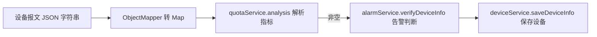

# 亿可控第二章收束：告警保存、EMQ Webhook 与断连监控

第二章「指标数据采集与断连监控」走到最后一程。设备报文的处理链还差最后两环：告警判断与落库保存，补完之后整体跑一遍验证；指标之外，设备自身的在线状态也需要监控，断网、断电导致设备不可用时必须及时掌控，这一半靠 EMQX 自带的 Webhook 插件把连接与断开事件主动推给亿可控。本篇按代码收尾、全链路测试、Webhook 机制、断连监控落地与测试的顺序推进，第二章就此收束。

## 先给结论

- messageArrived 收尾三步：ObjectMapper 把 JSON 报文转成 Map，交给 quotaService.analysis 解析指标；解析结果非空时 alarmService.verifyDeviceInfo 做告警判断，最后 deviceService.saveDeviceInfo 保存设备信息。
- 全链路测试用 EMQX 的 Websocket 页面模拟设备发报文、Kibana 查 ES 验证：温度 12 度（阈值高于 10 度）触发告警，降到 8 度自动恢复正常。
- 设备文档只保存当前最新的告警状态，历史告警不做保存。
- 断连监控靠 EMQX 的 Webhook 插件：事件发生时以 POST 单向通知配置好的 web 地址，不关心返回结果。
- 落地路径：DeviceController 新增 /device/clientAction 接收事件并在认证过滤器中放行；修改 emqx_web_hook.conf 的 api.url 指向宿主机地址，只保留 client.connected、client.disconnected 两条规则，重启容器生效。
- clientId 前缀过滤：webclient 开头是系统前端、monitor 开头是亿可控服务端，都不更新在线状态；其余按 action 分派 true/false 写回 ES。

## messageArrived 收尾：解析、告警、保存一条链

保存设备信息的基础逻辑完成后，改造 EMQ 包下的 EmqMsgProcess 类。它实现了 MqttCallback 接口，messageArrived 方法就是接收设备报文的入口；connectionLost 负责连接断开后的重连：重新 connect 一次，并把所有主题重新订阅一遍（quotaService.getAllSubject().forEach），异常用 try-catch 捕获 MqttException。

报文拿过来是 JSON 字符串，而指标解析逻辑需要的是 Map，中间要做一次转换。用 Jackson 提供的 ObjectMapper：new 一个实例，readValue(payload, Map.class) 得到 payloadMap，JSON 字符串到 Map 的转换就完成了。

转换完调用指标服务。quotaService.analysis 的第一个参数是主题 topic，第二个是 payloadMap，返回值是 DeviceInfoDTO。注意这一步只解析指标，并不包含告警信息，告警判断是另一条逻辑：注入 AlarmService，在解析结果非空的前提下调用 verifyDeviceInfo，返回值可以直接覆盖原来的 DTO 对象；为空则什么都不用做，直接忽略。

最后注入 DeviceService，调 saveDeviceInfo，参数取 deviceInfoDTO.getDevice()，把 DTO 里的设备属性提出来保存。整条链路如下：

```java
@Override
public void messageArrived(String topic, MqttMessage mqttMessage) throws Exception {
    String payload = mqttMessage.getPayload();
    System.out.println("收到消息：" + payload);
    ObjectMapper mapper = new ObjectMapper();
    Map payloadMap = mapper.readValue(payload, Map.class);
    DeviceInfoDTO deviceInfoDTO = quotaService.analysis(topic, payloadMap);
    if (deviceInfoDTO != null) {
        deviceInfoDTO = alarmService.verifyDeviceInfo(deviceInfoDTO);
        deviceService.saveDeviceInfo(deviceInfoDTO.getDevice());
    }
}
```



## 全链路测试：12 度告警，8 度恢复

代码写完要整体测一遍。打开两个 web 环境：Kibana 负责查 ES 中的数据，EMQX 负责发报文。Kibana 先执行查询，当前只有一条设备数据，处于不告警状态。

启动亿可控，服务随即开始监听数据库中配置的温度主题。告警规则是高于 10 度就告警，所以构造一条 12 度的报文：

```json
{"sn":"123456","temp":12}
```

发送方式不用单元测试，而是走 EMQX 管理界面的 Websocket 工具页（Host 192.168.200.128，Port 8083，Path /mqtt）：先 Connect，主题从数据库复制过来，正文写上面的报文后点发送。这样真实模拟了一台设备发报文、EMQ 接过来、后端处理的完整链路。

```sql
GET /devices/_search
{
  "query": { "match_all": {} }
}
```

发送后控制台收到消息，切回 Kibana 再查，设备的告警信息跟着变更。接着把温度降下来再发一条 8 度的报文，解析后不再满足告警条件，再查一次，设备恢复正常。两轮对比能看出一个设计口径：设备文档只保存当前最新的告警状态，历史发生过什么告警并不保存。

## EMQ Webhook：连接与断开事件的推送机制

设备断网怎么掌控？思路是知道设备什么时候断开、什么时候连接，然后去更改 ES 里存储的在线状态。技术选型是 EMQ 自带的插件 Webhook：发生某件事时，向某个 web 服务地址发通知。链路是 Client（每台设备或亿可控项目）连接 EMQ，EMQ 借助 emqx_web_hook 插件请求一个 Web Server，也就是亿可控自身的某个 controller 地址。客户端断开了，EMQ 自动触发通知；设备连上了，同样通知。注意通知是单向的：只告知一次，不关心返回结果，接收方没有必要返回任何内容。

Webhook 的配置在 etc/plugins/emqx_web_hook.conf。进入 EMQX 容器查看（镜像是精简系统，用 sh 而不是 bash）：

```bash
docker exec -it emqx /bin/sh
cat /etc/plugins/emqx_web_hook.conf
```

文件里有三块需要了解。第一块是 web.hook.api.url，通知目标的 web 地址，默认 http://127.0.0.1:8080，之后要改成亿可控某个 controller 的地址。第二块是 web.hook.encode_payload 编码设置，默认注释，设备报文是二进制、需要编码时才启用（base64），本项目接收的全是字符，不用管。第三块是事件规则：

```ini
# 事件规则：事件名.序号 = {"action": "固定动作值", "topic": "可选过滤主题"}
web.hook.rule.client.connect.1 = {"action": "on_client_connect", "topic": "a/b/c"}
web.hook.rule.client.connected.1 = {"action": "on_client_connected", "topic": "foo/#"}
```

规则格式的拆解：前缀 web.hook.rule. 固定；事件名分两段，前半段是分类（client 客户端类、session 会话类、message 消息类），后半段是具体事件名；末尾序号用于区分多条规则，从 .1、.2 往下排；action 的值基本固定，是提交给 web 地址的动作标识，接收方靠它分辨发生了什么事件；topic 可选，限定事件只在某主题下触发，支持 # 通配符，foo/# 也能匹配 foo/aa 这类主题。

| 事件 | 含义 |
|---|---|
| client.connect | 处理连接报文 |
| client.connack | 下发连接应答 |
| client.connected | 成功接入 |
| client.disconnected | 连接断开 |
| client.subscribe / client.unsubscribe | 订阅 / 取消订阅主题 |
| session.subscribed / session.unsubscribed | 会话订阅 / 取消订阅主题 |
| message.publish | 消息发布 |
| message.delivered | 消息投递 |
| message.acked | 消息回执 |
| message.dropped | 消息丢弃 |

马上要用的是 client.connected 和 client.disconnected 两个，其余了解即可，用到时查表。Webhook 插件默认关闭，在 EMQ 管理界面的 Plugins 页找到 WebHook，状态默认 stopped，点击 Start 开启。

## 落地：clientAction 接事件，updateOnline 写状态

第一步在 DeviceController 新增方法，即 EMQ 要调用的 web 地址。EMQ 的通知是 POST 请求，所以用 @PostMapping("/clientAction")；报文体以 @RequestBody Map<String, String> 接收。至于 EMQ 到底传了什么，第一步先原样打印出来看。

这个地址由 EMQ 调用，不能加 token 验证，要去认证过滤器里把 /device/clientAction 这个地址排除掉。

第二步修改 EMQ 配置。进容器编辑 emqx_web_hook.conf，api.url 不能保留默认的 127.0.0.1：容器所在机器是 192.168.200.128，127.0.0.1 指的是这台 Linux 虚拟机，而亿可控程序运行在 Windows 宿主机上。在宿主机用 ipconfig 查出无线网地址 192.168.3.4，虚拟机里 ping 该地址确认连通，端口取亿可控工程启动的 9093：

```ini
web.hook.api.url = http://192.168.3.4:9093/device/clientAction
```

规则只保留连接与断开两条，其余全部用 # 注释掉。:wq 保存，退出容器后重启 emqx 容器让配置生效。

先测通知能不能进来。启动亿可控，清空控制台，在 EMQX Websocket 页面点连接：控制台输出一串参数，其中 clientId 与页面上的 Client ID 一致，页面上改它提交值也会跟着改；action 等于 client.connected，表示客户端连接上了。点断开连接，又收到一条消息。后续处理就基于这些 parameter 参数来做。

第三步封装更新在线状态的逻辑方法。设备相关逻辑放在 DeviceService：定义 void updateOnline(String deviceId, Boolean online)。实现里有两个细节。其一，除了设备连 EMQ，还有两类客户端也会连：系统前端（clientId 以 webclient 开头）和亿可控服务端（以 monitor 开头），这两种不执行该逻辑，用 startsWith 判断后直接 return。其二，先 findDevice 查设备，返回 null 就直接返回不做处理；非空才调用第一章写好的 esRepository.updateDevicesOnline 更新状态。

```java
@Override
public void updateOnline(String deviceId, Boolean online) {
    // 以webclient开头的client为系统前端，monitor开头的是亿可控服务端
    if (deviceId.startsWith("webclient") || deviceId.startsWith("monitor")) {
        return;
    }
    DeviceDTO deviceDTO = findDevice(deviceId);
    if (deviceDTO == null) return;
    esRepository.updateDevicesOnline(deviceId, online);
}
```

第四步回过头改写 controller。从 param 提取 clientId 作为设备 ID，再按 action 分派：

```java
@PostMapping("/clientAction")
public void clientAction(@RequestBody Map<String, String> param) {
    System.out.println(param);
    String deviceId = param.get("clientId"); // 获取设备ID
    if (param.get("action").equals("client_connected")) {
        deviceService.updateOnline(deviceId, true); // 设备上线
    }
    if (param.get("action").equals("client_disconnected")) {
        deviceService.updateOnline(deviceId, false); // 设备离线
    }
}
```

综合测试：启动亿可控，现有测试数据只有一条设备，编号 123456。在 EMQX 的 Websocket 工具里模拟这台设备做连接与断开，Client ID 改成 123456，对 EMQ 来说 Client ID 就是设备 ID。点连接后再查 Kibana，online 仍为 true；点断开后再查，online 字段变成 false。用 EMQ 自带的工具就能模拟设备的连网与断网，断连监控整条链路测试完成。

## 小结

第二章至此收束，两条链路都通了：报文链在 messageArrived 里从解析、告警到保存写入 ES；连接链由 Webhook 把 client.connected、client.disconnected 事件转成设备在线状态。

- ObjectMapper.readValue(payload, Map.class) 完成报文转 Map；analysis 只管指标，告警判断在 verifyDeviceInfo，保存只取 DTO 里的 device 属性。
- 设备文档是最新快照：只保存当前告警状态与在线状态，历史不落库。
- Webhook 是单向通知：api.url 必须写成接收方能被容器访问到的地址（本例 192.168.3.4:9093），插件默认关闭，要在 Dashboard 的 Plugins 里 Start。
- 事件规则按 web.hook.rule.事件.序号 配置，action 是接收方识别事件的依据，topic 可选过滤并支持 # 通配符。
- webclient、monitor 前缀的客户端是前端与服务端自己，不属于设备，更新在线状态前要先 return 掉。
