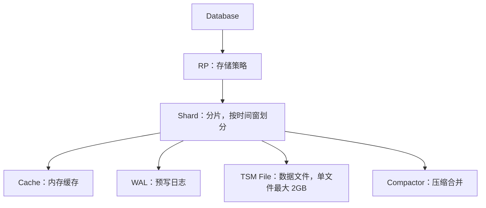

# 指标数据落库 InfluxDB：概念、TSM 存储引擎与亿可控集成

第三章「指标数据持久化与设备详情展示」的主线，是把上一章从 EMQ 接收并解析好的指标数据真正存起来。存储选型在第一章已敲定 InfluxDB，本章先补齐它是什么、怎么操作、为什么快（存储引擎 TSM），再进入工程集成：建库、引依赖、写配置、建 Repository、定义映射实体，最后在报文处理链路里接上保存逻辑，并用双指标报文验证。

## 先给结论

- InfluxDB 是 Go 语言编写的时间序列数据库，属于 NoSQL，提供类 SQL 的查询语言 InfluxQL；亿可控选它的原因：物联网报文高并发写入且不需要更新，MySQL 内部结构相对复杂、写入承载能力有限，扛不住。
- 概念映射三条：database 对应数据库，measurement 对应表，point 对应一行；point 由 time（主索引、自动生成）、tags（有索引、字符串）、fields（无索引、存值）组成。要做查询条件的字段用 tag，最终要查的值用 field。
- 操作上没有单独的建表命令，insert 自动建表；同一 field 列只能存一种类型，与首次插入类型冲突会报 field type conflict。
- 存储引擎 TSM 为自研（此前用过 LevelDB、RocksDB），核心思想是牺牲部分功能换取极致性能：Cache 写内存、WAL 预写日志防丢、TSM 文件面向查询优化（单文件最大 2GB）、Compactor 压缩合并，整体可理解为读写分离。
- 集成路径：命令行建库 ykk → 引入 influxdb-java 2.19.0 → Consul 配置 spring.influx 四项 → InfluxRepository 用 Point.measurementByPOJO 写入 → QuotaInfo 实体以 @Measurement/@Column 映射 → QuotaService.saveQuotaToInflux 循环落库。
- 时区坑：InfluxDB 自动按 UTC 存储，写入时间要在东八区毫秒值上再 plusHours(8)，否则与北京时间差 8 小时，查询会查不到想要的数据。

## InfluxDB 是什么：一张表看懂时序库概念

时间序列数据库对物联网场景的适配来自它的特点。其一，支持高并发写入、不需要更新：设备多、报文多、解析出的指标多，写入非常频繁，而普通 MySQL 内部结构相对复杂，写入效率不高，面对这种写入量肯定撑不住；时间序列数据库牺牲了一些功能，换来更快的写入效率。其二，写入量大意味着每天产生的数据非常多，存储必须有压缩手段。InfluxDB 本身面向物联网行业，是通用的指标采集与监控解决方案。当然不一定非它不可，OpenTSDB、TimeScaleDB 等时间序列数据库都能满足要求，亿可控最终采用的是 InfluxDB。

概念与传统数据库的对应关系只有三条：

| InfluxDB 概念 | 传统数据库概念 |
|---|---|
| database | 数据库 |
| measurement | 表 |
| point | 表中的一行 |

point 内部又分三部分，这是与传统数据库最大的差异：传统库里都是列（有的是主键有的不是），InfluxDB 把一行拆成了三块。

| point 属性 | 含义 |
|---|---|
| time | 数据记录的时间，主索引，默认自动生成 |
| tags | 有索引的列，只能存字符串类型 |
| fields | 没有索引的列，存具体值，类型支持字符串、浮点（Double）、整数、布尔；field value 总是与 timestamp 相关联 |

tag 和 field 怎么选？要把某个字段当查询条件、要对它做检索，就放 tag；它不是条件而是最终要查出来的值，就用 field。看真实数据更直观：

```sql
> select * from test
name: test
time                alarm deviceId level quotaName unit value
159281355973300000  false 1        0     name1     温度  0
159281355973800000  false 2        0     name2     温度  1
```

time 和想象中的时间格式不一样，是一串长整型数值；alarm、deviceId 这些筛选用的是 tag 列，value 是 field 值列。

## 基本操作：insert 自动建表，field 类型不可混存

环境里已带 influxdb 容器，docker ps 确认后进容器，influx 命令进入命令行，出现 > 提示符即成功：

```bash
docker exec -it influxdb /bin/bash
influx
```

数据库操作与 SQL 风格一致：show databases 查看所有库（_internal 是系统内置库）、create database test1 建库、drop database test1 删库、use test 切换当前库。

InfluxDB 没有 table 概念，取而代之的是 measurement，功能与传统数据库的表相同，可以直接称它为表。show measurements 查看所有表；没有单独的新建表命令，插入数据时自动建表。insert 的语法结构值得拆开看：

```sql
insert disk_free,hostname=server01 value=442221834240i
insert disk_free,hostname=server01 value=442221834240i 1435362189575692182
```

表名后紧跟逗号接 tag 键值对，多个 tag 用逗号分割；空格之后写 field 键值对；整型值末尾加 i 表示 integer；行尾可以再跟一个时间戳，不指定就自动补当前时间。插入后 select * from disk_free 查询，语法与 SQL 一样：第一列是时间戳，然后是 tag 列，后面是 field 值列。field 列名不一定叫 value，可以随便起；字段还能随时扩充，插入时多写一个新列，查询结果就多出一列。

field 值有四种类型：字符串、布尔、浮点（double）、整型（integer）。一个值得实测的问题：同一列能不能混存不同类型？disk_free 里已有三条 value 为整型的数据，往 value 里插一条字符串（字符串要用双引号引起来），直接报错：

```sql
ERR: partial write: field type conflict: input field "value" on measurement "disk_free" is type string, already exists as type integer dropped=1
```

而换一个新列 value=1i,sv="abc" 就能成功，查询多了 sv 列。结论：一个 field 只能存一种类型，且必须与第一次插入的类型一致，第一次插入时就建立了结构。tag 部分则不用加引号，写什么都会被当作字符串；field 要识别类型，字符串必须用双引号。测试完 drop measurement disk_free 删表收尾。

## 存储引擎 TSM：牺牲功能换性能的读写分离

InfluxDB 采用自主研发的存储引擎 TSM（Time-Structured Merge Tree）。此前它用过 LevelDB 和 RocksDB，使用过程中发现一些问题，最终决定自研。TSM 最核心的思想：牺牲掉一部分功能来提升性能，把性能做到极致优化。



RP（retention policy）是存储策略：InfluxDB 每天不停接收大量数据，总有一天把磁盘占满，而一年前的监控数据对用户没什么价值，所以允许用户自定义保留最近多长时间，之前的数据定期清理，有点像 Redis 的过期时间。每个数据库初始会自动创建默认存储策略 autogen，数据保留时间为永久；用户可以自己改（例如只保留最近 2 小时）；插入和查询时未指定存储策略就用默认策略。

Shard 是分片，一个逻辑概念而非真正的组件，按时间窗的范围选择不同分片保存，各分片之间相对独立。分片下有四个组件：

- **Cache**：内存缓存。往内存写速度最快，InfluxDB 存储快的原因就是写入过程实际是向 Cache 写。
- **WAL**：预写日志（Write-Ahead Log）。内存一旦崩溃数据会丢，所以同步写一份到磁盘兜底；它的格式与 Cache 完全相同，Cache 丢了可以从中恢复。WAL 是写优化格式，写入就是 append 追加到固定大小的段，速度很快，但不利于查询。
- **TSM File**：真正存数据的文件，单个最大 2GB，自定义格式，针对查询性能和压缩做了大量优化。
- **Compactor**：压缩组件，负责把不够优化的 Cache 和 TSM 转换成读取更优化的格式：压缩数据、清除已删除的数据、优化索引、把小文件合并成大文件。

整个结构可以总结成一句话：读写分离。落到磁盘上是三个存储目录：meta 存元数据（meta.db）；wal 目录放预写日志（.wal 结尾，只用于写不用于读）；data 目录放实际数据文件（.tsm 结尾，由前面两种定期整理而来，才是真正存储数据的文件）。

## 亿可控集成：从建库到双指标落库

实现思路五步：在 InfluxDB 中手动建库；在代码中定义与表各列一一对应的数据对象（思想类似 MyBatis-Plus）；定义专门和 InfluxDB 通信的数据访问层；在指标服务里封装保存方法；在接收 EMQ 数据、转换完成的地方添加调用。

第一步终端进 influx 命令行，create database ykk。第二步工程引入依赖：

```xml
<dependency>
    <groupId>org.influxdb</groupId>
    <artifactId>influxdb-java</artifactId>
    <version>2.19.0</version>
</dependency>
```

第三步加配置，在 Consul 配置中心的 spring 节点下：

```yaml
influx:
  db: ykk
  url: http://192.168.200.128:8086
  user: root
  password: root
```

第四步建数据访问层。com.yikekong.influx 包下创建 InfluxRepository，加 @Component，注入 InfluxDB 实例即可直接操作，连接 URL、用户名、密码都由自动化配置实现，不用自己连；再通过 @Value("${spring.influx.db}") 拿到库名：

```java
@Component
public class InfluxRepository {
    @Autowired
    private InfluxDB influxDB;
    @Value("${spring.influx.db}")
    private String dbName;

    public void add(Object object) {
        Point.Builder pointBuilder = Point.measurementByPOJO(object.getClass());
        Point point = pointBuilder
            .addFieldsFromPOJO(object)
            .build();
        influxDB.setDatabase(dbName);
        influxDB.write(point);
        influxDB.close();
    }
}
```

add 方法的逻辑：measurementByPOJO(object.getClass()) 创建一个 Point 行构建器；addFieldsFromPOJO 把对象的所有属性读出来添加为字段，自动构成写入语句；build 得到 Point 实例，一个 Point 就是一行；setDatabase 选择数据库后 write 写入，最后 close。

这里有一个时间上的坑：不给时间时 InfluxDB 会默认给一个时间，但存储时自动按 UTC 时间来存，与北京时间相差 8 小时，查询时会查不到想要的数据。解决办法是显式设置时间：

```java
pointBuilder.time(
    LocalDateTime.now().plusHours(8).toInstant(ZoneOffset.of("+8")),
    TimeUnit.MILLISECONDS);
```

拆开看：ZoneOffset.of("+8") 指定东八区，toInstant 转出来的毫秒值是当前北京时间的正确值；但 InfluxDB 接收时间时会自动再转成 UTC，等于又减了 8 小时，所以在时间上再 plusHours(8)，存储转换减掉的 8 小时刚好抵消，落库的就是北京时间的时间点。

第五步定义映射实体。dto 包下新建 QuotaInfo，@Data 加 @Measurement(name = "quota")，name 就是 InfluxDB 里的表名。字段按业务梳理：设备 ID（指标属于哪个设备）、指标 ID 与指标名称（指标属于哪个指标）、是否告警 / 告警级别 / 告警名称（之后要把告警指标单独筛出来，还会按告警名称和级别筛选）、单位、参考值，再加两个存值的字段：数值指标用 Double，非数值指标用字符串。

```java
@Data
@Measurement(name = "quota")
public class QuotaInfo {
    @Column(name = "deviceid", tag = true)
    private String deviceid; // 设备ID
    @Column(name = "quotaId", tag = true)
    private String quotaId; // 指标ID
    @Column(name = "quotaName", tag = true)
    private String quotaName; // 指标名称
    @Column(name = "alarm", tag = true)
    private String alarm; // 是否告警
    @Column(name = "level", tag = true)
    private String level; // 告警级别
    @Column(name = "alarmName", tag = true)
    private String alarmName; // 告警名称
    @Column(name = "unit", tag = true)
    private String unit; // 单位
    @Column(name = "referenceValue", tag = true)
    private String referenceValue; // 参考值
    @Column(name = "value")
    private Double value; // 数值指标
    @Column(name = "stringValue")
    private String stringValue; // 非数值指标
}
```

@Column 负责字段与列名的映射，tag = true 标记为标签。tag 只能存字符串，所以除最后两个存值字段外全部是 String 类型，是否告警也用 String 存；value 不写 tag，默认就是 false。整型指标也存得下 Double；数值指标存 value，报文上报的非数字指标存 stringValue。

写个单元测试验证。TestInfluxDb 加 @SpringBootTest(classes = YkkApplication.class) 和 @RunWith(SpringRunner.class)，注入 InfluxRepository，构建 QuotaInfo 赋值（设备编号 123456、指标 ID 1、指标名称温度、参考值 0-10、单位摄氏度、存一条告警数据、value 存 double 的 11），调用 add 写入：

```java
@Test
public void testAdd() {
    QuotaInfo quotaInfo = new QuotaInfo();
    quotaInfo.setDeviceId("123456");
    quotaInfo.setQuotaId("1");
    quotaInfo.setQuotaName("温度");
    quotaInfo.setReferenceValue("0-10");
    quotaInfo.setUnit("摄氏度");
    quotaInfo.setAlarm("1");
    quotaInfo.setValue(11d);
    influxRepository.add(quotaInfo);
}
```

测试执行成功无报错，到 influx 命令行 use ykk 后 select * from quota，数据已经存进去了。

接下来封装业务方法。QuotaService 定义 void saveQuotaToInflux(List<QuotaDTO> quotaDTOList)：一条报文可能包含多个指标（温度、湿度一起上报），解析后得到的是指标列表 QuotaDTO。实现里循环列表，每个 QuotaDTO new 一个 QuotaInfo，BeanUtils.copyProperties 拷贝属性；指标 ID 两边属性名不一样（DTO 里叫 id 且是 Integer，QuotaInfo 里叫 quotaId 且是 String），copyProperties 复制不过来，要单独设置 quotaInfo.setQuotaId(quotaDTO.getId() + "")；最后 influxRepository.add(quotaInfo)，add 的必须是带注解的 QuotaInfo，注解映射才能生效。

```java
@Override
public void saveQuotaToInflux(List<QuotaDTO> quotaList) {
    for (QuotaDTO quotaDTO : quotaList) {
        QuotaInfo quotaInfo = new QuotaInfo();
        BeanUtils.copyProperties(quotaDTO, quotaInfo); // 拷贝属性
        quotaInfo.setQuotaId(quotaDTO.getId() + ""); // 指标ID
        influxRepository.add(quotaInfo); // 保存到数据库
    }
}
```

调用点在 EmqMsgProcess 的 messageArrived：解析、告警判断之后，在保存设备信息的旁边再加保存指标数据，分两次保存：

```java
deviceService.saveDeviceInfo(deviceInfoDTO.getDevice());
quotaService.saveQuotaToInflux(deviceInfoDTO.getQuotaList());
```

至此报文从解析到告警判断到保存，一条龙完成。

综合测试加大复杂度：之前只测过单指标报文，这次测两个指标。指标库里已有温度指标，再添加一个湿度指标：单位百分比，主题与温度相同（两个指标共用一个主题），值的 key 用湿度简写 h，类型 double，参考值 10-20（不参与运算），id 为 2。启动亿可控，用 EMQX 的 Websocket 工具连接后发送报文：

```json
{"sn":"123457","temp":20,"h":10}
```

sn 用新设备 123457；温度 20，超过告警表中大于 10 的阈值会触发告警；湿度 10。发送成功后查 InfluxDB：之前只有单元测试写入的一条记录，再次查询多了两条，其中温度那条带告警、值为 20、单位摄氏度。双指标、共主题的偏复杂报文解析与持久化测试完成。

## 小结

- 概念与操作都围着 point 转：database/measurement/point 对应库/表/行，time 主索引、tag 带索引存字符串、field 无索引存值；insert 自动建表，field 类型一旦确定不可混存。
- TSM 引擎的关键是读写分离：写入走 Cache 加 WAL（快、可恢复），查询走 Compactor 整理出的 TSM 文件（面向查询与压缩优化），RP 决定数据保留多久。
- 集成五步：建库、influxdb-java 依赖、spring.influx 配置、InfluxRepository（measurementByPOJO + addFieldsFromPOJO）、@Measurement/@Column 实体映射。
- 时间必须显式设置并 plusHours(8) 补偿 UTC，否则落库时间与北京时间差 8 小时。
- 保存链路在 messageArrived 里分两笔：设备信息进 ES，指标列表循环转 QuotaInfo 后进 InfluxDB；多指标共主题报文实测两条记录同时落库。
