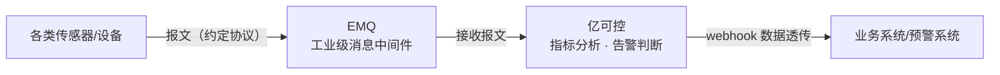
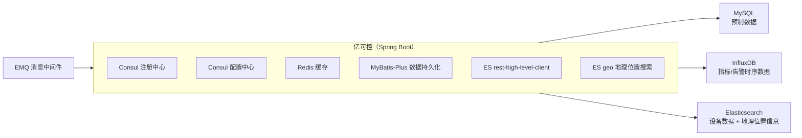

# 亿可控开篇：物联网全景与亿可控需求、业务架构、系统架构

亿可控是一个物联网行业项目，动手写代码之前，第一章把三件事讲清楚：物联网这个行业长什么样、亿可控到底解决什么问题、整个系统的业务与技术架构如何设计。本文按这条主线走一遍：从 IoT 的定义与三层技术架构，到亿可控的中台定位、六大业务模块，再到"一个 Spring Boot + 三种数据库"的选型理由。

## 先给结论

- 物联网（Internet of Things，缩写 IoT）指通过信息传感设备、按约定协议把任何物体接入网络，实现智能化识别、定位、跟踪、监管；技术上都分为感知层、网络传输层、应用层三层，后端开发主要工作在应用层。
- 物联网不是独立行业，而是渗透进智能家居、智慧交通、智能电网、智慧城市等各行各业；市场数据逐年上升，但消费级物联网仍处初级阶段。
- 亿可控提取的是所有物联网行业的通用需求——对设备上报的指标进行分析与预警，不做具体业务功能，夹在硬件与业务系统之间，是一个中台项目。
- 数据链路为：传感器 → EMQ（工业级消息中间件）→ 亿可控 → 业务系统；告警触发后通过 webhook 数据透传给外部系统，亿可控自己不做发短信、发邮件这类具体处理。
- 业务上分六大模块：图形监控、数据详情、看板管理、设备管理、报警管理、系统管理；其中设备不做手动增删改，靠报文解析自动添加。
- 技术选型用 Spring Boot 而非 Spring Cloud（中台业务单一），存储用 MySQL（配置类预制数据）+ InfluxDB（指标时序数据）+ Elasticsearch（设备数据），再加 Redis 缓存共四种。

## 物联网是什么：从一块温度传感器说起

物联网的官方定义是：通过信息传感设备，按约定的协议，将任何物体与网络相连接，物体通过信息传播媒介进行信息交换和通信，以实现智能化识别、定位、跟踪、监管等功能。定义里有几个词值得拆开看，拿冷链仓库举例最直观。

冷链仓库存放生鲜、雪糕等必须冷冻冷藏的商品，靠制冷设备维持低温。制冷设备谁也不敢保证永不出故障，但物联网能做到的是：故障发生后第一时间知道。仓库里放一个温度传感器，持续采集环境温度，封装打包成报文（通常就是一个 JSON）通过网络发到中央服务器。服务器收集每个仓库的温湿度，一旦指标超出安全值（比如上限零下十度，实际已升到零下七八度），系统自动触发报警逻辑，比如发短信通知工作人员检查设备。

这个例子对应物联网应用中的三项关键技术：感知层负责感知环境（温度、湿度传感器），网络传输层负责把数据传出去，应用层负责可视化展现与分析。前两层由硬件解决，后端开发做的正是应用层。

再看物联网涉及的四个知识领域，它们彼此交叠、并非孤立：

| 领域 | 含义 | 典型例子 |
| --- | --- | --- |
| 两化融合 | 工业化和信息化的融合，以信息化带动工业化、以工业化促进信息化，核心是信息支撑 | 国家层面的新型工业化道路 |
| M2M | Machine to Machine，数据从一台终端传送到另一台终端，机器与机器的对话 | 自动抄表，仪器一扫水表数据就传到机器上 |
| RFID | 射频识别，阅读器与标签之间非接触式数据通信 | 食堂饭卡、门禁卡、二代身份证 |
| 传感网 | 由传感器组成的网络 | 物联网最初涉及的领域，其余领域由它演变而来 |

发展历史上，1999 年中国提出的概念叫"传感网"，中科院当年就启动了传感网研究，起点处于世界前列；2005 年 11 月国际电信联盟 ITU 发布《ITU 互联网报告》，第一次正式提出物联网概念；2009 年中国移动总裁王建宙在公开演讲中再度提到物联网。

应用领域方面，智能家居（智能音箱、智能灯、智能锁、扫地机器人等，依托 WiFi、Zigbee、蓝牙、NB-IoT 等技术）解决"住"的问题，智慧交通（车联网实现人车路互联、实时路况避堵、手机查公交还有几站）解决"行"的问题，此外还有智能电网、智慧城市（民生、环保、公共安全、城市服务等），以及智能汽车、智能建筑、智能水务、智能农业、智能安防、智能医疗等众多方向。市场规模同样在逐年上升：

| 指标 | 数据 |
| --- | --- |
| 全球物联网市场规模 | 2008 年 500 亿美元 → 2018 年 1510 亿美元，年均复合增速 11.7% |
| 我国物联网市场规模 | 2012 年 3650 亿元 → 2017 年 11650 亿元，年均复合增长率 25% |
| 全球物联网行业渗透率 | 2013 年 12% → 2017 年 29%，预计 2020 年超 65% |
| 全球消费级 IoT 市场 | 2015 年 3063 亿美元 → 2022 年预计 15502 亿美元，年均复合增速 26.0% |
| 中国消费级 IoT 市场 | 2015 年 715 亿美元 → 2022 年预计 3118 亿美元，年均复合增速 21.3% |

一句话概括：消费级物联网蓬勃发展，但仍处于初级阶段，行业新兴、潜力巨大。

## 亿可控的定位：夹在硬件与业务系统之间的中台

不管物联网涉猎哪个领域，都有一个共同点：有设备、有传感器。对设备运行状态和采集指标进行分析、预警，几乎是所有物联网行业的共同需求。亿可控解决的就是这个通用需求，不做具体行业的业务功能，只做在线监测与设备预警——所以它是一个中台项目，处在硬件和业务系统之间。

整条数据链路长这样：

传感器把报文发给 EMQ，EMQ 再发给亿可控——亿可控与硬件之间通过 EMQ 连接。拿到报文后，亿可控做两件核心的事。

第一是指标分析。报文按特定格式传来，但格式可以在亿可控里动态自定义：指定报文中哪个字段是温度值、哪个是湿度值、哪个是设备编号，系统按设置把值提取出来。

第二是预警。指标（如温度）超过设定的安全值就触发预警，但亿可控本身并不实现报警的具体逻辑，而是向一个可自定义的地址发送请求，把告警通知给另一个系统处理，这叫数据透传。

按官方口径，亿可控的核心功能有四块：报文数据采集与指标分析、报警监控（触发告警后通过关联配置的 webhook 透传到其它系统）、GPS 定位监控、自定义数据看板。

## 业务架构：六大功能模块与几个关键设计

业务架构图把整个系统划分为六大功能模块：

| 模块 | 子功能 | 说明 |
| --- | --- | --- |
| 图形监控 | 实时监控、设备分布、异常设备监控 | 图表监控设备地理分布、设备指标与异常设备 |
| 数据详情 | 设备状态、指标信息、报警信息 | 查看每个设备的运行状态与各指标，数据来自报文解析，本质是查询 |
| 看板管理 | 选择看板、自定义看板 | 自定义看板后在图形监控中展示报表 |
| 设备管理 | 设备管理、指标管理 | 设备只查不改，靠报文解析自动添加；指标管理定义解析规则 |
| 报警管理 | 报警日志、报警管理 | 预设报警规则，达标自动报警，日志可查 |
| 系统管理 | 系统设置 | 管理员密码修改等通用功能 |

模块之下有几个关键设计：

设备自动添加。设备管理里没有新增、修改设备的入口：物联网设备数量太多（比如共享单车动辄几百万台），靠人工一个个加不现实。设备编号固化在硬件里，随报文发过来，系统解析后查询——库里没有就自动添加。设备列表里能人工操作的只有标签筛选和一个开关：开关关掉即置为不可用状态，系统不再接收该设备的任何报文。标签在界面上也没有写入功能，而是以接口形式暴露给其他系统调用。

指标解析规则。报文怎么解析必须有规则，指标管理就是定义规则的地方：指标名称（如温度）、单位（如摄氏度）、报文主题（从 EMQ 的哪个主题提取指标）、指标值字段类型（整数、小数、布尔、字符串可选）、指标值字段（JSON 的哪个 key 是指标值）、设备识别码字段（设备 ID 从哪个字段取）、webhook 地址、安全值。注意安全值不参与运算、只做显示参考，真正起告警作用的是报警管理。另有一类特殊的 GPS 指标：单字段（经纬度挤在一个字段里、以分隔符隔开，需指定字段和分隔符）或多字段（分别指定经度、纬度字段）两种取法。

告警规则与沉默周期。同一指标允许配置多条告警规则，按区间区分：比如温度大于 -10 低于 0 叫"温度较高"，大于 0 小于 10 叫"温度过高"，名称可自定义。每条规则包含告警名称、关联指标、webhook、报警阈值（大于/小于/等于某值触发）、告警级别（一般/严重两级）和沉默周期。沉默周期是个很实际的机制：报文上报频率可能很高，两分钟、五分钟就报一次，若每次都通知对用户是持续干扰——周期内重复的相同报警不再提交 webhook，超过周期才再次发送。

首页与看板。产品原型（托管在 Mockplus 上）的首页集中了系统的可视化能力：设备总数与报警设备数、设备状态饼图（原型中正常 88%、离线 10%、报警 2%）、地图上的设备分布（原型共 22,100 个设备）、异常设备列表、异常趋势图、异常数量 TOP10。指标趋势动态表支持多设备同图对比，时间范围可选一小时、一天或七天。这些图表一部分系统内置，一部分由用户通过"添加看板"自定义：起名称、选指标（单选）、选设备（多选但有数量限制，否则图表看不清）、选时间范围，预览确认后配置存入数据库，首页随之展示。

## 系统架构：Spring Boot 单体中台与三库分工

需求说完进入设计。系统架构图上，左侧是 EMQ，接收大量设备上报的数据，亿可控从 EMQ 把数据接过来，做报文解析、报警判断等处理：

技术栈里最值得说的是两点。其一，底层框架用 Spring Boot 而不是 Spring Cloud——亿可控不是复杂业务系统而是中台，业务单一，用不着微服务全家桶。其二，Consul 身兼两职：作为注册中心可搭建亿可控集群；作为配置中心让配置变更更灵活，程序上线后要改配置，改配置中心就够了。此外 Redis 缓存频繁访问的数据以提高运行稳定性，MyBatis-Plus 做持久层，ES 侧用 rest-high-level-client 操作 Elasticsearch、用 ES geo 搜索一定范围内的设备坐标（支撑首页地图）。

存储层是"三种数据库 + Redis"的组合，分工明确：

| 存储 | 存什么 | 为什么 |
| --- | --- | --- |
| MySQL | 预制数据：报警规则、指标解析规则等配置 | 数据量极小，需要完整增删改查 |
| InfluxDB | 设备上报的指标数据、告警数据 | 时序数据库，支持高频高并发写入、查询分析效率高；但只能追加不能改删，恰好指标数据只写只查 |
| Elasticsearch | 设备数据、设备地理位置信息 | 设备量可能非常庞大且搜索频繁，放 MySQL 不合适 |
| Redis | 频繁访问的数据 | 缓存，提高稳定性与响应速度 |

为什么指标数据不进 MySQL？设备一多、上报频率一高，指标数据量近乎几何级增长，关系型数据库的写入和存储压力都扛不住。那为什么不干脆全用 InfluxDB？因为它只能追加和查询，不能改删，凡需要增删改查的功能都胜任不了。于是形成互补：小而需改的配置进 MySQL，海量只写只查的指标进 InfluxDB，海量要搜的设备数据进 ES。

## 小结

这一章没有代码，但把后面所有开发的坐标系立起来了：亿可控是做设备指标监测与预警的物联网中台，上游通过 EMQ 对接硬件报文，下游通过 webhook 向业务系统透传告警；设备靠报文解析自动入库，指标靠规则驱动解析，告警靠阈值加沉默周期控制噪音；技术上是一个 Spring Boot 单体，配 Consul、Redis，数据按特性分流到 MySQL、InfluxDB、Elasticsearch。接下来的章节进入落地：建库建表、环境与配置中心、核心代码解析，以及第一个功能——添加设备。
