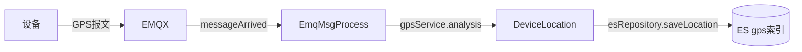

# 设备GPS信息采集：MQTT订阅、单双字段解析与geo_point距离搜索基础

亿可控第五章要做"设备分布"地图：每台设备按经纬度钉在地图上，绿色代表正常、红色代表告警、灰色代表离线，点开弹窗还能看到设备编号、状态、温度、湿度、经纬度和上报时间。要把设备钉上去，前提是后端先把设备自动上报的 GPS 数据采集入库——这些信息不靠人工录入，而是随报文自动上报。GPS 在报文里就是一种特殊指标：走同一条 MQTT 链路，但要单独解析、单独存储，之后才能按位置搜索。本篇覆盖采集入库的完整链路（订阅 → 解析 → 保存），以及地理距离搜索的 ES 基础与 Java 封装。

## 先给结论

- GPS 本质是设备报文里的一个特殊指标，复用既有的 MQTT 接收链路，但要单独解析、单独写入 Elasticsearch 的 `geo_point` 字段。
- `geo_point` 必须在建索引时显式声明，动态映射识别不了地理位置；写入支持三种格式——字符串"纬度,经度"、对象 `{"lat":…,"lon":…}`、数组 `[经度,纬度]`，字符串和数组的经纬度顺序正好相反。
- GPS 解析规则集中在 MySQL 表 `t_gps`，id 固定为 1，读写都走这一条记录；订阅要做两处：GPS 配置更新时重新订阅、系统启动时初始化订阅，都用 `$queue/` 共享订阅，为集群做准备。
- 解析方法 `analysis` 四步走：读规则 → 读设备 ID → 提取 GPS（单字段按分隔符拆分、双字段分别取值）→ 封装 `DeviceLocation`；设备报文是经度在前，ES 存储要求纬度在前，必须颠倒。
- 入库用 `IndexRequest` 写 gps 索引，文档 ID 就是设备编号：同 ID 覆盖更新，ID 不存在则自动新增。
- 距离搜索对应 ES 的 `geo_distance` 查询：DSL 指定 distance 与中心点；Java 端用 `GeoDistanceQueryBuilder` 封装，结果限定 `from(0)`、`size(200)`。

## 一、需求分析与geo_point：ES里怎么存经纬度

先明确两个核心问题：信息从哪来、往哪存。设备分布数据不能手工录入，只能由设备自动上报——GPS 其实也是一个报文，和温度、湿度这些指标一样从 MQTT 主题发上来，只是它需要特殊处理、单独做一份存储。存好之后，前端从存储介质里把坐标查出来，调百度地图或高德地图的 API 把点画上去即可；地图选型是前端的事，后端只负责把数据准备好。

实现思路两条：一是解析设备报文，判断这条数据是不是 GPS 指标数据（GPS 通常会有专门的主题，从主题里把数据提出来）；二是如果是，就解析出经纬度并存储到 Elasticsearch。所以 GPS 功能拆成两小节：采集（订阅、解析、保存）和搜索（按位置查设备列表）。

存储的第一步是建索引。经纬度构成地球表面的一个点，知道这个点就能算距离、判断是否落在某个区域内。能不能直接当字符串存？写入当然可以，但建索引时必须显式声明字段类型为 `geo_point`——只有声明了这个类型，ES 才认为它是地理位置，后续才能使用地理搜索那一整套功能：

```json
PUT /gps
{
  "mappings": {
    "properties": {
      "location": {
        "type": "geo_point"
      }
    }
  }
}
```

Kibana 里执行返回 `acknowledged: true`，gps 索引就建好了。写入文档支持三种形式，经纬度顺序各不相同：

| 写入格式 | 示例 | 经纬度顺序 |
| --- | --- | --- |
| 字符串 | `"40.715, -74.811"` | 纬度在前，经度在后，逗号分割 |
| 对象 | `{"lat": 40.722, "lon": -73.989}` | lat 是纬度、lon 是经度，键名固定，谁前谁后无所谓 |
| 数组 | `[-73.983, 40.719]` | 经度在前，纬度在后，与字符串正好相反 |

三种格式各存一条验证：

```json
PUT /gps/_doc/100001
{
  "location": "40.715, -74.811"
}

PUT /gps/_doc/100002
{
  "location": {
    "lat": 40.722,
    "lon": -73.989
  }
}

PUT /gps/_doc/100003
{
  "location": [-73.983, 40.719]
}
```

`GET gps/_search` 能查到这三条，说明三种写法都被正确识别为 geo_point。字符串与数组的顺序相反，这个坑后面解析代码里还要再踩一次。

## 二、主题订阅：t_gps规则表与两个订阅时机

GPS 怎么解析、从哪个主题收，规则都放在 MySQL 表 `t_gps` 里：

| 字段 | 含义 |
| --- | --- |
| id | 主键，固定为 1，不可改变 |
| subject | GPS 报文的 MQTT 主题 |
| sn_key | 设备编号在报文里的键名 |
| single_field | 布尔值：true 单字段，false 双字段 |
| value_key | 单字段模式下，坐标所在的键名 |
| separation | 单字段模式下，经纬度的分隔符（一般是逗号，可自定义） |
| longitude / latitude | 双字段模式下，经度、纬度各自的键名 |

单双字段是兼容不同设备的设计：有的设备把坐标放在一个字段里传，如 `"116.404,39.915"`；有的设备则把经度、纬度分成两个键分别传。表里只有一条数据且 id 固定为 1，前端"指标管理 → GPS 指标设置"入口读出的就是这条记录，改完点确认再写回去，读写都按 id=1 走。对应的 `GpsService` 只有两个方法：`getGps()` 固定按 id=1 读，`update()` 不管前端传来的 id 是多少都强制改成 1 再保存——没有增删，也没有其他查询。

订阅要在两个时机做。第一个是 GPS 配置更新时：用户在界面上改了主题，就得按新主题重新订阅，写在 `update()` 里：

```java
@Override
public boolean update(GPSEntity gpsEntity) {
    try {
        emqClient.subscribe("$queue/" + gpsEntity.getSubject());
        System.out.println("订阅GPS主题：" + gpsEntity.getSubject());
    } catch (MqttException e) {
        e.printStackTrace();
    }
    gpsEntity.setId(1);
    return this.updateById(gpsEntity);
}
```

第二个是系统启动时：只写在 update 里，启动阶段没人改配置就不会执行。之前的 `Monitor` 类里已有 `@PostConstruct` 的 `init()` 方法负责普通指标订阅，在它后面追加 GPS 订阅即可：

```java
GPSEntity gpsEntity = gpsService.getGps();   // 读取GPS配置，主要用它的主题
try {
    emqClient.subscribe("$queue/" + gpsEntity.getSubject());
} catch (MqttException e) {
    e.printStackTrace();
}
```

两处都加了 `$queue/` 前缀做共享订阅——后续可能做集群，共享订阅能保证同一条消息在多个实例间只有一个收到。订阅完成后测试：启动工程，控制台先打印"初始化方法，订阅主题"；再打开 EMQ 的 WebSocket 工具（Host `192.168.200.128`，Port `8083`）连接后向 gps 主题发一条报文，主题 gps、内容 `{"sn":"100001","gps":"71.222,-81.333"}`。`EmqMsgProcess` 的 `messageArrived` 里已有打印逻辑，控制台能看到接收到的报文，订阅就验证通过了。

## 三、报文解析与入库：analysis四步与saveLocation

整条采集链路串起来是这样：



第一步先定义封装对象 `DeviceLocation`，加 `@Data` 并实现序列化接口，两个属性：`deviceId`（设备编号）和 `location`（坐标字符串，约定逗号分割、纬度在前——与 ES 字符串格式的顺序对齐）。

第二步写解析方法。在 `GpsService` 里定义 `DeviceLocation analysis(String topic, Map payloadMap)`，参数与普通指标解析一致。物联网发来的报文可能只有指标、只有 GPS，也可能两者都有，所以在 `EmqMsgProcess.messageArrived` 里追加第三块逻辑：前两块分别负责接收报文转 Map、解析指标并完成告警判断与设备/指标保存，第三块调 `gpsService.analysis(topic, payloadMap)`，结果不为空就打印"GPS解析结果"（先打到控制台验证，下一步再入库）。

`analysis` 的实现分四步：读规则、读设备 ID、提取 GPS、封装返回。规则就是 `getGps()` 读出的配置，读出来后层层校验：配置为 null 返回 null；主题为空（`Strings.isNullOrEmpty`）返回 null；报文主题与配置的 subject 不相等（`!topic.equals(...)`）也返回 null，主题对不上就没必要往下走。设备 ID 按规则里的 sn_key 从报文 Map 里取，取不到同样返回 null——连设备编号都没有，提取 GPS 也没意义。核心的提取 GPS 分两种情况：

```java
String location = null;
if (gpsEntity.getSingleField()) {
    // 单字段：按配置的分隔符拆分
    String gps = (String) payloadMap.get(gpsEntity.getValueKey());
    if (Strings.isNullOrEmpty(gps)) return null;
    String[] split = gps.split(gpsEntity.getSeparation());
    if (split.length == 2) {
        // 报文是"经度,纬度"，存储要"纬度,经度"，颠倒顺序
        location = split[1] + "," + split[0];
    }
} else {
    // 双字段：分别取纬度、经度再拼接
    String lat = (String) payloadMap.get(gpsEntity.getLatitude());
    String lon = (String) payloadMap.get(gpsEntity.getLongitude());
    if (!Strings.isNullOrEmpty(lat) && !Strings.isNullOrEmpty(lon)) {
        location = lat + "," + lon;
    }
}
if (location == null) return null;
```

单字段拆分后长度不等于 2 就是不正常数据，不做封装；这里特别注意顺序：物联网报文习惯经度在前、纬度在后，而 ES 存储是纬度在前，所以要颠倒。双字段则两个值都非空才拼接。最后封装返回：`new DeviceLocation()`，`setDeviceId`、`setLocation`，返回对象，解析完成。

解析写完立刻测试，分两轮。第一轮双字段：`t_gps` 里 single_field 值为 0（双字段），向 gps 主题发经纬度分开两个键的报文，控制台先收到报文、再看到解析结果，数据正常解析。第二轮单字段：把值改成 1（单字段），改配置要重启服务才能生效，再发 `{"sn":"100001","gps":"71.222,-81.333"}` 这种单字段报文——注意报文里经度在前，解析结果里两个值已经颠倒成纬度在前。

第三步入库。在 ES 包的 `ESRepository` 里加 `saveLocation(DeviceLocation)` 方法，用 `IndexRequest` 写 gps 索引：

```java
public void saveLocation(DeviceLocation deviceLocation) {
    IndexRequest request = new IndexRequest("gps");
    request.id(deviceLocation.getDeviceId());      // 设备编号就是文档ID
    request.source(JSONUtil.toJsonStr(deviceLocation), XContentType.JSON);
    try {
        restHighLevelClient.index(request, RequestOptions.DEFAULT);
    } catch (IOException e) {
        log.error("更新GPS异常：{}", e.getMessage());
    }
}
```

文档 ID 取设备编号，索引只有一个 location 字段，ID 之外就是坐标。`EmqMsgProcess` 里解析结果不为空时调用 `esRepository.saveLocation(deviceLocation)`，存储就接上了。验证：先在 Kibana `GET gps/_search` 记下 100001 现有坐标，启动工程后从 EMQ 重发报文，再查——100001 的坐标已被更新，且和上报值是颠倒关系（上报"经度,纬度"，存储"纬度,经度"）。这个方法既更新也新增：再发一条文档里不存在的 100004，查询时它也出现了，index 语义天然就是"存在则覆盖、不存在则创建"。

## 四、地理距离搜索：geo_distance与Java封装

采集入库不是最终目的，最终目的是在地图上标记设备。后端最关键的能力是：给定一个坐标点（地图中心点）和一个半径，把范围圈的设备查出来交给前端——这正是 ES 地理距离过滤器 `geo_distance` 的活：以给定位置为圆心画一个圈，返回坐标落在圈内的文档。

先在 Kibana 里验证 DSL：

```json
GET gps/_search
{
  "query": {
    "geo_distance": {
      "distance": "1km",
      "location": {
        "lat": 40.722,
        "lon": -73.989
      }
    }
  }
}
```

`distance` 是半径，可写 `1km` 也可写 `1km` 对应的 `1000m`；中心点 location 用对象形式给 lat、lon（字符串、数组、对象三种写法都可以）。以 100002 的坐标为圆心查 1km，命中两条：一条是圆心自身，另一条距离不远也在圈内；把半径缩到 100m 就查不到了——范围之外的文档不会命中。之后的 Java 代码本质上就是对这个查询的封装。

在 `ESRepository` 里新增方法，参数三个：纬度 lat、经度 lon、公里数 distance，返回 `List<DeviceLocation>`。套路和之前的查询一样，两大步：构建查询、封装结果。

```java
public List<DeviceLocation> searchDeviceLocation(Double lat, Double lon, Integer distance) {
    SearchRequest searchRequest = new SearchRequest("gps");
    SearchSourceBuilder searchSourceBuilder = new SearchSourceBuilder();
    GeoDistanceQueryBuilder queryBuilder = new GeoDistanceQueryBuilder("location");
    queryBuilder.distance(distance, DistanceUnit.KILOMETERS);   // 半径，单位公里
    queryBuilder.point(lat, lon);                               // 圆心
    searchSourceBuilder.query(queryBuilder);
    searchSourceBuilder.from(0);
    searchSourceBuilder.size(200);                              // 最多200条
    searchRequest.source(searchSourceBuilder);
    // ……执行查询与封装结果
}
```

`GeoDistanceQueryBuilder("location")` 实例化时传字段名——坐标字段是自定义的，得告诉构建器查哪个字段；`distance` 第一个参数是数值、第二个是单位，这里选公里；`point` 指定圆心纬度和经度。这三行对应的就是 DSL 里 `geo_distance` 的那几行。查询结果特别多时一万个点铺在地图上根本看不清，所以不管命中多少，只取前 200 条（`from(0)`、`size(200)`）。

封装结果部分：

```java
try {
    SearchResponse searchResponse = restHighLevelClient.search(searchRequest, RequestOptions.DEFAULT);
    SearchHits hits = searchResponse.getHits();
    if (hits.getTotalHits().value <= 0) {
        return Lists.newArrayList();                // 没有命中，返回空集合
    }
    List<DeviceLocation> deviceLocationList = Lists.newArrayList();
    Arrays.stream(hits.getHits()).forEach(h -> {
        DeviceLocation deviceLocation = new DeviceLocation();
        deviceLocation.setDeviceId(h.getId());      // 文档ID即设备编号
        deviceLocation.setLocation(h.getSourceAsMap().get("location").toString());
        deviceLocationList.add(deviceLocation);
    });
    return deviceLocationList;
} catch (IOException e) {
    e.printStackTrace();
}
return Lists.newArrayList();
```

`getHits()` 返回的是数组不是集合，没有现成的 stream 方法，要用 `Arrays.stream(...)` 转流再 forEach。每个命中封装一个 `DeviceLocation`：设备编号取 `h.getId()`，坐标从 `getSourceAsMap()` 里按字段名 location 取出再 `toString`。异常时返回空集合。

最后单元测试验证。在 `test.es` 测试类里加 `testESGO`，调用 `esRepository.searchDeviceLocation(40.722, -73.989, 10)`——参数和刚才 DSL 测试一致，只是半径放大到 10 公里——结果用 `JsonUtil.serialize` 打印，控制台输出的两条数据与 DSL 查询结果完全一致，按地理位置搜索的方法就完成了。

## 小结

这一篇把 GPS 采集入库的链路走通了：`t_gps` 一张规则表驱动订阅与解析，配置更新与系统启动两个时机做 `$queue/` 共享订阅，`analysis` 四步解析出"纬度,经度"的 `DeviceLocation`，`saveLocation` 以设备编号为文档 ID 写入 geo_point 索引，index 语义同时覆盖更新与新增。最容易出错的两处：一是 geo_point 的三种写入格式里字符串"纬度在前"、数组"经度在前"，顺序相反；二是设备报文习惯"经度在前"，入库前必须颠倒。距离搜索这边，`geo_distance` 以圆心加半径圈定文档，Java 端 `GeoDistanceQueryBuilder` 逐层封装，并限定最多返回 200 条。下一篇接着做位置搜索的收尾（Service 整合 ES 与 InfluxDB、分页），再进入指标、告警、断连、GPS 四类数据透传。
