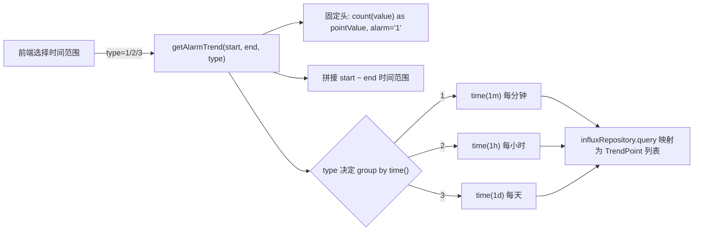

# 看板统计四件套：设备数量/状态分布/实时监控统计与告警趋势（InfluxDB 时间分组）

亿可控第四章"报表分析"从首页统计做起。首页要回答两类问题：一是"现在怎么样"——设备总数多少、正常/离线/报警各占多少、报警设备有几台；二是"趋势如何"——异常告警随时间怎么变化。前一类全部从 Elasticsearch 数出来就能满足，后一类必须到 InfluxDB 里按时间分组统计。本篇按依赖顺序过完这四件套：三个 count 方法是底座，饼图和数字卡片直接调它，告警趋势则另起一条 InfluxDB 的线。

## 先给结论

- 设备数量统计全部在 ES 完成：CountRequest + restHighLevelClient.count()，全量用 matchAllQuery；离线、告警用 BoolQueryBuilder 加 termQuery 条件。
- 告警数只统计"在线且告警"的设备：离线已经单独算过，饼图各块数量不能重复；正常运转数也不用单独统计，总数减离线减告警即是。
- ECharts 饼图要的数据就是 [{name, value}] 数组：value 直接给实际数量，百分比前端自动算，三块加起来不必等于 100。后端做一个通用 PieVO，之后所有饼图都能复用。
- /report/statusCollect 返回饼图数据；/report/monitor 返回具体数字（MonitorVO 里 deviceCount、alarmCount 两个值），后者简单到不必过 Service，Controller 直接注入 ESRepository 调用。
- InfluxDB 时间分组三件套：count() 括号里必须写 field 类型字段（写 1 不行，tag 也不行）；precision rfc3339 把时间列从毫秒数调成可读格式；group by time(1m/1h/1d) 按粒度切割，且时间列记录的是区间的开始时间。
- 前端传的时间选项决定分组粒度：type=1 一小时→time(1m)，type=2 一天→time(1h)，type=3 七天→time(1d)；TrendPoint 用 @Measurement 映射 quota 表，count 列加 as pointValue 别名对齐 @Column。

## 设备数量统计：ES 里的三个 count 方法

设备状态统计的需求是：在首页以饼图展示不同状态设备的占比，示例图里正常运转 86%、离线 2%、报警 10%、故障 2%。设备不可避免会出现报警甚至离线，要掌控设备的实时状态，就要把这些状态统计出来以直观方式呈现。实现并不复杂——每个设备的信息已经存在 Elasticsearch 里，状态和是否告警都是现成字段，拿它们当查询条件统计记录数即可。这个统计只涉及 ES，不涉及 InfluxDB。

需要三个方法，都写在 ESRepository 中：统计全部设备数量、统计离线设备数量、统计告警设备数量。全量统计用 ES 提供的 CountRequest——专门做数量统计的请求对象，查询条件用 matchAllQuery 匹配所有记录，通过 RestHighLevelClient 的 count 方法执行：

```java
public Long getAllDeviceCount() {
    CountRequest countRequest = new CountRequest("devices");
    countRequest.query(QueryBuilders.matchAllQuery());
    try {
        CountResponse response = restHighLevelClient.count(countRequest, RequestOptions.DEFAULT);
        return response.getCount();
    } catch (IOException e) {
        e.printStackTrace();
    }
    return 0L;
}
```

CountResponse 的 getCount() 直接返回记录数，异常时返回 0L。离线统计在这个骨架上加条件：用布尔查询构建器 BoolQueryBuilder 的 must 方法加 termQuery，条件是 online 为 false：

```java
public Long getOfflineCount() {
    CountRequest countRequest = new CountRequest("devices");
    BoolQueryBuilder boolQueryBuilder = QueryBuilders.boolQuery();
    boolQueryBuilder.must(QueryBuilders.termQuery("online", false));
    countRequest.query(boolQueryBuilder);
    try {
        CountResponse response = restHighLevelClient.count(countRequest, RequestOptions.DEFAULT);
        return response.getCount();
    } catch (IOException e) {
        e.printStackTrace();
        return 0L;
    }
}
```

告警统计再复制一份修改。这里有个口径问题：告警设备数不包括离线的那部分——饼图的数量不能重复，离线的归离线，告警指在线设备的告警。所以把复制来的 online 条件从 false 改成 true，再追加 alarm 为 true，两个条件一起生效：

```java
// 告警设备数：只统计在线告警，离线部分已单独统计
BoolQueryBuilder boolQueryBuilder = QueryBuilders.boolQuery();
boolQueryBuilder.must(QueryBuilders.termQuery("online", true));
boolQueryBuilder.must(QueryBuilders.termQuery("alarm", true));
```

测试类 TestES 里写 testCount，依次调用三个方法打印：设备总数 62、离线设备 1、告警设备 15，三个方法测试没有问题。

## 状态分布饼图与实时监控数字

有了三个数量，先做设备状态分布饼图。前端图表工具是 ECharts（百度的报表框架，自带丰富的统计图表），后端不用关心前端怎么画，但必须知道前端要什么格式的数据——这是前后端达成的数据格式共识。ECharts 饼图要的是一个集合，每个元素两个属性：name 是扇区名称，value 是具体数值，value 越大占比越高，百分比自动算出，三块加起来不必凑成 100，直接给实际数量就行。对应 API 定义为 GET /report/statusCollect，返回对象数组。

按这个格式定义 VO。建 PieVO（所有饼图都会用到的结构，之后再有别的饼图可以直接复用），加 @Data 注解，就两个属性：name 和 Long 类型的 value：

```java
@Data
public class PieVO {
    private String name;   // 扇区名称
    private Long value;    // 数量
}
```

业务逻辑单独建一个报表服务——之前的 Service 都是业务向的，报表相关逻辑集中到 ReportService 接口与 ReportServiceImpl 实现类（加 @Service 注解），把 ESRepository 注进来。getStatusCollect 的封装逻辑：正常运转那块的 value 用全部减离线、再减告警，剩下来的就是正常运转的数量：

```java
@Override
public List<PieVO> getStatusCollect() {
    Long allDeviceCount = esRepository.getAllDeviceCount();  // 全部设备数量
    Long offlineCount = esRepository.getOfflineCount();      // 离线设备数量
    Long alarmCount = esRepository.getAlarmCount();          // 告警设备数量

    PieVO devicePie = new PieVO();
    devicePie.setName("正常运转");
    devicePie.setValue(allDeviceCount - offlineCount - alarmCount);

    PieVO offlinePie = new PieVO();
    offlinePie.setName("离线");
    offlinePie.setValue(offlineCount);

    PieVO alarmPie = new PieVO();
    alarmPie.setName("报警");
    alarmPie.setValue(alarmCount);

    List<PieVO> pieVOList = Lists.newArrayList();
    pieVOList.add(devicePie);
    pieVOList.add(offlinePie);
    pieVOList.add(alarmPie);
    return pieVOList;
}
```

所有报表相关接口统一放一个 Controller。新建 ReportController，加 @RestController 和 @RequestMapping("/report")，方法用 @GetMapping("/statusCollect") 映射，地址与 API 定义完全一致，注入 ReportService 后直接返回：

```java
@RestController
@RequestMapping("/report")
public class ReportController {
    @Autowired
    private ReportService reportService;

    @GetMapping("/statusCollect")
    public List<PieVO> getStatusCollect() {
        return reportService.getStatusCollect();
    }
}
```

启动亿可控，用 VS Code 测试脚本里"获取设备状态分布"的请求（地址与 Controller 方法一致）send 一下，返回的就是前端需要的格式。

第二件是实时监控数据统计。饼图只能看占比，看不到具体的设备数量和报警设备数量，所以产品在饼图上方又加了一块具体数字。这个功能更简单：三个方法已经有了，按前端要的格式封装即可。先建 MonitorVO（@Data，deviceCount 设备数量、alarmCount 告警设备数），然后在 ReportController 里加一个方法。因为业务逻辑已经写好、这里没有额外的封装逻辑，就不走 Service，直接把 ESRepository 注进来调用：

```java
@GetMapping("/monitor")
public MonitorVO getMonitor() {
    MonitorVO monitorVO = new MonitorVO();
    monitorVO.setDeviceCount(esRepository.getAllDeviceCount());
    monitorVO.setAlarmCount(esRepository.getAlarmCount());
    return monitorVO;
}
```

同样用 VS Code 脚本测 /monitor 这个 API，按前端要求的格式把两个数量返回来。

## 告警趋势：InfluxDB 时间分组统计

异常告警趋势报表是一张折线图：横轴是时间节点，纵轴是异常次数。它体现的是某个时间段内每个时间节点发生的异常数，能看出异常和时间之间的变化规律——图上某个点特别高，说明那个时间节点附近异常非常集中。时间范围有三种选项：一小时按分钟切，60 个节点；一天按小时切，24 个节点；七天按天切，7 个节点。需求细节里还有一条兜底规则：当前分钟/当前小时没有数据时，显示上一次的数据。

数据来自 InfluxDB。异常指标也是一种指标，指标数据都存在 InfluxDB 的 quota 表里并打了告警标记，从中提取告警数据统计即可。最核心的工具是 InfluxDB 的 group by time() 函数——专门做这种按时间段的分组统计，换其他类型数据库实现起来要麻烦得多。动手写代码前，先在 InfluxDB 里把语句调通：通过 Docker 命令进入 InfluxDB 容器，切到亿可控的库。quota 表里已经灌了大量测试数据。count 函数和常规 SQL 相似，但有个区别：count() 里通常写 1 的写法在这里不允许，必须写一个 field 类型的字段，tag 也不行。表里有两个 field——value 和 stringValue，统计用 value；条件加 alarm='1'（等于 1 就是告警），时间范围取九月份：

```sql
precision rfc3339
select count(value) from quota
  where alarm='1' and time>='2020-09-01' and time<='2020-09-30'
  group by time(1d)
```

直接执行的话，time 列显示的是 1970 年 1 月 1 日到现在的毫秒数，没法看。precision rfc3339 是设置时间显示格式的命令，执行后再查，时间就变成 2020-09-01T00:00:00Z 这种 RFC3339 格式，直观得多。还要注意一个语义：时间列记录的是统计区间的开始时间节点——9 月 1 日 0 点那条的数值，是 9 月 1 日 0 点到 9 月 2 日 0 点之间的统计值；22 号那条是 2379，意味着 22 号到 23 号 0 点之间统计出 2379 条，不是"22 号 0 点这一瞬间"的数。

time() 的参数决定切割粒度：1D 按一天一档，2D 两天一档（1 号到 3 号一条），10D 十天一档；时间范围缩到一天后换 1H，每小时一个结果，2H 两小时一档；再换 1M，每分钟一个节点，结果量非常大。落到本需求：前端传一小时就按分钟切，传一天按小时切，传七天按天切。

## 告警趋势的代码封装与测试

把调通的语句封装成功能，分两步。第一步建 DTO 封装查询结果：查询结果是个列表，每个元素两个属性——time 时间字符串和统计值。在 DTO 包下建 TrendPoint（趋势点），实现 Serializable，加 @Data，再用 @Measurement(name = "quota") 映射表名，属性用 @Column 与查询结果的列对应。count 这一列不想叫 count 的话，在查询语句后面加 as 别名即可，这里起名 pointValue（点的值），实体里对应 @Column(name = "pointValue")：

```java
@Data
@Measurement(name = "quota")
public class TrendPoint implements Serializable {
    @Column(name = "time")
    private String time;
    @Column(name = "pointValue")
    private Long pointValue;
}
```

第二步写服务方法。在 ReportService 接口里定义 getAlarmTrend，返回 List<TrendPoint>。参数想一下前端会给什么：开始时间、截止时间，还有时间选项。选项和前端约定好——传 1 代表一小时、2 代表一天、3 代表七天，用 int type 接收。实现里用 StringBuilder 拼接语句：固定不变的查询头做初始串（注意要带 as pointValue，和实体的列名对齐），时间部分拼接 start 和 end，最后一块按 type 决定：

```java
@Override
public List<TrendPoint> getAlarmTrend(String start, String end, int type) {
    StringBuilder ql = new StringBuilder(
            "select count(value) as pointValue from quota where alarm='1' ");
    ql.append("and time>='" + start + "' and time<='" + end + "'");
    if (type == 1) {
        ql.append("group by time(1m)");   // 一小时：按分钟切割
    } else if (type == 2) {
        ql.append("group by time(1h)");   // 一天：按小时切割
    } else if (type == 3) {
        ql.append("group by time(1d)");   // 七天：按天切割
    }
    return influxRepository.query(ql.toString(), TrendPoint.class);
}
```



查询交给注入的 InfluxDBRepository，调用它的 query 方法，把语句字符串和 TrendPoint.class 传进去，结果自动映射成 List<TrendPoint> 返回。

最后做单元测试。新建 TestReport 测试类，所有报表相关的测试都放这里：加 @RunWith(SpringRunner.class) 和 @SpringBootTest(classes = YkApplication.class)，注入 ReportService。测试方法里调 getAlarmTrend，开始时间传 2020-09-01、截止时间传 2020-09-30——这两个时间不是固定的，按你自己实际灌的数据调整。为了看得清楚，循环列表用 JsonUtil.serialize 把每个 TrendPoint 序列化成字符串打印：

```java
@RunWith(SpringRunner.class)
@SpringBootTest(classes = YkApplication.class)
public class TestReport {
    @Autowired
    private ReportService reportService;

    @Test
    public void testAlarmTrend() throws JsonProcessingException {
        List<TrendPoint> trendPointList =
                reportService.getAlarmTrend("2020-09-01", "2020-09-30", 1);
        for (TrendPoint trendPoint : trendPointList) {
            System.out.println(JsonUtil.serialize(trendPoint));
        }
    }
}
```

type 传 1 时按分钟切割，一个月的数据量非常大，输出形如 {"time":"2020-09-29T16:00:00Z","pointValue":0}，每分钟一个节点，多数 pointValue 为 0；改成 2，每小时统计一次，数量少很多，个别时段带数据（22 号）；改成 3，每天统计一次，结果更少。三种粒度的输出都符合预期，告警趋势统计完成，后面再把它加工成前端折线图的格式。

## 小结

这套首页统计的分层很清晰：数据在哪儿，统计就在哪儿做。设备数量、状态、告警标记都在 Elasticsearch，三个 count 方法（matchAllQuery 全量、termQuery 过滤离线、双条件过滤在线告警）就够支撑饼图和数字卡片；数据出口对齐 ECharts 的数据结构——饼图给 [{name, value}]，数字卡片给 MonitorVO，接口统一挂在 /report 下，正常运转数靠总数减法得出。异常告警趋势则换了数据源：InfluxDB 的 quota 表 + group by time() 时间分组，count() 只认 field 字段、precision rfc3339 调时间格式、时间列记的是区间起点这三个细节决定了语句怎么写；代码侧用 TrendPoint 承接查询结果，getAlarmTrend 按前端约定的 type（1/2/3）拼出 time(1m)/time(1h)/time(1d)，单元测试按分钟、小时、天三种粒度逐个验证。
