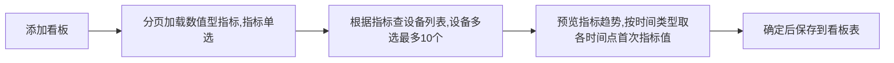

# 异常告警趋势与告警次数 Top10：报表封装与自定义指标看板上半场

亿可控第四章"报表分析"进入实现密集区。异常告警趋势的统计逻辑此前已经调通，但统计结果还是面向 InfluxDB 的原始结构，本篇先把它加工成前端 ECharts 折线图需要的数据格式，顺带处理时间轴的显示格式；随后完成第二个报表"告警次数 Top10 设备指标"，核心是 InfluxDB 的 TOP 函数与嵌套查询；最后铺开自定义指标看板的需求，并完成两个前置查询：数值型指标列表、按指标查设备列表，为看板的指标值序列查询铺路。

## 先给结论

- ECharts 折线图只关心两块数据：x 轴数组与 series 数组。后端做一个通用 LineVO 即可，所有折线图共用，不必每种统计图各建一个 VO。
- InfluxDB 返回的时间是 ISO 格式长串（如 2020-09-01T00:00:00Z），直接放到 x 轴没法看。按 type 用私有方法 formatTime 转成分钟值、小时值或"x月x日"。
- 告警次数 Top10 的查询分两步：内层按设备 ID、指标 ID、指标名称分组做 count，外层用 TOP 函数取前 10 名并倒序。
- InfluxQL 不要求 group by 的列出现在 select 后面，这与标准 SQL 不同；反过来，select 后只写一个 tag、不带任何 field 的查询查不出结果。
- 自定义看板只能选数值型指标（long、integer、double），用 LambdaQueryWrapper 加 or 条件从 MySQL 分页查出；设备列表也不从 Elasticsearch 查全量，要去 InfluxDB 查"上报过该指标"的设备。
- 报表类功能的固定套路：先调通语句，再建 DTO 封装结果，然后写业务方法，最后 Controller 调用。

## 异常告警趋势：折线数据封装与时间格式化

前端图表工具是 ECharts，告警趋势画的是折线图。查官网最简单的折线图实例，左侧配置分三部分：xAxis 里的 data 是 x 轴数据，yAxis 是固定部分，series 是折线上每个点的值。x 轴数组与 series 数组的元素个数一一对应，而 getAlarmTrend 查回来的是包含时间、数值两个属性的 TrendPoint 列表，需要二次加工。

ECharts 折线图的原始配置长这样：

```json
{
  "xAxis": {
    "type": "category",
    "data": ["Mon", "Tue", "Wed", "Thu", "Fri", "Sat", "Sun"]
  },
  "yAxis": { "type": "value" },
  "series": [
    { "data": [820, 932, 901, 934, 1290, 1330, 1320], "type": "line" }
  ]
}
```

整套配置不必由后端提供，前端真正要的只有 x 轴数组和 series 数组两块。所以定义一个通用折线图 VO（LineVO），加 @Data 注解、实现 Serializable，只放两个 List 属性：xData 存 x 轴时间串，series 存每个点的值。Controller 按 API 定义写接口，路径 /report/trend/{startTime}/{endTime}/{type}，type 取 1 按分钟、2 按小时、3 按天：

```java
@GetMapping("/trend/{startTime}/{endTime}/{type}")
public LineVO getQuotaTrendCollect(@PathVariable String startTime,
                                   @PathVariable String endTime,
                                   @PathVariable Integer type) {
    List<TrendPoint> trendPointList = reportService.getAlarmTrend(startTime, endTime, type);
    LineVO lineVO = new LineVO();
    lineVO.setXData(Lists.newArrayList());
    lineVO.setSeries(Lists.newArrayList());
    trendPointList.forEach(t -> {
        lineVO.getXData().add(t.getTime());
        lineVO.getSeries().add(t.getValue());
    });
    return lineVO;
}
```

启动亿可控，用 VS Code 里的"获取告警趋势"脚本测试：startTime 传 2020-09-01 00:00:00，endTime 传 2020-09-30 23:59:59，type 传 3，按天切割正好是这个月的告警趋势；type 传 1 按分钟切，数据量会非常大。

测试通过后还剩一个问题：返回的时间是 2020-09-01T00:00:00Z 这种长串，放到 x 轴上非常难看。需求是：按分钟展示就只返回分钟值；按小时展示返回 0 到 23 的小时值；按天展示要返回"x月x日"，因为 7 天的区间很可能跨月。这类为前端服务的转换逻辑，直接在 ReportController 里写一个私有方法：

```java
private String formatTime(String time, int type) {
    LocalDateTime localDateTime = LocalDateTime.parse(time, DateTimeFormatter.ISO_OFFSET_DATE_TIME);
    if (type == 1) {
        return localDateTime.getMinute() + "";
    } else if (type == 2) {
        return localDateTime.getHour() + "";
    } else if (type == 3) {
        return localDateTime.getMonthValue() + "月" + localDateTime.getDayOfMonth() + "日";
    }
    return time;
}
```

ISO_OFFSET_DATE_TIME 正好对应这种 ISO 格式，先 parse 成 LocalDateTime 再按 type 提取字段；type 不是 1、2、3 时把原串原路返回。调用处改成 lineVO.getXData().add(formatTime(t.getTime(), type))，重启再测：type 传 2、起止时间都改成 22 号当天，x 轴变成 0 到 23 的小时；type 传 1、区间缩到 10 点到 11 点，x 轴变成 0 到 59 的分钟，每分钟的告警统计都能对上。

## 告警次数 Top10：TOP 函数与嵌套查询

第二个报表是告警次数 Top10 设备指标，最终效果是一个横向柱状图：纵轴显示设备编号加指标名称，即"哪台设备的哪个指标"；横轴的柱表示这个设备指标在时间段内的告警次数；只显示前 10 名，按告警次数从多到少排列，界面上提供一小时、一天、七天三个时间范围选项。它的价值在于筛查：告警次数最多，说明这台设备最可能出了问题，需要重点关注。

实现还是熟悉的四步：先在 InfluxDB 里把语句调通，再建实体类封装结果，然后写业务方法，最后 Controller 调用。

第一步是分组统计，算出每个设备指标的告警条数：

```sql
select count(value) as heapValue
from quota
where alarm='1' and time>'2020-09-01' and time<'2020-09-30'
group by deviceid,quotaId,quotaName
```

value 是 field 列，alarm='1' 表示这条数据处于告警状态。按标准 SQL 的习惯，group by 后面的列必须出现在 select 后面，否则报错；InfluxQL 没有这个要求，这是两者一个比较明显的差别。

这个分组结果是中间结果，相当于一张表。要取前 10 名，在它外面再套一层查询，用上 InfluxDB 的特色函数 TOP：

```sql
select top(heapValue,deviceid,quotaId,quotaName,10) as heapValue
from (select count(value) as heapValue from quota where alarm='1' and time>'2020-09-01' and time<'2020-09-30' group by deviceid,quotaId,quotaName)
order by desc
```

TOP 函数的参数有讲究：第一个参数是要排序取值的字段，这里就是内层统计值的别名 heapValue；中间的参数是要显示在结果集里的字段，依次写设备编号、指标 ID、指标名称；最后一个参数是取前几名，取前 10 就写 10。最后 order by desc 倒序，排第一的就是告警次数最多的设备指标。

查询调通后开始封装。结果里的 time 字段报表用不上，真正需要的是统计值、设备 ID、指标 ID、指标名称四列，所以在 DTO 包下新建 HeapPoint：加 @Data 和 @Measurement(name = "quota")，四个字段分别用 @Column 指定列名 deviceid、quotaId、quotaName、heapValue，其中 heapValue 用 Long 类型。

业务方法放在报表服务里，语句太长不便阅读，拆成多段用 StringBuilder 拼接，时间部分用参数替换：

```java
@Override
public List<HeapPoint> getTop10Alarm(String startTime, String endTime) {
    StringBuilder ql = new StringBuilder("select top(heapValue,deviceid,quotaId,quotaName,10) as heapValue ");
    ql.append("from (select count(value) as heapValue from quota where alarm='1' ");
    ql.append("and time>='" + startTime + "' and time<='" + endTime + "' ");
    ql.append("group by deviceid,quotaId,quotaName ) order by desc");
    return influxRepository.query(ql.toString(), HeapPoint.class);
}
```

Controller 里新增 getTop10Alarm 方法，路径 /top10Alarm/{startTime}/{endTime}，两个时间参数用 @PathVariable 接收，方法体一行调用业务方法。界面上"一小时、一天、七天"的选项不需要后端处理：前端选中后会自动换算成开始、结束时间再传参，后端只按时间段统计。用"获取告警top10"脚本把时间改成 9 月 1 号到 9 月 30 号 23:59:59，返回结果里带设备 ID、指标 ID、指标名称和次数，前端拿这份数据就能画出横向柱状图。

## 自定义指标看板：需求与数值型指标列表

指标看板，是看某几台设备的同一个指标在一段时间内的变化规律：监测温度指标、选定若干设备，就有几条线，每条线代表一台设备，每个时间点的值连成曲线，多台设备之间还能横向比较。自定义看板把这个"关注"做成了可配置项：添加看板时填写名称、选择一个指标、再选择多个设备，先预览，确认没问题后点确定，系统把指标、设备和名称存进看板表。看板与当前管理员 ID 绑定，每个管理员可以定制自己的看板，相当于个人专属报表。

有一个取数规则要提前定好：物联网设备发报文有间隔，可能两分钟一次，也可能五分钟一次，不能保证准点（比如 8 月 5 号凌晨零点）刚好有数据。规则是：某个时间点取不到数据，就取这个时间点之后第一次上报的报文值，把它当作这个点的值。按天、按小时、按分钟都照此办理，后面查询指标值序列全靠它。

实现思路对应三块功能：



第一块是获取数值型指标列表。指标有的报数字、有的报非数字，非数字指标没法在图上成点，看板只能选数值型指标。指标定义存在 MySQL，数量可能很多，接口要求分页：GET 方式访问 numberQuota，问号传参 page 和 pageSize，返回分页结果。用 MyBatis Plus 的条件查询实现，QuotaService 里扩展方法：

```java
@Override
public IPage<QuotaEntity> queryNumberQuota(Long page, Long pageSize) {
    Page<QuotaEntity> pageResult = new Page<>(page, pageSize);
    LambdaQueryWrapper<QuotaEntity> wrapper = new LambdaQueryWrapper<>();
    wrapper.eq(QuotaEntity::getValueType, "long")
            .or().eq(QuotaEntity::getValueType, "integer")
            .or().eq(QuotaEntity::getValueType, "double");
    return this.page(pageResult, wrapper);
}
```

数值型有 long、integer、double 三种，三个 eq 之间用 or 连接。Controller 用 @RequestParam 接收分页参数，required 设为 false 并给默认值：page 默认 1，pageSize 默认 10，不传参也能直接请求；查询结果再用自定义 Pager 对象包一层返回。启动工程后用"获取数值指标"脚本测试，不带页码页大小走默认值，查出来的温度、湿度正是两个数值型指标。

## 按指标查设备列表与 first 取值语句

看板选设备时，设备列表不能从 Elasticsearch 查：ES 里是全部设备，但不是每台都上报了所选指标。列出来的应该是"上报过该指标"的设备，所以要到 InfluxDB 里按指标查。

第一版语句直接按指标过滤：

```sql
select deviceid from quota where quotaId='1'
```

执行后查不出任何结果。原因：deviceid 是 tag，select 后面只跟一个 tag 而不带任何 field，这种查询 InfluxDB 不允许，必须至少列出一个 field。把 value 加上（虽然用不上）就能查了，结果集很大，再按设备 ID 和指标 ID 分组：

```sql
select deviceid, value from quota where quotaId='1' group by deviceid,quotaId
```

设备在列表里只要出现一次就够，需要去重。外层套 distinct 做嵌套查询，顺带加 limit、offset 实现分页：

```sql
select distinct(deviceid) as deviceid
from (select deviceid, value from quota where quotaId='1' group by deviceid,quotaId)
limit 10 offset 0
```

分页还需要记录总数，把 distinct 外面包一层 count、去掉 limit 部分：

```sql
select count(distinct(deviceid)) as deviceCount
from (select deviceid, value from quota where quotaId='1' group by deviceid,quotaId)
```

符合条件的设备是 40 个。

把语句封装成业务方法时，两条语句的 from 子句完全一样，先把它单独拼出来，quotaId 用参数替换；再基于它拼列表语句和统计语句，offset 用固定公式 (page - 1) * pageSize 计算：第一页从 0 开始，每页 10 条时第二页从第 10 条开始。列表语句用 QuotaInfo 接收，但最终只需要设备 ID 一列，用 stream 的 map 把 QuotaInfo 里的 deviceId 提出来 collect 成新集合；统计语句用 QuotaCount 接收，这个类里有一个 count 属性，语句里的别名必须是 count：

```java
@Override
public Pager<String> getDeviceByQuota(Long page, Long pageSize, String quotaId) {
    String fromQl = "from (select deviceid, value from quota where quotaId='" + quotaId + "' group by deviceid,quotaId)";
    String listQl = "select distinct(deviceid) as deviceid " + fromQl
            + " limit " + pageSize + " offset " + (page - 1) * pageSize;
    String countQl = "select count(distinct(deviceid)) as count " + fromQl;
    List<QuotaInfo> quotaInfoList = influxRepository.query(listQl, QuotaInfo.class);
    List<String> deviceIdList = quotaInfoList.stream()
            .map(QuotaInfo::getDeviceId).collect(Collectors.toList());
    List<QuotaCount> quotaCountList = influxRepository.query(countQl, QuotaCount.class);
    Pager<String> pager = new Pager<>();
    if (quotaCountList == null || quotaCountList.size() == 0) {
        pager.setTotal(0L);
        pager.setItems(new ArrayList<>());
        return pager;
    }
    pager.setTotal(quotaCountList.get(0).getCount());
    pager.setItems(deviceIdList);
    return pager;
}
```

统计结果为 null 或空集合时，返回一个总数为 0、items 为空集合的空分页对象；不为空时可以放心地取 get(0) 拿到总数。Controller 走 GET /devices，三个参数照旧用 @RequestParam 加默认值。测试脚本"通过指标查询设备列表"里 pageSize 原本是 1000，改成 10，返回总记录数 40、每页 10 条，分页查询完成。

看板功能里最核心的一块，是按设备指标查询指标值序列：前端那条曲线，后端给的其实是线上每个时间点的值，曲线本身由 ECharts 连接。取值语句用上 InfluxDB 的另一个函数 first，先执行 precision rfc3339 让时间以年月日时分秒显示，方便核对结果：

```sql
select first(value) as pointValue from quota
where time>'2020-09-01' and time<'2020-09-30' and quotaId='1' and deviceId='100001'
group by time(1d)
```

first 就是取第一个值：按 1d 分组，每个分组返回当天第一条报文的值，正好落实"准点取不到就取之后第一次上报"的规则。某天完全没有数据，该分组查出 null；示例数据里 22 号第一个值是 32，24 号是 7，25 号是 26。group by time 里写 1d、1h 还是 1m，取决于前端传来的时间选项。这条语句的封装，连同大量 null 值的补全处理，放到下一篇展开。

## 小结

本篇把报表分析的上半场走完。告警趋势用通用 LineVO 承接 ECharts 要的 x 轴与 series 两块数据，formatTime 按 type 把 ISO 时间串转成分钟值、小时值或"x月x日"。告警次数 Top10 的核心是"分组 count 套 TOP 取前 10 再倒序"的嵌套查询，配 HeapPoint DTO 与拼接时间参数的业务方法，前端的一小时、一天、七天选项由前端换算成起止时间。自定义看板立下三条规则：指标只能选数值型、设备必须上报过所选指标、准点取不到就取之后首次上报。数值型指标用 LambdaQueryWrapper 的 or 条件从 MySQL 分页查出，设备列表用 distinct 嵌套查询从 InfluxDB 去重分页，first 函数则为下一篇的指标值序列查询备好语句。
