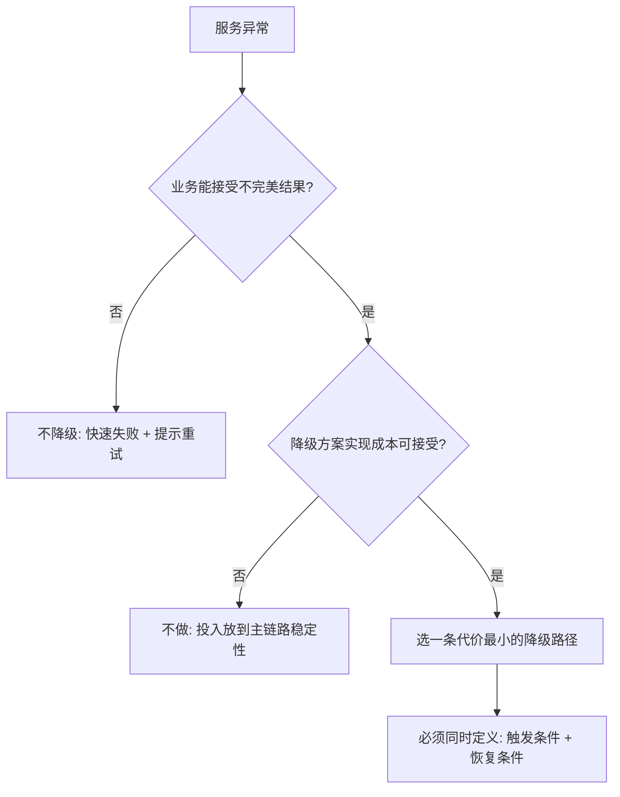
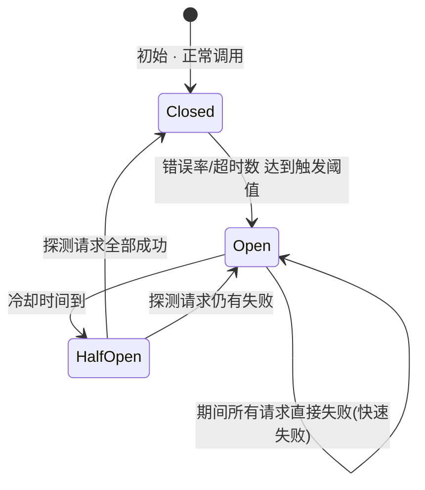

---
title: "8. 服务调用的限频、限流、降级和熔断（三）—— 降级与熔断的落地设计、触发恢复规则与取舍边界"
date: 2026-10-10 07:10:00
categories: [Kubernetes, 微服务]
tags: [降级, 熔断, 触发条件, 恢复条件, 手动降级, 自动熔断, 半开状态, Hystrix, 服务治理]
disableNunjucks: true
---

# 8. 服务调用的限频、限流、降级和熔断（三）—— 降级与熔断的落地设计、触发恢复规则与取舍边界

前两节讲清了"为什么要自保"和"有哪些算法方法"。这一节往前再走一步：落到**工程落地**上——降级方案怎么选才不白做？熔断的触发条件和恢复条件具体怎么定？手动和自动怎么配合？以及最容易被忽略的一点：**什么时候不该降级**。

## 纲要

- 降级的本质是**兜底**："有总比没有好"，但每一条降级路径都是有代价的
- 降级八法的**代价对照**：读旧数据 / PlanB / 默认值 / 放弃部分请求 / 降低质量 / 提高门槛 / 反向过滤 / 补偿服务
- 熔断 = **降级的特殊形态**：简单粗暴地停止调用，且自带恢复探测
- 触发条件与恢复条件必须**成对设计**，只写触发不写恢复等于把服务永久判死
- 手动 vs 自动：**手动兜底 + 自动恢复**是最稳的组合
- 熔断的三种边界情况：半开探测被打爆、误熔断、依赖不可降级

## 一、降级的本质：在不完美里选一种最不痛的

降级解决的是这样一个困境：服务已经异常了，但我们希望**对外看上去还是正常的**、还是有返回的。

它的理念只有一句话：**有总比没有好**——哪怕返回的结果不是那么完美。

因此在设计降级方案之前，必须先回答一个问题：**这个业务能不能接受不完美的结果？**

- 能接受（商品推荐、排行榜、评论数、头像）→ 可以降级，空间很大；
- 不能接受（下单扣款、库存扣减、转账）→ **不能降级**，这类场景降级等于制造脏数据，正确做法是快速失败并提示用户稍后重试。

> 一句话判断标准：**降级后的返回值如果会被写进数据库当成事实，就不要降级。**

## 二、降级八法与各自的代价

课程列了八条常见做法，实际选型时真正起作用的是**代价**那一列：

```dir
降级八法 · 代价对照
├── ① 读旧数据（备份/缓存）
│      代价：数据不是最新的；缓存本身也可能已过期
├── ② PlanB（备用方案/备用系统）
│      代价：开发工作量翻倍，两套逻辑都要维护
├── ③ 默认值（异常直接返回固定值）
│      代价：信息量为零，用户看到的是"占位内容"
├── ④ 放弃部分请求（丢弃一部分流量）
│      代价：被放弃的用户直接失败，需配合重试
├── ⑤ 降低质量（跳过耗时长/计算量大的逻辑）
│      代价：结果精度下降，不要求实时算出全部结果
├── ⑥ 提高参与门槛（如只允许 VIP 参与）
│      代价：普通用户被挡在外面，业务侧需接受
├── ⑦ 反向过滤（不过滤，直接返回全量）
│      代价：结果"脏"了，但避免了过滤的高开销
└── ⑧ 补偿服务（记录日志，事后补救）
       代价：实时性差，只能事后一致
```

举两个最能说明问题的：

**读旧数据**：如果有备份数据、缓存数据，这时候就可以利用起来。旧数据虽然不是最新的，但也比空的强。

**PlanB**：如果你的服务实现了多套解决方案，方案一异常时就切换到别的方案。比如发布系统既可以调 A 系统完成，也可以调 B 系统完成——A 挂了就切 B 发布。**开发工作量会增加很多，但对系统可用性的好处极大**。这是代价最重、效果也最好的一种。

## 三、降级的两条劝退线

课程在这里特意给了两句"劝退"的话，务必记住：

1. **如果你的服务无法接受不完美的结果，那可能就不能使用降级方法了。**
2. **如果你设计和使用降级方法太难实现、或者效果并不好，也不要一味降级。**

第二条尤其容易被忽略。降级的复杂度和难度，并没有听起来那么容易——**毕竟为异常兜底这类小概率事件做太多工作，也没有多少人能感知到**。投入产出比很低的降级方案，不如不做，把精力放在提升主链路的稳定性上。



## 四、熔断：降级的特殊形态

熔断比降级简单多了，**也可以理解成是降级的一个特殊方法**。它的特点是：

- **简单粗暴**——直接停止对服务的调用；
- **只是暂时停止**——过一段时间又会放一部分请求进来，看看后端服务是否恢复正常了。

所以它天然自带"恢复探测"能力，这是普通降级方案没有的。



三状态的职责：

| 状态 | 行为 | 意义 |
| --- | --- | --- |
| `Closed` | 正常调用，持续统计错误 | 一切正常，但**在计数** |
| `Open` | 直接返回失败，不发起调用 | 给下游**喘息时间**，也避免自己被拖垮 |
| `Half-Open` | 放少量探测请求 | 试探下游是否恢复，避免"一恢复就被打爆" |

> 关键理解：`Open` 状态下不是"报错"，而是**快速失败**——这一层是保护调用方自己的线程池/连接池不被慢请求占满。

## 五、触发条件与恢复条件必须成对设计

这是本节最实操的一点。降级和熔断都**需要有一个触发条件和一个恢复条件**，缺一不可。

### 手动方式（最简单、最兜底）

最简单、最容易理解的方式当然是：**手动触发降级/熔断，再手动恢复**。它慢，但绝对可控，是任何自动化方案之上的最后兜底。

### 自动方式（要设规则）

自动方式就要把规则写清楚。课程给的规则样例是这样的：

```text
触发：1 分钟内，服务的超时请求 / 500、503 等响应 超过 100 次
      → 触发降级或熔断

恢复：5 分钟后，尝试放行 10 次请求到后端服务
      ├─ 全部正常返回 → 恢复（回到 Closed）
      └─ 未全部正常返回 → 继续保持降级/熔断状态
            → 下一个 5 分钟后再来尝试恢复
```

把这段规则拆成可配置的四个参数：

| 参数 | 样例值 | 作用 |
| --- | --- | --- |
| 统计窗口 | 1 分钟 | 在多长时间内统计错误 |
| 错误阈值 | 100 次（超时 / 5xx） | 达到就触发 |
| 冷却时长 | 5 分钟 | Open 状态持续多久再探测 |
| 探测请求数 | 10 次 | Half-Open 放多少请求去试探 |

用 Go 把这段逻辑写成一个最小可用的熔断器骨架：

```go
// 最小熔断器：Closed / Open / HalfOpen 三状态 + 成对触发恢复条件
type CircuitBreaker struct {
	mu           sync.Mutex
	state        string    // "closed" | "open" | "halfopen"
	failCount    int       // 当前窗口内的失败数
	failThreshold int      // 错误阈值，如 100
	windowStart  time.Time // 统计窗口起点
	windowSize   time.Duration // 统计窗口，如 1 分钟
	coolDown     time.Duration // 冷却时长，如 5 分钟
	openedAt     time.Time // 进入 Open 的时刻
	probeTotal   int       // 探测总数，如 10
	probeOK      int       // 探测成功数
}

// Allow 判断本次请求是否放行
func (cb *CircuitBreaker) Allow() bool {
	cb.mu.Lock()
	defer cb.mu.Unlock()

	switch cb.state {
	case "open":
		// 冷却时间到 → 进入半开，开始放探测请求
		if time.Since(cb.openedAt) >= cb.coolDown {
			cb.state = "halfopen"
			cb.probeOK = 0
			return true
		}
		return false // 快速失败，不打下游

	case "halfopen":
		// 半开期间只放 probeTotal 个探测请求
		return cb.probeOK < cb.probeTotal

	default: // closed
		return true
	}
}

// Report 上报本次调用结果
func (cb *CircuitBreaker) Report(ok bool) {
	cb.mu.Lock()
	defer cb.mu.Unlock()

	if ok {
		if cb.state == "halfopen" {
			cb.probeOK++
			// 探测请求全部成功 → 恢复
			if cb.probeOK >= cb.probeTotal {
				cb.state = "closed"
				cb.failCount = 0
			}
		}
		return
	}

	// 失败
	switch cb.state {
	case "halfopen":
		// 探测期间仍有失败 → 回到 Open，再等一个冷却周期
		cb.state = "open"
		cb.openedAt = time.Now()
	case "closed":
		// 跨窗口则重置计数
		if time.Since(cb.windowStart) >= cb.windowSize {
			cb.windowStart = time.Now()
			cb.failCount = 0
		}
		cb.failCount++
		if cb.failCount >= cb.failThreshold {
			cb.state = "open"
			cb.openedAt = time.Now()
		}
	}
}
```

> 实现要点：真实项目里不要自己造轮子，用成熟库即可（Java 系是 Hystrix / Sentinel，Go 系可用 `sony/gobreaker`、`afex/hystrix-go`）。上面的代码只用来把"三状态 + 成对条件"讲清楚。

## 六、三种容易踩的边界情况

1. **半开探测被打爆**：冷却时间一到就放全部流量，下游刚恢复又被打挂。→ 必须限制**探测请求数**（如 10 次），而不是一放了之。
2. **误熔断**：把**业务异常**（参数错误、404）也算进错误率，会导致正常业务被熔断。→ 只统计**超时和 5xx**，4xx 一般不计入。
3. **依赖不可降级**：如果所有降级路径都依赖同一个已经挂了的组件（比如降级要读的缓存也在同一台机器上），降级就是无效的。→ 降级路径要**物理隔离**于主链路。

## 七、熔断器的位置

熔断器放置的位置和限流类似，也是三层，但更强调在**调用方**：

```dir
熔断放在哪
├── 调用方（最重要）
│      保护自己：下游慢/挂时不再堆积请求，避免雪崩传导
├── 服务自身
│      保护自己依赖的第三方（DB、Redis、外部 API）
└── 网关层
      对整条链路做粗粒度的快速失败
```

> 记忆点：**限流是"别打太多"，熔断是"先别打了"**。熔断发生在下游已经不健康之后，所以它一定带有"过一会儿再试试"的恢复机制。

## 总结

这一节把降级和熔断落到工程上：

1. **降级的前提是"能接受不完美"**——降级后的值若会被当成事实写库，就别降；写操作（扣款、扣库存）一律不降级。
2. **降级八法各有代价**，PlanB 效果最好但工作量翻倍，默认值最省事但信息量为零；**实现成本过高或收益很低的降级方案，不如不做**。
3. **熔断是降级的特殊形态**：直接停止调用，且自带 `Closed → Open → Half-Open` 的恢复探测。
4. **触发条件与恢复条件必须成对设计**——只写触发不写恢复，等于把服务永久判死。
5. **规则可拆成四个参数**：统计窗口、错误阈值、冷却时长、探测请求数（课程样例：1 分钟 / 100 次 / 5 分钟 / 10 次）。
6. **手动兜底 + 自动恢复**最稳；自动规则只统计超时与 5xx，别把 4xx 业务异常也算进去。
7. 后续程会用 **Hystrix** 开源库做补充学习——它就是把这一节的规则封装好、开箱即用的实现。
