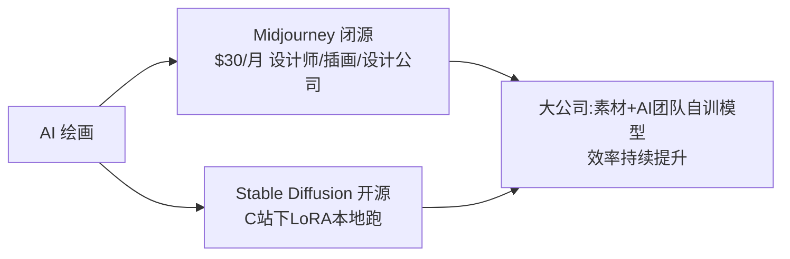

## 纲要

- **ChatGPT Plus**：约 $20/月 ≈ 150 元/月（含汇率）；学生党是不小支出，但工作/创作/程序员「请了个专家」很值。
- **额度**：GPT-4 每 3 小时 50 次（≈一天 400 次）；用完后转 GPT-3.5（无次数限制）；设自定义指令后 3.5 某些场景甚至优于 4。
- **进阶权益**：数据分析、Plugins（chatwithPDF / askyourPDF / promptperfect / webpilot 等）、GPT-4V 多模态（视觉/听觉/说）。
- **Midjourney**：约 $30/月；适合设计师/插画师/设计公司找灵感或跑通 AIGC 流程；闭源（似 iOS）。
- **开源抗衡**：Stable Diffusion（似安卓，开源）可在 C 站下 LoRA 人物模型本地跑，淘汰设计师「哭晕」——大公司有素材+AI 团队自训模型只会更强。
- **结论**：值不值看「适不适合你、帮不帮你」；为提效付费 = 花钱买别人智慧、省自己时间，别省。

> 本章按课程口径重构；价格以课程时段为准；剥离营销与课程群引流。

## 一、ChatGPT Plus 值不值

| 视角 | 判断 |
|---|---|
| 学生党 | 150 元/月不小，先试用 |
| 程序员/创作者 | 集合全人类智慧、省时间、做梳理规划，非常值 |
| 对比 | 请巴菲特吃顿饭都花很多钱，而 AI 不分昼夜答疑 |

- **心智收益**：有了付费会员会「用回本」的潜意识，反而保持对新技术敏感与关注。

## 二、Plus 进阶玩法

- **Plugins**：chatwithPDF（读 PDF）、askyourPDF、promptperfect（优化提示词）、webpilot（联网）等。
- **GPT-4V 多模态**：视觉（拍自行车指导调座椅）、听觉（上传视频提炼内容）、说（iOS 侧对话）。

## 三、Midjourney 与开源 SD

- **类比**：MJ 似 iOS（闭源好用），SD 似安卓（开源可玩）；C 站搜 LoRA 按下载量倒序下本地试用。

## 四、FAQ

**Q1：学生该开 Plus 吗？**
先试用；确能影响工作流、提效再续费，别省该花的钱。

**Q2：GPT-4 次数用完怎么办？**
转 GPT-3.5（无限制）；设自定义指令后 3.5 部分场景可超 4。

**Q3：MJ 和 SD 选哪个？**
找灵感/团队跑流程用 MJ；想本地可控/免费玩用 SD + LoRA。

**Q4：付费的本质？**
花钱买别人智慧、省自己时间，换来陪家人/提升自我。

## 五、面试高频问答

**1. 怎么判断 AI 工具值不值得付费？**
看是否适合你、是否真提效；能影响工作流就值得长期续费。

**2. GPT-4 与 3.5 的取舍？**
4 有次数限制且贵；3.5 无限制，配合自定义指令部分场景可替代 4。

**3. MJ 与 SD 的定位差异？**
MJ 闭源、设计师向；SD 开源、可本地+LoRA 定制，大公司自训更优。

**4. 付费 AI 的心智价值？**
「用回本」潜意识驱动持续关注新技术，长期受益。

## 六、ops 提示（采购）

> **先试用后付费**：Plus/MJ 都先开一个月验证再长期。
>
> **价格时效**：文中价位为课程时段，以官方当前定价复核。
>
> **合规**：境外订阅涉及支付合规；境内优先国内平替完成学习。
