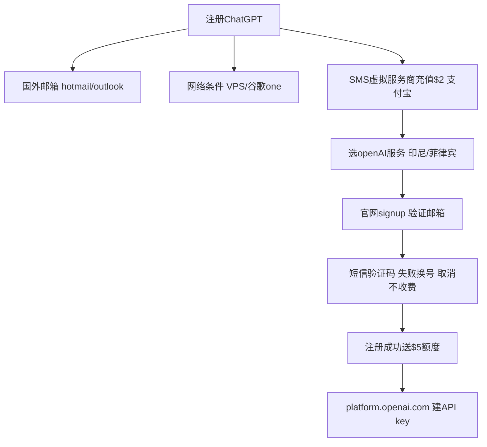

## 纲要

- **虚拟卡 vs 实体卡**：虚拟卡（护照/基础信息 + 存额）可境外消费、付 Plus、ebay/亚马逊转运；但年限/场景受限，ChatGPT 限制虚拟卡支付，香港卡也因属中国被限制。
- **实体境外银行卡用途**：境外版服务（阿里云海外版买港/日服务器）、收款（Stripe/PayPal 需实体卡）、投资（美股港股）、经商打工收款；灰产警示（有程序员非法通道赚百万被没收，触法倾家荡产）。
- **个人外汇管理办法**：经常项目年度总额 5 万美元以下不需申报；5000 美元以下 / 日累计等值 1 万美元以下可银行直办；境外提现每人每年 ≤10 万人民币。
- **开户地**：香港/新加坡为主；费用 2000–4000 元；渣打（某宝购服务 ~4000 元，不需赴港）推荐；华美（收手续费+存款限制）、汇丰（门槛高）不推荐；需护照/邮箱，境外手机号非必须；留意账户管理费与存款要求。
- **ChatGPT 注册**：国外邮箱（hotmail/outlook）易得；网络条件（VPS/谷歌 one）；SMS 虚拟服务商充值 $2（支付宝）选 openAI 服务（印尼/菲律宾便宜），官网 signup → 验证邮箱 → 短信验证码（失败换号、取消不收费）；注册送 $5 额度至 2024-2；platform.openai.com 建 API key；成本 ~1 元/账号，勿淘宝花 20–30 元买。
- **Plus 开通（iOS 侧稳妥）**：美区 ID（iPhone 拔卡、英文、地区美国、全新邮箱、地址生成器选 5 免税州否则 >$20、日期 >18 岁、跳过付款）→ 支付宝买 Apple 礼品卡（pocketshop，$20，旧金山地区九折）→ 系统设置兑换 → iOS ChatGPT app 内 upgrade to plus 付费。
- **安全警示**：转接/配置转换服务可能泄露信息；服务商有跑路风险——女生尤需注意网络安全。

> 本章按课程口径重构；外汇/开户政策随两地法规变化，以当地银行与官方为准；剥离营销与课程群引流。本内容仅作合规知识普及，红线性内容勿触碰。

## 一、卡与账户

| 类型 | 优势 | 限制 |
|---|---|---|
| 虚拟卡 | 开户门槛低、可境外消费/付 Plus | 年限/场景受限；ChatGPT 限虚拟卡；香港卡也限（属中国） |
| 实体境外卡 | 境外版服务、Stripe/PayPal 收款、炒美股港股 | 开户费 2000–4000 元；有管理费/存款要求 |

- **红线**：灰产（非法通道/黄赌毒/b 圈）曾致程序员赚百万全没收；心中留红线，不触法。

## 二、外汇合规

- 经常项目年度总额 **5 万美元以下**不需申报；**5000 美元以下** / 日累计等值 **1 万美元以下**银行直办。
- 境外提现每人每年累计 ≤ **10 万人民币**。
- 留学/移民等触红线需申报。

## 三、开户推荐

- 地：香港 / 新加坡（政策常变，以当地银行为准）。
- 渣打（某宝购服务 ~4000 元，不需赴港）推荐；华美（手续费+存款限制）、汇丰（门槛高）不推荐。
- 准备：护照、邮箱；境外手机号非必须；留意账户管理费与存款（如 1000 美金/新币）。

## 四、ChatGPT 注册流程

- **成本**：~1 元/账号；勿在闲鱼/某宝花 20–30 元买号。

## 五、Plus 开通（iOS 侧）

1. 注册**美区 ID**：iPhone 拔卡、语言英文、地区美国、全新邮箱、地址生成器选 **5 个免税州**（否则可能 $21.5–21.9）、日期 >18 岁、跳过付款。
2. **买 Apple 礼品卡**：支付宝 → 地区选旧金山 → 搜 pocketshop → 买 $20（九折）。
3. **兑换**：系统设置 → Apple Store → 兑换充值卡或代码。
4. **付费**：iOS ChatGPT app 登录 → 设置 → upgrade to plus；失败排查（地址须免税州 / 充值未成功 / ID 受支付限制联系苹果解锁）。

## 六、FAQ

**Q1：虚拟卡能付 ChatGPT Plus？**
ChatGPT 限制虚拟卡，香港卡也因属中国被限；稳妥走 iOS 侧礼品卡支付。

**Q2：注册账号要花多少钱？**
~1 元/账号（SMS 虚拟 $2 可注册十几个）；别买现成号。

**Q3：开户必须去香港？**
不一定；渣打等可某宝购服务远程开，不需赴港。

**Q4：外汇红线？**
年度 5 万美元以下不申报；境外提现年 ≤10 万人民币；留学移民触线需申报。

## 七、面试高频问答

**1. 国内访问/订阅境外 AI 服务有哪些坑？**
虚拟卡被限、香港卡属中国被限；iOS 侧礼品卡最稳妥；网络与合规是双重门槛。

**2. 个人外汇合规要点？**
5 万美元以下不申报；境外提现年 ≤10 万人民币；触留学/移民等需申报。

**3. ChatGPT 注册成本构成？**
国外邮箱 + 网络 + SMS 虚拟接收码；~1 元/号，避免买号溢价。

**4. 开户地怎么选？**
香港/新加坡；渣打远程开性价比高，华美/汇丰有门槛或费用，留意管理费。

## 八、ops 提示（合规）

> **合规优先**：本内容仅普及合规知识；灰产/非法通道绝对不碰，曾有案例全没收。
>
> **信息保护**：转接/配置类网络服务易泄露信息、服务商可能跑路，女生尤需警惕。
>
> **免税州**：美区 ID 地址务必选 5 免税州，否则 Plus 可能 $21.5+。
>
> **替代路径**：学习阶段优先用国内平替，降低合规风险。
