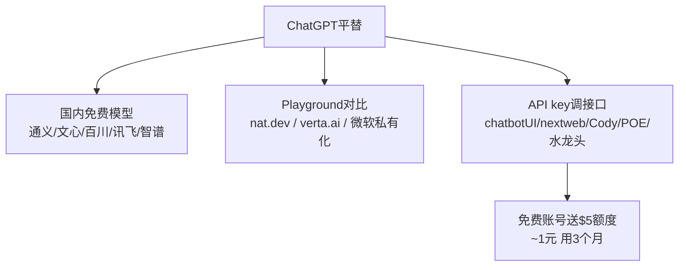

## 纲要

- **背景**：课程讲提示词工程而非 ChatGPT 本身；注册/付费麻烦可跳过，用国内免费模型练手。
- **方案一：国内免费模型**：通义千问/文心一言/百川/讯飞星火/智谱 AI（智谱提供中文本地化部署文档，可上 40 系显卡自跑）。
- **方案二：Playground 对比**：nat.dev（注册后 ~$1 多选模型一次提问）；verta.ai（GPT-3.5 可白嫖，GPT-4/Claude pro 需 $20/月，比直接开 Plus 不值）；微软 OpenAI 私有化部署达芬奇 playground。
- **方案三：API key 调官方接口**：注册免费账号（送 $5 额度用 3 个月，~1 元）→ 桌面端 chatbotUI / chatGPTnextweb（设生成温度 0.5–0.7 更聚焦；nextweb 支持面具角色扮演+中转 API 地址，国内不便访问官方可用中转）；VScode Cody 插件（程序员，代码预提式）；POE（集成多模型，GPT-4/Claude 有限访问需充值，Llama2）；chatGPTAPI 水龙头（每 24h 产 $1 API key，配 nextweb 测 3.5）。
- **实践示例（chatbotUI）**：platform.openai.com 建 secret key → 左下设 API key → 调生成温度 → 用文件夹存对话 → 自定义 prompt 加 `{input}` 变量，斜杠调用替换。
- **额度实测**：新注册账号极耐用；约 500 字仅 ~$0.0105；水龙头 $1 可用多次。

> 本章按课程口径重构；工具链接与价格以当前为准；剥离营销与课程群引流。学习优先用国内平替降低合规风险。

## 一、方案总览

## 二、方案一：国内免费模型

- 通义千问/文心一言/百川/讯飞星火均可免费用；**智谱 AI** 提供本地化部署中文文档，配 40 系显卡自跑。
- 团队用 API 性价比仍属 GPT-3.5 最高。

## 三、方案二：Playground

- **nat.dev**：注册 ~$1，右侧筛选多模型（Cloud/GPT-3.5/GPT-4/Llama2/ChatGLM）一次 submit 全对比。
- **verta.ai**：GPT-3.5 白嫖；pro $20/月解锁 GPT-4/Claude，比官网 API 贵约 50%——不如直接开 Plus。
- **微软 OpenAI 私有化**：部署达芬奇等模型，自带 playground 练 Prompt。

## 四、方案三：API key + 桌面端

| 工具 | 适用 | 亮点 |
|---|---|---|
| chatbotUI | 通用 Web | 建 API key、调温度、文件夹存对话、自定义 prompt 变量 `{input}` 斜杠调用 |
| chatGPTnextweb | 三端清爽 | 面具角色扮演、支持中转 API 地址（国内不便访问官方可用） |
| VScode Cody | 程序员 | 编辑器内问答、代码预提式 |
| POE | 集成多模型 | GPT-4/Claude 有限访问需充值，含 Llama2 |
| chatGPTAPI 水龙头 | 测试 | 每 24h 产 $1 API key，配 nextweb 测 3.5 |

- **生成温度**：数值越小越聚焦、确定性越强（建议 0.5–0.7）。
- **自定义 prompt**：写 `互联网专家` + `{input}`，保存后斜杠调用，替换 input 即可批量复用。

## 五、FAQ

**Q1：完全不想注册 ChatGPT 怎么练？**
用国内免费模型（通义/文心/百川/讯飞/智谱），智谱还能本地部署。

**Q2：哪里能白嫖 GPT-3.5？**
verta.ai 白嫖；水龙头每 24h 产 $1 key 配 nextweb；新注册官方账号送 $5 额度。

**Q3：chatbotUI 和 nextweb 区别？**
nextweb 三端更清爽、预置 prompt 面具、支持中转；chatbotUI 文件夹管理更强。

**Q4：程序员的平替？**
VScode Cody 插件，编辑器内问答+代码预提式。

## 六、面试高频问答

**1. ChatGPT 平替有几类？**
国内免费模型、Playground 对比、API key+桌面端（chatbotUI/nextweb/Cody/POE/水龙头）。

**2. 生成温度怎么设？**
越小越聚焦确定（0.5–0.7 推荐）；越大越发散创意。

**3. 自定义 prompt 变量怎么用？**
chatbotUI 写 `{input}` 占位，保存后斜杠调用替换，批量复用模板。

**4. 学习阶段最优路径？**
优先国内平替（合规低门槛），确需 GPT 用免费额度/白嫖，避免合规风险。

## 七、ops 提示（工具）

> **合规优先**：境内访问/订阅境外服务有网络与合规门槛，学习用国内平替最稳。
>
> **额度管理**：新账号 $5 额度极耐用（500 字 ~$0.01）；水龙头 $1/天足够测试。
>
> **中转谨慎**：nextweb 中转地址来自第三方，注意密钥安全，勿用于生产敏感数据。
