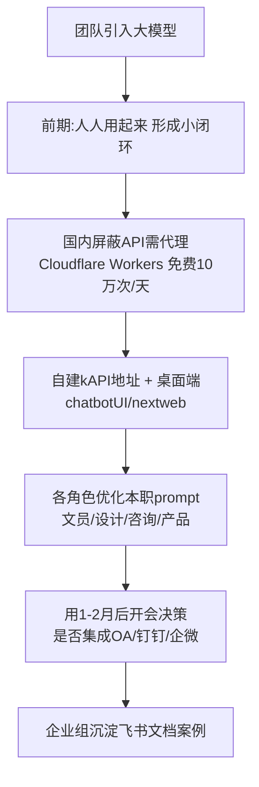

## 纲要

- **小团队闭环**：先让大家都用起来，明确工具能帮做什么；国内屏蔽 OpenAI API 需代理（Cloudflare Workers 免费 10 万次/天请求，需域名+Cloud 账号，自建 kAPI 地址）。
- **工具落地**：配合桌面端（chatbotUI / chatGPTnextweb）请求自建 API；文员/设计/咨询/产品各自优化本职 prompt（基础原则/优化方法后续章讲）。
- **决策节奏**：用 1–2 月后开会交流心得，决定是否集成到 OA / 钉钉 / 企业微信；企业组推广须拿现实案例，沉淀到飞书类文档便于接手流转。
- **GPT-4 与否**：Plus 会员成本高；API 普通用户限额 $120/月，超了需企业资质 API（美国公司/税号/支付方式，有税）；大团队有开发能力 → 接私有化模型（支持微调）。
- **官方微调**：jupyter 调试 GPT 模型，准备 messages 数据 → 校验 → 测试；100 条消息微调约 $1–3（≈¥21），得基于 GPT-3.5 的优化模型。

> 本章按课程口径重构；额度/政策以官方当前为准；剥离营销与课程群引流。

## 一、小团队落地

- **代理方式**：Cloudflare Workers 建免费 Workers（10 万次/天请求基本用不完），配域名 + Cloud 账号，生成专属 kAPI 地址。

## 二、决策与推广

- **试用节奏**：先人人用 1–2 月，再开会决定是否固化进工作流。
- **集成目标**：OA / 钉钉 / 企业微信。
- **企业组**：拿出现实可用案例，沉淀飞书文档，便于接手与流转。

## 三、额度与私有化

| 路径 | 说明 |
|---|---|
| Plus 会员 | 成本高，按人计费 |
| 官方 API | 普通用户限额 $120/月；超额需企业资质（美国公司/税号/支付，有税） |
| 私有化模型 | 大团队有开发能力可接，支持微调 |
| 官方在线微调 | 100 条消息 ~$1–3（≈¥21），基于 GPT-3.5 训优化模型 |

## 四、FAQ

**Q1：国内团队怎么直连 OpenAI API？**
需代理；Cloudflare Workers 建免费 kAPI 地址（10 万次/天），配桌面端用。

**Q2：要不要全员开 Plus？**
成本高；先用 API/私有化，按角色优化 prompt，试用 1–2 月再决策。

**Q3：超 $120/月额度怎么办？**
申请企业资质 API（美国公司/税号），涉及境外税务。

**Q4：官方微调贵吗？**
100 条消息约 $1–3，适合小样本优化客服等场景。

## 五、面试高频问答

**1. 团队如何落地大模型工作流？**
先人人用形成闭环 → 代理/自建 API → 各角色优化本职 prompt → 1–2 月后决策集成 OA/钉钉。

**2. 国内访问 OpenAI API 的合规代理？**
Cloudflare Workers 免费额度够用，但需关注网络与合规，学习优先国内平替。

**3. 企业级额度瓶颈？**
普通 API $120/月，超额需企业资质（公司/税号/支付），有税务成本。

**4. 私有化与微调权衡？**
大团队有开发能力接私有化；小样本用官方在线微调（$1–3/百条）更快。

## 六、ops 提示（团队）

> **先闭环再固化**：别一上来就集成 OA；试用 1–2 月验证价值再推广。
>
> **案例沉淀**：飞书/文档化案例，避免人走流程断。
>
> **合规**：代理与企业 API 涉境外合规，评估风险；学习阶段用国内平替。
