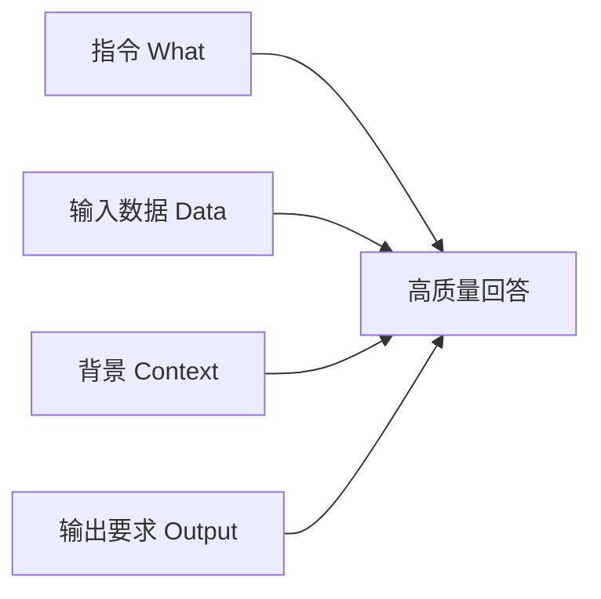

## 纲要

- **本章定位**：前述是「通识技能」章，把前几章零散的写法收敛成 8 个可复用的技巧，让 Prompt 真正帮你**拓宽视野、提升效率**。
- **八技巧一览**：① 为 AI 设定角色；② 为自己设定角色（背书）；③ 明确问题 + 提供背景；④ 限制回复长度与精确度；⑤ 分阶段提问让模型一步步思考；⑥ 明确你的要求和目的；⑦ 结构化思考你的 Prompt；⑧ 系统化设计 ChatGPT 自定义指令。
- **底层公式**：所有技巧都围绕一个核心结构——**指令 + 输入数据 + 背景 + 输出要求**。前几章讲原则，本章讲「怎么把它用熟」。
- **学习方法**：量变引起质变——常写常练、把结构「疯狂套用」，比背现成 Prompt 有用得多。
- **贯穿要点**：上下文长度有限 → 要拆分、要聚焦目标；模型不是肚里蛔虫 → 要主动给背景、要迭代。

> 本章按课程口径重构；剥离营销与课程群引流，保留可复用的技巧与示例。

## 一、为什么需要「通识技能」

- 复杂问题即便表述清楚，也常因**上下文长度限制**得不到满意答复 —— 需要拆解。
- 拆解不是「想到哪拆到哪」，而是有章法的：让模型始终围绕你的焦点、你的目标来谈。
- 八技巧就是这套「章法」的落地清单，覆盖**角色、背景、精度、拆解、目的、结构、个性化**七个维度。

## 二、八技巧速查

| 技巧 | 解决什么 | 一句话口诀 |
| --- | --- | --- |
| ① 为 AI 设角色 | 回答太通识、不专业 | 让模型当「领域专家」 |
| ② 为自己设角色 | 回答不贴合你的身份/场景 | 告诉模型「我是谁」 |
| ③ 明确问题 + 背景 | 答非所问、方向飘 | 问题 + 上下文一起给 |
| ④ 限制长度与精度 | 太长/太水/超上下文 | 限 token、分块、要克数 |
| ⑤ 分阶段提问 | 复杂问题一口吃不下 | 一步步拆、始终聚焦目标 |
| ⑥ 明确要求和目的 | 重复指令冲突、太宽泛 | 给思维顺序、让模型反问 |
| ⑦ 结构化思考 | 写 Prompt 没章法 | 套「指令+输入+背景+输出」 |
| ⑧ 自定义指令 | 每次重写背景太臃肿 | ChatGPT 一次性固化人设 |

## 三、底层公式：指令 + 输入 + 背景 + 输出要求

- **指令**：你要模型做什么（清晰、具体）。
- **输入数据**：你给的原始材料/问题。
- **背景**：领域、角色、约束、时间范围等上下文。
- **输出要求**：格式、长度、风格、粒度。

## 四、贯穿全章的两大现实约束

- **上下文长度有限**：长文要分块（` 摘要法）；分阶段时要反复强调目标，防止模型跑偏。
- **模型不是蛔虫**：设了专家角色 ≠ 它自动懂你；要主动补专业输入、要检查真实性、要迭代优化 Prompt。

## 五、FAQ

**Q1：八技巧都要用吗？**
按需组合。简单问题用 ①+③ 即可；复杂任务叠加 ⑤⑥⑦；高频重复场景用 ⑧ 固化。

**Q2：底层公式会不会太死板？**
不会。它是「检查清单」——写完后对照四项看缺哪样，补上即可，熟练后可省略显式项。

**Q3：分阶段提问和明确目的有什么区别？**
⑤ 偏「怎么把大问题拆小」，⑥ 偏「怎么让模型按你的思路走、别跑偏」；两者常一起用。

**Q4：技巧八只适用于 ChatGPT？**
文中以 ChatGPT 自定义指令为例；其他产品的「系统预设/人设」是同一思路，可迁移。

## 六、面试高频问答

**1. 写一个好 Prompt 的核心结构是什么？**
指令 + 输入数据 + 背景 + 输出要求。缺项就补，熟练后可隐式省略。

**2. 复杂问题大模型答不好，怎么办？**
上下文长度有限，需分阶段拆解（技巧⑤），并始终强调目标防止跑偏。

**3. 怎么让回答更贴合我的场景？**
用技巧②给自己设角色（背书），并补背景（技巧③），把领域/身份/约束说清。

**4. 提升 Prompt 能力最快的方法？**
常写常练、把结构套熟——量变引起质变，而非背现成模板。

## 七、ops 提示（实践）

> **组合优于单点**：真实任务往往同时用到 3~5 个技巧，先列出要用哪几个再写。
>
> **先总览后深挖**：本章先建立八技巧地图，再逐技巧看示例，避免只见树木。
>
> **对照公式自检**：写完后问自己——指令清不清？背景够不够？输出要求明不明？
