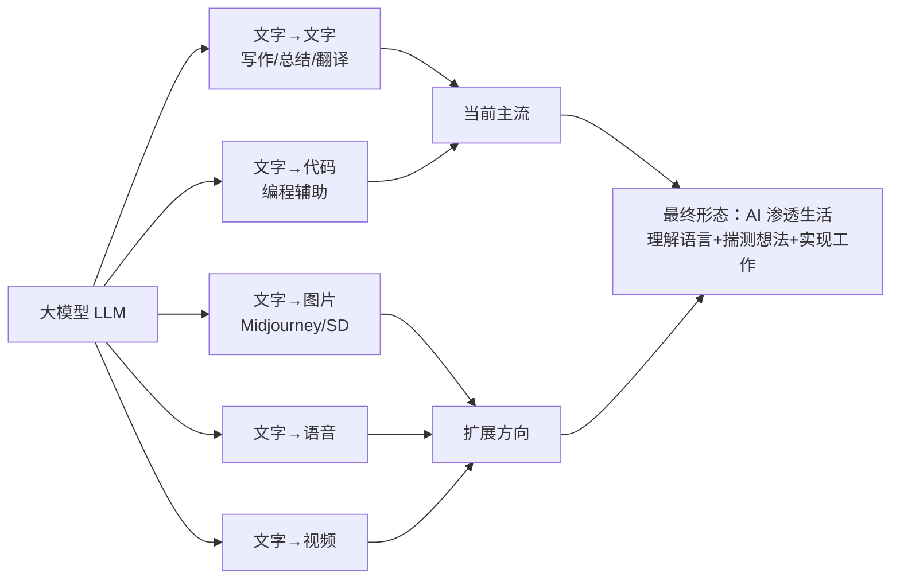

## 纲要

- **课程定位**：面向所有人的「提示词工程 + 大模型多场景实战」；理论 10% + 实践 70% + 趋势与商业化思维 20%，重实践、重思考。
- **核心命题**：提示词是「挖掘人类智慧中最有价值部分」的钥匙——通过组织有规律的关键词，从大模型海量语料中抽取出贴合特定场景的专业回复。
- **三大认知**：① 提示词工程师是 AIGC 浪潮催生的新岗位（薪酬 5k–30k，非百万年薪神话）② 高薪提示词工程师需要专业领域护城河 ③ 学提示词不为当「提示词工程师」，而为吃第一波技术红利、用信息差提效与商业化。
- **应用主轴**：文字→文字、文字→代码（当前主流）；文字→图片/语音/视频（扩展方向）；最终形态是 AI 渗透生活方方面面的「贾维斯」。
- **课程九大模块**：环境准备 → Prompt 编写原则策略 → 多场景实战 → 深入大模型技术 → 商业化思维 → 应用进阶 → AI Agent 与代码解释器 → 扩展应用 → AI 绘图与未来思考。

> 本章为课程导学，按课程口径重构；无代码，重在建立「提示词工程 ≠ 训练模型」「人人可学、重实践」的正确预期，并剥离营销噪声。

## 一、什么是提示词工程

### 1.1 定义与直观示例

- **一句话定义**：通过组织有规律的关键词，抽取大模型中有用的信息；提示词本身需要理解其背后的工作原理，后续模型越懂你，对话越「对你胃口」。
- **直观对比**（课程原例）：
 - 直接问「提示词工程是什么」→ 模型给**中庸、铺开式**介绍（无角色、无背景）。
 - 加上**角色 + 背景 + 限定条件** → 输出更确切、专业度与深度明显提升。
 - 这正说明：**同样的基座模型，提示词质量决定输出质量**。

### 1.2 应用方向演进

## 二、市场与岗位认知

### 2.1 提示词工程师是真岗位，但别被神话

- **真实薪酬跨度**：5k–30k 不等，要求各异；美国人才统计站点 2023-10-10 数据显示 Prompt Engineering 平均年薪约 **6 万美元**（平均水平靠上）。
- **关键提醒**：不能只看平均薪酬，**岗位数量与需求量**才是真相——提示词工程师岗位总量仍偏少，属新兴岗位。

### 2.2 与传统岗位对比（2022→2023 趋势）

| 岗位 | 2022 | 2023（OpenAI 出圈后） | 量级/薪酬特征 |
|---|---|---|---|
| 算法工程师 | 下降 | 爆发式增长 | 高薪、岗位量较大 |
| 数据标注工程师 | 与提示词岗关联 | 爆发增长 | 量级比算法低一级 |
| 数据分析师 | 下跌 | 随 AI 指明方向回升 | 中规中矩 |
| Java / 前端工程师 | 互联网寒冬、裁员、岗位骤降 | 七八月份一波回升 | 传统三巨头 |
| 产品经理 | — | 异军突起、增长最快 | 岗位量 5–10 万、薪酬约 30k，量级最高 |

**结论**：2023 年传统三巨头岗位数均增加，但普通岗位需求趋于饱和；提示词工程师作为 AIGC 关联新岗，总量少但代表新方向。

### 2.3 护城河：为什么高薪提示词工程师需要专业背景

- 大模型背后的语料，尤其**专业领域语料**，需要专家调教、纠正；否则喂入垃圾语料，即使加自学习特性也无法甄别好坏。
- 举例：没有医疗专家，模型不敢开「减肥食谱」；没有金融算法公式与市场理解，模型无法从股票数据得出可信结论。
- **推论**：提示词工程师十多年前就已存在（GPT-1→GPT-4 背后是千千万万标注/专家）；低门槛≠低竞争，**高薪靠专业领域知识做护城河**。

## 三、为什么学提示词工程

- **不为当「提示词工程师」**：学习提示词的意义，是掌握「用高质量提示词让大模型输出专业回复」的能力。
- **第一波技术红利**：早入场者靠信息差与商业化思维游刃有余；有人靠卖 AI 平台账号即获利颇丰。
- **提效与创作**：进阶用法是用 AI 工具辅助创作、提升生产生活效率——本质是一种**信息差 + 商业思维**。
- **AI 生态已完善**：从算力→工具→大模型→AI 代理→AI 编程→基础设施，技术积累为商业化产品提供支撑；代表产品：ChatGPT、Copilot / Codium（代码辅助）、Midjourney / Stable Diffusion（绘图）等。

### 3.1 使用现状（课程引述数据）

- 国家热力图：多国已广泛使用对话式 AI。
- 人群分布：男性约 55.4%；年龄 18–44 岁占约 80%；主力人群为大学生、文案、翻译、软件工程师、数据分析师、教育工作者。
- **启示**：若你属上述从业者，大模型可显著帮到你；比别人先用、先进入，走得更靠前。

## 四、课程结构与亮点

### 4.1 三大内容块

| 模块 | 占比 | 目标 |
|---|---|---|
| 理论与概念 | 10% | 紧跟前沿名词概念，打开视野，后续读文献/新闻能懂 |
| 实践与应用 | 70% | 重实践：GPT 工具资料与使用技术、多场景落地 |
| 趋势与商业化思维 | 20% | 培养商业化思维，探索感兴趣方向或对应工作 |

### 4.2 九大详细模块

1. 环境准备
2. Prompt 编写的原则与策略
3. 具体场景实践
4. 深入大模型技术
5. 商业化思维培养
6. 应用进阶（提示词工程与工具）
7. AI Agent 与代码解释器
8. 扩展应用
9. AI 绘图与未来发展思考

### 4.3 五大课程亮点

1. 实用提示词工程体系与实战
2. 对接国内外前沿对话式使用技巧
3. 行业场景（职场 / 副业多场景实战）
4. 商业思维培养
5. 融合对话式 AIGC（探讨 AI 未来）

### 4.4 适合人群与技术储备

- **适合**：程序员、职场人士、创业者、产品经理、教育工作者、内容创作者（普适型）。
- **技术储备**：会装软件；对机器学习感兴趣；程序员需一定基础编程知识（后续程序员专场更易理解）。手摸手教学，「有手就行」，需一点耐心、不怕困难。

## 五、FAQ

**Q1：提示词工程是训练大模型吗？**
不是。它是「基于基座模型的提示词编写」，从模型已有语料中抽取值得的信息，而非从零训练模型。

**Q2：提示词工程师真的年薪百万？**
被媒体放大。真实薪酬跨度 5k–30k，美国平均约 6 万美元/年；高薪靠专业领域护城河，低门槛岗位竞争激烈。

**Q3：没 ChatGPT 账号能学吗？**
可以。课程提供注册/Plus 开通/海外卡与外汇法规知识，同时给出**国内免费大模型平替方案**——模型之间原则策略互通。

**Q4：学完能做什么？**
用信息差与商业化思维提效创作；在职场/副业多场景落地；探索 AI 相关方向或工作。

**Q5：需要很深的技术储备？**
不需要。会装软件 + 对 ML 感兴趣即可；程序员有基础编程更好。

**Q6：这门课和「教你怎么写提示词」的网络内容区别？**
五大亮点定位：体系实战 + 国内外前沿技巧 + 行业多场景 + 商业思维 + AIGC 未来探讨，而非零散技巧堆砌。

## 六、面试高频问答

**1. 一句话说清提示词工程？**
通过组织有规律的关键词，从大模型语料中抽取贴合特定场景的专业回复；提示词质量直接决定输出质量。

**2. 为什么提示词工程师需要专业领域背景？**
大模型专业语料需专家调教纠正，否则无法甄别垃圾语料；金融/医疗/法律等领域无专家即无可信输出，这是高薪护城河。

**3. 当前大模型两大主流应用方向？**
文字→文字（写作/总结/翻译）与文字→代码（编程辅助），其余文→图/语音/视频为扩展方向。

**4. 普通人学提示词工程的意义？**
不为当提示词工程师，而是吃第一波技术红利、用信息差提效与商业化，在 AI 浪潮上冲浪。

**5. 如何看待「人人都是提示词工程师」的论断？**
反映趋势而非岗位神话：未来人人都需具备用提示词驾驭 AI 的基础能力，但专业高薪仍靠领域深度。

## 七、ops 提示（学习路线）

> **预期管理**：提示词工程重实践（占 70%），别被「百万年薪」营销带偏；把它当「用 AI 的底层能力」而非求职捷径。
>
> **账号与合规**：若用 ChatGPT Plus，涉及海外卡与外汇法规，务必了解合规要求；国内免费大模型可平替完成全部原则策略练习。
>
> **信息差价值**：课程大量干货本质是信息差；知识付费获取信息差即比别人走得快，也是对创作者劳动的认可——但落地仍靠自己多练。
>
> **学习顺序**：先建立「提示词工程 ≠ 训练模型」「应用主轴」世界观，再进入环境准备与 Prompt 编写原则。
