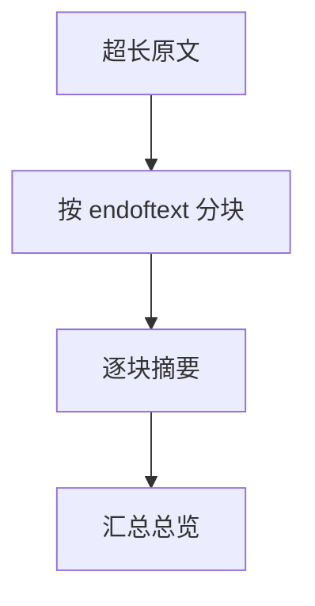

## 纲要

- **技巧三（明确问题 + 提供背景）**：问题越空、背景越缺，回答越通识、越易跑偏；补齐背景 = 把模型「锚定」在你的真实需求上。
- **技巧四（限制回复长度与精确度）**：大模型有上下文上限，长文会截断/稀释；要主动控 token、控粒度、控格式。
- **关键换算**：约 `4k token ≈ 2k 汉字`；Claude 100k 上下文 ≈ `5 万汉字` 量级——据此判断一次能塞多少。
- **长文对策**：超长材料用 `endoftext` 分块 + 逐块摘要法，避免一次性喂爆上下文。

> 本章按课程口径重构；剥离营销与课程群引流，保留背景补全与长度精度控制方法。

## 一、技巧三：明确问题并提供背景

- **问题**：只抛一个问题（如「描述互联网发展历史」）→ 结果太宽泛、太通识。
- **解法**：把**问题 + 背景（领域/范围/时间/用途）**一起给，并借助 Prompt 优化平台迭代。
- **视觉缺陷提醒**：纯文字模型看不到图；涉及图表的任务要明确「用文字/表格/代码描述」，别假设它能读图。
- **示例**：`请作为移动互联网专家，为小白梳理 2000–2020 关键节点，输出带年份的时间线表格` —— 比裸问「发展史」精准得多。

## 二、技巧四：限制回复长度与精确度

- **token 换算基准**：
 - 中文约 `4k token ≈ 2k 汉字`（token 含标点/子词，非严格 1:1）。
 - Claude 100k 上下文 ≈ 可处理 `5 万汉字` 量级长文。
- **控制手段**：
 - 长度：显式要求「不超过 N 字 / 用 3 条要点 / 一段话」。
 - 精度：要求给出**具体度量**（如食谱「面粉多少克」而非「一杯」）。
 - 格式：限定「表格 / 列表 / 代码块 / JSON」。
- **长文分块（endoftext 摘要法）**：
 1. 把超长文本按 `endoftext` 切分。
 2. 逐块让模型产出摘要。
 3. 汇总各块摘要再要总览 —— 规避上下文上限。

## 三、背景 + 精度的组合示例

- 食谱案例：先问「常见巧克力蛋糕主料」→ 再问「鸡蛋作用 / 替代物」→ 最终 `作为资深糕点师，为小白出 3 份无蛋奶食谱，食材给具体克数`。
- 这一步同时用到了：背景（资深糕点师+小白）、精度（克数）、分阶段。

## 四、常见误区

- 以为「问题短 = 高效」——短问题常换来通识废话。
- 不控长度导致截断或稀释重点；不问具体度量导致「一杯/适量」无法执行。
- 长文硬塞一次 → 后半段被忽略；应分块摘要。

## 五、FAQ

**Q1：背景要给到什么程度？**
够模型判断「领域、范围、用途、读者」即可；越具体越准，但别泄隐私。

**Q2：中文 token 怎么估？**
粗算 `4k token ≈ 2k 汉字`，据此评估一次能喂多少、要不要用分块。

**Q3：endoftext 分块一定要用这个标记？**
`endoftext` 是课程示例的分隔思路；关键是「切块 + 逐块摘要 + 汇总」，标记可替换。

**Q4：让模型给克数会不会更啰嗦？**
会略长，但可执行性大幅提升；用「限 N 条/限格式」平衡长度。

## 六、面试高频问答

**1. 为什么背景信息能提升回答质量？**
背景把模型锚定到具体领域/读者/用途，避免通识化与跑偏。

**2. 中文场景下怎么粗略估算 token？**
约 `4k token ≈ 2k 汉字`；Claude 100k 可处理约 5 万汉字量级。

**3. 超长文档怎么不让模型遗漏？**
分块（如 endoftext 切分）→ 逐块摘要 → 汇总，规避上下文上限。

**4. 怎么让模型输出「可执行」而非「适量」？**
在输出要求里强制具体度量（克数/像素/秒数）并限定格式。

## 七、ops 提示（实践）

> **背景三件套**：领域 + 读者 + 用途，先填再问。
>
> **长度双保险**：既限「字数/条数」，也限「格式」，防止发散。
>
> **长文必分块**：超模型单窗容量的材料，一律切块摘要再汇总。
