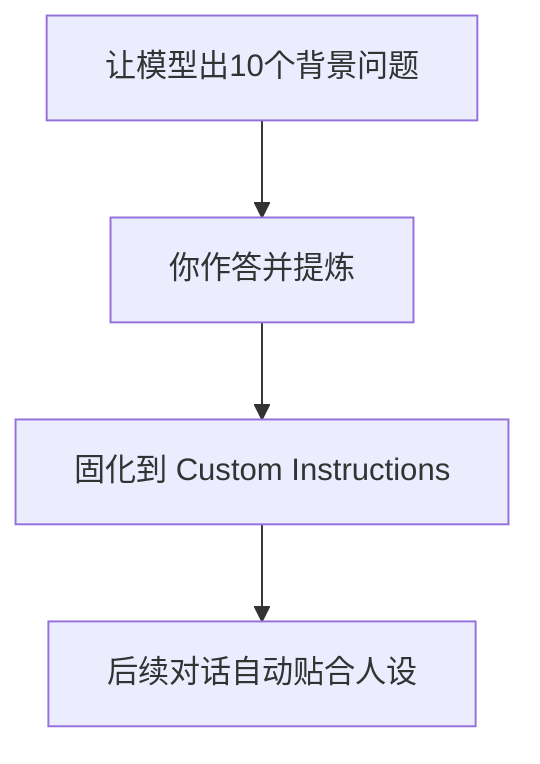

## 纲要

- **技巧八（自定义指令 / Custom Instructions）**：把「你是谁、你希望怎么被回复」固化到 ChatGPT 设置里，免去每轮重写背景与输出要求。
- **两个核心问题**：
 1. `你希望 ChatGPT 了解你的哪些信息？`（角色/背景/用途）
 2. `你希望 ChatGPT 如何回应？`（格式/语气/深度/风格）
- **怎么填**：不会写就分阶段让模型生成 10 个相关问题 → 你作答 → 提炼关键信息，得到专属画像。
- **实测收益**：开启自定义指令后，同一问题（如「HTTP 工作原理短视频脚本」）回答明显更专业、更深入原理，而非通识流水账。
- **迁移性**：思路通用于各产品的「系统预设 / 人设」能力，不只 ChatGPT。

> 本章按课程口径重构；剥离营销与课程群引流，保留自定义指令范式与模板。

## 一、两个核心问题

- **问题一（你是谁）**：相当于一次性告诉模型你的角色、水平、用途——之后不必每轮重复。
 - 模型据此缩小知识搜索范围，往你的领域聚拢，并用你能懂的术语。
- **问题二（怎么回）**：一次性定制输出格式与风格——之后不必反复说「简洁点/详细点」。

## 二、分阶段生成你的画像

1. 让模型出 `10 个关于「使用者的背景」的问题`。
2. 你作答，提炼关键：职业、当前项目/挑战、兴趣、价值观、学习风格、目标偏好、语言、教育背景、沟通风格。
3. 对「如何回应」同样让模型出几个问题，梳理后提炼风格取向。
- **权重规则**：画像里**越靠前的内容权重越高**，把最重要的放前面。

## 三、可直接套用的模板

- **数字营销人员**：职业=数字营销专家；挑战=产品在线知名度/转化率；兴趣=社媒营销+数据分析；价值观=透明、数据驱动；学习=实践导向。
- **知识付费达人**：角色=知识付费领域达人；挑战=筹备线上课程；兴趣/目标相应调整。
- **前端开发者 / 新媒体视频创作者**：目标=一年内百万订阅；取向=分享视频技巧、标注工具来源、推荐教程。
- **用法**：复制模板 → 改个人背景与偏好 → 粘进 Custom Instructions → 保存。

## 四、实测对比

- **关闭自定义指令**问「HTTP 工作原理 500 字短视频脚本」：从场景直接讲，含主持人设定，偏通识、未深入原理。
- **开启后**同问：场景化但无主持人（因你是创作者），引入请求/响应/状态码/有连接等**专业名词与原理**，深度明显更好。
- **结论**：自定义指令把「专家对专业人士」的人设固化，长尾任务自动受益。

## 五、FAQ

**Q1：自定义指令会泄露隐私吗？**
只填抽象身份与取向（职业/兴趣/风格），避免真实姓名、证件、联系方式等敏感信息。

**Q2：两个问题写多长合适？**
越具体越好，但把**最重要放最前**（权重高）；不用一次完美，可迭代。

**Q3：不会写画像怎么办？**
让模型分阶段出 10 个问题，你答完提炼即可，不必硬憋。

**Q4：只适用于 ChatGPT？**
文中以 ChatGPT 为例；其他产品的系统预设/人设是同一思路，可迁移。

## 六、面试高频问答

**1. Custom Instructions 解决什么痛点？**
免去每轮重复写背景与输出要求，把人设与风格一次性固化。

**2. 两个核心问题是什么？**
「你希望模型了解你什么」+「你希望模型怎么回应」。

**3. 怎么高效生成自己的画像？**
让模型出 10 个背景问题→作答提炼；越靠前权重越高。

**4. 自定义指令真有实测差异吗？**
有。同一问题开启后回答更专业深入（如 HTTP 脚本引入状态码/原理），而非通识流水账。

## 七、ops 提示（实践）

> **一次固化长期受益**：高频重复场景务必用自定义指令，省 token 也省心智。
>
> **前置最重要信息**：画像越靠前权重越高，把核心身份/用途放开头。
>
> **去隐私化**：用抽象角色，别写真实敏感字段。
