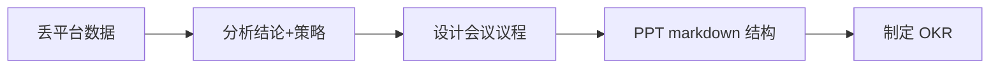

## 纲要

- **笔记结构**：用 `AI 写作导师` 角色 + 你的身份，生成「适合 XX 学生的笔记结构」，再要求精简成课堂记录用框架（标记/日期/目标/要点/术语/例子/思考）。
- **逐步引导成文**：设计 10 个标题 → 按亲和力/科技感/吸引力/通俗性评分选最佳 → 给语料按结构写笔记/博文。
- **职场数据复盘**：把平台数据丢给模型（如 MCN 新媒体运营官），让其分析结论 + 运营策略 → 设计会议议程 → 出 PPT markdown 结构。
- **OKR vs KPI**：OKR=目标与关键结果（方向性、灵活、笼统）；KPI=关键绩效指标（定量衡量人/标准）。两者常配合。
- **心法**：「摸着石头过河」——把模型方案当起点，实践反馈再迭代，比空想强。

> 本章按课程口径重构；剥离营销与课程群引流，保留笔记与数据复盘范式。

## 一、笔记结构生成与精简

- `你是 AI 写作导师；我是 IT 学生；请给适合我的笔记结构` → 初版 13 项。
- 再指令 `只需课堂记录用，请精简` → 收敛为 标记/日期/目标/要点/重点术语/例子/思考问题/补充材料。
- 有了框架后「完形填空」式记录，比收藏即躺平有效（呼应费曼「讲出来」）。

## 二、从标题到成稿

1. `为某主题设计 10 个吸引人标题`。
2. 按多维度评分（亲和力/科技感/吸引力/通俗性）选最佳。
3. 提供语料/背景，按选定结构写笔记（形似博文）。
- 上下文越丰富，输出越贴实际；写不出时可让模型润色/补观点。

## 三、职场数据复盘链路

- 示例：小视频平台假数据 → 模型指出快手潜力/月末异常 → 设计会议主题 → markdown PPT → 设「提升抖音流量」OKR（月点击量+20% 等）。

## 四、OKR 与 KPI

- **OKR**：Objectives and Key Results，目标 + 关键结果，定方向与可衡量成果，灵活笼统。
- **KPI**：Key Performance Indicator，关键绩效指标，定量衡量「人/标准是否达标」，更具体。
- 用法：OKR 指方向，KPI 量达成；不同团队取舍不同。

## 五、FAQ

**Q1：笔记结构怎么又快又好？**
让模型按身份生成结构再精简，得框架后填空式记录。

**Q2：写不出内容怎么办？**
给语料 + 让模型润色/补观点，逐步引导（标题→评分→成文）。

**Q3：OKR 和 KPI 区别？**
OKR 是目标+关键结果（方向性、灵活）；KPI 是关键绩效指标（定量、具体）。

**Q4：数据复盘怎么用模型？**
丢数据→要结论与策略→出会议议程→PPT 结构→OKR，串成闭环。

## 六、面试高频问答

**1. 怎么用 AI 提升笔记效率？**
生成并精简笔记结构，再逐步引导出标题/成稿，框架化记录。

**2. 职场数据怎么让模型帮忙？**
喂数据要分析结论+策略，顺推会议议程与 PPT markdown，再定 OKR。

**3. OKR 与 KPI 如何配合？**
OKR 定方向，KPI 量达成，二者互补而非互斥。

**4. 模型方案的定位？**
作起点，「摸着石头过河」——实践反馈再迭代，优于空想。

## 七、ops 提示（实践）

> **结构先行**：先要框架再填内容，避免东一榔头西一棒。
>
> **数据带结论**：给模型数据时要明确「要结论 + 策略」，而非只罗列。
>
> **OKR 落地量化**：关键结果写可衡量数字，别停在方向口号。
