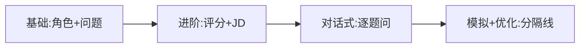

## 纲要

- **模拟面试**：基础（部门+岗位+问题）→ 进阶（回复评分 + 贴岗位 JD 提具体问题）→ 对话式（一二面技术项目，一个一个问）→ 模拟 + 优化（分隔线区分，优化表达/突出特点/引导面试官问熟悉方向）。
- **英语口语**：`你是英语口语教师与改进者，纠正语法/错字/事实错误` → 全英文对话即时纠错。Plus 语音对话支持方言（如四川话）。
- **AI 口语 App**：如 call Annie 类虚拟角色，纠正发音/语法，适合练习。
- **文献翻译两段式**：设《纽约时报/经济学人》中文翻译风格；规则（保留英文术语/数字/人名）+ 分两次翻译（直译不遗漏 → 意译通俗）+ 格式示例。
- **心理指导**：用「心理医生」角色做陪伴式开导，给具体建议（私密问题替代方案）。

> 本章按课程口径重构；剥离营销与课程群引流，保留教育类 Prompt 范式。

## 一、模拟面试四层进阶

1. **基础**：`你是 X 部门面试官；面试 Y 岗位；请提 5 个问题` —— 回复评价偏中庸。
2. **进阶**：加「对我的回复评分 + 给岗位建议」，并粘贴真实岗位 JD，问题更具体。
3. **对话式**：`一个一个问我问题，范畴=一二面技术项目` —— 模拟真实来回，输入时有思考时间。
4. **模拟 + 优化**：`每次我回复后，继续提问 + 输出我的回复优化（表达习惯/突出特点/引导问熟悉方向），用分隔线区分`。

## 二、英语口语与 AI 陪练

- **纠错 Prompt**：`你是英语口语教师与改进者，修复/纠正语法错误、错别字、事实错误` → 切英文对话，写错词立即纠。
- **Plus 语音**：Settings → New Features → Voice Conversations，支持中/英/方言（四川话等）实时对话。
- **AI 口语 App**：虚拟角色通话，纠正发音吐词与语法，适合日常练习。

## 三、文献翻译两段式

- 角色：`你做《纽约时报/经济学人》中文翻译`。
- 风格规则：保留特定英文术语、数字、人名。
- **两次翻译**：① 直译不遗漏信息；② 基于直译意译，使其通俗易懂。
- 给格式示例（优化原则之一），一次对话内完成双任务。

## 四、心理指导

- `你是心理医生，针对我的私密困扰给具体建议` —— 模型知识库丰富，可作陪伴式开导。
- 适合「想不通又不便于与人说」的场景，给可操作办法。

## 五、FAQ

**Q1：模拟面试怎么更真实？**
从基础角色 → 贴 JD 进阶 → 对话式逐题 → 加「回复优化+分隔线」，层层贴近实战。

**Q2：英语纠错 Prompt 怎么写？**
`你是口语教师与改进者，纠正语法/错字/事实错误`，切英文对话即时纠。

**Q3：文献翻译两段式是什么？**
直译（不遗漏）→ 意译（通俗），保留术语/数字/人名，给格式示例。

**Q4：模型能当心理开导吗？**
可作陪伴式开导给建议，适合私密不便与人说的场景。

## 六、面试高频问答

**1. 怎么用 AI 练面试？**
四层进阶：角色提问→评分+JD→对话式→模拟优化（分隔线区分优化点）。

**2. 英语口语怎么用模型练？**
纠错角色 + 全英文对话；Plus 语音/AI 口语 App 练发音与语法。

**3. 专业文献翻译 Prompt 要点？**
定杂志风格 + 保留术语数字 + 两段式（直译→意译）+ 格式示例。

**4. 模型做心理开导可靠吗？**
可作陪伴与建议起点，严重问题仍需专业人类介入。

## 七、ops 提示（实践）

> **面试先定层**：按准备阶段选基础/进阶/模拟，别一上来就最重。
>
> **翻译保术语**：两段式 + 保留英文术语，质量远超单次直译。
>
> **口语重实时**：Plus 语音/App 比纯文字更练反应与发音。
