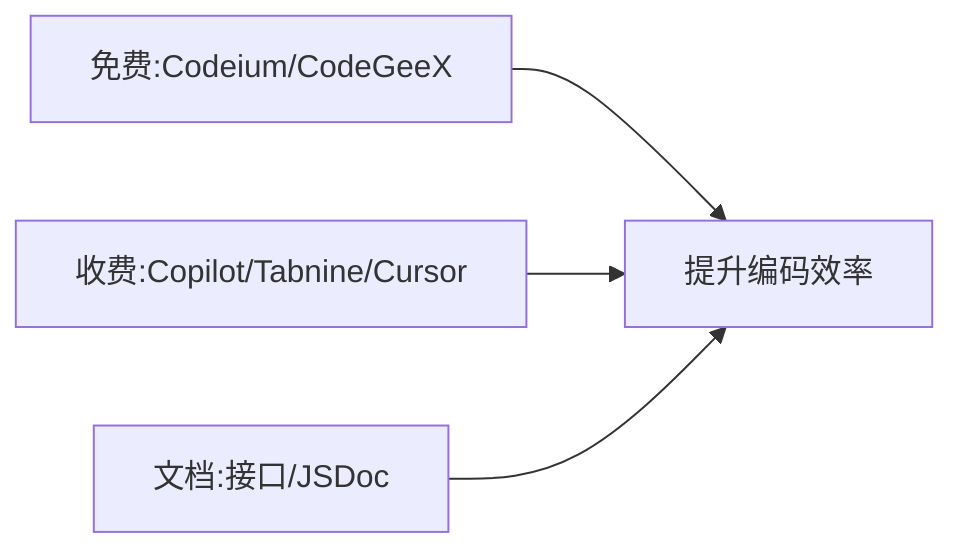

## 纲要

- **免费方案**：Codeium（含对话窗，可问编程/非编程问题，explain 解释代码）、CodeGeeX（清华开源、可本地部署多卡推理）。
- **收费方案**：GitHub Copilot（闭源，$10/月、企业 $19/月，语言丰富提示惊艳）、Tabnine（最早 AI 提示，$12–15/月，pro 区块提示、免费用户单行）、Cursor（智能编辑器，500 次高速 GPT-4 + 无限 GPT-3.5，绘画式编辑 + 双色标注接受/拒绝）。
- **隐私**：Cursor 类工具本地化 + 本地数据库，只传代码特征不上传全部源码；敏感代码可走本地部署（如 CodeGeeX）。
- **文档编写**：接口文档可按格式自动生成；插件快捷入口（如 Generate JSDoc）一键生成函数说明，可要求中文回复。

> 本章按课程口径重构；剥离营销与课程群引流，保留工具对比与选型要点。

## 一、免费：Codeium 与 CodeGeeX

- **Codeium**：装插件后左侧开对话窗，可问编程也可问非编程（如「设计 PRD 模板」）；写注释回车即出代码，explain 一键解释。
- **CodeGeeX**：国产、清华开源模型，可本地部署、多卡推理加速，多平台推荐。

## 二、收费：Copilot / Tabnine / Cursor

| 工具 | 性质 | 费用 | 亮点 |
|---|---|---|---|
| Copilot | 闭源 | $10/月（企业 $19） | 语言丰富、提示惊艳 |
| Tabnine | 最早 AI 提示 | $12–15/月 | pro 区块提示；免费用户单行 |
| Cursor | 智能编辑器 | 较高 | 500 次高速 GPT-4 + 无限 3.5；绘画式编辑 + 双色标注接受/拒绝 |

- **Cursor 特性**：聊天直接访问你的代码（无需手贴上下文）；改动以两色区分，可接受/拒绝/重生成。

## 三、隐私与本地化

- 大厂工具本地化 + 本地数据库，只上传代码「特征」而非整库源码。
- 核心/机密代码优先本地部署方案（如 CodeGeeX），保安全。

## 四、文档自动编写

- 套路一：给固定格式让模型按格式出接口文档/产品说明书。
- 套路二：插件快捷入口（如 Generate JSDoc）一键生成函数说明，可 `请用中文回复` 重生成。

## 五、FAQ

**Q1：首选免费还是收费？**
上手用免费（Codeium/CodeGeeX）；要更强提示与 GPT-4 编程力再上 Copilot/Cursor。

**Q2：Cursor 会泄露源码吗？**
本地化 + 只传特征；机密代码建议本地部署。

**Q3：文档怎么偷懒？**
用 JSDoc 类快捷入口一键生成，再要中文/微调。

**Q4：Tabnine 免费能用？**
普通用户可免费单行提示；区块级提示需 pro。

## 六、面试高频问答

**1. 主流 AI 编程工具有哪些？**
免费 Codeium/CodeGeeX；收费 Copilot/Tabnine/Cursor，按预算与需求选。

**2. Cursor 相比插件强在哪？**
绘画式编辑 + 双色标注接受/拒绝 + 聊天直访代码，无需手贴上下文。

**3. 代码隐私怎么保？**
选本地化工具或本地部署开源模型，避免整库上传。

**4. AI 工具能替代程序员吗？**
不能；它是「卷同行」的杠杆，基础思考仍在人。

## 七、ops 提示（实践）

> **先免费后付费**：Codeium 上手，Copilot/Cursor 按需升级。
>
> **敏感代码本地化**：机密优先本地部署，别整库上传。
>
> **文档善用快捷入口**：JSDoc/接口文档一键生成再微调，省注释时间。
