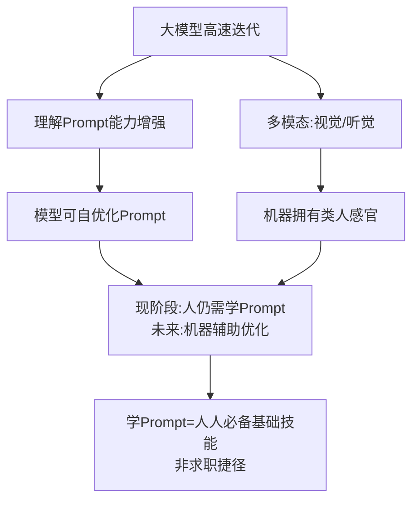

## 纲要

- **时代背景**：2023 年 ChatGPT 风靡全球后，Prompt Engineering 概念全球火热；直聘类站点已出现「Prompt 工程师 / Prompt 师」岗位，薪酬不错。
- **本质定义**：提示词 = 给机器发送的指令，告诉它完成什么任务；大模型「遇强则强、遇弱则弱」——提示词质量由背景知识决定。
- **岗位价值**：负责某领域知识体系构建 + 提供高效专业提示词 + 解决特定领域问题；最终作用都是**为企业降本增效**。
- **冷静视角**：Google DeepMind 论文指出，大模型可自优化 Prompt、甚至理解人类意识——不必过度焦虑「写不好 Prompt 会失业」。
- **人人必备技能**：学提示词不是求职捷径，而是 AI 时代每个人的基础能力；可落地方向：Prompt 工程师 / 博文与知识付费 / 视频拓展人际 / 垂类应用降本增效。

> 本章按课程口径重构；剥离营销话术，聚焦「岗位真相 + 学习定位」。

## 一、为什么诞生 Prompt 工程师

- **根因**：大模型训练语料庞大，但同一问题不同提示词 → 答案天差地别；写高质量提示词能让模型精准命中目标知识范围，输出更贴合用户意图。
- **反例**：问「怎么赚一个小目标」「怎么带孩子」这类假大空、不具体的问题 → 模型给无意义回答。
- **岗位涌现**：因大模型风靡，出现专业编写提示词的人员；不同公司、岗位对 Prompt 工程师要求各异。

## 二、岗位职责与任职要求

| 维度 | 要点 |
|---|---|
| 岗位职责 | 负责某领域知识体系构建；提供高效专业提示词；解决特定领域问题 |
| 任职要求 | 熟悉常见大模型；能传授分享技巧；对新技术敏感有洞察 |
| 进阶要求 | 有学历/专业要求；有其他大模型使用经验；有落地项目或公开作品集 |
| 优化要求 | 根据用户需求反馈优化流程与 Prompt，实现流程优化与结果提效 |

**核心结论**：不论哪种定位，Prompt 工程师最终都是**利用大模型为企业/个人提效**——更快完成工作、更好学习、帮企业少走弯路、减少人员支出。

## 三、模型自优化 Prompt 的启示

- Google DeepMind 论文大意：大模型可**自己优化自己的 Prompt**，甚至理解人类相关意识。
- 大模型高速迭代，对 Prompt 的理解持续增强；今后「写不好 Prompt」不必过度担心，机器会帮忙优化。
- **但现阶段仍有大量可做的事**：多模态（GPT-4V 的 V=Vision 视觉能力）让机器拥有类人感官，能做的事暴增。

## 四、可尝试的方向

1. **Prompt 工程师**：直接的岗位方向。
2. **博文 / 知识付费**：用新知识写文章、做付费内容。
3. **视频拓展人际**：发相关视频，结交行业同好，扩展人际网络。
4. **垂类应用降本增效**：在自身本职工作里用好 Prompt，让本职降本增效。
5. **心态**：害怕 AI 不如先加入它、了解它；深刻了解后才能合理运用。

## 五、FAQ

**Q1：Prompt 工程师是噱头吗？**
不是。直聘站点真实存在岗位，薪酬不错，职责聚焦「领域知识体系 + 高效提示词 + 降本增效」。

**Q2：写不好 Prompt 会失业？**
不会。论文表明模型能自优化 Prompt；学 Prompt 是人人必备技能，不是「不学就失业」的恐吓。

**Q3：岗位核心要求？**
熟悉大模型 + 能传授技巧 + 新技术洞察 + （进阶）学历专业 / 作品集 / 反馈优化能力。

**Q4：普通人学 Prompt 的意义？**
在自己的工作/副业里提效；把重复劳动交给机器，腾出时间提升自我。

## 六、面试高频问答

**1. 一句话定义提示词工程岗位？**
专业编写给机器的指令（提示词），负责领域知识体系构建与高效提示词供给，为企业降本增效。

**2. 为什么大模型需要专业提示词？**
大模型语料庞大但「遇强则强、遇弱则弱」，高质量提示词能精准命中目标知识范围、贴合用户意图。

**3. 如何看待「模型自优化 Prompt」？**
代表趋势，但现阶段人仍需学；多模态发展让机器能力暴增，早学早受益。

**4. Prompt 工程师的最终价值？**
不是堆砌技巧，而是用大模型实现个人/企业提效，减少人力支出、避免走弯路。

## 七、ops 提示（认知校准）

> **去魅**：把「Prompt 工程师 = 百万年薪」当营销滤镜；真实岗位要求领域知识 + 作品集，低门槛竞争激烈。
>
> **定位**：把学 Prompt 当「AI 时代基础能力」而非求职跳板；能协同 AI 的人才会被保留。
>
> **行动**：从本职工作的提效场景切入，比追逐岗位更务实。
