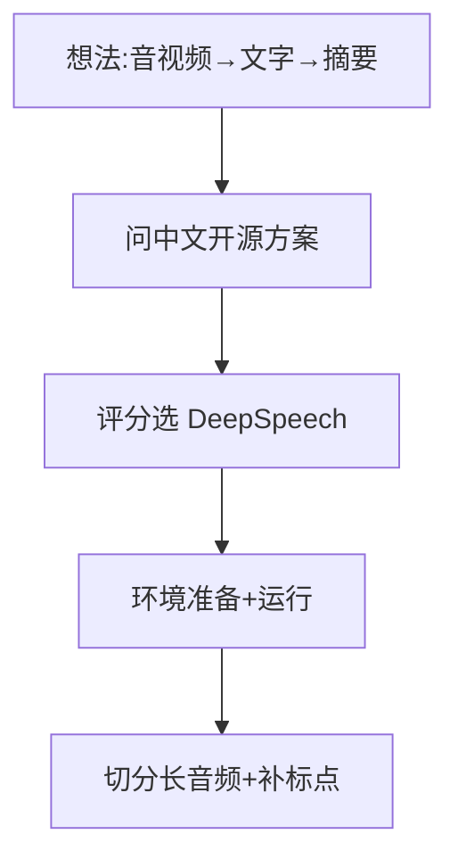

## 纲要

- **定位**：大模型是「超强问答系统」（替代 StackOverflow），帮程序员快速论证想法、补齐未知领域知识。
- **案例一·音频转文字**：问「中文开源音频转文字方案 + GitHub 链接」，加「中文」限定词避免英文方案；比较评分选 DeepSpeech/Kaldi；环境准备（miniconda/nvm/JVM 版本管理）；踩坑（长音频限制→切分；无标点→标点推测模型）。
- **案例二·Node 爬虫**：问「nodeJS 侧爬虫库」→ 用 prevision 库下载慕课图片 + 生成 JSON，约 2.5 小时，含日志/批量/重试。
- **通用 Prompt**：专家角色 + 自己偏好/背景 + 输出要求（保证正确性/关联性/时效性）。
- **避坑**：复杂任务不能直接丢（缺上下文 + 离线无联网）；贴代码 + 错误而非只贴错误；注意版本与上下文丰富度。

> 本章按课程口径重构；剥离营销与课程群引流，保留验证想法范式与实战坑点。

## 一、把模型当论证引擎

- 有想法 → 问模型「可行性 + 开源方案 + 链接」→ 比较评分 → 落地最小闭环。
- 切入点要带思考：如音频转文字选「中文开源」因英文方案需重训练、得不偿失。

## 二、案例一：中文音频转文字

1. `给我中文开源音频转文字方案 + GitHub 链接并描述`（必加「中文」限定）。
2. 模型列 5 个 → `从流行度/生态/效果评分给综合分` → 选 DeepSpeech（百度出品，中文友好）。
3. 问「本地运行注意什么」→ 拿到 miniconda/nvm/JVM 版本管理前置。
4. **踩坑**：长音频超限 → 切分 ≤2 分钟；无标点 → 用模型推测标点。

## 三、案例二：Node 爬虫

- `nodeJS 侧跑爬虫可用哪些库` → 选 prevision → 下载慕课图片 + 命名生成 JSON。
- 含日志格式化、批量下载、失败重试；约 2.5 小时由模型书写，落地即用。

## 四、通用 Prompt 与避坑

- **通用式**：`设专家角色 + 我的偏好/背景 + 输出要求（正确性/关联性/时效性）`。
- **不能直接丢复杂任务**：模型不知你的上下文，且多数离线无联网 → 最新方案可能编不出。
- **给足上下文**：贴「代码 + 错误信息」而非只贴错误，否则它只能翻译错误/给通识。
- **适用方向**：代码转换（java→node）、成熟生态示例、基础算法；减重复劳动。

## 五、FAQ

**Q1：问方案为什么要加「中文」？**
英文开源方案对中文音视频支持差，且需重训练，加限定词精准命中。

**Q2：长音频模型处理不了？**
切分 ≤2 分钟逐段转，再补标点推测。

**Q3：通用编程 Prompt 怎么写？**
专家角色 + 自己背景偏好 + 输出要求（正确性/关联性/时效性）。

**Q4：只贴报错够吗？**
不够；贴代码 + 报错，模型才能结合给专业回复。

## 六、面试高频问答

**1. 怎么用大模型快速验证想法？**
问可行性+开源方案+评分选型 → 环境准备 → 最小闭环落地，模型补齐未知领域。

**2. 辅助编程的适用边界？**
代码转换、成熟生态示例、基础算法；复杂架构/内存泄露/最新框架需人把关。

**3. 为什么复杂任务不能直丢模型？**
缺上下文 + 离线无联网，易编不可用代码；要拆解+给上下文。

**4. 贴报错的正确姿势？**
代码 + 错误信息一起给，避免模型只翻译错误给通识。

## 七、ops 提示（实践）

> **验证先于实现**：先问可行性+方案评分，再动手，省弯路。
>
> **坑要记**：长音频切分、无标点补推测，都是真实踩过的。
>
> **上下文要给足**：代码+错误+版本，模型才专业。
