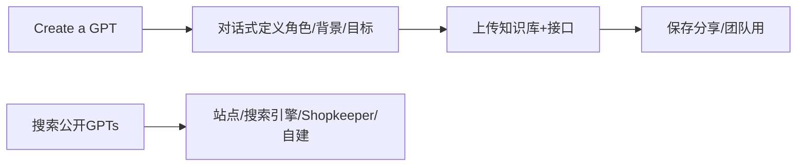

## 纲要

- **Create a GPT（My GPTs）**：对话式创建专属助手，固化角色背景 + 自己背景 + 目标 + 输出要求，解决长对话遗忘上下文痛点（仅 Plus）。
- **可视化定制**：可让 DALL·E 生成头像并多轮调整（如「侧脸、专注编码、阳光背景」）；保存分享给团队。
- **知识库与接口**：instructions + 上传 PDF 作知识库（upload files）+ actions 接口 + privacy policy；把公司方案/代码当检索源。
- **成本**：GPT-4 比原先便宜约 2.7 倍，流程界面化并暴露 API，对小 AI 公司冲击大。
- **搜索公开 GPTs**：GPTs App 站、搜索引擎 `site:chat.openai.com/g <主题>`、GPTs Shopkeeper 懒人搜；也可自建搜索 GPT（基于 New Bing 结构迭代微调）。

> 本章按课程口径重构；剥离营销与课程群引流，保留自定义 GPT 范式与生态。

## 一、Create a GPT：对话式微调

- 点 Create a GPT → 左侧发 Prompt 定义角色（如「Python/Java 开发专家」+ 背景 + 自己技术偏好 + 目标 + 输出要求）。
- 右侧直接对话验证；无需再担心长对话遗忘上下文。
- 本质是一次「微调」：把专业方向固化成常驻 GPT。

## 二、头像与分享

- DALL·E 生成头像，多轮语言调整（背对/侧脸/阳光等）；保存后可分享链接给团队。
- 仅 Plus 用户可用；创建的 GPT 可集成 browsing（联网）+ DALL·E（绘图）。

## 三、知识库 + 接口

- **upload files**：上传 PDF/方案/代码作知识库，让 GPT 基于事实作答。
- **actions**：配鉴权方式与 privacy policy，暴露 API 方便集成。

## 四、搜索公开 GPTs

- 站点：GPTs App 聚合站。
- 搜索引擎：`site:chat.openai.com/g <主题>`（如 webdevelopment/frontend）。
- 懒人：GPTs Shopkeeper 输入关键词搜公开 GPT。
- 自建搜索 GPT：用 New Bing 搜索结构 + 迭代微调，输入「数据分析」即扩关键词并搜出公开 GPT。

## 五、FAQ

**Q1：自定义 GPT 解决什么痛点？**
长对话遗忘上下文；把专业方向固化成常驻助手，免重复声明。

**Q2：知识库怎么用？**
upload files 传 PDF/方案，让 GPT 基于真实文档作答，减少编造。

**Q3：公开 GPTs 去哪找？**
GPTs App 站、`site:chat.openai.com/g` 搜索、Shopkeeper 懒人搜。

**Q4：成本变化？**
GPT-4 便宜约 2.7 倍，界面化+API 化，对小 AI 公司冲击大。

## 六、面试高频问答

**1. 什么是 Create a GPT？**
Plus 功能，对话式创建专属助手，固化角色/背景/目标/输出，解决上下文遗忘。

**2. 怎么让自定义 GPT 基于私有知识？**
upload files 上传 PDF/方案作知识库，配 actions 接口。

**3. 公开 GPTs 搜索技巧？**
GPTs App 站 + `site:chat.openai.com/g` + Shopkeeper + 自建搜索 GPT。

**4. 自定义 GPT 商业影响？**
GPT-4 降价 2.7 倍 + 界面化 API，降低定制门槛，挤压小 AI 公司。

## 七、ops 提示（实践）

> **长对话用自定义 GPT**：固化人设，别靠反复声明背景。
>
> **私有知识传文件**：upload files 比纯 Prompt 更抗编造。
>
> **搜 GPTs 多路并行**：站点 + 搜索引擎 + Shopkeeper，挑好用的复用。
