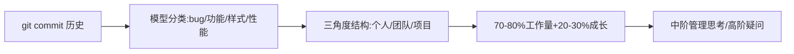

## 纲要

- **写周报的意义**：个人成长「倒灌」（费曼式）、团队暴露需配合项、项目管理体现成长与创新点。
- **三角度结构**：个人（学了什么新技术/沟通发现）+ 团队（配合谁、哪没推动）+ 项目（甲方进展/学习层面迁移）。
- **用 git 总结工作量**：把 commit message 丢给模型，分类「修 bug / 新功能 / 样式 / 性能」；养成良好提交习惯即天然上下文。
- **黄金比例**：70–80% 工作量主体 + 20–30% 个人成长与团队思考（中阶加管理思考，高阶加「疑问加分题」靠拢领导视角）。
- **最终 Prompt**：含比例 + 结构 + 示例 + 贴合上下文 + 固化「明白了请回好」。

> 本章按课程口径重构；剥离营销与课程群引流，保留周报方法论与可复用 Prompt。

## 一、为什么写周报

- 个人：梳理一周所得，像费曼学习法把知识倒灌出来，下周有目标。
- 团队：领导看到需配合/推动的部分。
- 项目：体现成长（不是「做了多少任务」，而是「创新点/不一样的地方」）。

## 二、三角度结构

- **个人**：新学技术、与客户沟通发现的新需求。
- **团队**：配合哪些人/部门、哪没推动、沟通卡点。
- **项目**：甲方进展、与先前项目的管理关系、提升了多少/解决多少 bug。

## 三、用 git 总结工作量

- 把历史 commit message 丢给模型 → 自动分「修 bug / 新功能 / 样式优化 / 性能优化」。
- 良好提交习惯（带分类前缀）本身就是给模型的优质上下文。
- 也可直接丢代码片段让模型提炼。

## 四、黄金比例与进阶

- **及格**：70–80% 工作量 + 20–30% 学习/成长。
- **中阶**：再加「对团队/公司层面的思考」体现管理力。
- **高阶**：加「疑问/加分题」靠拢领导视角（非溜须，是展现准备）。
- **最终 Prompt**：比例 + 结构 + 示例 + 「贴合上下文、后续不再重复要求、明白了请回好」。

## 五、FAQ

**Q1：周报怎么体现成长？**
不堆任务量，写「创新点/不一样的地方/学的新技术」。

**Q2：工作量怎么让模型帮写？**
丢 git commit 历史，模型按 bug/功能/样式/性能分类总结。

**Q3：黄金比例是什么？**
70–80% 工作量主体 + 20–30% 学习成长，再叠加管理思考进阶。

**Q4：周报 Prompt 要点？**
含比例+结构+示例+贴合上下文+固化指令。

## 六、面试高频问答

**1. 程序员周报怎么写得专业？**
三角度（个人/团队/项目）+ git 总结 + 70/30 比例，体现成长而非堆任务。

**2. 怎么用 AI 生成周报？**
喂 git commit 历史，模型分类产出，再补管理思考进阶。

**3. 周报体现管理力的方式？**
中阶加团队/公司思考，高阶加疑问加分题靠拢领导视角。

**4. 良好提交习惯的价值？**
带分类前缀的 commit 即给模型的天然上下文，总结更准。

## 七、ops 提示（实践）

> **提交即沉淀**：日常 commit 带分类，周报零成本。
>
> **比例守 70/30**：别全写工作量，成长/思考占 20–30%。
>
> **固化周报对话**：用「明白了请回好」沉淀模板，每周只填输入。
