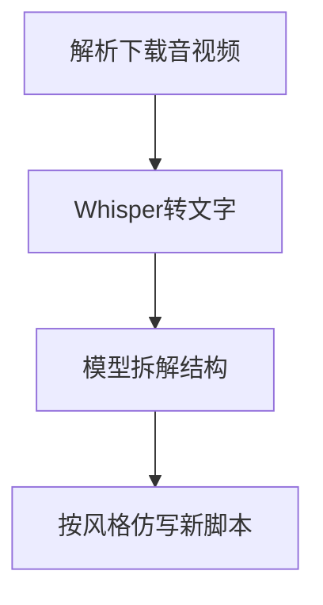

## 纲要

- **心态**：成功 99% 努力 + 1% 灵感；先做出来、坚持，运气才会来。方法上「进驻者寂寂、抄袭者黑」——先学优秀视频再仿写。
- **扒视频工作流**：抖音解析网站下载音/视频 → Whisper/网易见外转文字 → 丢模型拆解结构 → 按风格改写新脚本。
- **案例**：阿三解说（幽默/BGM/表情包/「问题不大」口头禅）→ 仿写奥特曼主题；高赞「乔布斯时刻」→ 拆出万能脚本结构（开场引起兴趣→补充说明深入→结论反思→互动号召）。
- **跨界融合**：提炼大纲 + 按自己结构重写；模型擅移植效仿，但**核心思想要自己定**，别全依赖模型揣测。

> 本章按课程口径重构；剥离营销与课程群引流，保留「借鉴—拆解—仿写—融合」工作流。

## 一、先学后仿

- 分析高赞/同方向视频：选题、节奏、长度、评论；全方位研究后再仿写脚本或替换素材演绎。
- 把扒视频流程固化成工作流，提效率。

## 二、扒视频标准流程

1. 抖音/平台解析网站取下载链接 → 下音/视频。
2. Whisper / 网易见外转文字。
3. 丢模型：`拆解该视频结构`。
4. `按此风格为<新主题>写脚本`。

## 三、案例与万能结构

- 阿三解说风格（幽默/固定 BGM/表情包/口头禅）→ 跨到科技主题仍成立。
- 高赞视频拆出万能结构：`开场引起兴趣 → 补充说明深入 → 结论与反思 → 互动号召`，与爆款公式呼应。

## 四、融合与边界

- 提炼大纲 + 按自己结构重写，是改写过程；模型擅跨界移植。
- **别过度依赖**：无具体指引时模型会揣测核心思想且常不准；最终大纲/内容喧闹仍靠人。

## 五、FAQ

**Q1：新手怎么快速出视频？**
扒优秀视频→转文字→拆结构→仿写，先把流程跑通。

**Q2：扒视频用什么转写？**
Whisper / 网易见外，平台解析站下音视频后转文字。

**Q3：万能脚本结构？**
开场引起兴趣→补充说明深入→结论反思→互动号召。

**Q4：模型能包办创作吗？**
不能；结构/风格可借，核心思想与最终把关在人。

## 六、面试高频问答

**1. 怎么高效效仿优秀视频？**
解析下载→转文字→拆结构→按风格仿写，固化工作流。

**2. 借鉴与抄袭边界？**
学结构/风格而非搬运；替换素材、重写，形成自己版本。

**3. 万能脚本结构怎么用？**
开场钩子→补充深入→结论反思→互动号召，套用后再调。

**4. 为什么不能全依赖模型？**
模型无具体指引会揣测核心思想且常偏，最终创作靠人。

## 七、ops 提示（实践）

> **工作流固化**：扒视频四步做成可复用 SOP。
>
> **结构可借风格可仿**：素材与核心思想必须自己掌。
>
> **先做完再优化**：前期别纠结器材/剪辑，做出来发上去看反馈。
