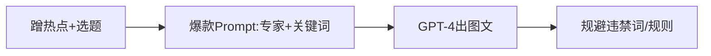

## 纲要

- **平台特性**：UGC 高质量图文、算法精准推细分赛道、重个人经验分享、年轻用户；细分内容转化率高。
- **爆款关键词**：网络用语/蹭热点；官方创作平台有标题参考；数据平台（巨量算术/飞瓜，多收费）不如直接刷热点榜（抖音/微博/知乎）。
- **Prompt 范式**：运营专家角色 + 二级标题法 + 吸引标题 + 爆关键词 + 创作原则 + 主题；GPT-4 可出配图，3.5 较差。
- **配图工具**：搞定设计/图怪兽，把文案贴图形成一致风格图。
- **非人人可做**：需兴趣/愿分享/有独特性；前期先「做出来」发上去看反馈；违禁词（最佳/特效/永久/史无前例/医疗用语）作为附件让模型规避；平台规则 PDF 上传了解。

> 本章按课程口径重构；剥离营销与课程群引流，保留小红书文案方法论。

## 一、平台与选题

- 小红书重个人经验、图文精美、算法按细分推精准用户；与公众号/知识星球定位不同。
- 选题靠蹭热点（抖音/微博/知乎热榜）+ 数据平台辅助；标题参考官方创作平台。

## 二、爆款 Prompt

- `你是小红书运营专家；用二级标题法；吸引标题+爆关键词；遵循创作原则；主题=X`。
- 让模型从热点中选主题扩展，文字≤120 字（因放图内）。
- GPT-4 出配图，3.5 图文割裂明显。

## 三、配图与风格

- 工具：搞定设计、图怪兽；文案贴图形成清爽一致风格（小红书文案突出主题、不堆字）。

## 四、违禁词与规则

- 常见违禁词：最佳/特效/永久/史无前例/前无古人/疑似医疗用语（减肥/美妆）。
- 把违禁词文档作附件、规则 PDF 上传，让模型写时规避。
- **非人人可做**：要有兴趣+分享+独特性；前期别纠结器材/剪辑，先做出来发上去比。

## 五、FAQ

**Q1：小红书文案 Prompt 怎么写？**
运营专家+二级标题+吸引标题+爆关键词+主题，文字短放图内。

**Q2：爆关键词哪来？**
网络用语/蹭热点；官方创作平台标题参考；热榜辅助。

**Q3：违禁词怎么规避？**
把违禁词清单作附件、规则 PDF 上传，让模型写时回避。

**Q4：新手能做小红书吗？**
需兴趣/分享/独特性；前期先做出来发上去看反馈，别纠结器材。

## 六、面试高频问答

**1. 小红书文案怎么用 AI 提效？**
专家角色+爆关键词+主题，GPT-4 出图文，配图工具贴图。

**2. 选题与热点怎么结合？**
刷抖音/微博/知乎热榜 + 数据平台，选细分赛道。

**3. 违禁词处理？**
清单附件+规则 PDF，模型写时规避，避免限流。

**4. 为什么非人人可做？**
需兴趣/独特性/持续分享；前期重「做出来」而非器材。

## 七、ops 提示（实践）

> **图文一致**：小红书文案短、突出主题，图清爽不堆字。
>
> **违禁词前置**：清单与规则当附件，写前规避。
>
> **GPT-4 出图**：配图质量 4 远胜 3.5，重要图文用 4。
