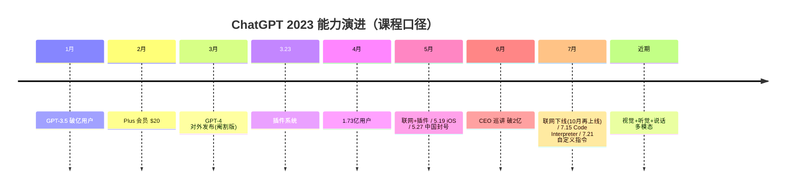

## 纲要

- **发展时间线**：2023 年 1 月 GPT-3.5 破亿用户 → 2 月 Plus（$20）→ 3 月 GPT-4（对外阉割版）→ 3.23 插件 → 4 月 1.73 亿 → 5 月联网+插件 → 5.19 iOS / 5.27 中国封号 → 6 月 CEO 巡讲破 2 亿 → 7 月联网下线（10 月再上线）→ 7.15 Code Interpreter → 7.20 回复次数 → 7.21 自定义指令 → 后续视觉/听觉/说话多模态。
- **多模态能力**：图像生成（与图像模型合体）、视觉（上传自行车图让模型指导调座椅）、音频（上传音频理解内容）。
- **办公套件**：Google（Bard 类）、Microsoft（Office AI：会议摘要 / 计划 / 演讲稿 / PPT / 邮件自动生成）。
- **通识 Prompt 实例**：文字→PPT 大纲（Markdown）+ 自动生成工具；角色扮演「与万物对话」；翻译（优于传统工具）；未知领域学习计划书。
- **变现思路**：信息差——淘宝/小红书店铺、文案稿费、国外案例日赚百刀。

> 本章按课程口径重构；时间线为课程讲述口径，具体日期以官方发布为准；剥离营销与课程群引流。

## 一、ChatGPT 发展关键节点

- **GPT-4 真相**：对外版本已在法律/道德伦理/数学运算等方向做大量阉割与限制；即便如此仍是「大模型之手」，综合能力领先、被多家当作标准。
- **自定义指令（7.21）**：预先设置用户背景与响应方式，免去每次写 Prompt 的背景信息。

## 二、多模态能力

- **图像**：ChatGPT-4 将与图像模型合体，无需收集提示词即可原生生成图片。
- **视觉（经典示例）**：用户上传自行车照片问「怎么调低座椅」→ 模型定位释放螺栓/六角螺丝 → 用户拍照确认 → 指导用 4mm 六角螺丝旋松 → 调低成功（"It worked,thanks"）。
- **音频**：上传一段音频，模型理解并响应其内容。

## 三、办公套件：与 AI 对话完成工作

| 厂商 | 能力演示 |
|---|---|
| Google | AI 办公套件：会议摘要、会议进程规划、周报、PPT |
| Microsoft | Office AI：发指令生成会议计划、基于先前内容写产品发布会演讲稿、自动建 PPT、自动发邮件 |

**趋势**：今后工作 = 与 AI 工具对话；邮件/PPT/Word/表格自动完成，几乎不敲键盘。

## 四、通识 Prompt 实例

### 4.1 文字 → PPT 大纲

- 给一段文字（如「智能时代超级发展，职场人何去何从」）→ 模型生成 PPT 大纲（Markdown）。
- 用 Markdown 导入**家秀 / MotionGo** 等工具自动生成 PPT；或套用 OfficePlus 官方模板。

### 4.2 与万物对话（角色扮演）

- 示例：「你是一只乖巧的小猫，我是一个 6 岁小孩，想了解蓝猫的一切」→ 模型以儿童口吻回应（蓝猫女孩、爱吃鱼和猫粮）。
- 配图/视频可变成绘本——给没时间带娃的家长快速创编故事。

### 4.3 翻译

- 设定「你是一名中英译者」，自动把中文翻成英文；长文直接丢给模型（接口无上限），质量优于传统翻译工具，支持中英/英中/多语言。

### 4.4 未知领域学习计划

- 对未知领域小白：「帮我写一份该领域的计划/大纲 + 具体学习建议」→ 产出职业规划书（个人介绍/目标/发展路径）。

## 五、变现思路（信息差）

- 国外案例：小哥用 ChatGPT 每天赚约 100 刀。
- 国内思路：开淘宝/小红书店铺卖资料、写文案发平台赚稿费、做 AI 相关视频。
- **核心**：很多生意本质是「卖信息差」；打开思路比工具本身更重要。

## 六、FAQ

**Q1：GPT-4 为何很多方向不能答？**
对外版本在法律法规/道德边界/数学等方向做了阉割限制；触及边界即不提供回复。

**Q2：没 ChatGPT 账号能做这些吗？**
能。国内免费大模型互通原则策略；本课程的通用 Prompt 实例可平移。

**Q3：自动 PPT 工具好用吗？**
家秀/MotionGo 等用 Markdown 导入即可生成，可换风格/套模板；是提效利器。

**Q4：角色扮演 Prompt 有什么用？**
适合教育（儿童故事绘本）、语言练习、创意写作等场景，体现「与万物对话」。

## 七、面试高频问答

**1. ChatGPT 2023 关键里程碑？**
GPT-3.5 破亿 → GPT-4（阉割）→ 插件 → 联网 → 自定义指令 → Code Interpreter → 多模态视觉/听觉。

**2. 多模态给 Prompt 工程带来什么？**
模型拥有类人感官（看/听/说），能从图片/音频理解任务（如指导调自行车座椅），应用边界大幅扩展。

**3. 办公套件如何改变工作？**
会议摘要、PPT、邮件、周报由 AI 自动生成，工作形态转为「对话式下达指令」。

**4. 通识 Prompt 的核心价值？**
把模型当「人类智慧结晶」，用结构化指令（大纲/角色/翻译/计划）快速完成特定任务、提升效率。

## 八、ops 提示（实践）

> **账号合规**：国内访问 ChatGPT 受限且封号风险高；优先用国内免费大模型完成全部练习，合规优先。
>
> **工具选型**：PPT 自动生成多家可选，先看模板审美再选；OfficePlus 官方模板更稳。
>
> **信息差变现**：思路千千万，但落地靠持续执行与合规经营，勿迷信「躺赚」。
