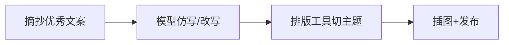

## 纲要

- **广告形式谱系**：硬广告（全篇广告，伤粉）→ 转推引流坑位（互推增粉）→ 强关联软广（贩卖焦虑+吹专家+数据+推课程+企微引流）→ 动图引流 APP → 知识星球（腾讯绑定佣金 3–6%）→ 纯硬广坑位。
- **私域变现案例**：「九零后奶爸半年变现 3 万」——猎奇标题 + 贩卖焦虑 + 私域星球（门槛 ~200 元、「每天一块钱」话术）；甄别伪造微信截图。
- **模型在软文场景**：① 润色文章；② 总结扩展引流；③ 仿写改写（如知识星球简介仿写）。
- **排版**：生成后贴排版工具切换主题（蓝/绿/晨心等），插图用图怪兽/搞定设计搜关键词。

> 本章按课程口径重构；剥离营销与课程群引流，保留软文形式认知与仿写方法。

## 一、广告形式谱系

| 形式 | 特点 | 风险/成本 |
|---|---|---|
| 硬广告 | 全篇广告 | 伤粉、费用高 |
| 转推坑位 | 互推增粉 | 引流非直销 |
| 强关联软广 | 焦虑+专家+数据+课程+企微 | 转化高、须合规 |
| 动图引流 APP | 领福利拉新 | 引到自有 APP |
| 知识星球 | 腾讯绑定佣金 3–6% | 内容须真 |

## 二、私域变现套路

- 猎奇/焦虑标题吸点击 → 贩卖焦虑 + 运营漏斗 → 推星球/课程（门槛低、「每天一块钱」降阻）。
- **甄别**：伪造微信聊天截图工具可生成头像/时间/内容，看到类似截图多思考目的。

## 三、模型的三类用法

1. **润色**：写文时让模型润色。
2. **总结扩展**：把信息总结/扩展引流到平台。
3. **仿写改写**：摘抄优秀文案/简介，按自己风格仿写（如知识星球前端技术博主简介仿写）。

## 四、排版落地

- 生成文案 → 排版工具切主题（蓝/绿/晨心等）→ 插图用图怪兽/搞定设计搜关键词（如「程序员」）。

## 五、FAQ

**Q1：公众号广告有哪些形式？**
硬广/转推坑位/强关联软广/动图引 APP/知识星球，按合规与转化取舍。

**Q2：私域变现常见套路？**
猎奇焦虑标题→贩卖焦虑→推星球/课程（低门槛话术），须甄别伪造截图。

**Q3：模型在软文里干嘛？**
润色、总结扩展引流、仿写改写三类。

**Q4：排版怎么快？**
生成后贴排版工具切主题，插图用图怪兽/搞定设计。

## 六、面试高频问答

**1. 软文有哪些广告形式？**
从硬广到强关联软广到知识星球，谱系清晰，合规与转化权衡。

**2. 怎么用模型写软文？**
摘抄优秀文案 → 按自己风格仿写改写 → 排版插图发布。

**3. 私域变现注意什么？**
低门槛话术引流星球；甄别伪造微信截图，防被骗。

**4. 知识星球模式？**
腾讯绑定、佣金 3–6%，内容真实才持久。

## 七、ops 提示（实践）

> **形式选合规**：强关联软广重内容衔接，别硬广伤粉。
>
> **仿写不搬运**：摘结构/话术，按自己风格重写。
>
> **截图要甄别**：伪造对话工具泛滥，见截图多想目的。
