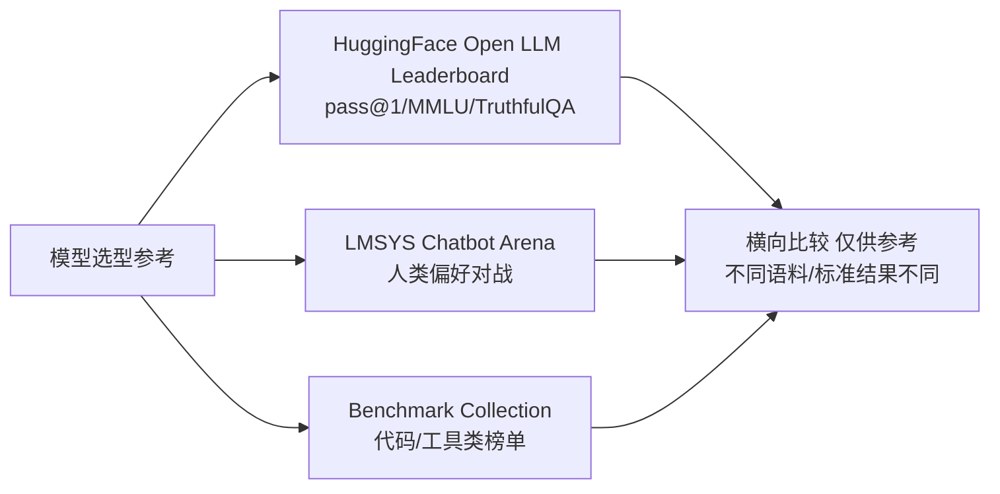

## 纲要

- **选型三问**：个人或企业用？要不要私有化/微调？能不能接受合规与维护成本？
- **开源模型**：Llama / Alpaca / ChatGLM 等可在本地运行，很多 MIT License 可直接商用；HuggingFace 上有大量中文微调版（如 llama2-chinese）。
- **闭源商业模型**：ChatGPT 综合能力行业翘楚，Claude（Anthropic，前 OpenAI 研究副总裁 Dario 创立）强调安全与自成长。
- **评测参考**：HuggingFace Open LLM Leaderboard、LMSYS Chatbot Arena；评分维度 pass@1 / MMLU / TruthfulQA 等，仅供横向参考。
- **成本三块**：服务器、网络、其他（私有化需暴露 API、做界面、维护）。
- **合规红线（重点）**：国内用大模型须遵守《生成式人工智能服务管理暂行办法》《互联网信息服务深度合成管理规定》，须备案/获证；不合规套壳平台曾被批量下架。
- **推荐结论**：个人 → 现成商业产品（GPT / Claude）；企业 → 性价比产品；有定制需求 + 技术团队 → 国内授权可商用模型（如 ChatGLM）。

> 本章按课程口径重构；许可证与法规以最新官方文本为准；剥离营销与课程群引流。

## 一、开源 vs 闭源

| 类型 | 代表 | 特点 | 适用 |
|---|---|---|---|
| 开源 | Llama2 / Alpaca / ChatGLM / 羊驼系列 | 可本地运行；MIT 等 License 多可商用；社区大量中文微调版 | 私有化、定制、数据敏感 |
| 闭源商业 | ChatGPT / Claude | 综合能力强、持续迭代、合规支持好 | 个人/企业直接提效 |

- **认知纠偏**：开源模型参数大 ≠ 好用；ChatGPT 综合性仍领先，闭源模型很多训练量超 GPT-4 但效果不及——「智能涌现」机理科学界尚未完全解释（复旦相关研究：参数/规模到阈值后能力指数级飞升）。

## 二、排行榜与评测

- **注意**：不同评分标准、不同训练语料会导致不同结果；业内专家认为客观对比两个大模型本身极困难。

## 三、成本与合规

- **私有化免费模型隐性成本**：暴露 API、做界面、服务器出问题要维护——部署/对接/维护三角度都要算。
- **商业模型要求更高**：高准确度、低延迟、好扩展性；GPT/Claude 持续迭代。
- **合规（国内必看）**：
 - 《生成式人工智能服务管理暂行办法》（国家网信办/工信部联合发布）
 - 《互联网信息服务深度合成管理规定》（备案）
 - 国内多家大模型已获证可商用；无资质套壳平台曾批量下架。

## 四、FAQ

**Q1：个人用选开源还是闭源？**
直接选现成商业产品（GPT/Claude），省去部署维护；想玩私有化再用开源。

**Q2：企业用免费开源模型省钱？**
未必。算上服务器/网络/维护/调优成本，往往不如性价比商业产品；有定制+技术团队才考虑国内授权模型。

**Q3：排行榜第一就是最好？**
不是。评分标准、语料差异大；GPT-4 / Claude 长期领先，但需结合自身场景测试。

**Q4：国内用大模型合规底线？**
须遵守生成式 AI 办法与深度合成规定，备案/获证；不合规平台会被下架。

## 五、面试高频问答

**1. 开源与闭源大模型怎么选？**
个人/轻量提效用闭源商业产品；数据敏感、需私有化/微调用开源（注意 License 与算力）。

**2. 为什么 ChatGPT 综合仍领先？**
持续迭代 + 强合规/支持 + 生态；很多开源模型训练量虽大但效果不及，智能涌现机理未完全明晰。

**3. 国内大模型合规要点？**
遵守《生成式人工智能服务管理暂行办法》与深度合成规定，备案/获证后方可商用；套壳无资质平台风险高。

**4. 企业落地大模型的成本构成？**
服务器 + 网络 + 维护（私有化还需暴露 API、做界面）；商业 API 则按调用计费、省运维。

## 六、ops 提示（选型）

> **不要盲目追参数**：参数大 ≠ 效果好；先明确目标（聊天试玩 / 真要干活），再选模型。
>
> **合规前置**：国内商用先查备案/许可证，避免上线即下架。
>
> **License 核对**：开源模型确认 MIT/Apache 等可商用条款，避免侵权。
