## 纲要

- **显存底线**：最低 RTX 2060S（8G）；进阶 RTX 3090（24G，约 6500–7000 元/张）；绘图建议 RTX 3060 及以上、显存 ≥16G。
- **显卡避坑**：不推荐 AMD（A 卡）生态兼容差、驱动/版本易不适配；苹果芯片（M 系列）强但偏移动端；主流模型用 N 卡。
- **性能量级**：4090（172.4 相对性能）vs 3060 12G（21.8）≈ 慢 8 倍；4090 出图约 20 秒，3060 约 160 秒。
- **租赁优先**：autoDL（3090 约 1.58 元/时、4090 约 2.68 元/时、A100 约 6.68 元/时，会员更便宜）首推；揽睿、OpenBayes 备选；先租 3–4 天跑通再考虑购置。
- **二手矿卡**：海鲜市场淘性价比高，但生产环境慎用，须开箱验货。
- **公司级**：双卡/四卡 GPU 工作站（至强 64 核、双电源 2400W、3×4090 约 6 万）；阿里云等大厂对个人玩家偏贵。

> 本章按课程口径重构；价格为课程引用时段（2023），以当前电商/租赁平台实时报价为准；剥离营销。

## 一、显存与显卡配置

| 档位 | 显卡 | 显存 | 说明 |
|---|---|---|---|
| 最低 | RTX 2060S | 8G | 能跑但慢 |
| 进阶 | RTX 3090 | 24G | 约 6500–7000 元/张，性价比高 |
| 高端 | RTX 4090 | 24G | 约 1.5–1.6 万；出图/推理快 |
| 绘图 | RTX 3060+ | ≥16G | 出图速度明显快 |

- **CPU**：要求不高，i9 十代 / i7 十二代即可；**内存越大越好**。
- **精度**：全精度 > 半精度 > 更低精度；精度越低对硬件要求越低、输出准确度也越低（精度 = 正确预测样本数 / 总样本数）。

## 二、选购避坑

- **不推荐 A 卡（AMD）**：N 卡生态主流，A 卡驱动/版本适配坑多、扩展性综合不及 N 卡。
- **苹果芯片**：M 系列很强但偏移动端场景，本地大模型选配朝 M 系列。
- **商家坑**：A4000 16G / CMP 90HX 等商用/矿卡型号需避开；照主流通用游戏卡买一般不出问题。
- **升级能力**：团队用需支持多卡（双卡位或 2 的倍数）、支持后续扩展。

## 三、租赁 vs 购置

```mermaid
graph TD
    A[想本地玩大模型] --> B{预算/频率}
    B -->|试水| C[租赁GPU<br/>autoDL首推 3090~1.58元/时]
    B -->|确定有价值| D[购置3090 24G<br/>约6k 二手3k+]
    B -->|生产级训练| E[租A100 或 公司级工作站<br/>3x4090~6万]
    C --> F[先租3-4天跑通流程]
    F --> D
```

- **大厂云坑**：阿里云等对个人玩家价位尴尬，不如租 autoDL 类平台。
- **淘宝第三方租赁**：问清磁盘容量（限 50/100G 基本没法玩）与网络带宽限制。

## 四、公司级工作站

- 双卡/四卡 GPU 服务器；塔式（插 4090）或机架式（4U）。
- 配置重点：售后保障 + 基础配置（至强 64 核、双电源 2400W、3×4090 约 6 万）。
- 参考：课程自用训练服务器 = 3×4090 + 至强 6130（64 核），约 6 万。

## 五、FAQ

**Q1：学这门课必须买贵硬件？**
不必。先用平替方案或租 GPU（autoDL 几元/时），跑通有价值再购置。

**Q2：能用 AMD 显卡？**
不推荐；N 卡生态主流，A 卡适配坑多。

**Q3：3090 和 4090 差多少？**
4090 相对性能约 3090 的 8 倍量级；出图 20s vs 160s（以 3060 计），体验差异大。

**Q4：二手矿卡能买？**
个人玩可淘性价比，生产环境慎用；务必开箱验货视频。

## 六、面试高频问答

**1. 本地部署大模型硬件怎么选？**
显存优先（3060+ / 16G 起，3090 24G 性价比高）；N 卡为主；CPU/内存够用即可；按场景租或购。

**2. 为什么不选 AMD？**
N 卡生态与模型兼容性主流，A 卡驱动/版本坑多、扩展综合不及。

**3. 个人 vs 公司级配置差异？**
个人租 GPU 或单卡 3090；公司级双/四卡工作站 + 至强多核 + 双电源，重售后与扩展。

**4. 精度与硬件的关系？**
精度越低对硬件要求越低但准确度也降；全/半精度需更大显存。

## 七、ops 提示（采购）

> **先租后买**：autoDL 首推，租 3–4 天验证流程再决定购置，避免闲置。
>
> **价格时效**：文中价位为课程时段，购前以电商/租赁实时报价复核。
>
> **生产避坑**：二手矿卡勿上生产；租第三方看清磁盘/带宽限制。
