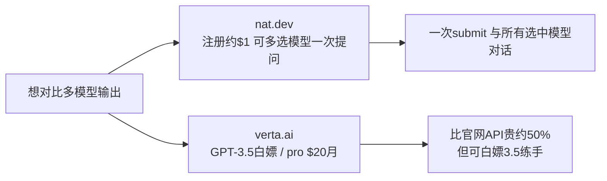

## 纲要

- **ChatGPT**：综合能力最强，但注册/网络是两大门槛（留待后续平替）。
- **Claude（Anthropic）**：界面清爽；上下文 100k token ≈ 5 万汉字，适合长文处理；文字处理与安全性强（如拒答「国内架 VPN」类灰色问题）。
- **NewB（Perplexity 类）**：可联网、上下文约 5 次会话、实时性好且引用配链接；作为 GPT/Claude 不能联网时的「语料整理」配套。
- **开源 Llama2（Meta）**：生态/流行度最高，llama2-chinese 社区有文档与微调流程，可下模型本地跑。
- **PaLM2（Google）**：英文/编码较好，中文知识弱于官方 Bard/Claude。
- **对比 Playground**：nat.dev（注册后约 $1 可对比多模型）；verta.ai（versel，GPT-3.5 可白嫖，GPT-4/Claude pro 需 $20/月，比官网 API 贵约 50%）。

> 本章按课程口径重构；模型能力与价格以官方当前为准；剥离营销与课程群引流。

## 一、商业模型

| 平台 | 特色 | 注意 |
|---|---|---|
| ChatGPT | 综合/代码最强；GPT-4 多模态（视觉/听觉/说） | 注册+网络门槛 |
| Claude | 100k 上下文、长文处理、安全性强 | 拒答灰色地带问题 |
| NewB | 联网、实时、带引用链接 | 上下文仅约 5 次会话 |

- **联网取舍**：GPT/Claude 官方联网后「智商下降」（在海量实时语料中搜素提炼）；更推荐自己搜集语料上传给它做输入。

## 二、开源模型

- **Llama2（Meta）**：Resources → Models & Libraries 可下模型；llama2-chinese 社区文档丰富，按模型微调流程喂语料即可训出领域模型。
- **PaLM2（Google）**：英文/编码识别好，中文不如 Bard/Claude 类服务。

## 三、对比 Playground

- **nat.dev**：右侧筛选模型（Cloud/ GPT-3.5/ GPT-4/ Llama2/ ChatGLM 等），输入一次指令 submit 即可与全部对比。
- **verta.ai（versel）**：模型多（Cloud/ Llama/ GPT）；未登录也能用；GPT-3.5 可白嫖；Pro $20/月解锁 GPT-4/Claude，价格比官方便宜渠道贵约 50%，但练手够用。

## 四、FAQ

**Q1：Claude 和 ChatGPT 怎么选？**
综合/代码选 ChatGPT；长文处理、安全性要求高选 Claude（100k 上下文）。

**Q2：NewB 有什么用？**
作为 GPT/Claude 不能联网时的实时语料整理配套，带引用链接，适合先搜资料再喂给模型。

**Q3：哪里能免费对比模型？**
verta.ai 白嫖 GPT-3.5；nat.dev 付约 $1 可多模型对比。

**Q4：Llama2 怎么本地用？**
从 Meta Resources 下模型，llama2-chinese 社区有微调文档，喂领域语料即可。

## 五、面试高频问答

**1. 国外主流大模型平台各自定位？**
ChatGPT 综合最强；Claude 长上下文+安全；NewB 联网实时；Llama2 开源可私有化；PaLM2 英文/编码好。

**2. 为什么不完全依赖官方联网？**
联网后在海量实时语料中搜素提炼，模型「智商下降」；自搜语料上传更可控。

**3. 对比 Playground 的价值？**
一次指令横向看多模型输出差异（nat.dev / verta.ai），便于选型与练手。

**4. 开源模型商用注意？**
确认 License（Llama2 有使用条款），中文用 llama2-chinese 社区微调版需注意合规。

## 六、ops 提示（平台）

> **白嫖优先**：verta.ai 的 GPT-3.5 足够练 Prompt；别急着付费。
>
> **长文场景**：Claude 100k 上下文是刚需场景首选。
>
> **合规访问**：国内访问境外平台涉及网络与合规，优先用国内平替完成学习。
