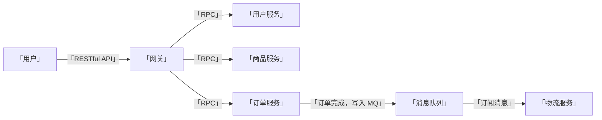

本讲介绍微服务中的核心要素之一：通信机制。

## 微服务中常用的三种通信方式

微服务中常用的通信支持方式有三种：

第一种是 RPC 通信。这种通信机制主要应用在拆分之后的服务，用于服务与服务之间的调度。

第二种是 RESTful API，用于整个项目对外提供访问资源的接口。

第三种是消息队列。消息队列在单体项目中主要应用于处理耗时任务，当然在微服务中也可以作为一种通信机制。

下面通过一个示意图，了解这三种机制是怎么工作的。

## 三种通信机制如何工作

假设目前有三个服务：用户服务、商品服务、订单服务。在服务与服务之间，它们会有相关的调度关系，比如用户和商品、用户和订单，以及商品和订单。而服务与服务之间的通信，称之为 RPC 通信。通过 RPC 使得服务与服务之间的调度像在本地调用一样，这种方式主要应用在服务与服务的内部。

如果有用户想要访问这个项目，难道也需要通过 RPC 去请求各个服务吗？显然这对用户来说并不友好，因为服务有很多。因此在业界中提出了网关这一概念：在用户和项目之间增加一层网关，用户将请求发送到网关，网关再将用户的请求分发给各个服务。

先来看网关与服务之间的通信。对用户来说，网关即是服务，所以它所请求的服务，实际上仍然还是一个整体，这是需要注意的。

而网关与服务之间的通信，也仍然会采用 RPC。因为服务在处理请求的时候，其方式就是用 RPC 来接收和处理的，所以网关也是用 RPC 的。而用户在请求网关的时候，常见的方式主要是使用 RESTful API，即用户采用 API 的方式访问网关，网关以 RPC 的方式访问各个服务，完成最终的请求。

这就是 RPC 和 API 各自的功能和应用。

在项目中，还会用到消息队列。比如说生成一份订单的时候，订单完成之后，将信息写入 MQ 中；物流服务要发货，只需要从订单服务中订阅这一条消息，完成发货的动作，这就形成了订单和物流之间的通信。

## 为什么有了 RPC 还要消息队列

关于通信机制，可能需要关注的一个问题是：项目中使用 RPC 之后，服务与服务之间的通信已经有点类似于本地调用了，那为什么还要增加消息队列来进行通信？这主要是由通信机制的特点决定的。

RPC 的通信机制实时性是比较高的，但是如果服务与服务之间调度过深，对整个项目来说会增加复杂度。其次，它的调度实际时机不好控制，因为从一个服务请求另一个服务，是需要实际发起调用的，这是一个关键性的因素。

RPC 主要适用于要求实时性或者数据变更比较多的情况。而消息队列，主要处理一些实时性要求不是特别高的、或者说耗时的任务，这类场景就可以把 RPC 转变成 MQ，以消息队列的方式来进行处理，充分利用两者的特点。

同时对整个系统来说，采用消息队列的方式会大大提升解耦性。比如用户服务与订单服务采用 RPC 交付之后，两者会存在一定的耦合。而订单服务和物流服务之间采用的是消息队列，订单服务并没有直接向物流服务发送消息，因此它们之间的耦合实际上比较低。两者唯一需要注意的就是：订单服务发送到消息队列中的数据格式，与物流服务接收的格式是不是一致。这就是两者的区别。

在项目中这三种通信机制都用得到。当然，除了这些通信机制以外，还有其他主流的通信机制，主要是 gRPC、RPC 和消息队列。
