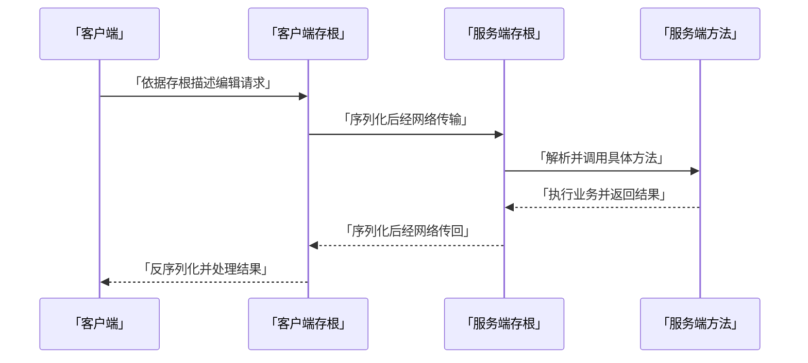

从本次课程开始，将学习 RPC 与 gRPC 的课程知识。本讲先了解什么是 RPC，以及在项目中是如何实现服务通信的。

在前面的学习中已经了解到：对于一个单体服务，通过拆分原则将服务进行拆分之后，构成服务化，项目之间通过 RPC 这个机制，来实现服务与服务之间的通信。

对于 RPC 的具体定义：RPC 是一种用于不同计算机之间通信的协议，它允许一个计算机调用另一个计算机之上的方法或者函数。

可以这样理解：在单体服务的情况下，服务与服务之间的调度，可以通过 new 创建一个服务对象，然后再通过点（.）调用它的方法，就可以完成具体的业务请求了。但服务进行拆分之后是两台机器，此时就不能这样调用了，那应该怎么办？这时候就有了一个理念：希望在服务拆分之后，服务与服务之间的调度，也能够保持像本地这样的方式调用，所以 RPC 就诞生了。

所以 RPC 的存在，就是使得服务与服务之间的远程调用，相互之间在调度上，能够与本地调度是类似的，或者说是一致的。

举一个例子：有两个服务，一个是订单服务，另一个是 user 服务。这两个服务会部署在不同的机器上，此时订单服务需要调用 user 服务，获取某一些信息，来完成请求。

在使用 RPC 的情况下，user 服务会在自己的服务中创建一个 RPC 的 Server，也就是 RPC 的服务对象，对外会提供 RPC 的相关调用的方法；而订单服务会通过 RPC 的客户端，来调用 user 服务中的 RPC Server，完成具体的请求。

## 实现 RPC 通信要解决的问题

那具体如何实现 RPC 通信？首先有几个问题。

第一就是在调用过程中，需要找到或者确定要调度的服务目标。当然仍然还是会通过 IP 和端口，IP 代表机器，端口代表程序。虽然我们还是要通过 IP 和端口来确定服务，如果项目后期用了域名，那就把 IP 更换成域名。

第二个问题就是要调度的目标。在 RPC 通信中，要调度的目标是服务的方法，比如 userServer 中的 getUser 方法，是调用需要用到的。

知道了服务的地址，也知道了要调用的目标，那如何传递信息？也就是 RPC 服务端和客户端这两者之间通信的时候，会约定统一的数据格式去进行通信，这是需要解决的下一个问题。

举个例子：有一个 user 服务，服务中有几个方法，比如发送 Pin 码、登录、注册、获取用户信息，以及查找用户。每个服务的方法会有不同，这五个方法要求传递的参数和响应的结果是不相同的，这是需要思考并解决的问题。如果要自己去实现 RPC，在程序中应该如何区分方法？又应该如何区分它的请求参数？

可以这样设置：设计两个结构，一个是请求，一个是响应。在请求结构中，第一个参数代表方法，也就是请求 RPC 具体要请求的方法，它的格式可以写成服务对象.方法，这样就可以确定目标服务、调用的服务和调用的方法。第二个参数用的是 interface 类型，这代表它可以表示任意类型，它的信息存储就是要请求的参数。第三个参数，则用于记录在请求过程中每一个请求的 ID 标识，以便做到请求的区分。

而在响应结构层面，会有一个 ID，用来区分这是哪一次请求；第二个参数是结果，同样用的是 interface 类型；第三个是异常。这样在请求 RPC 的时候就知道参数是什么，RPC 出现异常时也能知道。通过这两个结构，基本上就可以大体的规划或者实现 RPC 通信了，因为通过这两个结构，基本上就可以定义对 RPC 服务所发出的方法的调用。

除此之外，参数传递过程中会采取什么样的协议？可以用 JSON，也可以用 XML，也可以用二进制，这都是可以的。因为在 RPC 通信过程中，它并没有明确规定一定要用哪一种协议，但目前相对主流的是 JSON 以及二进制，这两个方式用得较多。

还有一个问题：RPC 的客户端与服务端之间基于什么协议来进行通信？实际上，可以用 TCP、UDP、HTTP、WebSocket，都是可以的，因为它并没有明确规定一定要用哪一种协议类型。而在目前的主流中，TCP 协议应用比较广，其次是 HTTP/2，这一个协议应用也比较广泛。

## RPC 通信的具体流程

最后来看一下具体流程。客户端会向服务端发送消息，这是一个期望。具体做法是：在客户端和服务端之间，都会存在一个叫 stub（存根）的内容，这个存根的目的就是记录服务端和客户端需要调用的方法，以及方法的参数、方法的响应的相关信息。

对客户端来说，服务的存根就是对服务端所定义的服务的描述；而服务端的存根，对服务端来说是一个接口的约束，这是存根的作用。

客户端在调用的时候，会先通过存根知道服务中的哪一个方法，因此依据存根中所定义的描述，将请求编辑好并发起调用，再通过内部的调度机制，通过网络传输到服务端，经过服务端的存根，然后调用服务端具体的方法。此时，服务端完成请求之后，同样会把结果发回，通过客户端的存根，最终又通过网络传回，客户端准备接收之后进行处理。

中间会进行数据格式的序列化和反序列化：客户端发送的时候会进行序列化；服务端接收的时候会进行反序列化；服务端发送的时候也会进行序列化，这是需要注意的。

序列图中两侧对应服务端和客户端在发送过程中使用的数据结构，请求结构与响应结果各占一块。

本讲主要了解了 RPC 是什么，以及它是如何进行通信的，以上就是具体的通信流程。
