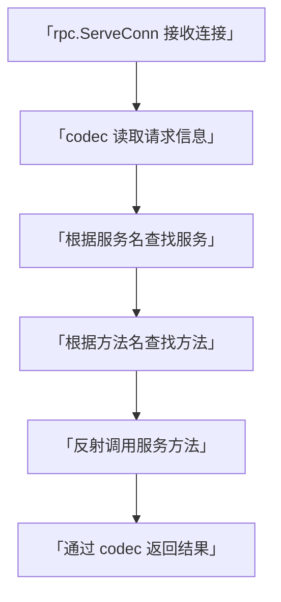

本讲内容分为三部分：首先分享一些源码阅读的小技巧；然后构思如果自己去写，应该如何去实现；最后结合代码来进行分析。

之所以讲源码分析的小技巧，主要是因为后续会对源码进行分析，很多人在这一块比较欠缺，看源码的时候容易迷糊。看源码时常见的状况是：看不懂、觉得源码又很绕、不知道怎么下手。关键问题在于：一是看源码的时候不确定自己的目标、方向，或者说不确定希望从源码中得到一些什么样的内容；二是看的时候没有基于自己的思想去构思，直接就去看，导致了很迷糊；另一个是源码整体的调度链非常复杂、比较难理解。就因为这三点，很多人对源码并不感兴趣。

课程的方案可以这样理解：首先确定目标，确定整套源码要阅读的目标，因为阅读源码一定需要一个关键性的主题，没有主题的话可能会失去目标。确定源码之后，还要想一下：如果源码让自己去写，应该如何构思。基于构思，可以大概说出源码实际的流程和方式，这样就有一个方向性。最后基于前面的分析，继续源码的阅读。一般来说这就是阅读源码最好的思路。而关于源码在整体调度链这一块的分析，会在后面的课程中分享。

现在来看第二个话题，就是整体的构思。构思主要分为三个点：RPC 之间通讯的数据格式、传输参数，以及请求的处理方式。前两个点在讲 RPC 的时候，比如第一讲，就已经解释过了，并且也看了一下源码：在标准库 net/rpc 包中，`ServerCodec` 这里就定义了一个请求和响应的数据结构，因此已经了解了。

而对 net/rpc 来说，因为它没有固定一种传输的编码方式，所以还需要考虑这个问题：如何在项目中集成多元化的编码格式。在标准库里面默认提供的是一个 JSON 的序列化方式，这里有一个实现。因此在第二点，也要去考虑实现，毕竟如果要自己构建一个 RPC 服务，那就必须要去想这两个问题。

之后就是接触到请求之后，是如何运行对应的服务，又是如何运行对应的方法。在实例中，比如客户端向服务端已经发出消息，那么如何调用到这个服务的方法，这是思考的问题。因为它是在整个包的外层，不是在里层，所以整个调度需要自己去实现。前面这两个能理解，第三个其实也可以分析。构思中有一个非常关键性的包，那就是反射，可以基于反射的思想把它实现。

具体的流程可以这样理解：首先在客户端，依据 RPC 调用的存根，也就是知道调用的方法、方法名、传递的参数和响应的信息，然后根据这个存根进行请求，进入网络到服务端。服务端根据这个存根去解析，解析请求中它会接收到请求，此时接收到的只是一个最基础、最原始的请求。而要找到服务的话，如果服务名写错了，它会先抛出服务名相关的错误，所以这里会根据传递的服务名先去找到服务，找到服务之后再找方法。

服务和方法，他们是以字符串的方式表示的，那么可以想一想怎么存储。当然是用 map，因为 map 的 key 可以用字符串；如果用其他结构，它的 key 写一个运行时类型是没法做到的。所以此处可以想到：在注册的时候，他一定是把服务基于反射注册到结构体的名称，然后注册到以名称做 key 的 map 中。那么可以这么思考：在查找的时候，只需要根据传递的「服务名.方法名」的方式，通过字符串分割，先得到服务名，根据服务名找到服务，然后再根据方法名找到方法。

因此在注册的时候，可以想到：服务向 RPC 注册，在他内部的机制中，会通过反射获取到服务的对象、服务的名称，然后再获取到服务的一些方法并继续绑定。所以这个是可以去实现的。

从整体上来讲，整个 RPC 的调用可以分为两块：第一块就是注册的时候，会根据传递的服务，先利用反射获取到服务名，注册到服务名、方法名，注册到自己所定义的一个服务对象中，然后以字符串作为服务名或者方法名，存到 map 中。第二块就是调度的时候，当他接收到请求连接，从连接里面获取到信息，再基于请求参数的服务获取到服务名，然后再获取到请求的参数、请求的 ID，再根据前面定义的注册的方法、注册的服务拿去解析。所以在这里已经大概有了一定的轮廓，之后结合源码来验证是否如此。

结合源码，可以从整个服务的入口开始，也就是服务在注册的这一层入口：上面就是注册服务，下面就是监听，最后就是处理。因此从整体上先看注册，然后再看处理。

## 注册过程

先看注册。在注册中，他会先创建一个默认的服务对象，然后再调用它的注册方法。他的默认服务对象是一个 server，创建的是一个空的 server，往下就可以返回刚刚看代码的地方，这就是 server 中的注册方法。在注册方法中，默认传的就是要注册的服务对象，然后第二个参数是一个名称，以及是否使用这个名称，默认了会 force。也就是说默认并不会去定义这个名称，那就由系统自己去获取。

继续往下走到这一步，就明显可以确定他使用到了反射，这就符合前面所讲的：注册的时候会通过反射获取到服务对象的技术信息，包括服务名、方法名。往下可以看到，当服务自定义的名称没有的时候，他就会去获取：通过反射或者指定服务对象，再根据类型得到名称，这符合刚刚所讲的这一套。到此第一步得到名称了。得到名称之后，他也得到方法，在下面就有一段加载方法（`suitableMethods`）的代码，再往下可以看到它会遍历整个对象的方法，遍历通过反射完成，具体再往下可以不用去看了。

到此，已经清楚了解到他做了什么事情：在一开始注册的时候，注册的过程中会先得到服务名，然后得到一个方法列表，最终再由这个服务进行存储。存储之后往下，这里有一个写法：这里的服务确实是 map，用的是 sync.Map，也就是在使用的时候，他为了避免并发而使用了 sync.Map，然后通过它来加载并注册。加载的时候可以看到是以服务名作为 key，然后以服务对象作为 value，这就符合前面所分析的特点。

## 请求处理

再往下就是去处理请求，处理请求的就是 rpc.ServeConn。这一条也可以看一下他到底怎么做的，同样他也是默认的服务对象往下走。到这里他做了一个事情：一个 codec。此处的 codec，在整个程序中，对 RPC 来说是用于做编码、做序列化工作的。因为平时无论是通过 JSON 还是做二进制，在使用的时候，多数会调用 Decode 方法来进行反序列化或序列化的操作。所以从这里可以尝试着去分析，它是否真的在做这样的事情，带着这个疑问去理解，因为目前还不能验证刚刚提到的它是做编码的工作，所以还需要程序往下走。

在阅读源码的时候，还有一个很好的思维点：方法名实际上是有讲究的，一般正规或者标准化的源码，方法名都会定义好，做到见名知意。从这里可以看到 ServeConn 是读取请求，然后他会返回出请求信息，因此这一段可读也可不读。不读，是因为已经知道这里返回的信息是属于读取到的请求结果。那这里的服务名、请求类型、请求预期的请求参数、响应、是否长连接错误，看字面就可以分析出来。

在下边就可以看到服务的调度，也就是调度就在这里发生了。从整体的分析上，已经能够分析出来、验证刚刚所提的 codec 是否用于消息编码。往下走，这里会读取到请求的头部信息，再往下，可以看到这里会读取到请求的 body，然后请求的整体信息。这里确实会读到请求的整体信息，但是他读取调用的方法，并不是调用 server，而是调用 codec。比如说在请求中，他会把自己的信息传递给 codec，通过读取请求的方法进行获取。从这一点就分析出 codec 确实需要这一功能，比如 codec 他会根据请求的参数回去进行转化。在此处确实验证了刚刚所讲到的这一点。

到此，net/rpc 标准库的处理已经大概了解了，net/rpc 标准库中的这些源码，整体来说并不复杂。刚刚分析的时候，也包含了一些源码分析的技巧，建议在课后尝试着自己去阅读、了解一下。
