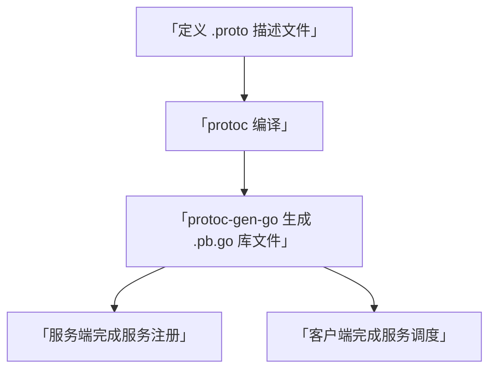

gRPC 主要是去解决 RPC 在通信过程中所存在的一系列问题。本讲进一步了解和学习 gRPC。

在构建实例前，首先需要对 gRPC 本身、它构建实例的使用过程做一定的分析。

## gRPC 构建实例的流程

开始的时候，会先定义一个 .proto 文件，它主要起到一个约定或者说明的作用：约定服务端构建服务时应该实现的方法、方法的参数以及参数的类型。客户端通过它，可以了解到服务的方法、参数和响应的结果，这就是它的作用。

而在使用中，会通过 protoc 工具，就是前面所下载的对数据进行序列化、反序列化的工具，根据 .proto 文件进行编译，再通过相应的工具，比如当前会用到 protoc-gen-go，去生成对应的库代码。因为使用的是 Go，所以当前会使用 .go 后缀的库。

在这个库中，会包含对服务的定义，比如服务的接口、参数、请求等都会定义好。在客户端，它也会有服务如何调用服务的相关内容。因此，客户端和服务端的这份 .pb.go 文件是一致的。服务端和客户端分别会从该文件中去完成相应的工作：服务端做服务注册；客户端依据它去进行服务的调度。

这就是使用 gRPC 涉及到的一些流程。具体来说：首先，会先定义一个 .proto 描述文件；然后，根据这个描述文件，生成 .pb.go 的库文件；最后，再由服务端和客户端分别基于这一份库文件，完成相应的应用开发。

## 定义 proto 文件

回到代码中。首先，定义一个 proto 目录，该目录主要存放项目入口复用的一些 .proto 文件。现在定义一个 .proto 文件，当前使用的是 user.proto，这与前面的内容是相符的：前面的应用案例使用 user 作为了具体的应用案例实例，所以这边也使用 user.proto。

接下来描述该文件的内容。第一行基本上是固定的，定义一个 syntax，它的作用主要是去描述版本，决定 proto 版本，目前以 proto3 为主。

第二行，会定义一个 package，可以理解为很多语言中的命名空间，在这里定义的意思是默认的包名。

最后，因为当前使用的是 Go，所以还要定义一个 option：go_package，来指定 Go 的包。这里注意一下版本号，它会要求写上 user，实际就是 Go 要生成的包的名称，即包名。

第一行可以理解是定义对应的命名空间，第二行定义的是具体的包，也就是当前的这一个包。通过上面的三层，就已经了解到所使用的语义：当前会生成的库文件的包名，以及命名空间，就在这里定义好。

定义完成之后，还要往后面写，那就是完成服务的定义和请求参数、响应参数的定义。

在服务的定义上，统称都是采用 service。当前使用 user 作为服务，并在服务里去写 user。定义完服务名之后，下面就是定义好 RPC 的方法，通过 rpc 关键字修饰，GetUser 就是我们要定义的方法。GetUser 中肯定要传递参数，对于每一个 RPC 的方法，都会要求传递和响应出结果，否则会抛出错误。因此需要定义好对应的方法。

方法名的定义，以及在这里所描述的一系列内容，可以根据它的方法定义 request 请求和 response 响应。这边会定义一个 message，代表是方法（请求）的信息。请求可以把它看成是一个结构体。那这时候也能理解好：前面 RPC 对服务的定义，使用的是结构体。同样可以把这个 message 描述成一个消息体，把它看成是一个结构体，然后作为传递参数。还有一个是响应，这样请求的、响应的两个消息体的结构就定义完成了。

最后写上里面的内容，即属性的定义。在字段的定义上，要求是属性的类型，然后属性名、标识符。这个标识符，后面会讲为什么要增加一个标识。

属性类型的定义，首先是 Id，然后往下是响应的结构。在响应结构中，它会输出 Id，除了 Id 以外，还包含了名称和手机号。

内容中有一点值得注意：在一个 message 中，标识符是不能重复的。还要注意它的格式是：属性类型、属性名、标识符。然后还得注意，每一个内容中要加上分号，这里没加，加上。

到此，一个 proto 就定义完成了。

## 生成库文件

之后构建好相关的库文件。编译的命令比较多，把它写在脚本文件内，方便查看。

在进行编译前，还有一个话题要讲一下：安装的时候，是把 gRPC 的这三个文件都放到同一级目录下，并且这三个都配置到环境变量中了。这是一点值得注意的，所以会直接去使用它们。因此要检查一下你的安装，是否都放在同一个环境目录下，这是最好的。

上面就是它的编译命令。执行这个命令的目的，是为了生成库文件。前面讲过了，proto 文件的作用是约束服务和给客户端做说明，它们会根据 proto 去生成对应的库，而我们目前也需要生成库文件。

命令内容是 protoc 作为编译，在里面它会有两个参数：一个是 --go-grpc_out，一个是 --go_out，--go_out 代表是它要输出的目录。然后在输出目录下面传一个点，再分别指定两个插件：protoc-gen-go-grpc 与 protoc-gen-go，两份有一点不同：protoc-gen-go-grpc 这一份是对 gRPC 的支持，protoc-gen-go 这一份是标准的对消息的转化的处理。然后再指定要使用的 proto 文件。到此就写好了。

通过它来生成，是在同级下进行的。执行完之后，它会在根目录创建两个文件：一个是 user.pb.go，一个是 user.grpc.pb.go 的文件。

user.pb.go 这个文件里面会包含前面对消息体的处理代码，比如定义的请求的结构体。可以看到，在结构体中，上面这一块属于 gRPC 内部的内容，放在它下面的，就是所定义的具体属性，它把注释的也加上去了。然后在下面就是一个响应，这就是定义响应结构体。在最后的这一段内容，就是对前面所定义的两个结构体进行序列化，即序列化的封装。

在另一个文件中，它包含了对服务和结构的定义，所以服务和客户端两端结构的定义也属于客户端结构。比如说它怎么去调度，在下面有封装好的怎么去调度这个方法、列出这个客户端然后调用，以及怎么去调用服务的具体内容，都写好了。

下面是服务的一个结构。在服务结构中，它定义了要实现的一个结构，但同时，它这里又要求实现一个方法，这个方法属于新版本，也就是新的 proto 文件用了新版本的编译器，protoc 是一个新版本，它会带上这一段内容。这段内容要求实现这个结构，这个结构的主要目的是用于向前兼容，属于 proto 最新版本。在以前的版本中，生成的 grpc 文件里这一段是不存在的，可以不使用它。

回到这个文件中，在后面的这里加一个内容，一般可以先加上它，因为它暂时在实际开发中不会直接用到。在后面加上这一段，去设置对刚刚的一个结构方法的实现，这样它就不会再报错误。所以在编译下，再次运行就可以了，它会重新生成。

然后再给当前的 module 初始化，并加载所需要的包。在加载包的过程中，可以看到它会去查找 grpc 的核心库包，查得到并加载进来。到此就写好了。

## 服务端实现

第一部分写完之后，需要根据它去构建服务，并进行请求调度。因此，还要完成服务端和客户端。

首先，仍然实现服务端的功能。数据仍然是 data，把它挪过来，所以命名空间、设计这里不用改，因为这是存储数据。

重点是服务方法。在服务方法中，之前是定义了一个服务，因此在这里，还是定义一个服务。服务定完之后，再定义它的实现方法。这一次不是按照 net/rpc 包了，需要依据 protoc 根据它生成的这个服务的接口去进行实现。也就是说，这是要实现的一个接口。在实现接口中，要实现好 GetUser 方法、context，然后就是它的一个请求 request，这请求是 GetUserRequest，然后再响应，直接响应就是在 user 包下，一句错误信息。到此，就实现了 user server 的一个接口。

实现完成之后，需要完成它里面的功能。这里的功能，可以直接从前面的代码中复制过来，其实都是一致的，把它拷贝过来。完成之后，这里它的响应、结果就会是这样子：查询到结果时，把结果写入响应对象；没有结果时，就返回错误。那到此，服务就实现完成了。

实现完之后，最后再启动好服务。启动的过程，和前面的也具有很大的相似点。首先，也需要一个 listen 的监听，主要还是通过 net 包来创建的。在配置上，默认还是用的 tcp，因为像 HTTP/2，它也是基于 tcp 去建立的。做异常处理，建立失败就返回错误。

建立完之后，接下来就要去创建服务了。首先去创建的是 grpc.NewServer()，而在里面它要传递很多信息，后面会讲它的 server options 的一些操作。

创建好服务之后，需要完成服务的注册，通过 RegisterUserServiceServer 这个方法。这个方法从哪里来的？就是在生成的库中，它包含了对服务注册的代码。在服务注册的时候，它会要求把 grpc 的服务传进来，然后再把自己要注册的这个接口的服务传进来，并最终调用 grpc 的注册方法去完成最终注册。所以第一个参数就是 grpc 服务本身，第二个参数就是要创建的服务 server。

创建完之后，最后再启动，给它输出一个信息提示一下，就是服务已启动。server 启动起来，把 listen 放进来。到此，服务定义完成了。

其实在使用上的话，和原生的 gRPC 做了很多相似的，写法上面也是非常简洁。

## 客户端实现

然后再完成客户端。在客户端中，就是通过库文件实现服务 gRPC 的一个调用，通过 grpc.Dial 的一个方法去获取一个连接。这是一个获取连接的方式，它建立的是 grpc 的客户端连接，写法上仍然和 rpc 的方式相同。

在后面它会有一个参数，这里要求传递 grpc.WithTransportCredentials，它传递的是一个认证相关的参数，主要是传递是否去进行一个接入的认证。当下没有使用 tls 认证，所以需要先传递进来，然后它会传递一个新的参数，把这个认证的对象给它传进去就可以了。

第一个参数是服务的地址，第二个参数这一段传的是连接过程中使用的是否加密的，然后把这个加密（凭证）放进去。当前它会返回一个客户端的连接和错误，所以还需要接收一下连接对象和错误，连接失败就返回错误。

连接成功之后，那么当然是请求，然后还需要关闭，调用 close 关闭。

然后去实例化一个 new 客户端，前面讲过它这里除了服务以外，还有对客户端的创建。创建了之后，通过下面的调用它的 GetUser 方法去完成服务端的处理。所以在整体上可以看出来，它已经封装好了，我们知道是调用就可以了，把客户端传进去，然后再调用。第一个参数是 context，再传递要请求信息，用户 Id 为 1。这样就写完了，再做一下服务异常的处理。一个服务端客户端的调用就写完了。

## 运行与总结

先启动服务，go run；再启动客户端，go run。可以看到是没有问题的：服务端启动成功，并且客户端也进行响应了。到此，就已经构建好一个 gRPC 的实例了。

再回过头看代码，从代码的整体结构上来说并不复杂，它在原生的 rpc 的基础上面增加了一个 proto 的文件。这一份文件对于服务端和客户端来说，起到了很好的沟通作用。最后再通过命令生成对应的库文件，这样，它们可以更好地去完成相互的协作。在不同语言也是可以去实现通信的，不同语言也只需要根据这一个 proto 的文件，它也能够生成自己语言的库文件，并完成服务的调度。

这就是一个非常简单的 gRPC 的应用实例。
