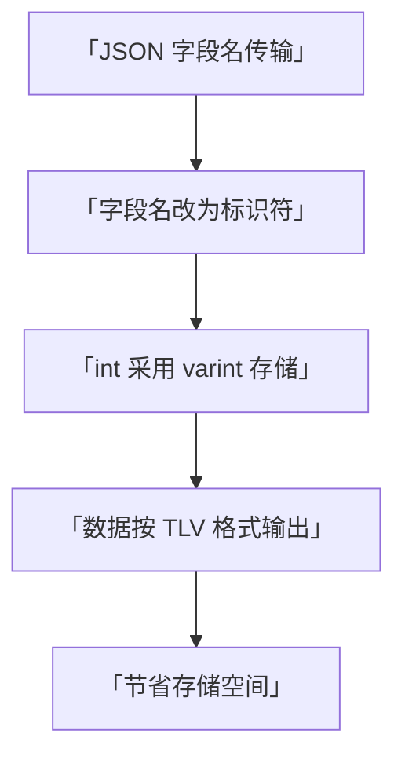

本讲来了解 protobuf 具体是如何应用的，以及它背后的原理是怎样的。对 protobuf 的理解，从这几个维度来展开：先了解它本身是什么，以及它的背景；然后了解 protobuf 的工作过程、它的语法，以及对数据的序列化、反序列化的原理分析。

## protobuf 是什么

首先，先来了解一下它到底是什么。protobuf 是谷歌开发的一种跨平台、易于扩展、性能极高效的序列化格式，特点就是将自定义的数据转化成字节流，再从字节流转化成数据结构。它本身在使用上的话，比 JSON 和 XML 小，同时，在序列化与反序列化的过程，速度是比较快的。这是它基本概念的定义，具体可以用后面的分析来理解这些定义。

## protobuf 要解决的问题

第一个问题就是它是解决什么问题的。它解决的问题，第一个就是版本兼容性。开发项目的时候，经常会有一些版本的迭代更新，一个版本一个版本之间会有一些差异，特别是可能会因为业务的需求，使得原本已经编辑好并开发运行的功能模块会有一些改动，而这些改动就包含了其中一些方法的参数。一个方法的参数一旦改变，对它基于这个方法的调度，这一条链都一定会有一些变动。因此怎么能够在升级新版本的时候，更好地去兼容以前的版本，就提出了 protobuf 的一个特性来解决这个问题。所以它本身在一开始的时候并不是用于 RPC 通讯的。

第二个问题，就是接口定义清晰。这一点，在定义 user.proto 文件的时候就已经能看出来了。所以 protobuf 的诞生本身就是为了去更好地解决在系统中版本迭代更新、版本之间的兼容性问题。因为随着时代发展，发现这个特性非常好，就引入到了 RPC 通信这一块里面，通常就变成了 RPC 所应用的一组协议，这是它的一个发展过程。

## protobuf 的工作过程

接着看 protobuf 的工作过程，其实在前面内容中已经有讲到。首先会先定义一个 .proto 的文件，基于 protoc 的工具，把它编译成各个语言所适用的库。在使用的时候，客户端通过编译之后生成的这个库进行调度，也根据它自己所使用的 RPC 的核心代码，发起对服务端的调度。因为两者之间的协议都是基于 .proto 文件进行转化的库文件，因此无论对服务端还是客户端来说，都是可以很好地兼容起来的。也就意味着理论上，如果知晓项目中某一个服务的 .proto 文件，那就能够知晓它所对外提供的方法，以及调度的过程。这就是它的一个工作过程。因此过程中，会基于 .proto 通过 protoc 的工具，把它编译成各个语言依赖使用的库包，再完成它们各自业务的开发。

## proto 的语法

再来看 .proto 的语法，可以看一下文档。前面定义 user.proto 文件的时候，就已经有接触并了解了：前面三行主要是对它的版本号、.proto 以及包名进行定义，下面就是定义服务、定义服务相关的结构体，就是消息体。这里基本上已经有了一定了解，主要来看一下它里面的内容。

在内容中值得关注的是关于消息体中的格式，其实消息体的格式是由限定修饰符加上数据类型组成的。但在我们内容中的话，实际上没有加这个所谓的限定修饰符，所以从这里可以看出它是一个可选项。

限定修饰符主要有这三个：required、optional、repeated。required 是用来限定这个字段是必须增加的，在消息中，如果它为空，那么可以给它设置一个默认值。repeated 的特点是在消息中使得这个属性能够起到数组特点，因为在消息中是没有定义数组的类型的，所以需要通过 repeated 来进行修饰。因此如果需要数组，那么这个 repeated 就是非常关键性的，它会加在这个参数的前面，加上之后，这个手机号码就是一个数组，一个字符的数组，所以它修饰的对象就是这个属性类型。

下面这里有一个表，就是 repeated 中所使用的数据类型。这里的数据类型是指上面各个数据类型对于语言的具体类型，这一边是 protobuf，这边是各个语言的。主要关注 protobuf 的，因为它转化了之后，还是要根据你去进行转化的。

再看一下 service。service 的一个写法主要是定义一个服务，在定义的时候，通过 rpc 修饰代表该方法是一个 RPC 的方法，然后内容中一个请求一个响应，这两个在参数里面是 proto 格式上要填写的。而在 proto 中的重点就是这两个：一个是 service，一个是 message，这里一定要去了解它们的一些关系，特别是对序列化来说，是项目中也许会用得到的。

## protobuf 的序列化原理

再看 protobuf 的序列化原理。在没有使用 protobuf 的时候，客户端和服务端相互通信，基本上大多是以 JSON 这一类数据类型为主。而这一类数据类型，从整体可以看出，这里有 Id、Name、Phone 等字段，它们之间会以这样的格式进行传输。下面从传输的角度来做优化，看一看怎么优化。

这是原本正常的 JSON 文件，根据 proto 会定义一个 message，在这个 message 中，首先会定义好这个 JSON 中所使用到的 key、字段以及它的属性类型，比如 Id 它对应的属性类型、Name 对应的属性类型。定义完之后，在后边跟上 1、2、3 的标识符。那这个标识符的作用是什么？优化的地方就在这个上面。实际上每一次传输的时候，在客户端和服务端这些通信中，无论客户端还是服务端内容怎么变，有几个内容是不会变的，就是它的字段，字段名是绝对不会变的。因此基于这个思想，在 proto 中，就将这个字段名改为了标识符，通过标识符来代替。可以理解为把字段名转化成了标识符，在看的时候，就会更加节省：一个 int 类型总比一个 string 类型所占用的空间要少，在常规的比较下面来说，通常都会小。所以从这里可以看出它已经减少了内存空间。

那么这样的方式有什么好处？首先第一，它是减少空间，这是明显看得出来的。第二，假设序列化之后的这一份数据被第三方程序捕获，也不能够立马从中得到对应这个数据的答案，因为它只能得到一个标识符，所以它也具有一定的安全性。这一份 message，比如这个 message 定义的 proto 文件，一定是在客户端或服务端中的，然后再基于它根据接收到的数据进行编码转化，得到最终的结果。这一份数据如果是被第三方得到了，也不怕，因为标识符是不清楚的，只要标识符一改，这个结果和意义就发生了改变。这就是它的一个优化之处。

除此之外，在序列化过程中也有两大优化：第一，是对 int 类型运用 varint 进行的存储；而在数据化最终输出的时候，采用 TLV 的格式进行存储。这也是整个 protobuf 的协议转化过程中的两个非常关键的地方。

## varint 存储优化

首先看 varint。varint 到底是什么？以前都知道，一个 int 类型原来是四个字节，但现在期望在这上面对 int 类型做优化，varint 就是对这个 int 类型做出优化。那么它优化的地方在哪？直接往下看。

假设一个 int 类型 1 和 2 作为示例值，那么 1 和 2 的结果转换之后如下，这里省略了一些信息头。它原本是四个字节的，一个字节是 8 位。但因为实际上有值的时候，是在最后一位或者倒数第二位，实际上就把前面的那些改成标识位了。在 int 中实际有值的时候是最后一位，从中可以看出来，就是 int 类型的 1 这个数值，它在存储的时候实际上有较多的空间是比较浪费的，它实际只有最后一位的值才有结果，但是它会占四个字节，其实只有最后一个字节真正是有值的。

在这个时刻，想到在技术上面做一些调整，来看一下 varint 是如何存这些数据的。比如当前是一个二进制的数据结构，它占了四个字节，但是实际上最后一位才是有结果的。那如果是 varint 如何存？它会这么存，只是看不懂，为什么它这里占了两个字节，但是它的第一个数据从一开始，这怎么是一个二进制数据结果？很多人会有一个疑问，来分析一下。

这是它存的结果，比如说定义的这个 int 2 的结果。在理解上需要把它拆分成四块来理解：首位的 1 作为一块，然后 1 后面的一段内容作为一块，然后再跟上下一个字节的 0，也就是为这个 0 作为一块，后面的内容分为四块来理解。

先来看 1。1 的主要作用，就是代表当前的这个字节及后续的内容都属于该值。如果说首位字节的第一个位（高位）是一个 1，那么代表它是一个数字类型，并且它后面的字节、下一个字节，也是代表该数字的。它的功能其实就是做一个标识，标识当前这个字节是一个数字类型，然后下一个字节也是这个数字类型的。因此从这里可以看出，只要有 1 了，下面那个字节肯定和前面那个是连续的。

再来看一下 0 的定义，它代表这是这一个数值的最后一个字节，比如说是一个结束。那么从这里可以看到，1 是该数值的开始，0 是该数值的最后一位，就是结束。

那么剩下的这两位是怎么存？剩下的这两个内容就是数值的内容，它们在存入上实际上是交叉存放的，把它们互换一下，就会发现这不就是二进制的一种吗。比如说它在存储的时候，会把低位和高位的实际数值进行交换来进行存储，这样就可以更好地存储它的空间。因为高位的话，对于一个二进制的数值来说，其实都是一些零的、无意义的内容，因此这样交换之后，那么它只需要两个空间来存储起来。这样，原本一个需要四个字节，现在只需要两个字节就可以存储。同比之前，大大地节省了存储空间，这就是对 int 的一个优化。

## TLV 存储优化

然后再来看 TLV 的存储。TLV 的存储首先需要从它的标识开始：T 代表标识符，也就是所定义的消息体后面的标识符，在该结构（消息体）中称之为 key；V 是字段所对应的值；而 L 也很容易理解，它是长度，如果是整数值会省略。

这里有一个问题：为什么整数值会省略 L？TLV 的数据结构是很容易理解的，比如可以看一下这里，一个 Id、一个 Name，那么它们存起来怎么存？其实这是一个连续的内存块，所以第一个代表是 Id 的这个 key，就是它的一个标识符，紧接着后面的 value，也就是这个 Id 值。同样的，它存储的内容也是和 Id 连续在一起的，是一个连续的内存块。其实这个结构是很容易理解的，因为它们是连续内存块。因此对 TLV 很容易想到：跟着第一个标签标识符，就能够代表具体是哪一个值，L 就可以知道这个值的长度，那在数据截取的时候，就可以截取几位，就解决了。然后下一个 tag 它也是固定长度的，那么也能够知道所代表的数据的长度、代表的值对象。

但是这其中有一个关键问题，就是 L 在整数值是可以省略的，为什么？可以看一下，实际上对于 T、L、V，如果它俩都是整数值，实际上对于 T 和 value，可以这样理解：T 本身是一个 int 的类型，因为它是从 1、2、3 开始的这种 int 的标识符，但如果 value 也是一个 int，前面已经讲过 int 这一个格式了，结合 int 来理解：已知 int 的一个数值的开始位，一定是在字节的最高位，一定是 1；而一个数值它结束的所在字节，一定是 0。所以这里已知 int 它的数值，第一个字节所在的第一位一定是一个 1，而它的结束位一定是 0，当遇到 0 之后，代表这几段数值就已经提取完了。这样一来，就能明白为什么 L 可以省略了：因为下一个开始的时候一定是 1，那我就知道，因为它是由 varint 进行存储的，这就是为什么 L 可以省略的原因。

本讲主要讲了 protobuf 的介绍与语法。如果想更加深入了解，那就是后面所讲到的 varint 和 TLV 的存储结构，这是它实际的一个核心，如果有兴趣，一定要去了解一下这个结构的原理。
