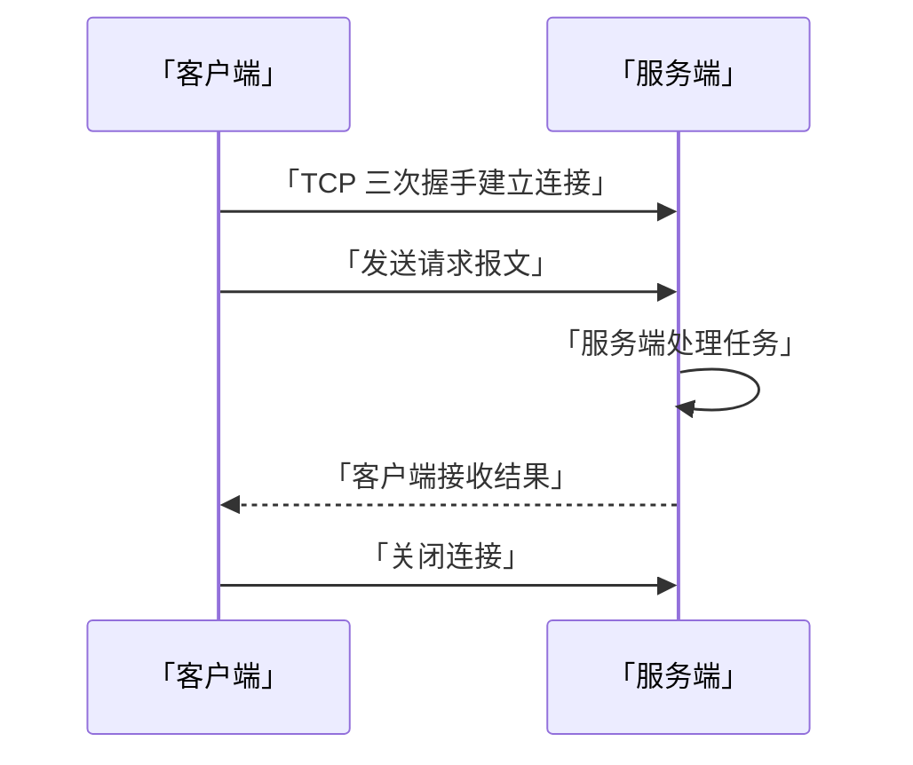

本次课程继续分析 gRPC 中所应用到的传输协议：HTTP/2。在了解 HTTP/2 之前，首先了解 HTTP/1，以及 HTTP/1 所存在的一些问题。

## HTTP/1 的请求过程

在 HTTP/1 中，进行请求的时候，通过网页请求与服务端，在请求的方式上，都是通过协议、域名、端口和路径这样的格式进行请求的。而 HTTP/1 的格式，主要是如 PPT 中所示：HTTP/1，加上域名以及路径的方式进行请求。

在请求的过程中，首先会先与服务端通过 TCP 三次握手建立连接，这是第一步。在服务端和客户端建立连接之后，客户端会向服务端发起请求、发送报文，此时服务端会接收到请求传递的信息，也就是请求报文。在得到该请求结果之后，服务端自己处理，这里还会有一段时间属于服务端任务的处理，任务处理完成之后，客户端接收结果。当请求完成之后，客户端会向服务端关闭连接。这是 HTTP/1 在程序中的执行过程。

那么它会有哪些问题？来分析一下。

## HTTP/1 存在的问题

第一个点就是低效的 TCP 利用。在刚刚的示例中，已经发现 HTTP/1 在发起请求的时候，会先通过 TCP 来三次握手构建连接，连接建立好之后，发送请求报文，在连接接收之后，又会断开与服务端的连接。它的低效主要在于这个连接是一次性的，不能重复利用。

第二个是臃肿的消息首部。在 HTTP/1，它的消息主要分为以下几个环节：第一个是请求行，在请求行中，会包含如方法、URL、版本；然后是首部行，首部行主要包含有比如首部的字段以及值；其次是空行，空行是用来分割首部行与实体主体，也就是实际要请求的数据信息。因此从整体上来说，前面三个可以理解为发送的一些带有报文性的信息，而最后的这一个实体，则是实际在请求过程中要传递给服务端的信息。而臃肿的消息首部主要是指首部中，还有较多的一些分割符号，因此导致这个消息首部实际是非常大的。

其次，HTTP 是一个明文传输的。对明文传输的解决方法，可以在 HTTP 的基础上面增加 SSL 认证，也就是证书认证，使得 HTTP 转为 HTTPS。

最后是在传输过程中传输的效率比较低，对于较大的数据来说比较低，因为它是整体的一个请求获取信息的方式，因此相对来说如果是处理较大的数据，那么性能会比较低。这是 HTTP 在使用过程中会存在的一些问题。

## HTTP/2 对传输的改进

那么 HTTP/2 是如何解决 HTTP/1 的问题？接着往下看。在 HTTP/2 中，首先它对传输进行了改造，同时对刚刚所提到的请求头来进行优化，并且在传输过程中，还有连接多路复用，以及服务端可以推送。尤其需要注意的是，前面并没有提到服务端可推送问题，但实际上 HTTP/1 是不支持服务端推送的，这是需要注意的。也可以理解为这是 HTTP/2 在 HTTP/1 基础上面新增的一个功能。

首先看 HTTP/2 对传输的改进，先看 HTTP/1 在传输过程中的一些问题。网页通过服务端获取数据的时候，对 HTTP 来说，它一次请求只能处理一个事情，并且不能中断对该请求的解析。其次在实际过程中，对于服务端来说，无法预知服务端传输的数据会有多大，因此无法预判会需要使用多长时间、使用更多的分割符号的内存。并且在整个传输的过程中，会有过多的分割符号，这些分割符号的存在，是因为有一些浏览器它所定义的分割符号和使用的分割符号会有区别，因此为了使得更多浏览器进行兼容，所以它也融入了较多的一些分割符号。这是在 HTTP 中传输过程存在的问题。

接下来看 HTTP/2 是如何解决的。HTTP/2 的特点是在建立连接后会继续保持连接进行通信，这是值得注意的，也就是说它的连接大概率是不会立即断开的。因此就会有特点：比如这是一份数据，在数据传输中，假设这是一个普通数据或较大的一个数据，在 HTTP/2 中，会把这份数据分成帧的方式，而这个帧有多个维度，有头部帧、有消息主体帧等等，总而言之，就是将原本一个整块的数据被拆分成多个帧，然后再通过拆分之后的多个帧，一份一份的传输给客户端。所以在这里的改进特点就在于，它传输过程中，不再是 HTTP/1 那样整体传过去了，而是把它分成分帧传输，这就是它的一个区别点。

在这个图中，就有用到了，比如在这里就是 HTTP/2 的协议，然后在内部就是它所分的帧，上边是它的一个头部帧，还有内容帧。这是 HTTP/1 的整体的一块较大的数据，但是它在处理过程中，就把上面的这块的头部作为了一块内容，下面的消息主体作为了一块，进行了拆分，然后进行分帧，成对应的内容，比如这是所谓的帧，就是上面的这一块内容，而消息的帧是这一块内容。所以从整体的思想上，之前也学过，那就是拆分。

总结一点，在这里用到了类似于 TCP 在传输协议过程中解决粘包的一种思想，就是将整块数据包进行分包，而当前的拆分方式是根据数据包的类型进行拆分，拆分之后，变成了各个较小的帧，再基于较小的帧，为每个帧增加一个标签或者一个序号，在传输过程中，帧的传输是可以乱序的，它们不一定是固定顺序。而在客户端当中，还会获取到帧的标识，然后进行数据的组装。因此总结一点，HTTP/2 对于 HTTP/1 的主要传输过程中的优化思想，就是将数据包进行拆分，然后为每个数据包打上一个统一的标识来标记，这是它的一个设计思想，也就是一个优化的思想。

## HTTP/2 对请求头的优化

接下来看 HTTP/2 对请求头的优化。先看 HTTP/1 在传输过程中它的请求头，因为 HTTP/1 的特点是无状态，并且请求头的信息是固定的，每一次请求都会写到请求行、首部行、实体，这是 HTTP/1 所存在的一个问题。因为无状态，你就必须要把这整块信息重新发给服务方，服务方从中才获取到相关的信息进行解析。

然后看 HTTP/1 它所传的请求信息有哪些。在其中可以看到，有方法的请求类型、请求的方式，比如说协议的方式，是 HTTP/1 还是 HTTP/2，请求的地址、路径以及类型，这只是其中的一部分，实际上也很多。因此在请求过程中，对 HTTP/1 来说，每一次它都需要写这么多类型。

那么 HTTP/2 是如何优化的？来看这里。在这个图中，分为两个请求，第一次请求当然还是会发送整体块的请求信息。请求完之后，HTTP/2 在请求过程中，会把这些相似内容记录起来，记录为一份索引。那么在第二次请求的时候，传递与前面所记录不相同的内容，比如地址是不相同的，虽然说地址不相同，但是其他信息是相同的，因此可以通过对这两者之间相加，就可以构成一个完整的请求头了。这一份它存放在客户端，并且已经标记好了，此时在传输过程中，实际服务端它只传输了差异的部分，因此同比上面可以看到，它少了这一些内容，所以在传输的层面来说，就对请求头做了优化。这样的话它有个好处，能够节省网络请求过程中的一些消耗，这就是关于请求头的优化。

对于它的优化，思想其实就是依据记录，记录于已经存在的信息，然后再通过对比组装。而记录的方式，在目前的业界中，程序里大部分都可以用字典，在 Go 中用的是 MAP。请求的标识符以及请求的结果，可以理解为是一个 key 和 value 的数据类型，因此用字典以及 Go 的 MAP，就可以来存储这个信息。

## HTTP/2 的多路复用

再来看 HTTP/2 中的多路复用。比如这里有一段信息，这是一个网页，正常会请求到的信息类，一个网页网址打开之后，不仅仅只是请求这个页面所提供的数据，还会去请求它所相关的图片、样式、JS，这些都会请求过来，因此实际上当访问一个网址，它请求的信息是非常多的。

那么在 HTTP 的情况下面，传输是怎样的？这里还是服务端和网页，在传输过程中，需要获取较多的图片、JS 文件、CSS 样式。对 HTTP 的传输过程来说，因为它是一次请求处理一个事情，处理完关闭连接，需要处理下一个资源的时候，就需要重新去发起连接并获取信息，因此在 HTTP 中它的连接是属于一次性的，即用即消耗，所以在整个通信的过程中，它需要进行多次请求连接，才能把这个页面的数据加载好。不讨论整个请求过程中请求连接建立的消耗，对于页面来说，实际上这一个加载的速度就比较慢了。

因此 HTTP/2 在这机制上面做了一些优化，同样还是网页和服务，它在请求过程中，只需要建立一次连接，然后在后续的所有的像 JS、CSS、HTML 的文件，都会通过这个连接进行发送，在过程中会基于流和帧进行传输，这样就能够大大地提高它的请求效率。

来看一下它建立的过程。首先在客户端向服务端建立连接之后，客户端会先请求服务端，获取一个 HTML 的信息，那么此时服务端会返回客户端 HTML 的信息。在返回之后，客户端会根据 HTTP/1 中所定义要请求的样式、JS 等相关信息再次发起请求，在发起请求过程中，这一段内容它可以并发的发起，所以在 HTTP/2 中它可以并发的发起，它不一定等待服务端响应，它并发的发起就可以了。

服务端会接收了请求之后，那么在这个过程中它怎么保证数据不乱？关键的因素就在于分帧、分帧里面的标识。虽然服务端会乱序的发送分帧，但是客户端会接收到数据包，接收之后再获取数据帧中关键位的帧的标识，再根据帧的标识，就能区别这是来自哪个请求，然后这是来自请求的第几个帧的数据包，那么此时就可以组装起来，还原出相应的数据。从这一点就可以看出，HTTP/2 中就很明显，性能大大提升了很多。

当然了，服务端可以推送给客户端，那是因为服务端和客户端它们直接建立连接，能够保持处于长连接的状态，因此服务端实际上是可以向客户端推送消息的，而 HTTP/1 不支持，主要是因为 HTTP/1 即用即断开。值得注意的是，在 HTTP/1.1 的版本中，它是增加了一个参数，使得客户端和服务端之间能够保持长连接不断开的，这可以理解为是 HTTP/1.1 在 HTTP/1.0 的基础上面就如此进行了升级。

本次课程的内容就到这里。主要的话题是了解 HTTP/2 这个协议，因为这是 gRPC 中所应用的关键协议。
