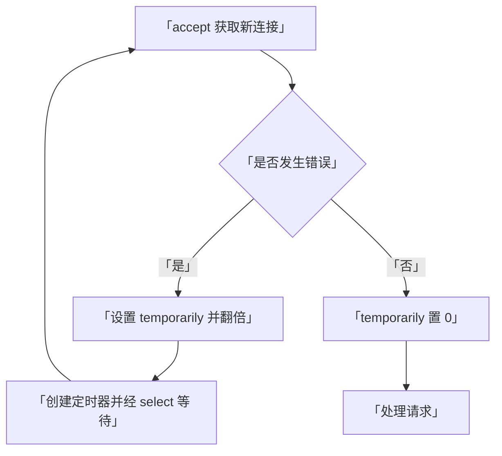

上一讲分析了 gRPC 上层自定义服务是如何加载的，以及服务注册的底层过程。本次课程继续分析 gRPC 的服务初始化、拦截器的定义与调度，以及请求连接的处理。

## gRPC 服务初始化

首先来看 gRPC 服务初始化的时候做了什么事情。回到代码中，服务初始化的核心代码就是 `grpc.NewServer` 这一行，打开可以看到，在第一行，它的方法要求传递一个可变参数的 `ServerOption`。

关于 `ServerOption`，目前可以先理解为它是一种配置，是针对当前服务操作的配置，具体怎么操作放在后面分析，现在只需要知道它可以理解为是一种配置。然后在输出上，它会输出当前创建的服务对象。

从整体来说，第一段代码里面就是设置服务运行过程中所需要的配置信息，然后再往下就是去创建服务，再创建一个服务的对象，即 `ServerOption`。在对象中会初始化选用的参数，比如要存放的监听对象的集合，就给它创建出来。然后创建监听对象的集合，它是以创建的监听对象本身作为 key，然后以 bool 作为 value。在其下还会记录连接对象，比如在使用 gRPC 请求接收的时候，可能会有连接进来，那么此时就通过 map 进行记录连接。然后定义记录服务退出的信号、结束的信号，还有通道信息。那么一个服务的初始化，最基础的信息就给它定义完成了。

定义完之后，下面就要去初始化，然后再去创建 stats handler（记录器），这是用于统计的处理器；再往下，它在下面的这一段内容中，会判断是否设置了程序性能的接口，可用于在程序上对 gRPC 整个服务在业务上的性能分析。再创建好服务的工作，及向通道中写入数据，到此一个服务的初始化就完成了。

那么在初始化前面刚刚提到这个 `ServerOption`，它是怎么做的？这里要注意，在很多的组件和框架中都会采用 Option 这个操作。这个操作，可以是为框架提供配置，又可以是为框架的一种操作，那么通过可变传参，使得在使用上更简洁。

在定义上，首先会定义这个 Option 操作，就是 Option 的一个对象。在对象中，就是会存储整个框架中会用到的相关的属性信息。比如这一段就很明显，就是定义好了框架中会用到的拦截器，就给它定义在这里。定义好拦截器之后，那么它就要去使用它。在下边就会提供大量对刚刚所提到的 Server 去进行赋值的方法，可以看到它确实是有进行一个赋值操作。

在方法中，其实就是通过定义一个接口、一个接口约定，约定这一个实例对象去实现它，而实现对象，它就是通过 New 传递出来的，因为它实现了上面的接口。那么只需要在此处调用方法，把它加进去。因为 `GlobalServerOption` 是一个数组，还有自己定义的传递的 Option，它也是一个数组，那么因此就可以使用它的 append 合并、传递，然后去设置，让这个 apply 方法进行设置参数，就完成了对 `ServerOption` 的一个赋值。这种写法值得注意，在后期的课程中也会经常看到。对它的最直观最简要的理解就是，对 Server 就是去做一个赋值的操作。

好了，这就是 gRPC 服务初始化时候会做的事情：第一设置好配置，初始化服务中会用到的参数属性信息，定义好拦截器以及 stats 模式，开启了对性能的一个接口；往下走就是去启动服务、启动工作进程。那么此处服务初始化就完了。

## 拦截器的定义与加载

接着往下走，来看一个拦截器是如何去定义和调度的。在前面的内容中，已经分析了拦截器的初始化，而在初始化过程中可以看到，它的信息来源是来自哪里？来自 `ServerOption`，从这一行是可以明显地发现的。而 `ServerOption` 初始化，在上面去进行初始化，并在这里去进行赋值了。

这是一个不同服务的拦截器。在 `ServerOption` 中，就标记了拦截器它的一个存储的属性。根据前面所讲的内容，既然存到属性，就存在对这个属性设置赋值的方法，往下就可以看到，这里就是一个拦截器对它属性赋值的方法了。也就意味着实际上第一先定义好拦截器，根据方法要求的传递参数，即实现这个类型，去定义好拦截器；然后定义完拦截器之后，再通过这个方法，传递来设置好拦截器的信息内容。

注意它发布的结果是 `ServerOption`，而 `NewServer` 中接收的正是可变传递的 `ServerOption`，这里把刚刚注册拦截器的方法传递到 `ServerOption` 中，它就在这里去进行加载。

好，接下来来编写一下代码。首先先定义一个 interceptor，即存放拦截器的 module 目录。在内容中定义两个拦截器：第一个拦截器是针对日志记录的，第二个是针对错误处理定义的方法。那在方法中它要接收请求和响应，那么请求和响应的内容，依据前面在拦截器中要求传递的类型。

往下走就是这个 `NewServer` 相关的 `ChainUnaryInterceptor`，那么它这里传递的方法类型，就是如所看到的：第一个参数是 ctx，第二个参数是请求，第三个就是服务的信息，第四个就是实际 gRPC 这种要调用的、我们自己的方法，然后输出的是响应和错误。

好，那到此就定义好两个拦截器，调用它的方法去执行、处理信息。分别在它执行请求的时候，收集一下内容，可以视为是这个拦截器的任务处理：日志的开始及日志的结束。同样下面是处于错误处理和错误的任务结束。然后需要对这两个拦截器进行加载、注册并运行，而根据前面单元，需要调用这个方法，并传递到 `NewServer` 中就可以了。

好，那么往下走，用 gRPC 的 `ChainUnaryInterceptor` 把这个方法调出来，再传递好自定义的拦截器，那么到此，以自定义拦截器给它传递进去了，传递到 Server 中。来看效果：运行，当前启动的是服务端，服务端成功启动了；再启动客户端来访问。重点看的是服务端，服务端中确实是输出了两个拦截器的信息，然后根据信息可以看到，先传递先执行，并最后结束，那确实是符合实际的需求。

## 拦截器的底层执行过程

那么拦截器就定义好了，到底是怎么执行的？根据前面的这段内容，其实也能够看得出来。首先 gRPC 底层调用这里的方法时，它会传递拦截器，因此它会先判断拦截器是否为空，如果为空的话，就直接结束；但如果不为空，它会把当前要调用的方法给它服务端放上一个 handler，比如要实际执行的方法，放到拦截器中。那么放到拦截器中，就是在拦截器定义这里，进行了执行。

那么底层是如何处理这个拦截器的？因为当前的拦截器如果只有一个，但实际上可能传递的拦截器是有多个的，当前是两个，因此此时就有一个疑问，它又如何去处理并同时运行两个？当前其实是看不出来的，因为只看了一个。因此还要去看 gRPC 在初始化的时候是如何对拦截器进行整合的。前面先是把拦截器设置到 ServerOption 中，然后通过下面的这两个代码去进行拦截器的处理。

第一行先加载拦截器，加载之后先判断是否为空、是否为 0 的这些状态，如果为一个直接返回；如果不为一个，重点在这里，它会调用 `chainUnaryInterceptors` 方法去处理拦截器，传递参数是一个数组结合的拦截器，返回结果就是一个拦截器。

再根据代码的执行，先从第一个拦截器开始进行调度，然后在调度的时候调用下面的 `getChainUnaryInterceptor` 方法，即再去根据拦截器往上走。这个方法在不停地嵌套，是递归的调用，每次递归调用的是下一个拦截器的方法，也就是先调用第一个，再调用第二个、第三个、第四个。然后套娃的方式，套好整个结构，因此到外层它只要进行一个调用，就可以进行所有的调用。所以它的套娃是采用闭包套娃，而不是直接运行，就是套娃，而是采用闭包。

因此从这里可以看出来，拦截器传递之后，那么通过下面的一个套娃的方式，给它封装成了最后一个拦截器，就是一个大的拦截器。然后在内库中，这里就进调用，这就是 gRPC 的一个设计。

## 请求连接的处理

好，接着分析 gRPC 请求接收的处理。请求接收的处理主要就是用这个方法来处理，往下看。在方法中，这个 for 就是整个请求接收的核心代码。在核心代码中，第一行会去调用 accept 方法，获取到一个新的连接，并在获取连接的过程中，可能会发生一个错误。如果存在错误，那么下面这里会设置 `temporarily` 这个参数值：如果这个参数值为 0，那么它会设置为 5 毫秒；但如果它不为 0，那就是会在这个基础上面进行翻倍，也就是说它的值就会翻了两倍，但是它最终不会超过 1 秒，在这里会判断不会超过 1 秒，1 秒肯定是它的最大值。

设置这个值的目的是什么？往下看，这里它会创建一个定时器，同时通过 select 去获取：是定时器先执行完，还是说程序出现意外停止了，那就结束了，整个代码是属于同步的执行。那这样做的目的，其实在于保护程序，因为程序它可能会因为处理不过来，可能会有这种情况，因此为了避免这种情况，它就会去设置这个参数，让程序先等待，给它缓冲的时间。在等待的时候，如果说程序这个连接得到释放了，那么它就可以去接收新的连接。所以其实它是在保护这一个程序。

然后在下面，当不存在错误的时候，它就会把 `temporarily` 给它设置为 0，同时再去处理请求。这就是在请求处理中所做的事情。

因此总结就是这个图：在 accept，它会去判断接收的请求和错误，如果存在错误，那么它就会设置 `temporarily`，并且会去进行一个 select 等待，保护程序；如果不存在错误，会把 `temporarily` 设置为 0，并执行请求。

到此，已经分析了 gRPC 在服务的加载、服务的初始化、拦截器以及请求接收的处理相关的源码。
