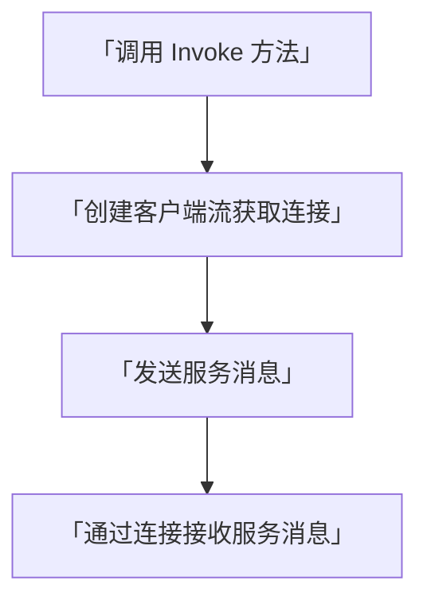

在上一讲的课程中，已经分析了 gRPC 服务端请求调度的实现过程。在本次课程，会分析 gRPC 客户端请求发送的实现原理。在课程内容中，会通过下面这四个环节来进行了解：先理解在 proto 生成的库代码中它的调度过程；然后看 gRPC 在客户端初始化的时候做了什么事情；之后具体看 gRPC 请求调度的这一条内容；然后再了解 gRPC 在关闭中的哪些操作。

## proto 库代码中的调度

首先理解一下库代码的调度。在上一讲的课程中已经讲过了，首先会定义一个 proto 文件，在这个文件中是会描述服务端的信息的，然后服务端也会根据 proto 文件定义服务，并通过 protoc 工具生成库代码，把服务注册到 gRPC 中，这是上一讲已经提到的内容。

而在客户端，同样也会用到 proto 文件，因为在 proto 文件中，它描述了服务的结构，比如它的服务名、服务方法、消息体都已经描述好了。再通过 proto 文件及 protoc 工具生成了对应的库代码，因此客户端实际上也是调用了库代码，以 gRPC 来调度到最终的请求服务对象，这是客户端的一个过程。

因此在分析上，也同样先看一下，在这个库代码中对于客户端而言，它做了哪些相关的操作。打开代码进到库代码中，以 user.grpc.pb.go 这一份为例，下面这一份属于服务端，而上面则属于客户端。

在一开始，它也会定义了一个针对客户端的接口，然后在接口之下提供了一个针对上面接口所实现的实例。在实例中提供了一个创建的方法，在创建的方法中，它会要求传递 gRPC 的客户端，然后在旗下有一个调度的方法。可以看到在代码的结构中，就能够很清楚地看到具体的调度过程。

首先会先根据当前的请求创建出对应的响应，也就是请求调度之后，它的一个响应的结果，提前给它定义出来，再通过响应调度方法去完成调度。仔细看一下这个 `Invoke` 的方法：在方法中，第一个参数是 ctx，这个很容易理解；第二个则非常关键，可以看到它的描述是一个方法，里面已经自动写好了调度方法。它的参数往下看，在这个描述之中就描述了服务名，因此这一串方法其实就是在描述服务名，后面则是具体的方法名。从这里可以看出，库代码提前写好了怎么去调度服务。后面就是一个请求和响应的参数，这就是在库代码中它的一个调度，整体来说并不是一个很复杂的过程。

在上层代码，就只需要去创建好服务、进行连接。创建服务连接，通过 gRPC 所提供的这个方法去进行连接的，在这个方法中，上面会写好服务的地址，以及对整个请求的设置，其中也包含了拦截器，当然还针对它的证书。在执行这个代码之后，假如进行连接之后，通过代码它会发布一个客户端，在这里，将库代码的客户端传递进去，然后再往下就去发起调度，这样就完成了一个服务的一次请求，即实现了整个从客户端发送到服务端的这个调度的方式。

## 客户端的初始化

具体看一看客户端是如何初始化的，以及它初始化的时候做了哪些事情。来看它的代码，连接在上面，第二个方法，因为它才是真正的获取一个客户端对象，因此重点来看的就是它。

在第二个方法中，调度的时候，它其实是调了一个 `DialContext`，由此可见，第二个方法是不需要传递 context 的，而这一个，是要求传递一个 context。

`DialContext` 中第一行代码就可以明显发现，就是创建一个客户端的连接，然后在里面也记录了连接的客户端以及默认的配置操作等等，这些都会记录好了。往下走，这一块就是对客户端本身它自己来去进行属性的赋值，比如说它的重试机制，这是一个重试的机制。下面它会去创建一个 context，从这里来就是对客户端进行了一些属性赋值，比如说一些重试、context 等等。

然后往下走，它这里是对默认的一个配置去进行操作，这一段之前有提过，它这里同样也用到了 Option，但是用的是 DialOption，之前是 ServerOption，同样可以把它理解为是一个配置。然后再往下就是一个解析器的事项，设置在这里，它会把客户端它的一个地址注册到这个 channel 中。然后往下走，这一段有一个作用，它其实和前面所调用的这个方法来进行的一个适配，它的作用主要是验证服务端是否开启了 SSL。那么怎么去判断？就是根据当前的参数来判断：如果服务端开启 SSL，那么在这里传递的时候，就需要要求传递 SSL 相关的一些证书历史信息，在这里传递进来，从而在此就会去设置好进行验证，所以这一行它的一个作用主要是做连接的这种加密验证的。

然后再往下，在这一段代码中是设置一个超时，如果设置了超时的一个时间，那么它会设置一个超时的时间，就是一次请求它的超时时间。再往下，在整体的这一段中，它是一个关闭客户端，做错误的处理。然后再往下，在这一行代码中，就是一个解析器（resolver），它做的事情，就是它会获取一个解析器。后面会讲，在后期代码中这是一个关键性的代码，它的一个作用，就是会根据当前传递的请求地址，然后去查找一个解析器，这个解析器可以把它定义为服务发现机制。在后面的课程中，会分析这一块。然后客户端会通过服务发现机制，去找到对应的服务目标去进行连接的，所以这是一个用于获取服务发现机制的，它获取方式就是根据传递的解析的地址，就进行获取。

下面它会去清空当前的状态，这一行代码，因为在请求的时候，它会把所有的状态都置成一个空的状态，然后把这个空的状态结束，变为一个可连接的状态，因为它会等待连接的这种状态。所以这里刚刚初始化都是置空的一个状态，但是它现在把置空的状态，把它视之为可连接的一个状态，所以这里是一个结束，是一个空的、没有运行的这种状态模式，改为正在连接的一种模式。

再往下，在这里其实它就做了一个事情了，它就会去在连接的时候，发起一次连接。gRPC 中这里其实有五种状态：第一种是空的状态（IDLE）；第二种是连接的状态（CONNECTING）；第三种是准备的一个状态（READY），也就是它准备工作了；然后第四种是出现了异常失败（TRANSIENT_FAILURE）；第五，就是当前已经停止了（SHUTDOWN），它是对连接的五个状态。

而回到前面代码中，在这里它会先判断当前是否为空的一个状态，如果是空的状态，它就是会发起一次连接，然后去建立连接，把状态就会改成一个正在连接状态，也就是连接成就绪了。当连接成功之后，就会变成一个就绪，那么这时就可以去进行通讯了。但是如果发生了意外，就会做一些意外的处理。

从整体来说，这就是一个客户端初始化做的事情。总结一下它的特点：第一会初始化客户端的连接对象（ClientConn）；然后会初始化重试机制、拦截器以及通道，这个通道，它主要是去整理在整个程序中所传递的一些元数据信息，所以这是它用于记录整个 gRPC 中会输出的一些元数据信息；然后会去验证当前连接的协议，并进行初始化；同时还会去设置超时机制，并且初始化解析器；与服务端会去构建好连接，把当前的一个客户端的连接，改为一个就绪状态。这就是客户端的一个初始化。

## 请求调度

再看一看请求调度。那么请求调度，就要从库代码中这个地方进行启动查找。根据前面代码中，其实已经知道，这个 cc 是谁？就是这个客户端，实际上它就是调用客户端中的这一个方法，因此可以直接查这个方法就可以了，在前面到下一个方法名、方法的关键词，这样的话查找会更快一些。没有查到直接点击，那么可以看到，它确实是刚刚的客户端支持的方法，只不过它不到同一个包里面了。

那么在这里，就是去调度了。在调度的时候，上面可以看到，在这里还只是做了一些属性参数的处理，`Invoke` 就是在这里进行调度的。在 `Invoke` 中，首先第一行的话，可以看到就是创建一个客户端的流，那么它会去根据传递的 context，以及这个流的描述，还有客户端方法，以及参数信息，都会创建一个对应的客户端流。

在得到这个客户端的流之后，再通过客户流发送消息，再接收消息。这里有一点就是发送消息和接收消息，它是分开的，这里注意一下。所以总结来看，在整个客户端调度的时候，可以通过库代码，然后通过 `Invoke` 去调度，而在 `Invoke` 中，它第一步会去先构建好连接，所以这里获取一个客户端的流，它其实就是一个获取连接。然后在获取连接之后，往下就会去发送服务消息，并通过连接接收服务消息，这其实就是一个客户端的流，一个请求调度的一个过程。

## 客户端的关闭

最后来看一看客户端的关闭。在客户端的关闭，调用的地方，在这里去触发的，也就是当创建了一个客户端的连接之后，需要关闭它。可以看一看它做了什么事情。

那么在里面这里就是结束了，前面在客户端创建的时候，它在 context 对象给它结束了，然后再往下，它就会去进行一个连接，如果没有连接，它就会发出一个错误。这里会先等待所有的连接的任务处理完成，然后处理完成之后，再往下，它就会去等待连接，会把所有的连接关闭，在这里会进行关闭掉。因此其实这里内容还是比较多的，第一个是同步的 WaitGroup，然后是解析器，这个是负责运行的功能器，所以它关闭的内容还是比较多。

如果不去做连接的关闭，把它多次作为一个重复创建的方式的话，那么可能对程序来说，从整体上会导致内存得不到释放，那么到时会有一个内存溢出的可能。因此对于客户端来说，如果使用它，一定要注意好要关闭，或者改为一个全局的属性进行使用，又或者是建立连接池这样子。

本讲主要了解客户端调度的过程及其所做的事情。
