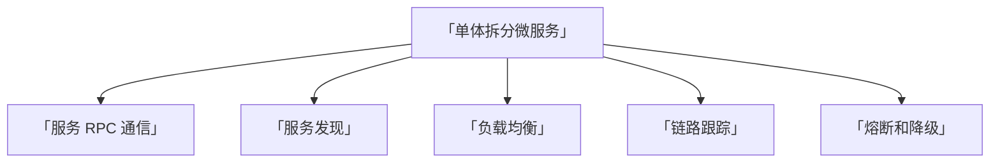

从本期开始进入 go-zero 框架的学习。在此之前，先弄清微服务框架与 Web 框架的区别。这里有两个问题：第一，微服务框架主要用来解决什么问题，与传统框架相比它的解决范围有什么不同；第二，既然之前已经学过 gRPC、也做过相关案例，理论上可以直接用 gRPC 开发微服务项目，为什么还要引入微服务框架。带着这两个问题往下看。

## 单体拆分微服务后面临的问题

单体项目演化成微服务项目，首先面临的是项目拆分问题，而其中最关键的就是服务间的 RPC 通信。项目拆分之后会出现多个服务，服务与服务之间必须保持通信，如何解决这个通信问题是首要任务，前面的课程中也正是围绕 RPC 来讲解服务间通信的。

通信解决之后，还有一系列问题需要处理。第一个是服务发现：服务拆分成多个之后，某个服务可能因为流量增长需要新增更多实例，此时客户端如何发现新增加的服务，是需要考虑的问题。

其次是负载均衡：发现服务之后，它背后可能存在多个节点，如何选择合适的节点来完成任务，负载均衡这套机制也需要自己去搭建。

还有链路跟踪：单体项目中代码连在一起，整个调度链非常清晰，某处出现异常可以通过 debug 定位。而在微服务下，某个服务出了问题，如何定位是哪条链路造成的影响，就需要对服务间的调度链路做跟踪，这直接关系到后期问题的排查。

再者是熔断和降级。这块内容会在后面详细讲解，这里先明确它要解决的问题：客户端向服务端发起请求时，如果服务端因繁忙无法处理请求，客户端可能出现超时；如果服务端直接宕机，客户端则完全无法访问到服务端。这时客户端需要对请求做处理，原本走服务端的逻辑改走其他路线，才能给调用方一个可接受的结果，这就是降级和熔断发挥作用的地方。

实际上，单体拆分成微服务后的问题远不止这些，上面只是列举了主要部分。由此可见，单体拆分微服务，技术难点是明显增大的。而微服务框架正是针对项目从单体迁移到微服务过程中出现的这些问题，定制了相应的解决方案，让我们不必自己造轮子。

理论上也可以用 Gin、Beego 这类单体框架实现微服务，再自己实现负载均衡、链路跟踪、熔断降级等机制，这并非不可行，但意味着反复造轮子，效果未必好。微服务框架则把这一整套体系预先实现好了。所以微服务框架是在传统框架的基础上，额外解决了上面提到的这些微服务问题。

## 为什么不直接使用 gRPC 开发

为什么不直接用 gRPC 开发项目？首先要理解，gRPC 是 RPC 框架，解决的是 RPC 通信问题。传统的 RPC 在通信时有一些必须解决的问题，比如序列化：使用 Go 的 net/rpc 包定义服务时，客户端无法清晰地了解服务端所定义的服务及其信息、参数类型；在跨语言处理上也存在障碍。gRPC 正是针对 RPC 的跨语言、统一协议标准等方面设计的，同时实现了错误处理、超时处理等机制。

但 gRPC 的定位是 RPC 框架，在微服务的完整体系上仍有功能缺口。比如链路跟踪，需要自己在 gRPC 机制上额外增加；数据读写这类做项目必备的基础功能，gRPC 也没有涉及。业界大部分微服务框架，其实都是在 gRPC 底层实现逻辑和通信机制的基础上进一步封装，构建出对应的微服务框架，go-zero 就是一个典型例子，后面会通过源码分析它如何基于 gRPC 扩展开发。

## 微服务框架与传统框架的对比

再看微服务框架与传统框架的对比。

功能方面：微服务框架包含传统框架的核心，比如数据读取、控制层处理都具备；同时还实现了微服务场景下的服务发现、链路跟踪等功能。目前业界提供的微服务框架，基本都包含了传统框架所支撑的核心功能。

用途方面：微服务框架主要用于构建微服务应用，目的是让开发人员快速搭建和管理微服务项目。传统 Web 框架下的单个项目数据往往非常庞大，而微服务框架更专注于分布式系统和服务化构建，让每个服务可以单独开发、部署、扩展。两者的定位和目的存在区别。

架构模式方面：微服务框架基于微服务架构，服务与服务之间构成一个整体；传统 Web 框架则基于传统的客户端到服务端的整体架构。

以上就是微服务框架与 Web 框架的主要区别。
