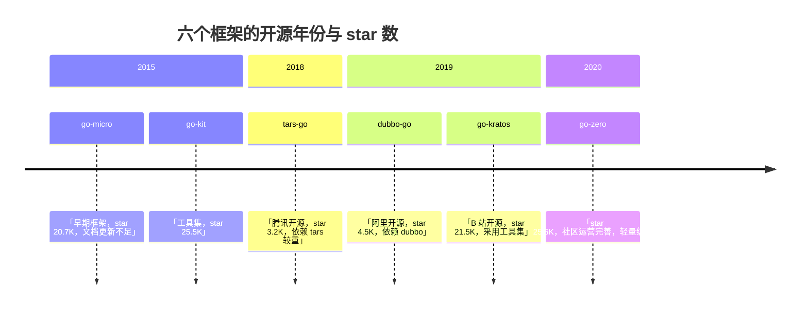

本节讨论为什么选择 go-zero。Go 语言中的框架很多，比如老牌的 go-micro、腾讯开源的 tars-go、阿里的 dubbo-go 和 go-kit、B 站的 go-kratos，以及 go-zero。为什么选 go-zero，需要从框架选择的方法说起。

## 框架选择的考虑因素

选择项目框架时，首先看官方更新和维护的力度。如果项目依赖的框架哪天不再更新，后续就只能靠自己维护，这是一个不小的风险，所以框架的更新情况是必须关注的。

其次是社区的发展和运营。社区状况决定了使用中遇到问题的解决效率。框架热度高意味着使用的人多，更关键的是资源也多，会有很多人围绕它写文章、写教程。除此之外，框架的上手难度和功能完备程度也是考虑因素。当然还有其他一些因素没有一一列举，但这几项在选择框架时是比较关键的评估维度。

## 六个框架的特点对比

基于这些维度，来看六个框架各自的特点。

先看 go-micro。这是 2015 年就开始开发的早期框架，在 GitHub 上有 20.7K 的 star 数。但它的问题在于文档更新不足，这与另一个情况有关：作者后期转做运营了，从 go-micro 3 版本开始就已经有这个倾向，这也是 go-micro 在使用中比较明显的问题来源。此外它的资料完善性也比较差，主要依靠国外，国内相对薄弱，资料较为稀缺。

第二个是 tars-go。它于 2018 年开发，目前有 3.2K 的 star 数，由腾讯开发，技术功底较好，并且在腾讯内部有实际应用，框架会持续更新和运营维护，不用担心失去维护。授权相关的介绍也比较全面，腾讯开源的框架，微信公众号等渠道也齐全。但它有一个明显缺点：依赖 tars。tars 是重量级体系，导致这个框架整体偏重，使用层面也是如此。

再看 dubbo-go。它比 tars-go 晚一年，2019 年开发，目前有 4.5K 的 star 数。它是阿里开发开源的框架，特点与腾讯类似，社区建设比较完整，所以与 tars-go 最为相似：tars-go 依赖 tars 这套体系，dubbo-go 依赖 dubbo 这套体系。这两个框架在使用层面都偏重，但都不必担心停止更新。

接下来是 go-kit。它 2015 年开发，目前有 25.5K 的 star 数，热度比较高。它的特点是一个工具集：概念上并不约束开发人员如何使用框架，而是把微服务体系的一整套解决方案、封装好的工具交由开发人员自行组合使用。缺点是社区技术资料不太全。

go-kratos 由 B 站在 2019 年开发，star 数很高，有 21.5K。它的设计介绍比较全，吸收了 go-kit 的特点，同样采用工具集模式。在整个框架对比中，它是一个比较优秀的框架：对外开源的时间是 2019 年，相对较晚，介绍完善，设计理念继承了 go-kit 的工具集方式。

go-zero 与 go-kratos 类似，但开源时间更晚，2020 年才开源。目前它在 GitHub 上的 star 数是最高的，达到 25.6K。这与它的社区运营有关：社区经常做宣传，配合视频、直播讲解，因此吸引了很多人关注。社区建设方面，相比前面的框架，它有微信群、公众号等渠道，更新也比较及时。

总体而言，对比这六个框架的几个核心维度：年份、star 数、开源方、社区情况。go-kratos 虽然是后起之秀，但发展速度有目共睹：一方面得益于社区运营，另一方面它自身的设计优点得到了很多企业的认可。而这些维度综合下来，正是选择 go-zero 的原因。

本节主要了解这些框架的特点，不评判优劣，重点是框架特点和热度。go-zero 开源较晚但热度高，社区介绍全面，使用上轻量级。轻量级的方式也更适合目前的趋势：很多功能都适合定制化、个性化的定义。其他功能会在后面的课程中讲到。
