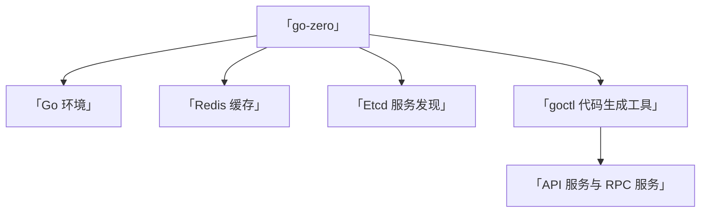

本节主要认识 go-zero。打开 go-zero 的官网 go-zero.dev，首页就介绍了这个框架是什么、有哪些特点；想了解得更详细，可以进入「概念」页面，那里对框架的好处、背景、名词组件等都做了系统介绍。

这里归纳几条关键信息。第一，go-zero 的设计吸收了很多 Web 框架、RPC 框架在实际项目开发中暴露的问题，是总结经验后重新设计的，因此使用过程中会有不少体验很舒服的地方。

## go-zero 的设计特点

以 API 框架为例。go-zero 为 API 提供了描述文件。传统的做法是先定义控制器，再通过工具生成 API 文档；而在 go-zero 中，为 API 定义了类似 proto 的描述文件，即 .api 文件，通过它可以生成一份 API 服务，构建 API 项目非常方便。

除此之外，go-zero 积累并内置了微服务开发中的超时、限流、自适应熔断、降级等功能。在以前的微服务项目中，这些功能往往需要自己在业务代码中手动调度使用，而 go-zero 自身实现了这一套，用起来非常省心。

这两点足以说明 go-zero 吸收了大量微服务项目和微服务框架的开发经验并重新设计。它的开发效率也很高，因为配备了强大的工具：官方文档中描述的自动代码生成工具，可以生成 RPC 服务、API 服务以及模型的 CRUD 代码，生成之后只需填写业务逻辑，就能实现它所说的「从需求到上线的距离」。

当然，go-zero 的内容远不止这些，更多独特的设计之处需要在后续课程的学习中逐步了解。

## 环境要求与安装

使用 go-zero 需要注意环境要求。服务这一块，第一是 Go 环境，这是必须的。其次是 redis 和 etcd：go-zero 定义模型时会使用 redis 作为缓存，所以建议在安装 go-zero 时先把 redis 装好；go-zero 构建 API 服务时，默认注册的服务发现机制是 etcd，所以 etcd 也建议一并装好。

go-zero 的构建中有两个关键元素。第一个是工具：这个工具可以为 go-zero 快速生成项目代码，用它生成 API 服务、RPC 服务后可以直接运行。另一个是 go-zero 核心代码，位于 go-zero 目录下，是整个框架及程序所依赖的核心代码目录包。

工具的下载在 go-zero 文档中已有详细介绍，有手动下载的方式，建议根据自己的系统直接手动下载，速度很快。go-zero 本身的安装，直接在项目中执行 go get 即可引用，再通过 go mod 的方式加载进来，同样很快。

有一点需要注意：go-zero 的代码生成工具在安装时建议放到 GOPATH 的 bin 目录下，方便使用。除此之外没什么特别难的地方，工具的具体功能后面会讲到。

本节主要是认识 go-zero，它的安装并不复杂，官网文章中已有详细介绍。
