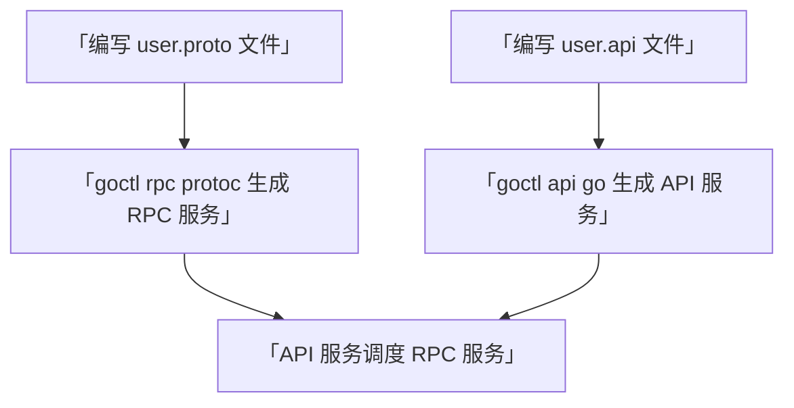

通过前面的学习已经对 go-zero 有了初步了解。本节基于 go-zero 构建一个应用案例，进一步加深理解：分别构建 RPC 服务和 API 服务，构建完成后再通过 API 去调度 RPC 服务，完成整个案例的功能。

构建过程是这样的：先编写 .proto 文件，.proto 文件在之前的课程里讲过，可以构建 RPC 对外的库包，本节也通过它来构建 RPC 服务；构建完成后再编写 .api 文件，.api 文件是 go-zero 提供的快速构建 API 服务的方式，功能上类似于 .proto 文件；然后通过 .api 文件构建 API 服务，最终将两者连通。

过程中会用到两个命令。通过 `goctl rpc new` 创建 RPC 服务时，goctl 后面的第一个参数是要构建的类型（创建一个新的），后面是服务名；API 服务的构建命令也是类似的道理。



## 通过 goctl 快速创建服务

下面进入具体实现。假设当前有一个 user 服务，需要在它下面创建 API 服务和 RPC 服务。cd 进项目目录，执行 `goctl api new api`（前面是固定写法，后面是创建的项目名称或目录），回车即可构建。

RPC 服务构建好后，它会自动写好一个简单的 RPC 相关 proto 文件、RPC 服务的启动入口文件，以及相关核心库的代码。比如 proto 文件中提到的 Ping 方法，已经有对应的实现并被加载了。也就是说，通过这一个命令就能创建出一个可运行的 RPC 服务。API 服务也是同样的道理：会创建 API 入口文件和 API 的核心逻辑处理层，控制层、逻辑层等应用基础一应俱全。

不过实际开发中一般不会用这种方式创建，而是先编写 .proto 文件和 .api 文件再来创建。所以先把刚刚生成的代码删除，得到一个空目录。

接着在目录下创建一个 rpc 目录，表示 user 服务的 RPC 部分。RPC 服务需要根据 .proto 文件进行编译，把上面提到的 user.proto 文件作为实例复制进来，放到 rpc 目录下。其中已经定义好了相关的结构体方法：

```protobuf
syntax = 「proto3」;

package rpc;

option go_package = 「.rpc」;

message Request {
    string ping = 1;
}

message Response {
    string pong = 1;
}

service Rpc {
    rpc Ping(Request) returns (Response);
}
```

再看 go-zero 提供的 goctl 如何创建相关服务，命令是：`goctl rpc protoc user.proto --go_out=. --go-grpc_out=. --zrpc_out=.`。注意这里后面的参数不再是 new，而是 protoc 编译器，user.proto 指定了要编译的文件。后面这一段内容其实就是之前执行 protoc 的编译命令：`--go_out`、`--go-grpc_out` 代表编译之后库文件的生成地址；最后一个非常关键的是 `--zrpc_out`，前面的参数针对 user.proto 生成 grpc 相关的库代码，而 `--zrpc_out` 代表当前项目服务的代码生成到哪里，点表示当前目录。由于当前目录下没有 user.proto 文件，需要进入 rpc 目录下执行编译。编译没有报错，相关代码已快速生成。

## 生成的目录结构

接下来了解生成的目录结构，整体上可以分为五大块。

第一块是 etc，这是当前 RPC 服务的配置目录，存放配置文件。第二块是 internal，这是核心的业务逻辑层。第三块是 user 层，里面放的是根据 user.proto 文件生成的库代码，grpc 所需要的消息结构体都在这里。第四块是 userclient，这里定义了一个客户端：RPC 服务需要对外提供信息时，其他服务不需要自己创建客户端，只要调用 rpc 下的 userclient，就可以创建出调用服务的客户端，里面也封装好了调用服务层的方法。

第五块是两个文件：入口文件和 user.proto 文件。打开 user.go 文件可以看到，它就是整个项目的入口。

同时它还生成了一个 go.mod 文件，但这个文件放在当前目录并不合适，先删除它。实际开发中，rpc 目录下会存在 .proto 文件，但 go.mod 文件不应该放到这一层。正确的做法是在项目更外层执行 `go mod init` 创建模块文件，然后再进入 rpc 目录，模块文件就在外层了。接着执行 `go mod tidy`，让 Go 加载相关模块包，它会下载并查找相关依赖。

其实 Go 语言中这样的目录结构是经过实践验证的，吸收了很多 Web 项目和微服务项目在开发过程中遇到的问题和设计经验。比如 internal 这一层为什么这么定义？internal 的意思是内核。go-zero 中很多地方都会定义 internal，它的含义是把当前服务的业务逻辑集中汇总到 internal，也就是 internal 包含了整个 user RPC 下面的所有核心业务逻辑，在里面可以看到配置文件、业务以及 context。

那为什么不把生成的库文件和客户端放到 internal 里？这里有一层考虑：无论是库文件还是客户端，都会被外层调用，而 internal 的语义是内核，所以这种被外层使用、引用的内容不会放进 internal。因此 internal 这一层只放当前 user RPC 的核心业务逻辑，配置则放到 etc 目录，这样有利于对配置的调整。

还有一个小细节：在 go-zero 中，服务的客户端一般放在与 rpc 同级的位置，代表对外提供的内容，即为其他服务编写的客户端。如果基于 go-zero 的这层结构再去构建一些异步任务的处理，目前的 goctl 命令不会自动生成相应的目录结构，需要自己在这层编写相关的客户端，供其他层调用。这种设计的好处在于可以自己控制客户端调用的逻辑和过程，有利于其他团队的协作开发。
