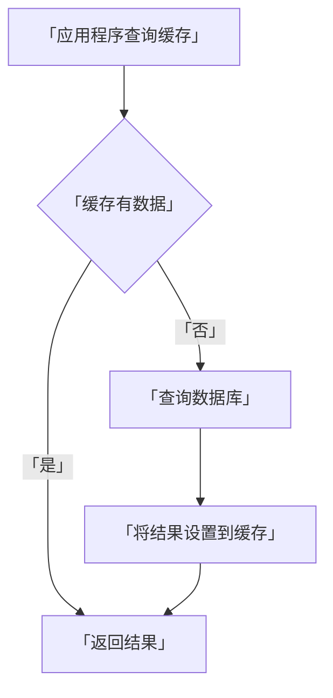

前面已经搭建了 API 服务、RPC 服务，并使服务之间能够调度。本节继续这个案例，借助 go-zero 开发数据读写操作和中间件。

先看 go-zero 的数据读写处理。由于涉及数据库，提前准备好了一个 user.sql 文件，其中是一份 user 表的建表语句，数据库中也已经建立了 user 表：

```sql
CREATE TABLE `user` (
    id bigint AUTO_INCREMENT,
    name varchar(255) NOT NULL DEFAULT '' COMMENT 'The username',
    password varchar(255) NOT NULL DEFAULT '' COMMENT 'The user password',
    mobile varchar(255) NOT NULL DEFAULT '' COMMENT 'The mobile phone number',
    gender char(1) NOT NULL DEFAULT 'male' COMMENT 'gender: male/female',
    nickname varchar(255) NOT NULL DEFAULT '' COMMENT 'The nickname',
    type int(1) NOT NULL DEFAULT 0 COMMENT 'The user type, 0:normal, 1:trip, for test',
    create_at timestamp NULL DEFAULT CURRENT_TIMESTAMP ON UPDATE CURRENT_TIMESTAMP,
    update_at timestamp NULL DEFAULT CURRENT_TIMESTAMP ON UPDATE CURRENT_TIMESTAMP,
    UNIQUE KEY `mobile` (`mobile`),
    UNIQUE KEY `name` (`name`),
    PRIMARY KEY (`id`)
) ENGINE = InnoDB COLLATE utf8mb4_unicode_ci COMMENT 'user table';
```

官方文档中提供了 goctl 针对 model 代码生成的命令，也附带了相关示例。可以直接把示例复制过去，在对应目录下创建好 sql 文件，执行命令后会生成对 user 表操作的模型代码。生成的目录结构如下：

```
.
├── client
├── proto
├── server
├── vendor
├── go.mod
└── user
    ├── models
    │   └── usersmodel.go
    ├── rpc
    │   └── user.proto
    ├── logic
    │   └── createLogic.go
    └── user.sql
```

回到项目中实际生成一次。在与 user.sql 同级建一个 model 目录，命令前面是固定写法，`-src` 指定要生成的数据库数据文件是哪一份，可以用 `*` 代表所有数据文件，也可以按文件名指定其中某一个；后面指定根据 .sql 文件生成的内容写到哪个目录下，这里放到 model 下存放生成的模型。与官方用例有一点区别：用例中没有加 `-c`，加 `-c` 的目的是生成模型时额外为模型增加缓存操作；不加就不会有缓存，加了才可以使用缓存。

执行命令后会输出一些描述信息。这些描述会根据建表数据文件调整，可能提示某些地方定义不符合规范，比如名称和手机号没有定义默认值，建议定义默认值。这不影响创建，只要 SQL 本身没有写错，就能正常执行通过。

执行完成后会在 user 目录下创建 model 目录，其中生成了三个文件。最后一个文件主要存放整个模型下可能用到的常量、变量等属性定义。往上看是关于 usermodel 的两个文件：第一个文件定义了对外输出的接口，以及实现该接口的默认结构体对象：

```go
package models

import 「github.com/zeromicro/go-zero/core/stores/sqlx」

var ErrNotFound = sqlx.ErrNotFound
```

打开第二个文件，整体上它先定义了 user 模型相关的属性字段：字段名称、可筛选的字段列，以及哪些字段不参与写出。值得注意的是，这里还增加了一个缓存用户的 ID 前缀，因为前面命令加了 `-c`，模型创建之后可以使用缓存，所以它为当前模型增加了一个这样的缓存前缀 key。再往下是一个 type，先定义了 user 模型要实现的接口（insert 等），默认提供了增删改查四个方法，然后是默认的结构体，以及实际要返回的用户模型实例对象。最后是具体的方法：初始化方法传递两个参数，一个是数据库连接地址，另一个是缓存配置；后面就是针对数据库操作的具体方法了。

## 缓存查询的流程

以 FindOne 为例简单了解一下操作流程。FindOne 中先拼装一个用户查询的 ID key，再通过下面的方法进行查询。正常情况下，应用程序要查询数据库，直接访问数据库即可。但因为加了 `-c` 启用了缓存，流程变成了：应用程序先调用缓存（统称为缓存，因为缓存项不一定是 redis），缓存中没有这个值，才去找数据库。也就是第一步查缓存，第二步查数据库。如果数据库中查到了结果，就把结果返回给应用程序，应用程序同时会把结果设置到缓存中。goctl 通过命令默认就把数据读取的缓存设置实现好了，非常省心，不需要自己在后期业务代码中考虑缓存的设计、存储、更新问题。



## 在服务中应用模型

接下来看怎么应用 goctl 生成的用户模型。应用是从 RPC 服务端调用的，进到 RPC 服务中的 svcctx，也就是 ServiceContext。前面讲过，ServiceContext 主要存放后期复用的信息，比如数据库操作、客户端等。在这里定义一个 UserModel，代表当前用户模型，使用 model 中的 UserModel。但要创建它，配置信息还没有定义好，所以需要先修改配置。

在 etc 中定义 Mysql 的连接地址，格式基本一致：用户名、密码、连接的服务地址。本地环境使用 127.0.0.1，后面跟数据库名，当前使用的是 user 数据库，还可以增加编码等设置。Redis 的配置如下：

```yaml
Name: user
Hosts:
  - 127.0.0.1:2379
Key: user.rpc
Mysql:
  DataSource: root:800000@tcp(127.0.0.1:3306)/user
```

缓存默认使用 Redis，所以还要配置 Redis。本地的 Redis 也已经启动，直接访问本地；本地没有设置密码，密码留空即可。这样 Mysql 和 Redis 的配置就定义完成了。

然后修改配置文件的结构体，比较简单：在结构体中定义 Mysql 的配置和 Redis 的配置。注意这里使用的是缓存的配置（cacheconf），底层用的就是 Redis 的配置。

回到 ServiceContext 中应用它们：先定义好数据库的连接，把配置信息传进去，数据库连接就得到了；再加上模型和缓存的配置，应用就完成了。

## 增加创建用户的方法

接着修改业务，增加一个方法。当前 proto 中只有获取用户的 Get 方法，所以增加一个创建方法：修改 user.proto 文件，增加创建用户的方法，把结构体、消息体放到上面（一般更多放在上面），在上面定义好创建请求的结构体对象和输出的消息体对象，要求传递手机号、名称，ID 也要传进来。user.proto 的内容如下：

```protobuf
option go_package = 「/user」;

message Request {}

message Response {}

message GetUserReq {
    string id = 1;
    string name = 2;
    string phone = 3;
}

message GetUserResp {
    string id = 1;
    string name = 2;
    string phone = 3;
}

message CreateReq {
    string name = 1;
    string phone = 2;
    string password = 3;
}

message CreateResp {
    string id = 1;
}

service User {
    rpc GetUser(GetUserReq) returns (GetUserResp);
    rpc Create(CreateReq) returns (CreateResp);
}
```

然后重新加载 proto 文件，方式之前讲过：再执行一次编译命令 `goctl rpc protoc user.proto --go_out=. --go-grpc_out=. --zrpc_out=.`。命令执行后会识别 proto 文件是否有新的定义方法和结构体，识别到新信息就创建它们，原有的内容不会改变。这样就得到了新创建的 user 创建业务逻辑对象。

接着完善里面的业务逻辑，其实就是创建操作：直接调用 user 模型的 Insert，创建一个 user 结构对象，完善后面的内容，把返回的 error 也返回出来，创建的业务就写完了：

```go
func (l *CreateLogic) Create(in *user.CreateReq) (*user.CreateResp, error) {
    // todo: add your logic here and delete this line
    err := l.svcCtx.UserModel.Insert(l.ctx, &models.User{
        Id:    in.Id,
        Name:  in.Name,
        Phone: in.Phone,
    })
    if err != nil {
        return nil, err
    }
    return &user.CreateResp{Id: in.Id}, nil
}
```

让程序跑起来验证。启动时会有包未加载的问题，重新加载一下包，服务就正常启动了。回到 ApiPost，选择 RPC 方式测试（不是 API），重新导入一次 proto 文件，创建方法就导入进来了；修改地址和 ID 为 1。请求返回一个 error，去数据库刷新可以证明没有问题，因为数据已经插入进来了。再来一次，没有问题。
