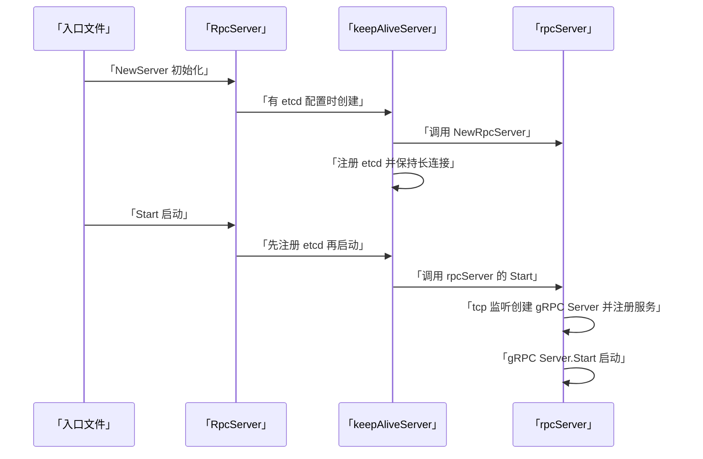

前面的课程学习了 go-zero 的基本应用，构建了案例，搭建了 API 服务、RPC 服务，并使用了它的数据模型和中间件。本讲开始探究 go-zero 内部的实现，分三个环节：第一，看 go-zero 的核心目录结构，了解核心层如何设计；第二，基于源码分析它如何适配 gRPC；第三，了解服务的初始化和启动流程。

## 核心目录结构

先看 go-zero 的核心目录结构。源码阅读建议先通过 go mod 的方式把源码加载到本地：打开 GOPATH，在 pkg/mod 里找到 zeromicro/go-zero 目录，这就是 go-zero 的核心代码层。

核心代码层有四个目录。第一是 core，存放 go-zero 的核心，包含数据组织类的能力，例如缓存、限流等操作都在这里实现。下面是 internal，存放 go-zero 内部定义的核心业务逻辑，包含服务、健康检测等机制。再后面是 rest，针对 API 定义的一套机制；以及 rpc，针对微服务 RPC 通信的一套机制。每个机制中都有一个 internal，用于定义和存放该目录下的业务逻辑。本讲主要分析 go-zero rpc 下的 server，看 Server 如何定义并创建。

## go-zero 对 gRPC 的适配

前面已经提到，go-zero 主要基于 gRPC 实现。回到代码，在 RPC 服务的目录下，有通过 goctl 生成的库文件（user 目录下）：一个是针对数据结构转化的 protobuf 协议转化库，另一个是 gRPC 的库。gRPC 库中定义了 UserServer 的服务接口，想要使用 gRPC，自己定义的服务就必须实现这个接口。

同样的道理，go-zero 想基于 gRPC 使用它的服务，也需要定义一个服务对象去实现 gRPC 所定义的 UserServer 接口。它是怎么做的？

在 internal 中有一个 server 目录，里面的 UserServer 结构体实现了前面提到的 gRPC 要求的 UserServer 接口。这个对象包含对每个方法的处理：先创建出处理该方法业务逻辑的对象，再调用实际具体的方法进行处理。

由此可以分析出：goctl 命令生成的是一个 UserServer，这个 UserServer 实现了 gRPC 的 UserServer 接口，但业务逻辑并不写在 UserServer 中，而是为了便于扩展，另外定义了一个 logic 层。logic 层会根据 UserServer 中的每一个方法定义一个具体处理的对象，比如对应 Ping 的对象或 GetUser 的对象，它们都通过 UserServer 来调用。这就是 goctl 对 gRPC 的支持方式。

## 服务的初始化与启动

了解完适配方式，再看服务的初始化和启动流程，这需要看项目的入口文件。入口文件中包含对服务上下文的创建和服务的加载，同时创建出具体的服务项目，这个创建方法返回一个 RpcServer。

RpcServer 有两个属性：第一个是 server，即 internal 定义的一个接口，它没有具体的方法；第二个 register 是一个注册方法类型，其中的 fn 会把传递进来的服务放进去，同时一起传递的还有 RPC 服务的配置信息。

```go
func NewServer(c RpcServerConf, register internal.RegisterFn) (*RpcServer, error) {
    if err := c.Validate(); err != nil {
        return nil, err
    }

    var server internal.Server
    metrics := stat.NewMetrics(c.ListenOn)
    serverOptions := []internal.ServerOption{
        internal.WithMetrics(metrics),
        internal.WithHealth(c.Health),
    }

    if c.HasEtcD() {
        server, err = internal.NewRpcPubServer(c.EtcD, c.ListenOn, c.Middlewares, serverOptions...)
        if err != nil {
            return nil, err
        }
    } else {
        server = internal.NewRpcServer(c.ListenOn, c.Middlewares, serverOptions...)
    }

    server.SetName(c.Name)
    rpcServer := &RpcServer{
        server: server,
        metrics: metrics,
    }
    if err := c.SetUp(rpcServer); err != nil {
        return nil, err
    }

    return rpcServer, nil
}
```

整个初始化流程中，首先进行配置验证，判断配置是否正常，然后再加载整个服务的操作。值得注意的是，`stat.NewMetrics` 这一行的作用是创建一个监听系统数据指标的工具，帮助监听项目整体运行过程中的数据指标。往下得到 server 对象，即这个方法要返回的对象。创建过程中有一段判断：先判断是否使用了 etcd，方式是根据配置文件，如果存在 etcd 相关的配置属性，就认为使用 etcd 作为服务发现注册机制，走对应的流程，创建出一个 keepAliveServer 对象；否则直接创建一个 rpcServer 对象。这一段的主要功能是得到实际的 server 处理对象，它们都实现了 internal server 接口。

再往下调用了 SetUp，它会设置 internal server（也就是设置拦截器），创建服务并加载配置信息。配置加载也做了一些事情：读取配置文件，触发相应的处理，以及触发对系统性能的监听工具等。到此初始化过程完成。

再看初始化中得到的服务对象，它有两个方法。先看结构：RpcServer 是当前通过这个方法访问的对象，它在结构上使用 internal server 接口，这个接口有两个实现：keepAliveServer 和 rpcServer。值得注意的是，keepAliveServer 在实际使用时仍然使用 rpcServer 结构，区别只是多了一个 register etcd 的方法属性。可以看出，keepAliveServer 仍然复用了 rpcServer 的核心实现方法来构建整个架构。

了解结构后看代码。创建 keepAliveServer 时，方法要求先传递 etcd 的配置信息、监听地址和中间件等参数，然后定义一个 register-etcd 的方法类型，最终返回 keepAliveServer。keepAliveServer 内部其实还是调用了 NewRpcServer，所以它仍然使用 NewRpcServer 中的核心方法来完成服务处理，只是多了 register-etcd。register-etcd 做的事情是：第一行根据节点信息解析出具体节点的地址或配置信息（比如服务的访问地址），然后设置好 etcd 的相关属性，得到 etcd 客户端，最终完成 etcd 对当前服务的注册以及与 etcd 的保持长连接。

再看 NewRpcServer 做的事情：它先加载 server-options 的操作，同时得到当前服务监听的指标对象；其中有一行是得到一个 baseRpcServer 的结构对象，实际上最终的结果还是通过 baseRpcServer 来完成的。这就是整个服务的初始化过程。

接着看服务的执行，即 Start 方法。Start 方法本身做的事情就是调用 server 的 Start 方法。根据前面的分析，keepAliveServer 主要是在接口方法上重写了 Start。所以重点看 keepAliveServer 的 Start 方法：可以看到它最终仍然要调用 rpcServer 的 Start 方法，区别在于先调用了 register etcd 这段代码，也就是先把自己的服务信息注册到 etcd，注册完成后再执行 Start。所以真正代表整个服务启动流程的是 rpcServer 的 Start。

从上至下看这个 Start：第一行先创建对 tcp 监听的连接；得到之后设置好 gRPC 的 server options，并得到一个 gRPC 的服务对象；再往下调用 register。这个 register 方法从哪里来？往上回溯，它是上层传递进来的注册方法，最终就在这里执行：把当前 gRPC 的服务对象传进去进行注册，注册的就是我们自己的服务对象。然后设置好 gRPC 的一些属性以及框架对整个程序的监听（还有一个状态的监听），最后就是具体启动，启动本身使用的是 gRPC 的 Server.Start。



最后是拦截器。go-zero 本身使用 gRPC 的服务机制来初始化并启动服务，想对整个服务定义拦截器，理论上需要符合 gRPC 这套体系。看 go-zero 对拦截器的初始化加载，即 buildUnaryInterceptors 方法。从上至下，它先检查是否开启了各类中间件属性（这里设置了默认中间件）：

```go
func (s *rpcServer) buildUnaryInterceptors() []grpc.UnaryServerInterceptor {
    var interceptors []grpc.UnaryServerInterceptor

    if s.middlewares.Trace {
        interceptors = append(interceptors, serverinterceptors.UnaryTracingInterceptor)
    }
    if s.middlewares.Recover {
        interceptors = append(interceptors, serverinterceptors.UnaryRecoverInterceptor)
    }
    if s.middlewares.Stat {
        interceptors = append(interceptors, serverinterceptors.UnaryStatInterceptor(s.metrics, s.middlewares.StatConf))
    }
    if s.middlewares.Prometheus {
        interceptors = append(interceptors, serverinterceptors.UnaryPrometheusInterceptor)
    }
    if s.middlewares.Breaker {
        interceptors = append(interceptors, serverinterceptors.UnaryBreakerInterceptor)
    }

    return append(interceptors, s.unaryInterceptors...)
}
```

最后有一行返回最终 interceptor 的代码，从这一点可以看出 go-zero 支持自定义扩展，关键在于如何设置 rpcServer 中对应的属性值。查找后发现它提供了一个 AddUnaryInterceptors 方法：要求传递 gRPC 拦截器的方法类型并传进来，最终通过前面的方法加载并注册到 gRPC 中。调用 server 的这个方法进行叠加，就可以把自定义拦截器加进去。

本讲分析了服务的初始化和启动流程，也了解了 go-zero 如何基于 gRPC 进行扩展。重点核心是理解 go-zero 扩展 gRPC 的方式。
