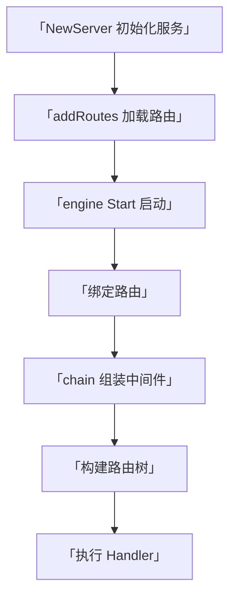

前面章节已经分析了 go-zero 在 RPC 这一块的机制，了解了 go-zero 如何基于 RPC 去扩展服务端和客户端。本节再来看 go-zero API 服务的启动过程，分析三个内容：先看 API 这一块的核心目录结构，再看 API 的启动流程，最后看路由与中间件的执行过程。

## API 的核心目录结构

先看 API 的核心目录结构。在 go-zero 的核心代码中，go-zero 目录下有个 rest 目录，rest 里面包含了整体对 API 定义的核心代码。其中有一个 handler 目录，定义了整个 API 服务中默认会使用的一些中间件，比如鉴权的例子，就是对 JWT 做验证的 Auth 中间件。除此之外还有很多其他的，像日志记录等等，这里不一一介绍。

handler 上面会有一个 chain，它是针对实际中间件运行的一个封装，后面再分析它。再接下来是 httpx，里面定义了对请求和响应的处理。而 internal 主要包含了整个 REST 处理的核心逻辑层，包括路由的参数解析，以及具体的路由对象和 router 的解析。这里解析的实际是 httprouter，因为 go-zero 默认使用的是 httprouter 的思想，所以这里使用的是 httprouter 的一个解析对象。

目录结构已经清楚了，接下来看 API 的启动过程。

## API 的启动流程

API 的启动过程从入口文件来看。API 有一个入口文件，启动的时候会先初始化 API 服务，然后注册路由，最终再启动。整体来看代码结构并不复杂：第一件事情是对配置进行设置，设置之后创建一个服务。服务创建的时候会得到一个 engine，这个 engine 是具体的服务数据对象，此外还有一个路由的对象，然后再设置相关的一些 opts，这里并没有什么特别复杂的内容：

```go
func NewServer(c *Config, opts ...RunOption) (*Server, error) {
    server := &Server{
        nginx: newEngine(c),
        router: router.NewRouter(),
    }
    opts = append([]RunOption{RunOption{WithNotFoundHandler(handler: nil)}}, opts...)
    for _, opt := range opts {
        opt(server)
    }
    return server, nil
}
```

得到服务对象之后，再通过下面这一行去加载路由。加载路由的时候要传递服务，因此服务中会有一个 addRoutes 方法，将传递的路由进行加载，但实际调用的是 engine 的 addRoutes 去进行加载路由的。

再看启动。启动实际上最终指向的也是 engine 的 Start 方法：

```go
func (ng *engine) Start(router http.Router, opts ...StartOption) error {
    // ... 省略部分代码 ...
    func(svr *http.Server) {
        if ng.tlsConfig != nil {
            svr.TLSConfig = ng.tlsConfig
        }
    }
    return internal.StartHttps(ng.conf.Host, ng.conf.Port, router, opts...)
}
```

在里面可以看到几个信息：它先要求绑定路由。在此之前需要先了解路由是怎么注册的：这是具体的路由，将 engine 添加进来，会先创建一个注册路由的方法，然后把它添加到 engine 中去，这里才是真正的添加。routes 是一个数组类型。

回到启动流程，启动过程中第一步要做的就是绑定路由，这里会创建一个参数，创建的参数就是当前 engine 在初始化初期的路由对象。这里实现的是一个接口，上面传入的是一个具体对象，实际创建的是 pathsearch 路由，接下来用这个对象给路由进行添加。

看绑定路由做了什么事情。绑定路由时会先创建出一个指标，用来搜集整个项目中的一些指标信息，这部分可以跳过。往下看，它会遍历所有 engine 中自定义添加的路由对象，再通过下面的 buildRoutes 方法来进行绑定路由。继续往下，这里是最终的绑定路由，绑定就用到了最开始提到的 chain。这里还会先判断，如果设置为空的话就去创建。接下来是具体的绑定，可以看到会绑定一些默认的中间件，像限流、日志等中间件就都绑定好了。

绑定完之后，就得到了 chain 的对象。如果设置了自定义中间件，它会把自定义的中间件也添加进来。最终通过这里把中间件进行组装。注意，这一步是在进行组装，绑定了一个结果；真正的组装在这里，它要把它们嵌套起来，这一点类似于 gRPC 中对拦截器的绑定。最终可以通过它获得一个具体要运行的实例方法，也就是一个 handler。注意，这里会调用 Then 去运行中间件，中间件的组装与嵌套最终是通过 chain 来完成的：

```go
func join(a, b []Middleware) []Middleware {
    mids := make([]Middleware, 0, len(a)+len(b))
    mids = append(mids, a...)
    mids = append(mids, b...)
    return mids
}

func (c *Chain) Then(fn http.HandlerFunc) http.Handler {
    if fn == nil {
        return c.Then(fn(nil))
    }
    return c.Then(fn)
}
```

再往后就是路由的执行，最后执行 Handler 的方法。这个方法其实已经认识了，因为前面提到过，Handler 是通过 Server 创建的。此处做的事情是把要创建的路由方法构成一个树。具体是什么树，要看后面的实现：它根据请求的 URL 构建成一个树。第一个是请求的类型；第二个是树的根节点，即版本号；再往下理论上就是请求路径。以本次定义的路由为例，请求最前面的路径如果是 user，那么参数指的就是 user，后面是路由的下一个路径，再往后依次是下一个路径及其后面的节点。从整体结构上，它是把整个请求路由进行了拆分。

这样的设计有两个特点：第一，因为它是树的结构，所以请求查找的时间复杂度可以达到 log 级别；第二，它的空间占用率比较小。

关于路由的设计，业界有两种方案：一种是通过 map，以路径作为 key，以执行的方法作为 value。而 go-zero 目前使用的方式是把请求的路径构成一个路径树，再通过这个树去查找结果。这种方式在性能和空间存储上是折中的方式，相当于会提升内存空间。

## 请求的执行与中间件

接下来看具体的运行。在 go-zero 里，net/http 这个包在服务启动之后，最终调用一个自定义处理方法的时候，实际调用的都是 ServeHTTP 这个方法。这一点可以自己分析一下 net/http 包，这里就不展开了。根据这个分析，从上至下，它会先得到请求的路径数据以及地址，然后通过下面的方法去进行查找并最终执行，整体来说并没有那么复杂。

而中间件的执行，在前面已经看到过：因为这里是逐一执行的，所以处理方式是根据每一个方法所设置的中间件，一个个地通过这个 chain 去进行组装，拼接成一个中间件链。因此在执行的时候，会先执行中间件。

最后总结一下具体的执行流程：启动中先进行初始化，通过 rest 的初始化，然后加载路由并启动。启动时进入 engine.Start 方法进行启动。它会先绑定好路由，然后通过 bindRoutes 方法一个个地绑定路由与中间件的关系。最后设置 handler，它会把路由构成一个路由树，启动时就完成了服务的启动。请求到来的时候，会逐一解析找到路由，然后进行执行。



以上就是 go-zero 在 API 服务的启动流程。
