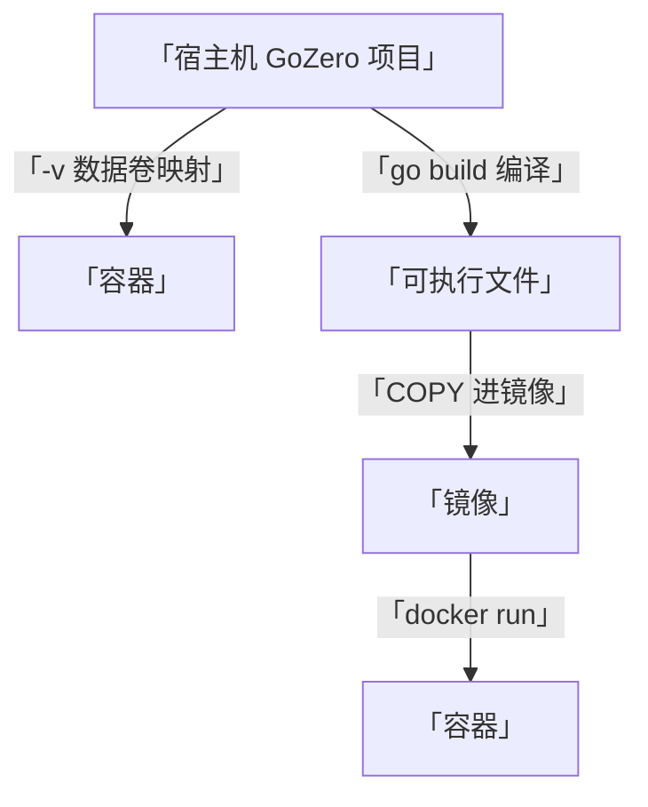

## 通过数据卷映射部署 GoZero

构建好 Go 环境容器之后，接下来就要基于这个容器去运行 GoZero。根据前面所提到的方式，当前使用的是基于宿主机本地环境的这个项目去运行。

先看示意图。在这张示意图中有一个非常关键的信息：这是一个宿主机，在宿主机中放好了 GoZero 的项目。准备好之后，现在希望在这个容器里面能够访问这个项目，那怎么办？就是要把这个项目想办法同步到容器里面去。

Docker 中有相关的命令，但在这里一定要理解一下思想，思想的本质就是基于宿主机的代码去运行。

接下来继续实践。这里已经将 RPC 的整个服务代码同步到宿主机上了，也就是需要启动容器，进入到这个 RPC 目录里面去，让它能够像当前这样通过 `go run` 运行起来。这是需要能做到的事情。

考虑到当前这个应用（API 服务调用 RPC 服务、RPC 服务再去请求 MySQL 的数据，最终返回出结果）具有一定的复杂性，对整个 GoZero 的应用做一定的调整：构建目标只构建 API 服务，API 服务只要在自己的逻辑里面处理好业务就可以了。

实际上要先调整一下 API 服务的业务逻辑：不去加载这个配置；然后在业务逻辑中，把这两段先注释掉，改为输出最大信息，比如说 ID、名称、手机号码，这是登录的业务；登录业务也同样处理，把它们先注释掉。

调整好之后，把代码准备好，先把这个代码同步到服务器上去。同步好之后，这里就是当前 etc 目录。要运行的服务器就是这个 API 服务，给它运行起来。目前它可以单独运行起来，那么就具备了当前项目应用的基本需求。

那么怎么让这个容器使用到宿主机的这个项目、里面的程序？可以这样做：先停止一下构建好的 Go 容器，停止之后确定没有了，再 `docker images` 看一下。

在 `docker run` 的时候，`-p` 是指定要把哪个端口映射出来，这点之前讲过。除此之外，还可以给容器挂载一个数据卷（`-v`）。看一下 `docker run` 命令的描述：上面没有指定，但在下面就指定了，这里有一个参数，其中提到一点，就是把宿主机的目录映射到容器里面去，这就是 `-v` 的描述。

`-v` 是数据卷的意思：它会把当前宿主机指定的这个目录或者文件同步到容器里面去。宿主机有什么目录，在容器里面就有什么目录，这个目录上面有什么文件，在容器里面就有什么文件，两者之间是一个同步的关系。

因此在这里会通过 `-v` 的方式确定好：它的左边代表宿主机，右边代表容器。通过 `-v` 之后，自己的项目就能够映射到容器里面去。在挂载之前，还要看一下自己当前项目的目录，当前目录就是在这里运行的，那就把它加进来：`-v` 的第一个参数是宿主机的目录地址，第二个参数是容器的地址，把项目放在这个目录下面去运行。放好之后，最后指定容器名称（还是 `go` 容器）。

挂载好之后，进到容器里面去看这个目录，确认目录中是否存在同步的内容。确定之后，接下来就要在里面去运行这个 API。进到 API 目录，目前代码已经写好了。

然后访问一下这个接口。当前访问发出了错误，需要设置环境，根据访问的 IP 地址进行配置。这里出现了一个 404 的错误，日志信息也有加载。其实理论上已经访问成功了，404 只是因为当前访问的路径不对。再看一下具体的 API 是 user-info，还有验证的信息，再构造请求发送一下，请求是正确的。

到此，就已经把 GoZero 部署好了。这是一种部署方式，通过将宿主机的项目与容器进行映射来部署。后期如果使用像数据库这类型的容器，通常会把容器中该程序存放数据的目录映射到宿主机上来。

现在就会有一个疑问：如果把这个容器删掉，会不会影响到映射的宿主机的目录？试一下，删除容器成功之后，可以看到宿主机上的文件目录没有发生任何影响。也就是说它只会做映射，但不会更改内容：停止容器、删除容器，是不影响这个目录的。这一点在实际的应用中非常值得关心，通常会把一些数据文件目录映射到宿主机上面来。

到此就了解了一种 GoZero 的部署方式，还有另一种部署方式：基于编译后的方式进行部署。也就是将 GoZero 打包编译，编译成一个可执行文件，再放到这个容器中进行运行。

这是 GoZero 项目，然后会通过 `go build` 把它编译成一个可执行文件，再放到 Dockerfile 里面，最终构建出镜像。整个过程就是：把项目编译成可执行文件，再通过 Dockerfile 编译成镜像，再部署成容器运行。

## 编译为可执行文件部署

回到系统中，在这个目录下面就是当前的项目。在这个项目上创建一个目录，用于存放编译后的可执行文件，然后对它进行编译。编译的命令在课程文档里面也提供了一份：命令中前面的参数是指定 Go 运行的环境配置信息（如目标操作系统和架构），然后跟上编译的输出参数，最后才是真正的具体编译。

复制一份，现在编译一下。编译完之后，在编译目录下面就存到了编译好的可执行文件。不过这里也会报错，配置没有指定，用 `-f` 的方式去指定配置就好了。指定一下：在 `/app` 下面的 `api/etc` 目录中的配置文件，这样它就可以自动运行。

现在要做的就是再重新编译一个 Go 容器，让它能运行宿主机上的这个程序。先直接退出来，回到程序中，把 Dockerfile 中安装 Go 环境的整体内容先注释掉，因为已经编译成了可执行文件，理论上不需要再去安装 Go 的环境了，一定要注意。所以此次操作就不需要再安装环境，只需要创建目录。

现在还需要做一件事：编译之后的程序是在宿主机上的，怎么把它同步到镜像里面去？此时就可以通过 `COPY` 命令，`COPY` 可以把宿主机的信息复制到容器里面去。比如把 `bin` 目录下的 `user-api` 复制进去，因为当前运行和这个 bin 目录是同级的，所以这里指的路径就是 `/app` 这个地址。

第一个参数就是宿主机的地址（前面已经指定好的）。然后还可以 COPY 配置文件：把 `api/etc/user.yaml` 复制到 `etc/user.yaml`。这个配置文件要不要 COPY？从理论上来说可以不 COPY，但从部署的角度来说建议 COPY，因为可以作为这个系统启动的默认配置文件。

COPY 完之后还有一个问题：这是一个可执行文件，还需要给它加上可执行的权限。加了之后，再进到容器的时候，通过 `WORKDIR` 这个命令指定进入容器时所在的目录。进入到容器的时候，目录一般来说在 `/app` 的下面，也就是进入到这个目录下。这样就完成了。

最后把执行命令加上就可以了。还有一个命令叫 `ENTRYPOINT`，它和 `CMD` 有点区别：`CMD` 是启动时运行，`ENTRYPOINT` 也是启动的时候可以配置命令。区别点在于 `CMD` 可以被替换，构建容器 `docker run` 后面所追加的命令是可以替换 `CMD` 的；如果不希望它被替换，就用 `ENTRYPOINT`。但它们的格式其实是一致的。

因为进入了工作目录下面，意味着它进到 `/app` 目录下来执行，其实只要执行它就可以了，给它一个 `-f` 参数指定配置文件。这样 Dockerfile 就写好了。

同步到服务器，没问题后构建镜像。构建的镜像叫 `user-api`，基于 Alpine 3.18，可以看到非常快、非常迅速，因为它并不需要像前面那样下载 Go 再进行安装，只需要 COPY 到本地的这个程序就可以了。

然后再 `docker run` 给它启动一下，看运行效果。启动后访问也没问题，说明整个操作是成功的。

## 常见问题与总结

到这里，任务就完成了。总结一些场景的问题。

第一个是 Dockerfile 在构建过程中可能出现的问题。意思是使用 Dockerfile 构建镜像的时候，可能会抛出一些意想不到的错误。举个例子：在这基础上面再增加一个命令，比如 `go version`，运行后会不会抛错？可能会抛错。这就是可能会看到的很多类似的错误。

遇到这种错误怎么办？还记得一开始构建 Go 容器的时候是手动操作的：先下载好 Alpine 镜像，然后进到 Alpine 容器里面去，把所有要执行的命令一行一行地执行下来，再把执行之后的命令复制到这个 Dockerfile 里面去，再构建镜像。所以如果遇到这个错误、不知道怎么办，可以先看前面成功的命令，然后从错误的那一行开始，把后面所有的命令注释掉；注释完成之后，用前面成功的命令去构建容器，构建的时候再启动好，然后再去运行后面的命令，一行一行地去找错误。这就是一种排查错误的方式，也是之后使用 Dockerfile 会遇到的问题。

第二个是概念上的问题。latest 是镜像构建容器的标签，很多人会把我们自己启动的这种容器误以为是一个系统，这里要注意：启动的只能说是容器，不能称为系统。系统包含了操作系统、硬件软件等这些组成，而 Redis 仅仅只是一个程序，所以不能叫系统。这两个问题是出现频率比较高的问题。

在整个课程中，核心就是学习了 Dockerfile，但例子是构建好的镜像。课程中虽然只讲了构建镜像，但其实隐藏了几个关系性的要点：

第一，容器的构建方式可以有两种，一般的项目常用的是第二种，因为这样方便团队在项目部署这一块的工作，所以往往都会倾向第二种方式。

第二，目前从公共开放的镜像仓库下载的这一些镜像，也都是第二种方式去构建的。构建完之后，通常它都会指定好一个容器启动时默认使用的配置文件，以及它所在的一个目录。因此如果要自己指定配置文件，可以通过 `-v` 的方式代替这个配置文件。

第三，`-v` 这个参数的作用在哪里？如果运行一个程序，它的数据是必须要保证完整性、不能丢失的，那么就需要把它通过 `-v` 映射到本地。

课程的内容就到这里，更多的内容还需要自己去实践，才能了解得更深入。
